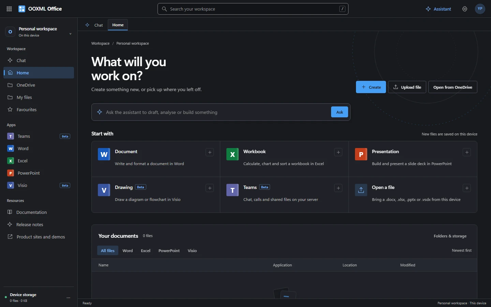
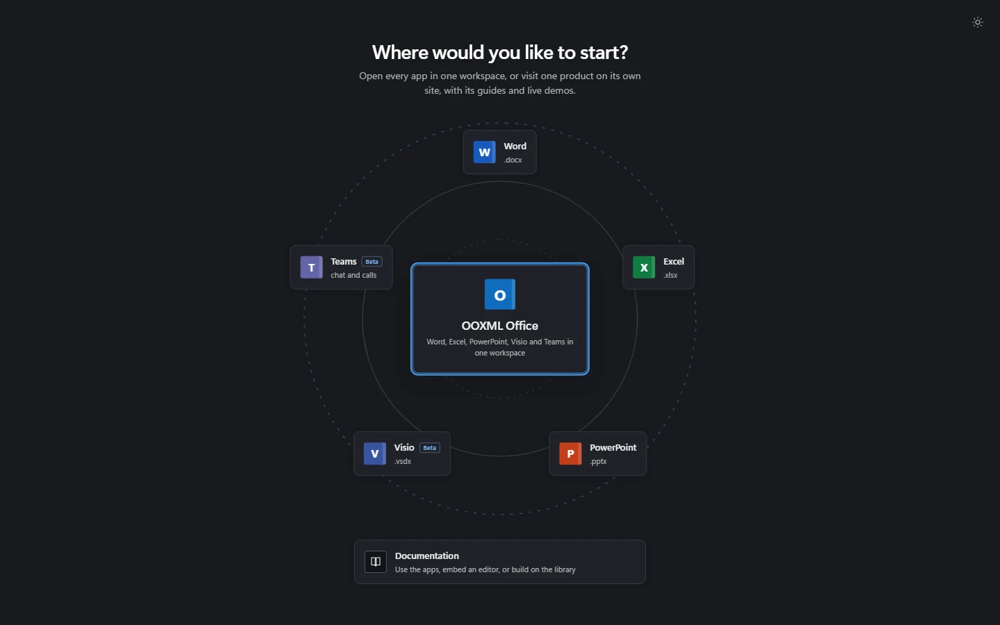
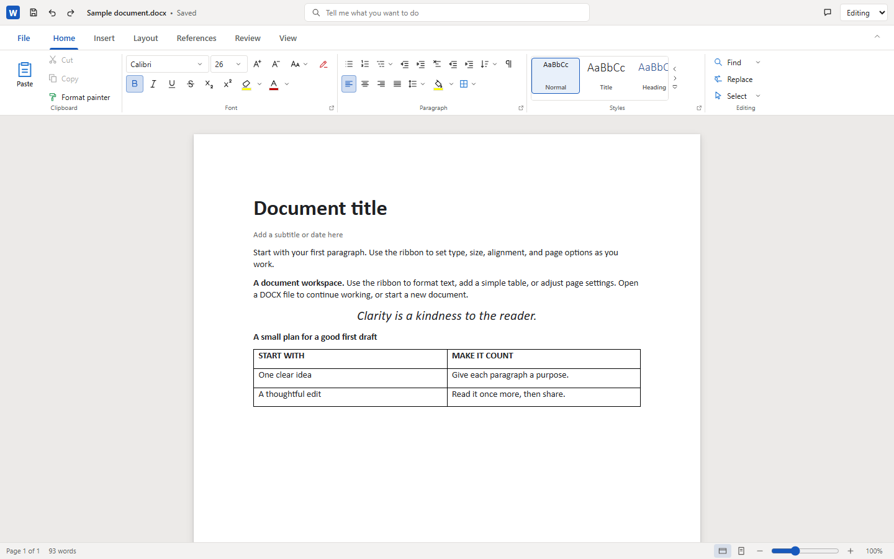
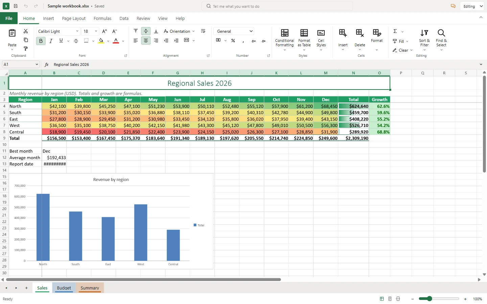
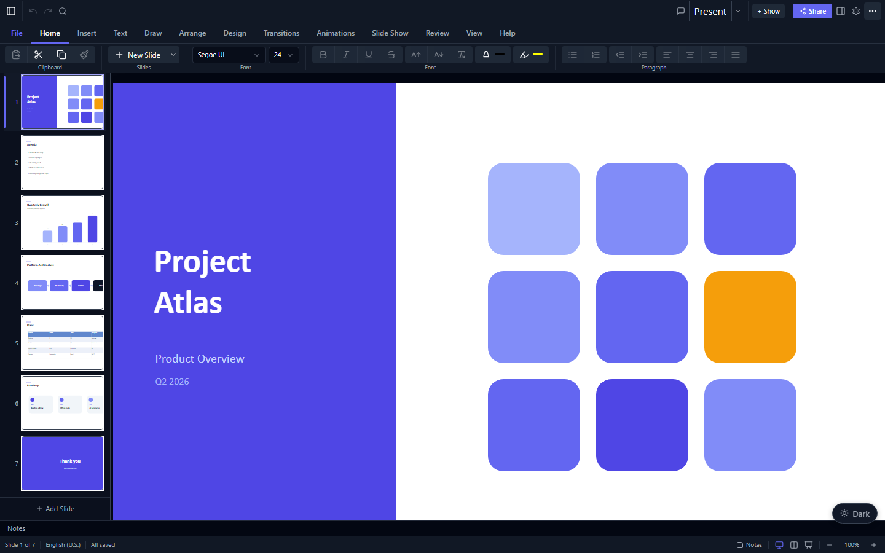
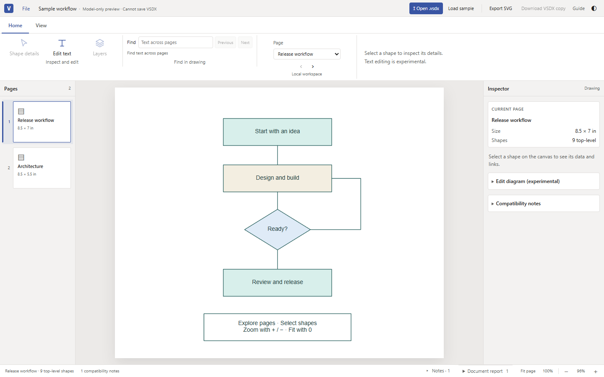
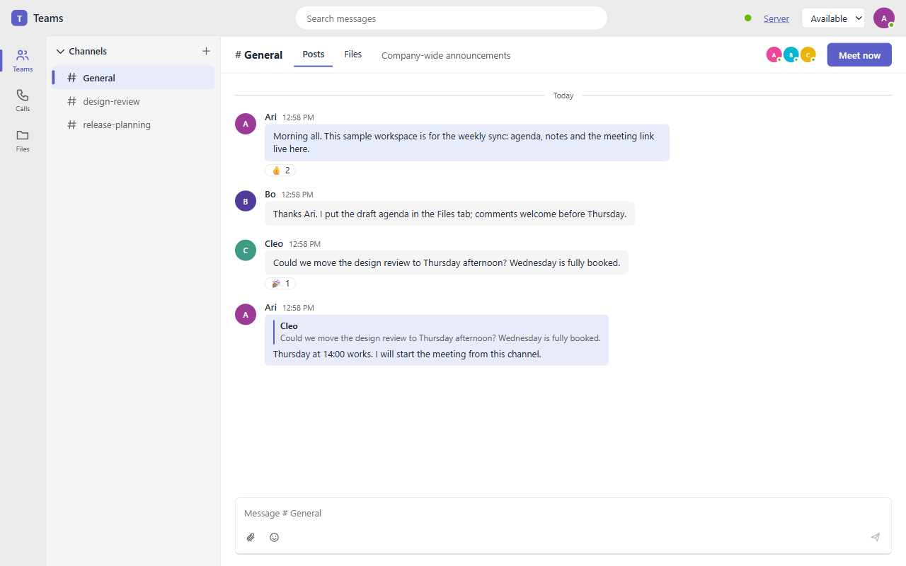

<div align="center">

# ooxml

**Word, Excel, PowerPoint and Visio in TypeScript: open, edit, validate and save Office files in the browser or on a server.**

One library for every format, real editors for every major framework, and no server in the middle.

[](https://github.com/ChristopherVR/ooxml/actions/workflows/ci.yml)
[](https://scorecard.dev/viewer/?uri=github.com/ChristopherVR/ooxml)
[](https://www.bestpractices.dev/projects/15347)
[](https://www.npmjs.com/package/ooxml-core)
[](../LICENSE)
[](../CODE_OF_CONDUCT.md)

[**Open OOXML Office**](https://christophervr.github.io/ooxml/) &nbsp;&middot;&nbsp;
[**Docs**](https://christophervr.github.io/ooxml/docs/) &nbsp;&middot;&nbsp;
[**Packages**](#packages) &nbsp;&middot;&nbsp;
[**Quick start**](#quick-start) &nbsp;&middot;&nbsp;
[**Changelog**](https://github.com/ChristopherVR/ooxml/releases) &nbsp;&middot;&nbsp;
[**Discussions**](https://github.com/ChristopherVR/ooxml/discussions) &nbsp;&middot;&nbsp;
[**Discord**](https://discord.gg/haE8xpMET9)

<a href="https://christophervr.github.io/ooxml/"></a>

</div>

## What it is

ooxml is an open-source Office stack written in TypeScript. At the bottom is **[`ooxml-core`](../src/core#readme)**, one package that reads, edits, validates and writes WordprocessingML, SpreadsheetML, PresentationML and Visio, with no UI and no native code. On top of it, **[`ooxml-ui`](../src/ui#readme)** draws the Office interface as web components, and thin packages bind those editors to React, Vue, Angular, Svelte, Solid and plain JavaScript. **[`ooxml-mcp`](../mcp#readme)** hands the same document operations to AI agents.

- **Files stay with the user.** Parsing, editing, layout, formula calculation and saving all run in the browser, Node.js, Bun or a worker. There is no conversion service and no Office install.
- **One model for every format.** XML, packaging, units, colour, geometry, DrawingML, charts and SmartArt are written once and shared by Word, Excel, PowerPoint and Visio.
- **Round trips that keep what they do not understand.** Untouched parts stay byte for byte, unknown markup is preserved, and an edit that would damage unsupported content is rejected instead of silently dropped.
- **Real editors.** Ribbons with KeyTips and Tell me, backstage, comments and tracked changes, a formula engine with dynamic arrays and `LAMBDA`, slide shows and transitions, undo and redo, find and replace, and real-time co-editing over Yjs.
- **Built for files and peers you do not trust.** Every package passes one guarded zip reader, formula, chart and Visio work is bounded, digital signatures are verified rather than merely detected, collaboration updates are checked before they are applied, and each fixed defect has a regression case in a sandboxed corpus.
- **Accessible the way Office is.** F6 between regions, dialogs that keep focus, accessible names that match the visible text, 3:1 control contrast, forced-colours support, and an Excel grid screen readers explore as a table, all checked in a real browser on every change.
- **Password-protected and legacy files.** ECMA-376 encrypted packages open and save, and legacy `.doc`, `.xls` and `.ppt` are read through the sibling [`ole2`](https://github.com/ChristopherVR/ole2) codecs.

## OOXML Office: the whole suite in one app

[**OOXML Office**](https://christophervr.github.io/ooxml/) is the integrated application built from everything in this repository. It mounts the real Word, Excel, PowerPoint, Visio and OpenTeams editors, the same components the npm packages ship, in one tabbed workspace.

<p align="center">
<a href="https://christophervr.github.io/ooxml/"></a>
</p>

- **A local library.** Import `.docx`, `.xlsx`, `.pptx` and `.vsdx` files or create blank ones. Files stay in the browser's IndexedDB (or the desktop app's WebView), nothing is uploaded, and Download always gives you the saved bytes.
- **Live tabs.** Each document opens in its own editor tab, and edits survive switching apps.
- **Office files in Teams.** Share a document in an OpenTeams channel, reopen it from the conversation and return to the channel.
- **An assistant across files**, off until a deployment configures it in [`ai-config.json`](../docs/suite-ai-config.md): pick files and get bounded edit proposals you review, apply and undo.
- **Install it anywhere.** The suite and each product (`/apps/word/`, `/apps/excel/`, `/apps/powerpoint/`, `/apps/visio/`, `/apps/teams/`) install as PWAs that share one profile, and a [desktop build](../desktop/README.md) wraps the same bundle.

Profiles are local conveniences, not sign-in; the only cloud drive is a OneDrive connection the host configures; and document co-authoring is not yet wired to suite files. The full boundaries are in [suite integration](../docs/suite-integration.md). Run it locally with `bun run build:suite && bun run preview:suite`.

## The products

<table>
<tr>
<td align="center" width="33%">
<a href="../viewers/docx#readme"></a><br>
<a href="../viewers/docx#readme"><strong>Word</strong></a><br>
<sub>Print Layout, styles, tables, fields, comments and tracked changes.<br><a href="https://christophervr.github.io/ooxml/docx/demo/">Demo</a> &middot; <a href="https://christophervr.github.io/ooxml/docx/">Docs</a></sub>
</td>
<td align="center" width="33%">
<a href="../viewers/xlsx#readme"></a><br>
<a href="../viewers/xlsx#readme"><strong>Excel</strong></a><br>
<sub>A grid with a real formula engine, charts, tables, pivots, conditional formats and slicers.<br><a href="https://christophervr.github.io/ooxml/xlsx/demo/">Demo</a> &middot; <a href="https://christophervr.github.io/ooxml/xlsx/">Docs</a></sub>
</td>
<td align="center" width="33%">
<a href="../viewers/pptx#readme"></a><br>
<a href="../viewers/pptx#readme"><strong>PowerPoint</strong></a><br>
<sub>Editing, slide shows, transitions, charts, SmartArt, sharing and an assistant.<br><a href="https://christophervr.github.io/ooxml/pptx/demo/">Demo</a> &middot; <a href="https://christophervr.github.io/ooxml/pptx/">Docs</a></sub>
</td>
</tr>
<tr>
<td align="center" width="33%">
<a href="../viewers/visio#readme"></a><br>
<a href="../viewers/visio#readme"><strong>Visio</strong></a><br>
<sub>A local-first diagram viewer with bounded editing, layers and shape data.<br><a href="https://christophervr.github.io/ooxml/visio/demo/">Demo</a> &middot; <a href="https://christophervr.github.io/ooxml/visio/">Docs</a></sub>
</td>
<td align="center" width="33%">
<a href="../viewers/teams#readme"></a><br>
<a href="../viewers/teams#readme"><strong>OpenTeams</strong></a><br>
<sub>A bring-your-own-server workspace: channels, chat, calls and shared Office files.<br><a href="https://christophervr.github.io/ooxml/teams/demo/">Demo</a> &middot; <a href="https://christophervr.github.io/ooxml/teams/">Docs</a></sub>
</td>
<td align="center" width="33%">
<a href="https://christophervr.github.io/ooxml/"></a><br>
<a href="../apps/office-suite#readme"><strong>OOXML Office</strong></a><br>
<sub>Every product in one installable app.<br><a href="https://christophervr.github.io/ooxml/">Open</a> &middot; <a href="#ooxml-office-the-whole-suite-in-one-app">About</a></sub>
</td>
</tr>
</table>

Word and Excel are labelled Stable and Visio and OpenTeams Beta under the [stability policy](../docs/stability.md); PowerPoint has not yet been assessed against it.

## Packages

Every editor ships the same component for each framework. Pick the cell for your product and framework.

| Product    | React                                                                                                | Vue                                                                          | Angular                                                                              | Svelte                                                                             | Solid                                                                            | Vanilla JS                                                                           | Headless                                                                                | MCP                                                                  |
| ---------- | ---------------------------------------------------------------------------------------------------- | ---------------------------------------------------------------------------- | ------------------------------------------------------------------------------------ | ---------------------------------------------------------------------------------- | -------------------------------------------------------------------------------- | ------------------------------------------------------------------------------------ | --------------------------------------------------------------------------------------- | -------------------------------------------------------------------- |
| Word       | [`docx-react-viewer`](https://www.npmjs.com/package/docx-react-viewer)                               | [`docx-vue-viewer`](https://www.npmjs.com/package/docx-vue-viewer)           | [`docx-angular-viewer`](https://www.npmjs.com/package/docx-angular-viewer)           | [`docx-svelte-viewer`](https://www.npmjs.com/package/docx-svelte-viewer)           | [`docx-solid-viewer`](https://www.npmjs.com/package/docx-solid-viewer)           | [`docx-vanilla-viewer`](https://www.npmjs.com/package/docx-vanilla-viewer)           | [`docx-core`](https://www.npmjs.com/package/docx-core)                                  | [`docx-viewer-mcp`](https://www.npmjs.com/package/docx-viewer-mcp)   |
| Excel      | [`@christophervr/xlsx-react-viewer`](https://www.npmjs.com/package/@christophervr/xlsx-react-viewer) | [`xlsx-vue-viewer`](https://www.npmjs.com/package/xlsx-vue-viewer)           | [`xlsx-angular-viewer`](https://www.npmjs.com/package/xlsx-angular-viewer)           | [`xlsx-svelte-viewer`](https://www.npmjs.com/package/xlsx-svelte-viewer)           | [`xlsx-solid-viewer`](https://www.npmjs.com/package/xlsx-solid-viewer)           | [`xlsx-vanilla-viewer`](https://www.npmjs.com/package/xlsx-vanilla-viewer)           | [`@christophervr/xlsx-core`](https://www.npmjs.com/package/@christophervr/xlsx-core)    | [`xlsx-viewer-mcp`](https://www.npmjs.com/package/xlsx-viewer-mcp)   |
| PowerPoint | [`pptx-react-viewer`](https://www.npmjs.com/package/pptx-react-viewer)                               | [`pptx-vue-viewer`](https://www.npmjs.com/package/pptx-vue-viewer)           | [`pptx-angular-viewer`](https://www.npmjs.com/package/pptx-angular-viewer)           | [`pptx-svelte-viewer`](https://www.npmjs.com/package/pptx-svelte-viewer)           | not available                                                                    | [`pptx-vanilla-viewer`](https://www.npmjs.com/package/pptx-vanilla-viewer)           | [`pptx-viewer-core`](https://www.npmjs.com/package/pptx-viewer-core)                    | [`pptx-viewer-mcp`](https://www.npmjs.com/package/pptx-viewer-mcp)   |
| Visio      | [`visio-react-viewer`](https://www.npmjs.com/package/visio-react-viewer)                             | [`visio-vue-viewer`](https://www.npmjs.com/package/visio-vue-viewer)         | [`visio-angular-viewer`](https://www.npmjs.com/package/visio-angular-viewer)         | [`visio-svelte-viewer`](https://www.npmjs.com/package/visio-svelte-viewer)         | [`visio-solid-viewer`](https://www.npmjs.com/package/visio-solid-viewer)         | [`visio-vanilla-viewer`](https://www.npmjs.com/package/visio-vanilla-viewer)         | [`visio-core`](https://www.npmjs.com/package/visio-core)                                | [`visio-viewer-mcp`](https://www.npmjs.com/package/visio-viewer-mcp) |
| OpenTeams  | [`openteams-react-viewer`](https://www.npmjs.com/package/openteams-react-viewer)                     | [`openteams-vue-viewer`](https://www.npmjs.com/package/openteams-vue-viewer) | [`openteams-angular-viewer`](https://www.npmjs.com/package/openteams-angular-viewer) | [`openteams-svelte-viewer`](https://www.npmjs.com/package/openteams-svelte-viewer) | [`openteams-solid-viewer`](https://www.npmjs.com/package/openteams-solid-viewer) | [`openteams-vanilla-viewer`](https://www.npmjs.com/package/openteams-vanilla-viewer) | [`openteams-server`](https://www.npmjs.com/package/openteams-server) (reference server) |                                                                      |

Shared by all of them:

| Package                                                                                  | What it is                                                                                                 |
| ---------------------------------------------------------------------------------------- | ---------------------------------------------------------------------------------------------------------- |
| [`ooxml-core`](https://www.npmjs.com/package/ooxml-core)                                 | The library: every format's model, parser, writer, editing commands, layout, signatures and collaboration. |
| [`ooxml-ui`](https://www.npmjs.com/package/ooxml-ui)                                     | The Office controls and product editors as web components. Every editor package brings it in.              |
| [`ooxml-mcp`](https://www.npmjs.com/package/ooxml-mcp)                                   | One MCP server that composes the four format servers.                                                      |
| [`@christophervr/pptx-viewer`](https://www.npmjs.com/package/@christophervr/pptx-viewer) | An interactive installer for the PowerPoint packages, and a drop-in for `pptx-react-viewer`.               |

Each product's README has install steps and a snippet for every framework: [Word](../viewers/docx#readme), [Excel](../viewers/xlsx#readme), [PowerPoint](../viewers/pptx#readme), [Visio](../viewers/visio#readme), [OpenTeams](../viewers/teams#readme).

## Quick start

**Open a Word document, change it and save it, with no UI**

```ts
import { loadDocx } from 'ooxml-core/docx';

const loaded = await loadDocx(bytes); // Uint8Array | ArrayBuffer
loaded.model.blocks; // paragraphs and tables
const saved = await loaded.save(); // parts the model does not cover are kept
```

**Put an editor in your app** (React shown; every framework has the same shape)

```tsx
import { useState } from 'react';
import { createDocument, WordEditor } from 'docx-react-viewer';

export function Editor() {
	const [model, setModel] = useState(() => createDocument());
	return <WordEditor documentModel={model} onDocumentChange={setModel} />;
}
```

**Give an AI agent your documents**

```bash
npm install ooxml-mcp docx-viewer-mcp xlsx-viewer-mcp visio-viewer-mcp pptx-viewer-mcp
ooxml-tools --root /path/to/documents
```

The [`ooxml-core` README](../src/core#readme) covers Excel, PowerPoint, Visio, signatures and comparison, and the [`ooxml-mcp` README](../mcp#readme) has the client configuration.

## How it fits together

```
pptx-*-viewer       ┐
docx-*-viewer       │
xlsx-*-viewer       │  framework bindings: lifecycle and events only
visio-*-viewer      ├── ooxml-ui ──┐   Lit web components: ribbons, grids, dialogs (DOM only)
openteams-*-viewer  ┘              │
                                   ├── ooxml-core ──┬── ole2 (legacy binary codecs)
ooxml-mcp ─────────────────────────┘   (all logic)   ├── emf-converter
                                                      └── mtx-decompressor
```

- **`ooxml-core`** owns the logic: packaging, XML, every format's model, parser, writer and editing commands, layout, validation and collaboration. It has no UI.
- **`ooxml-ui`** owns the DOM: the shared elements, the framework-neutral binding kit (`ooxml-ui/bindings`) and the product editors as `ooxml-ui/<product>` subpaths. The core never imports it.
- **The viewers** own only the framework bindings, demos, end-to-end tests and docs, and never copy logic from the library.

Every package is released from this repository with its own version and tag, published from CI with npm provenance by a pipeline in which third-party code cannot push, tag or publish. Packages that work together are released together, so upgrade them as a set.

## Fidelity

These are independent implementations of the Office file formats, built from the published specifications and from files the applications save. They approximate the Office applications; they are not Microsoft Office and do not claim parity, and saving is not lossless for content a model does not cover. Unsupported features are reported in the product (disabled commands, load notices, Excel's Feature Status list) rather than hidden, and the open gaps across all four products are tracked in one [parity checklist](../docs/parity-checklist.md). The [roadmap](../docs/roadmap.md) says what comes next.

Supported browsers are the last two major versions of Chrome, Edge, Firefox and Safari ([browser support](../docs/browser-support.md)); Node.js 22.3 or newer runs everything headless.

## Repository layout

| Folder                                             | What it is                                                                                                                                 |
| -------------------------------------------------- | ------------------------------------------------------------------------------------------------------------------------------------------ |
| [`src/core`](../src/core#readme)                   | `ooxml-core`, the library, one area per format and shared concern.                                                                         |
| [`src/ui`](../src/ui#readme)                       | `ooxml-ui`, the web components and product editors.                                                                                        |
| [`mcp/`](../mcp#readme)                            | `ooxml-mcp`, the combined MCP server.                                                                                                      |
| [`viewers/`](../viewers)                           | The Word, Excel, PowerPoint, Visio and OpenTeams packages: framework bindings, headless and MCP packages, docs sites and the Teams server. |
| [`demos/`](../demos) and [`e2e/`](../e2e)          | The framework demo apps and the Playwright browser and accessibility suites.                                                               |
| [`apps/office-suite`](../apps/office-suite#readme) | OOXML Office, with its shell in [`site/`](../site) and the desktop build in [`desktop/`](../desktop/README.md).                            |

## Development

You need [Bun](https://bun.sh/) and Node.js 22.3 or newer. One install at the root sets up the library, the UI and every viewer.

```bash
bun install
bun run typecheck      # strict project and the pptx project
bun run test           # the library's unit tests
bun run build          # the library
bun run test:package   # packs the build and imports every entry point from a clean install
bun run verify         # what CI would run for your commits
```

The viewers resolve `ooxml-ui` through its built `dist`, so build the library and the UI before working on one:

```bash
bun run build && bun run --cwd src/ui build
cd viewers/docx        # or pptx, xlsx, visio, teams
bun run typecheck && bun run test
```

Each viewer has its own scripts and browser tests. Commits follow [Conventional Commits](../CONTRIBUTING.md), which drive the automated releases ([releasing](../docs/releasing.md)). The working agreements for people and coding agents are in [AGENTS.md](../AGENTS.md), and [PROVENANCE.md](../PROVENANCE.md) records where each module came from.

## Documentation

- [Documentation hub](https://christophervr.github.io/ooxml/docs/): every guide, from the apps to the headless library and the MCP server.
- Product docs and live demos: [Word](https://christophervr.github.io/ooxml/docx/), [Excel](https://christophervr.github.io/ooxml/xlsx/), [PowerPoint](https://christophervr.github.io/ooxml/pptx/), [Visio](https://christophervr.github.io/ooxml/visio/), [OpenTeams](https://christophervr.github.io/ooxml/teams/).
- Guides in this repository: [embedding the editors](../docs/embedding.md), [storage integrations](../docs/storage-integrations.md), [OneDrive](../docs/onedrive-integration.md), [collaboration](../docs/collab-area.md), [font loading](../docs/font-loading.md), [MCP tools](../docs/mcp.md), [stability policy](../docs/stability.md) and [privacy](../PRIVACY.md).
- Release history: each package's CHANGELOG and the [GitHub releases](https://github.com/ChristopherVR/ooxml/releases).
- Related projects: [ole2](https://github.com/ChristopherVR/ole2) (compound files and legacy binary codecs), [emf-converter](https://github.com/ChristopherVR/emf-converter) (EMF and WMF rendering) and [mtx-decompressor](https://github.com/ChristopherVR/mtx-decompressor) (embedded MicroType Express fonts).

## Community and support

- **Questions:** ask in [Discussions, Q&A](https://github.com/ChristopherVR/ooxml/discussions/categories/q-a).
- **Ideas:** talk them through in [Ideas](https://github.com/ChristopherVR/ooxml/discussions/categories/ideas); agreed ones become feature requests.
- **Built something?** Share it in [Show and tell](https://github.com/ChristopherVR/ooxml/discussions/categories/show-and-tell).
- **Chat:** join the [Discord server](https://discord.gg/haE8xpMET9) to talk with other users and follow pull requests, releases and CI as they happen.
- **Bugs and fidelity gaps:** open an [issue](https://github.com/ChristopherVR/ooxml/issues/new/choose), ideally with a sample file.
- **Security problems:** report them privately, as [SECURITY.md](../SECURITY.md) describes.
- **Contributing:** start with [CONTRIBUTING.md](../CONTRIBUTING.md) and the [Code of Conduct](../CODE_OF_CONDUCT.md).

## License

[Apache-2.0](../LICENSE). Third-party notices are in [NOTICE](../NOTICE) and [THIRD-PARTY-LICENSES](../src/core/THIRD-PARTY-LICENSES).
