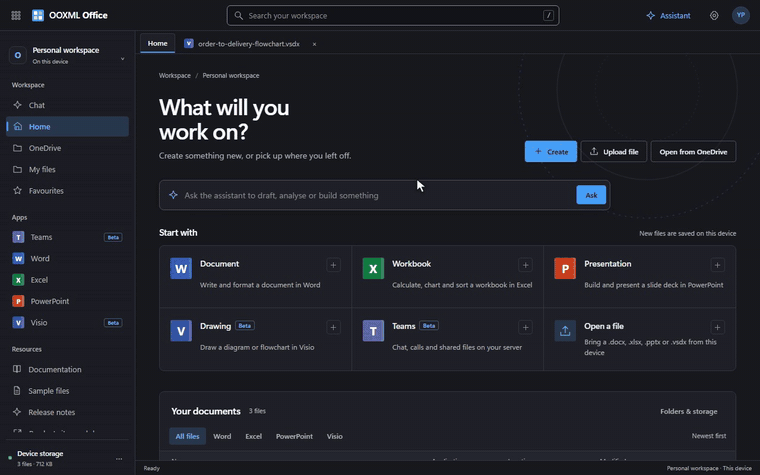

<div align="center">

# OOXML Office

**Word, Excel, PowerPoint, Visio and OpenTeams in one local-first workspace, in the browser or on the desktop.**

[**Open the app**](https://christophervr.github.io/ooxml/) &nbsp;&middot;&nbsp;
[**Suite overview**](../../.github/README.md#ooxml-office-the-whole-suite-in-one-app) &nbsp;&middot;&nbsp;
[**Integration and limits**](../../docs/suite-integration.md) &nbsp;&middot;&nbsp;
[**Desktop**](../../desktop/README.md)

[](https://christophervr.github.io/ooxml/)

</div>

`ooxml-office` is the deployable application shared by the integrated suite, the standalone PWAs and the [desktop build](../../desktop/README.md). It mounts the real editors directly, with no demo iframes, and owns only the wiring: document sessions, the shared profile and theme, Teams integration and the assistant. Format logic stays in [`ooxml-core`](../../src/core#readme) and reusable controls in [`ooxml-ui`](../../src/ui#readme). It is a private package, not an npm library.

## Three ways to open it

The first visit asks where to start:

- **OOXML Office**: every app in one workspace, opening on **Chat**, where you ask about your files or ask for a document, workbook or deck and open the draft in its editor. The shared library, a tab per open document, the app launcher and search sit beside it, and **Ask AI** opens the same chat next to any document. Settings (the gear in the header) holds the appearance (dark by default), the user name, the display language and view options every app follows, the font download choice and a privacy overview of everything the suite connects to.
- **One product on its own**: [Word](../../viewers/docx#readme), [Excel](../../viewers/xlsx#readme), [PowerPoint](../../viewers/pptx#readme), [Visio](../../viewers/visio#readme) or [Teams](../../viewers/teams#readme), each installable on its own under `apps/word/`, `apps/excel/`, `apps/powerpoint/`, `apps/visio/` and `apps/teams/`.
- **Documentation**: the hub at [`/ooxml/docs/`](https://christophervr.github.io/ooxml/docs/) (`site/docs/`), which links every manual.

The suite and the standalone apps share local profiles and documents when served from the same origin. Install them from the account menu or the browser's install command. The look of every page follows [the pages design system](../../docs/pages-design.md).

The start screen and the sidebar link to the [sample files](../../samples/README.md): the gallery at [`/ooxml/samples/`](https://christophervr.github.io/ooxml/samples/) opens a sample in its editor through `?sample=<id>`. The desktop app ships without the samples.

## Run it

From the repository root:

```sh
bun install
bun run build:suite    # core, UI and suite bundle into suite-dist/
bun run preview:suite  # serves it, by default on port 8123
```

## Status and limits

Profiles are local conveniences, not sign-in. Files stay in the browser's IndexedDB and are never uploaded; Download always gives the saved bytes. The only cloud drive is a OneDrive connection the host configures, and document co-authoring is not yet wired to suite files. The full list is in [integration and limitations](../../docs/suite-integration.md); per-product gaps are in the [parity checklist](../../docs/parity-checklist.md).

## Privacy and network use

The suite uses the editors, so their privacy notes apply. On top of them: the assistant is offline by default and talks to a provider only when the user or the deployment's [`ai-config.json`](../../docs/suite-ai-config.md) selects one; OneDrive is off unless the host configures it; Settings > Fonts chooses Google Fonts (the default), your own font server, or no downloads; and the installed app checks its own origin for updates. Every request is listed in [PRIVACY.md](../../PRIVACY.md#ooxml-office-suite-appsoffice-suite-the-github-pages-site-and-the-desktop-app).

## License

[Apache-2.0](../../LICENSE).
