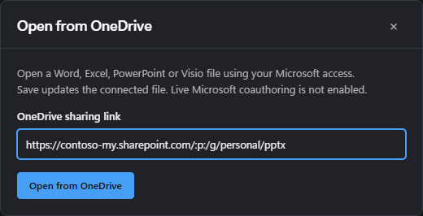

# OneDrive quick start

This guide connects a Word, Excel, PowerPoint or Visio editor to a file in OneDrive, step by step,
with a complete React PowerPoint example. It is the short path through the
[OneDrive integration reference](onedrive-integration.md), which covers every package, conflict
handling and sharing in detail.


The library does the OneDrive part: it resolves a sharing link, downloads the file, and uploads
saved bytes back to the same file. **Your application does two things the library deliberately
does not:**

1. **Sign the user in to Microsoft** and hand the library a Microsoft Graph access token.
2. **Ask which file to open.** There is no built-in file browser. The user pastes a OneDrive sharing
   link (the integrated Office app has a dialog for this; in your own app you add a link box or your
   own picker).

## 1. Register an application in Microsoft Entra

Microsoft only issues Graph tokens to registered applications, so you need your own registration.
It costs nothing. In the [Azure portal](https://portal.azure.com), open **Microsoft Entra ID >
App registrations > New registration** and set:

| Setting                 | Value                                                                                     |
| ----------------------- | ----------------------------------------------------------------------------------------- |
| Supported account types | Personal accounts only, or "any organizational directory and personal Microsoft accounts" |
| Redirect URI            | Platform **Single-page application (SPA)**, for example `http://localhost:5173`           |
| API permissions         | Microsoft Graph > **Delegated** > `Files.ReadWrite` (plus `openid` and `profile`)         |
| Client secret           | None. A browser app uses the authorization code flow with PKCE and keeps no secret        |

Copy the **Application (client) ID** from the overview page. Add your deployed origin as a second
redirect URI when you publish. A personal Microsoft account with no work directory may be asked to
create one before it can register an application; follow the portal's prompts.

To try the API before registering, see [Test without your own registration](#test-without-your-own-registration).

## 2. Install the packages

```sh
npm install ooxml-core @azure/msal-browser
# PowerPoint in React:
npm install pptx-react-viewer react react-dom i18next react-i18next
```

Import `ooxml-core` as a direct dependency of your application. MSAL is Microsoft's sign-in
library; any library that performs the PKCE flow and returns a Graph token works the same way.

## 3. Sign in and create the client

```ts
import { PublicClientApplication } from '@azure/msal-browser';
import { createOneDriveClient } from 'ooxml-core/embedding/onedrive';

const msal = new PublicClientApplication({
	auth: {
		clientId: 'YOUR_APPLICATION_CLIENT_ID',
		// `consumers` for personal accounts only, `common` for work/school and personal.
		authority: 'https://login.microsoftonline.com/consumers',
		redirectUri: window.location.origin,
	},
});
await msal.initialize();

const scopes = ['Files.ReadWrite'];
async function getAccessToken(): Promise<string> {
	const account = msal.getAllAccounts()[0] ?? (await msal.loginPopup({ scopes })).account;
	try {
		return (await msal.acquireTokenSilent({ scopes, account })).accessToken;
	} catch {
		return (await msal.acquireTokenPopup({ scopes, account })).accessToken;
	}
}

// Who may edit: here, only files on the signed-in user's own drive.
const ownDrive = await fetch('https://graph.microsoft.com/v1.0/me/drive?$select=id', {
	headers: { Authorization: `Bearer ${await getAccessToken()}` },
}).then((response) => response.json());

export const drive = createOneDriveClient({
	getAccessToken,
	canWrite: (file) => file.driveId === ownDrive.id,
});
```

`canWrite` decides whether a file opens editable. A `Files.ReadWrite` token alone does not prove
that the user may edit a particular file, so anything the policy does not allow opens read-only.
The own-drive rule above is the simplest safe policy; files shared from someone else's drive stay
read-only under it.

## 4. Let the user choose a file

The user copies a sharing link from OneDrive (select the file, **Share**, **Copy link**) and pastes
it into your application, which passes it to `drive.open(link)`. Supported files are `.docx`,
`.xlsx`, `.pptx` and `.vsdx`.

### In the integrated Office app

The Office app has this built in. Configure the token provider before its entry script loads, and
**Open from OneDrive** appears on the home page:

```ts
globalThis.ooxmlOneDriveOptions = { getAccessToken, canWrite };
```


It asks for the sharing link:



The file opens in the matching editor, and **Save** updates the same OneDrive file:


Without `ooxmlOneDriveOptions`, the dialog explains that sign-in has not been connected:


### In your own application

You add the link box yourself. The React example below includes one:


Microsoft's OneDrive file picker is not integrated or tested with this library; a link box is the
supported path today.

## 5. React PowerPoint example

The React viewer takes its labels from your application's `react-i18next` instance, so set that up
once at your entry point, together with the viewer's stylesheet (skip the stylesheet if your
application already uses Tailwind CSS 4):

```ts
// main.tsx
import i18n from 'i18next';
import { initReactI18next } from 'react-i18next';
import { keyToLabel, translationsEn } from 'pptx-react-viewer/i18n';
import 'pptx-react-viewer/styles';

void i18n.use(initReactI18next).init({
	resources: { en: { translation: translationsEn } },
	lng: 'en',
	fallbackLng: 'en',
	interpolation: { escapeValue: false },
	parseMissingKeyHandler: (key: string) => keyToLabel(key),
});
```

Then render `<OneDriveApp drive={drive} />` with the `drive` from step 3:

```tsx
// OneDrivePowerPoint.tsx
import { useMemo, useState, type FormEvent } from 'react';
import { PowerPointViewer } from 'pptx-react-viewer';
import type { DocumentStorage } from 'ooxml-core/embedding';
import {
	createOneDriveSession,
	OneDriveConflictError,
	type OneDriveClient,
	type OneDriveOpened,
} from 'ooxml-core/embedding/onedrive';
import { mergePptxSnapshots } from 'ooxml-core/pptx';

/** The whole page: a link box until a file is open, then the editor. */
export function OneDriveApp({ drive }: { drive: OneDriveClient }) {
	const [opened, setOpened] = useState<OneDriveOpened | null>(null);
	if (!opened) return <OpenFromOneDrive drive={drive} onOpened={setOpened} />;
	// A new key gives each opened file its own session and editor.
	return <OneDrivePowerPoint key={opened.file.itemId} drive={drive} opened={opened} />;
}

/** The library has no file picker: the host asks for a sharing link. */
export function OpenFromOneDrive({
	drive,
	onOpened,
}: {
	drive: OneDriveClient;
	onOpened: (opened: OneDriveOpened) => void;
}) {
	const [busy, setBusy] = useState(false);
	const [error, setError] = useState('');

	async function submit(event: FormEvent<HTMLFormElement>) {
		event.preventDefault();
		const link = String(new FormData(event.currentTarget).get('link') ?? '').trim();
		setBusy(true);
		setError('');
		try {
			const opened = await drive.open(link);
			if (opened.file.kind !== 'pptx') throw new Error('Choose a PowerPoint (.pptx) file.');
			onOpened(opened);
		} catch (cause) {
			setError(cause instanceof Error ? cause.message : String(cause));
		} finally {
			setBusy(false);
		}
	}

	return (
		<form className="open-onedrive" onSubmit={submit}>
			<h1>Open from OneDrive</h1>
			<p>In OneDrive, select the file, choose Share, then Copy link, and paste it here.</p>
			<label>
				OneDrive sharing link
				<input name="link" type="url" required placeholder="https://1drv.ms/p/..." />
			</label>
			<button disabled={busy}>{busy ? 'Opening...' : 'Open'}</button>
			{error && <p role="alert">{error}</p>}
		</form>
	);
}

const sameBytes = (a: Uint8Array, b: Uint8Array) =>
	a.length === b.length && a.every((value, index) => value === b[index]);

/** The editor, connected to one OneDrive file. File > Save uploads to that file. */
export function OneDrivePowerPoint({
	drive,
	opened,
}: {
	drive: OneDriveClient;
	opened: OneDriveOpened;
}) {
	// One session per opened file; `merge` combines independent edits made by someone else.
	const [session] = useState(() =>
		createOneDriveSession(drive, opened, {
			merge: ({ base, local, remote }) => mergePptxSnapshots(base.bytes, local, remote.bytes),
		}),
	);
	// Set once. Replacing `content` reloads the editor and clears undo, so only do it on purpose.
	const [content, setContent] = useState(opened.bytes);
	const [fileName, setFileName] = useState(opened.file.name);
	const [status, setStatus] = useState('Opened from OneDrive');
	const [conflict, setConflict] = useState<OneDriveConflictError | null>(null);
	const canEdit = opened.file.access === 'write';

	// The editor's own Save (button, File > Save, Ctrl+S) calls this. A rejection is reported as
	// a failed save, so a failed upload is never shown as saved.
	const storage = useMemo<DocumentStorage>(
		() => ({
			async save(bytes, meta) {
				setStatus('Saving to OneDrive...');
				try {
					const result = await session.storage.save(bytes, meta);
					const saved = session.getSnapshot().baseBytes;
					// Someone else's edits were merged in: show the combined deck.
					if (!sameBytes(saved, bytes)) setContent(saved);
					setFileName(session.getSnapshot().file.name);
					setStatus('Saved to OneDrive');
					return result;
				} catch (error) {
					if (error instanceof OneDriveConflictError) {
						setConflict(error);
						setStatus('Someone else changed the same content');
					} else {
						setStatus(`Not saved: ${error instanceof Error ? error.message : String(error)}`);
					}
					throw error;
				}
			},
		}),
		[session],
	);

	async function saveMyCopy() {
		if (!conflict) return;
		const copy = await session.saveCopy(
			conflict.conflict.local,
			fileName.replace(/\.pptx$/iu, ' (my edits).pptx'),
		);
		setFileName(copy.file.name); // later saves go to the copy; the original is unchanged
		setConflict(null);
		setStatus(`Saved your edits as ${copy.file.name}`);
	}

	async function openLatest() {
		const latest = await session.reload();
		setContent(latest.bytes); // discards your unsaved edits
		setConflict(null);
		setStatus('Opened the latest OneDrive version');
	}

	return (
		<div className="onedrive-editor">
			<header>
				<strong>{fileName}</strong>
				{!canEdit && <span className="badge">Read-only</span>}
				<span role="status">{status}</span>
				{conflict && (
					<>
						<button onClick={saveMyCopy}>Save my edits as a copy</button>
						<button onClick={openLatest}>Discard mine and open latest</button>
					</>
				)}
			</header>
			<PowerPointViewer
				content={content}
				fileName={fileName}
				canEdit={canEdit}
				storage={storage}
				onError={setStatus}
			/>
		</div>
	);
}
```

Give `.onedrive-editor` a height (for example `height: 100vh; display: flex; flex-direction:
column`) so the viewer fills the page. Once the file is open:


What the example does:

- **Saving.** The viewer's own Save button, **File > Save** and Ctrl+S all go through `storage`,
  which uploads to the same OneDrive file. There is no separate Save button to build.
- **Read-only files.** `canEdit` comes from `opened.file.access`, which your `canWrite` policy
  decides.
- **Someone else saved first.** The session reads the newer version and, with
  `mergePptxSnapshots`, combines edits that do not overlap. The combined deck is loaded back into
  the editor (this resets undo history). When edits overlap, saving fails with
  `OneDriveConflictError`, nothing is overwritten, and the user chooses between saving their edits
  as a copy and opening the latest version.
- **Reloading on purpose only.** Change `content` only on first load, after a merge or on "open
  latest". Setting it after every save would reload the editor and lose undo history.

The integrated Office app offers the same choices, plus downloads of both versions:


The viewer marks the deck saved (**All saved** in its status bar) only once `storage.save` has
resolved, and only if nothing was edited while the upload was in flight. A failed upload, or an
edit made during it, keeps **Unsaved changes**.

Word, Excel and Visio use the same client and session; only the editor wiring differs. See
[Word](../viewers/docx/docs/onedrive.md), [Excel](../viewers/xlsx/docs/onedrive.md),
[Visio](../viewers/visio/docs/onedrive.md) and the other
[PowerPoint bindings](../viewers/pptx/docs/guide/onedrive.md).

## Try it in the PowerPoint demos

Every PowerPoint framework demo (React, Vue, Angular, vanilla and Svelte) offers OneDrive under
**File > Open**, through the viewer's `fileProviders` prop. From the repository root:

```sh
bun install
bun run build && bun run --cwd src/ui build
cd viewers/pptx && bun run demo   # React on http://localhost:4173
```

The other demos use their own ports: `bun run demo:vue` (4175), `demo:angular` (4174, build
`packages/angular` first), `demo:vanilla` (4176) and `demo:svelte` (4177).

Open a deck, choose **File > Open**, then **OneDrive** and **Sign in**. The demo has to be told how
to sign in, which a real application does itself:

- **Your app registration**: set `VITE_ONEDRIVE_CLIENT_ID` (and optionally
  `VITE_ONEDRIVE_AUTHORITY=common`) in an untracked `.env.local` next to the demo, or enter the
  Application (client) ID from step 1 in the demo's sign-in dialog (it is remembered in that
  browser). Register each demo origin you use as a single-page application redirect URI
  (`http://localhost:4173/` through `http://localhost:4177/`, with the trailing slash).
- **A Graph Explorer token**: the same dialog accepts a token as described in the next section.
  Nothing is registered, and the token is kept only in memory.

After signing in the place lists your recent files, your files and a search box. Choose a `.pptx`
to open it, edit, then save with the viewer's own Save (or Ctrl+S): the file in OneDrive is
updated and the status bar reads **All saved**. A failed upload keeps **Unsaved changes**. Files on
someone else's drive open read-only, because the demo uses the own-drive `canWrite` policy from
step 3.

In your own application the wiring is one prop:

```tsx
<PowerPointViewer content={bytes} canEdit fileProviders={[oneDriveProvider]} />
```

where `oneDriveProvider` comes from `createOneDriveFileProvider` in
`ooxml-core/embedding/onedrive`; it owns your sign-in. A file opened from a place saves to that
file (not to the `storage` prop) until another document is loaded.

## Test without your own registration

Microsoft does not offer a shared application ID for other applications to use, and borrowing
another application's ID or redirect URI does not work and is not allowed. Microsoft Graph
Explorer, though, is Microsoft's own registered tool, and it can give you a short-lived token for
your own account, personal OneDrive included. That is enough for development testing:

1. Open [Graph Explorer](https://developer.microsoft.com/graph/graph-explorer), sign in with the
   account that owns the test file, and consent to `Files.ReadWrite` (**Modify permissions**).
2. Run `GET https://graph.microsoft.com/v1.0/me/drive` to confirm the account works.
3. Copy the token from the **Access token** tab. It expires after about an hour.
4. Either run the repository's command-line check, which opens the file without changing it
   (`--write-copy` saves a separate copy):

   ```sh
   bun run build
   node scripts/onedrive-live-check.mjs --help
   ```

   It reads the token and link from environment variables;
   [Testing OneDrive](onedrive-testing.md#run-the-real-service-smoke-check) shows how to set them
   without leaving them in your shell history.

5. Or, in a local development copy of your application, have `getAccessToken` return the pasted
   token instead of signing in, for example from an untracked `.env.local` file:

   ```ts
   const drive = createOneDriveClient({
   	getAccessToken: async () => import.meta.env.VITE_DEV_GRAPH_TOKEN, // development only
   	canWrite: (file) => file.driveId === ownDrive.id, // as in step 3
   });
   ```

Use a disposable file. Never commit the token, ship this shortcut, or use it for other people:
it tests your code against the real service, not your sign-in setup, redirect URIs or consent.
Before anyone else uses the application, register it as in step 1.

## Regenerating the screenshots

`scripts/onedrive-doc-shots.mjs` takes these screenshots against a test-only stand-in for Microsoft
Graph (the one the suite's browser check uses), so no Microsoft account is involved. Its header
comment lists the commands. The React screenshots come from the example above, served by a Vite
app.
