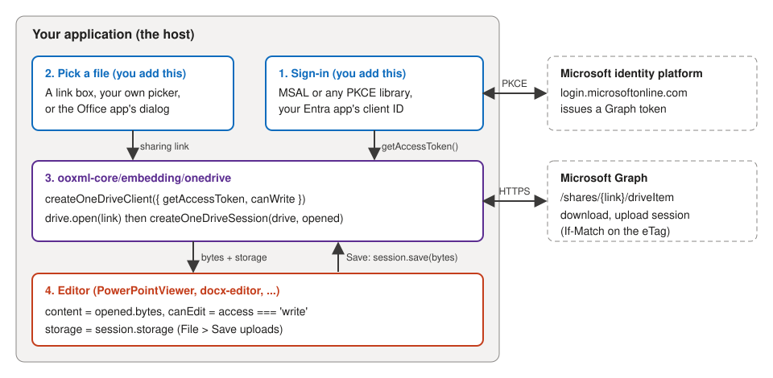
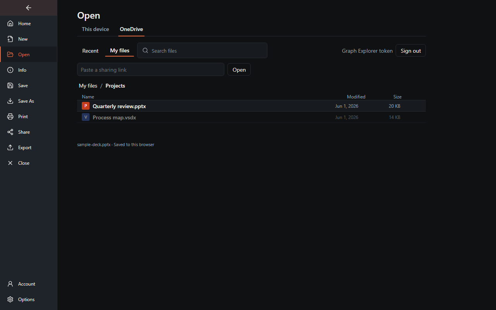
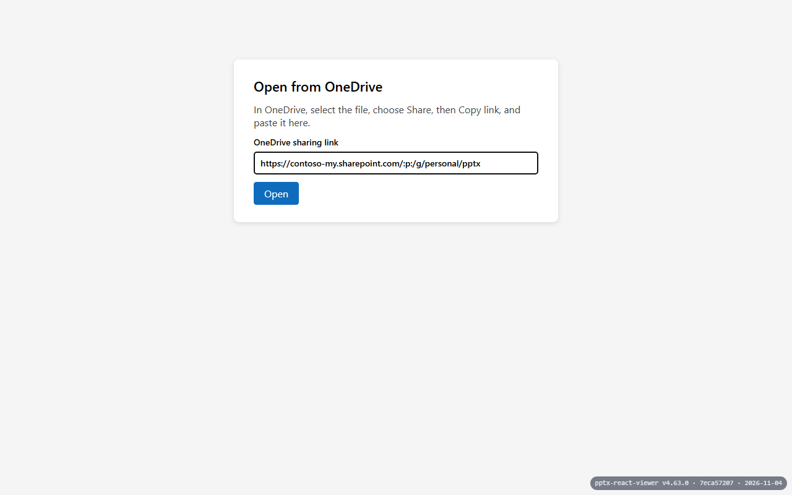
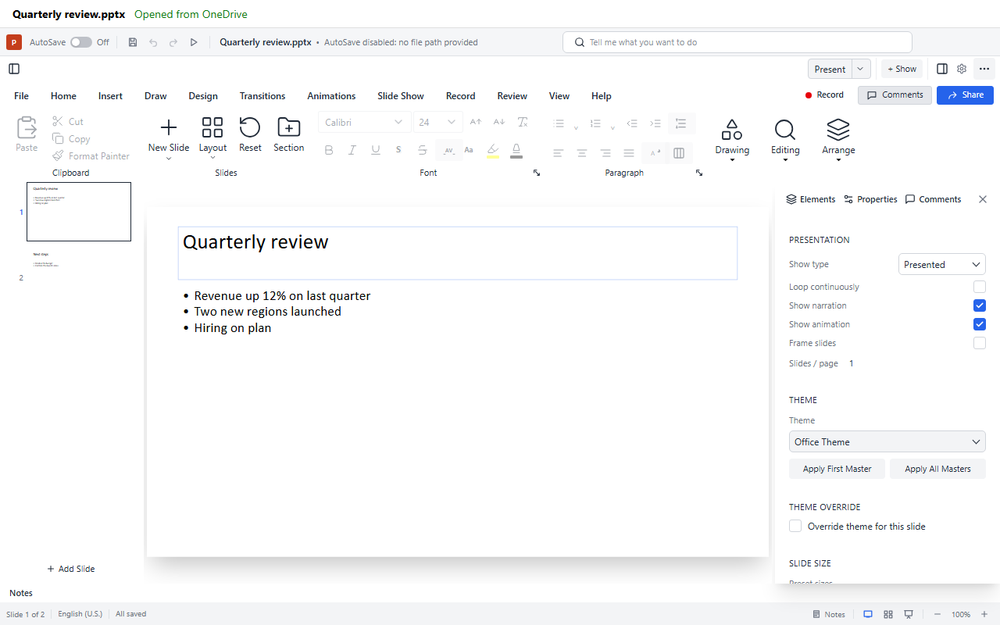
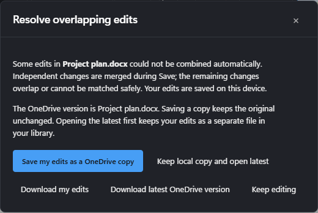
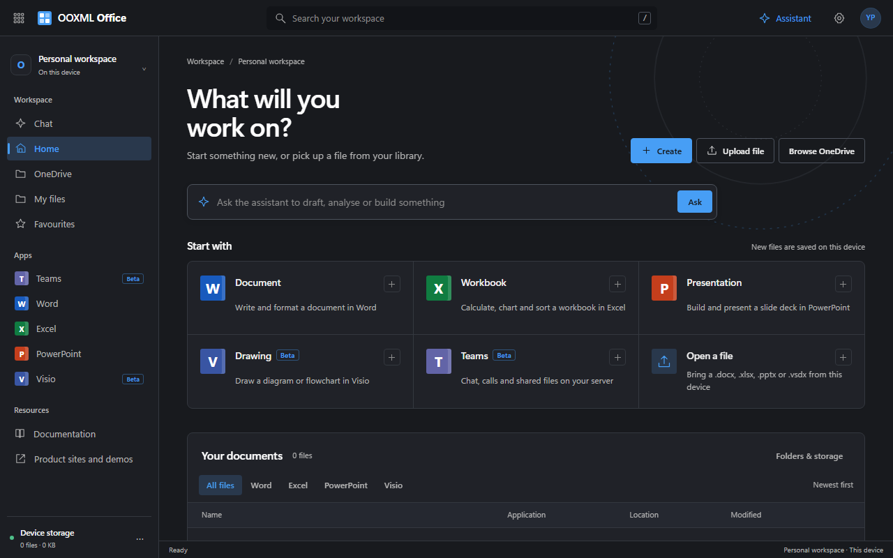
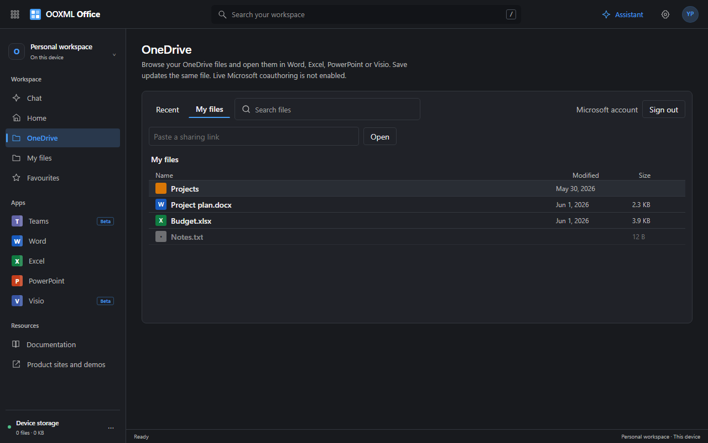
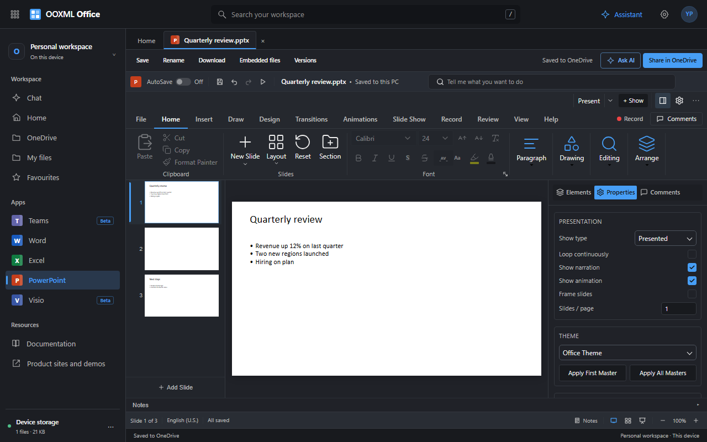
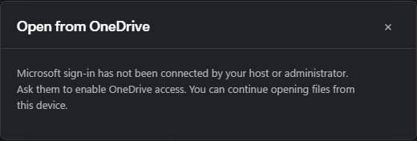
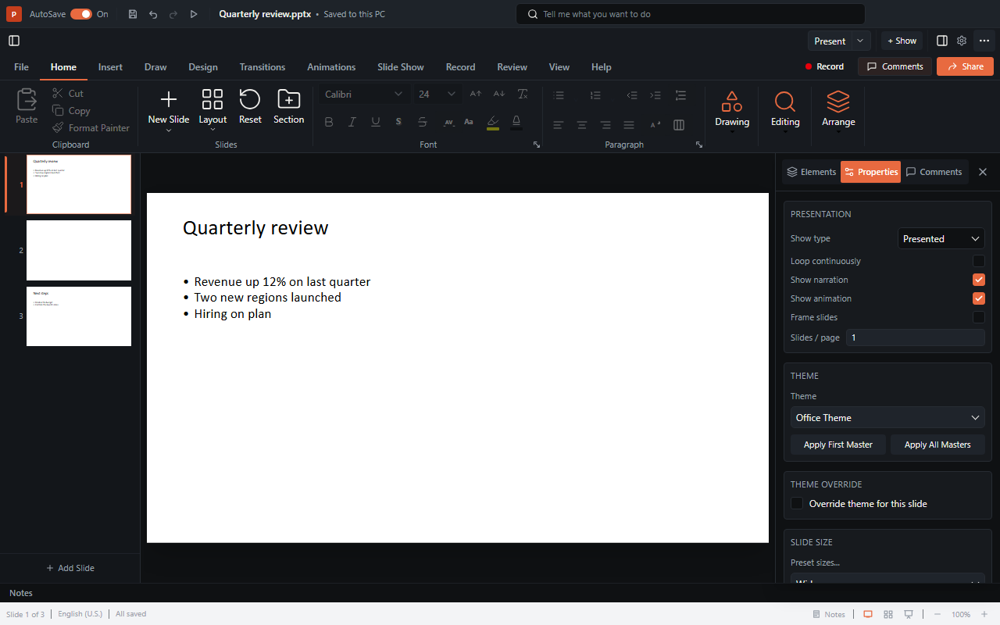

# OneDrive quick start

This guide connects a Word, Excel, PowerPoint or Visio editor to a file in OneDrive, step by step,
with a complete React PowerPoint example. It is the short path through the
[OneDrive integration reference](onedrive-integration.md), which covers every package, conflict
handling and sharing in detail.



The library does the OneDrive part: it browses the user's drive (recent files, folders, search),
resolves sharing links, downloads the file, uploads saved bytes back to the same file and combines
concurrent edits where it safely can. Every product's **File > Open** shows the same OneDrive place
and file browser. **Your application does one thing the library deliberately does not:** sign the
user in to Microsoft and hand the library a Microsoft Graph access token.

Everything else has a default you can change or replace: see
[Configure or replace anything](#configure-or-replace-anything).

## Choose your path

| You want to                                            | Follow                                                                                                          |
| ------------------------------------------------------ | --------------------------------------------------------------------------------------------------------------- |
| Add OneDrive to an editor embedded in your application | Steps 1 to 4, then the [React PowerPoint example](#5-react-powerpoint-example) if you use React                 |
| Connect the integrated Office app (the suite)          | Steps 1 and 3, then [Connect the integrated Office app](#connect-the-integrated-office-app)                     |
| Just see it working first, without writing code        | [Try it in the demos](#try-it-in-the-demos), with a [Graph Explorer token](#test-without-your-own-registration) |

**Before you start** you need: a Microsoft account (personal, or work or school) that can sign in to
the [Azure portal](https://portal.azure.com); Node.js 20 or later (or Bun); and the address your
application runs on during development, for example `http://localhost:5173`.

## 1. Register an application in Microsoft Entra

Microsoft only issues Graph tokens to registered applications, so you need your own registration.
It costs nothing and takes a few minutes. An app registration lives in an Entra tenant; if the
portal asks you to create one first, a free tenant is enough.

1. Open the [Azure portal](https://portal.azure.com) and go to **Microsoft Entra ID > App
   registrations > New registration**.
2. **Name**: anything, for example `My editor (development)`.
3. **Supported account types**: pick who may sign in. This choice decides the `authority` you use
   in step 3:

   | Choice in the portal                                           | `authority` in step 3                           |
   | -------------------------------------------------------------- | ----------------------------------------------- |
   | Personal Microsoft accounts only                               | `https://login.microsoftonline.com/consumers`   |
   | Accounts in any organizational directory and personal accounts | `https://login.microsoftonline.com/common`      |
   | Accounts in this organizational directory only                 | `https://login.microsoftonline.com/<tenant id>` |

4. **Redirect URI**: platform **Single-page application (SPA)**, value exactly the address your app
   runs on, for example `http://localhost:5173`. Microsoft compares it character for character:
   the scheme, host, port and trailing slash must match what your code sends (step 3 sends
   `window.location.origin`, which has no trailing slash). Every development port needs its own
   entry, and so does your deployed origin later (**Authentication > Add URI**).
5. Select **Register**. On the **Overview** page, copy the **Application (client) ID**: it replaces
   `YOUR_APPLICATION_CLIENT_ID` in step 3.
6. Open **API permissions > Add a permission > Microsoft Graph > Delegated permissions**, add
   `Files.ReadWrite`, and select **Add permissions**. That is the only scope the library needs: it
   covers the user's own files and the files shared with them by link. `Files.ReadWrite.All` is not
   needed, and MSAL adds `openid` and `profile` itself.
7. Consent: a personal account is asked to consent the first time it signs in. A work or school
   tenant may require an administrator to grant consent (**Grant admin consent** on the same page,
   or ask your administrator).
8. Leave **Certificates & secrets** alone and leave the implicit-grant boxes under
   **Authentication** unchecked: a browser application uses the authorization code flow with PKCE
   and keeps no secret.

To try the API before registering, see [Test without your own registration](#test-without-your-own-registration).

## 2. Install the packages

```sh
npm install ooxml-core @azure/msal-browser
# PowerPoint in React (step 5):
npm install pptx-react-viewer react react-dom i18next react-i18next
```

Import `ooxml-core` as a direct dependency of your application. MSAL is Microsoft's sign-in
library; any library that performs the PKCE flow and returns a Graph token works the same way.

## 3. Sign in and create the client

Keep the sign-in in one module, here `onedrive.ts`, so every later step imports the same pieces:

```ts
// onedrive.ts
import { PublicClientApplication, type AccountInfo } from '@azure/msal-browser';
import { createOneDriveClient, type OneDriveFile } from 'ooxml-core/embedding/onedrive';

export const msal = new PublicClientApplication({
	auth: {
		clientId: 'YOUR_APPLICATION_CLIENT_ID', // step 1.5
		authority: 'https://login.microsoftonline.com/consumers', // step 1.3
		redirectUri: window.location.origin, // registered exactly in step 1.4
	},
});
await msal.initialize();

export const scopes = ['Files.ReadWrite'];

/** Opens Microsoft's sign-in popup. Call it from a click: browsers block popups at page load. */
export async function signIn(): Promise<AccountInfo> {
	const { account } = await msal.loginPopup({ scopes });
	if (!account) throw new Error('Sign-in did not return an account.');
	msal.setActiveAccount(account);
	return account;
}

/** A Graph token for the library. It never opens a popup unless the cached sign-in has expired. */
export async function getAccessToken(): Promise<string> {
	const account = msal.getActiveAccount() ?? msal.getAllAccounts()[0];
	if (!account) throw new Error('Sign in to OneDrive first.');
	try {
		return (await msal.acquireTokenSilent({ scopes, account })).accessToken;
	} catch {
		return (await msal.acquireTokenPopup({ scopes, account })).accessToken;
	}
}

// Who may edit: here, only files on the signed-in user's own drive. Looked up once, after sign-in.
let ownDriveId: Promise<string> | undefined;
async function ownDrive(): Promise<string> {
	ownDriveId ??= fetch('https://graph.microsoft.com/v1.0/me/drive?$select=id', {
		headers: { Authorization: `Bearer ${await getAccessToken()}` },
		credentials: 'omit',
	})
		.then((response) => (response.ok ? response.json() : Promise.reject(response.status)))
		.then((drive: { id: string }) => drive.id);
	return ownDriveId;
}
export const canWrite = async (file: OneDriveFile) => file.driveId === (await ownDrive());

export const drive = createOneDriveClient({ getAccessToken, canWrite });
```

`canWrite` decides whether a file opens editable. A `Files.ReadWrite` token alone does not prove
that the user may edit a particular file, so anything the policy does not allow opens read-only.
The own-drive rule above is the simplest safe policy; files shared from someone else's drive stay
read-only under it. Replace it with your own rule (your permission service, a list of drives)
whenever you like.

## 4. Add OneDrive to File > Open

A **file provider** lets users browse their OneDrive inside the editor: **Recent**, **My files**
with folders, search, and a field to paste a sharing link. Supported files are `.docx`, `.xlsx`,
`.pptx` and `.vsdx`. Create it from the same `getAccessToken`, `canWrite` and `signIn` as step 3:

```ts
// onedrive.ts, continued
import { createOneDriveFileProvider, type OneDriveMerger } from 'ooxml-core/embedding/onedrive';
import { mergeDocxSnapshots } from 'ooxml-core/docx';
import { mergePptxSnapshots } from 'ooxml-core/pptx';
import { mergeWorkbookSnapshots } from 'ooxml-core/xlsx/collab';
import { mergeDrawingSnapshots } from 'ooxml-core/visio/collab';

// Combines edits someone else saved meanwhile with yours, per format (see "Configure" below).
const merge = (
	format: (base: Uint8Array, local: Uint8Array, remote: Uint8Array) => Promise<unknown>,
) => (({ base, local, remote }) => format(base.bytes, local, remote.bytes)) as OneDriveMerger;

export const oneDrive = createOneDriveFileProvider({
	getAccessToken,
	canWrite,
	signIn: async () => ({ name: (await signIn()).username }),
	signOut: () => msal.logoutPopup(),
	mergers: {
		docx: merge(mergeDocxSnapshots),
		pptx: merge(mergePptxSnapshots),
		xlsx: merge(mergeWorkbookSnapshots),
		vsdx: merge(mergeDrawingSnapshots),
	},
});
```

Pass it as `fileProviders` to Word (`<docx-editor>`), Excel (`<xlsx-editor>`), Visio
(`<visio-viewer>`) or any PowerPoint binding:

```tsx
<PowerPointViewer content={bytes} canEdit fileProviders={[oneDrive]} />
```

```ts
document.querySelector('docx-editor')!.fileProviders = [oneDrive]; // Word, Excel and Visio elements
```

That is all the wiring. What the user then gets:

- **File > Open** gains a **OneDrive** place next to **This device**. The first visit shows **Sign
  in**, which calls your `signIn` (a click, so the popup is allowed). Every product renders the
  same places element and file browser.
- Choosing a file opens it in the editor. **Save** (the button, File > Save, Ctrl+S) writes back to
  that OneDrive file; a file `canWrite` does not allow opens read-only.
- When someone else saved the file meanwhile, Save combines both sets of edits where they do not
  overlap, and asks the user what to do when they do.
- **File > Account > Connected services** shows the signed-in account with **Connect** and
  **Disconnect**, calling the same `signIn` and `signOut`. Without `signOut` the session shows as
  managed by your organization.



To open a file from your own UI instead (a start page, your own picker), Word, Excel and Visio
(the elements and every binding's handle) take `openCloudFile(file)` with what
`oneDrive.open(entry)` returned. PowerPoint has no equivalent yet: use `fileProviders` and
File > Open.

### From a sharing link

`drive.open(link)` opens a file from a link the user pasted (in OneDrive: select the file,
**Share**, **Copy link**); the file browser offers the same as its **Paste a sharing link** field.
The React example below shows a link box on its own:



## 5. React PowerPoint example

The React viewer takes its labels from your application's `react-i18next` instance, so set that up
once at your entry point, together with the viewer's stylesheet (skip the stylesheet if your
application already uses Tailwind CSS 4):

```ts
// main.tsx
import i18n from 'i18next';
import { initReactI18next } from 'react-i18next';
import { keyToLabel, translationsEn } from 'pptx-react-viewer/i18n';
import 'pptx-react-viewer/styles';

void i18n.use(initReactI18next).init({
	resources: { en: { translation: translationsEn } },
	lng: 'en',
	fallbackLng: 'en',
	interpolation: { escapeValue: false },
	parseMissingKeyHandler: (key: string) => keyToLabel(key),
});
```

Then render `<OneDriveApp drive={drive} />` with the `drive` from step 3. This example opens a file
from a pasted sharing link, so you can see the session and conflict handling in full; with
`fileProviders` (step 4) the viewer's own File > Open does the browsing for you.

```tsx
// main.tsx, continued
import { createRoot } from 'react-dom/client';
import { drive } from './onedrive';
import { OneDriveApp } from './OneDrivePowerPoint';

createRoot(document.getElementById('root')!).render(<OneDriveApp drive={drive} />);
```

```tsx
// OneDrivePowerPoint.tsx
import { useMemo, useState, type FormEvent } from 'react';
import { PowerPointViewer } from 'pptx-react-viewer';
import type { DocumentStorage } from 'ooxml-core/embedding';
import {
	createOneDriveSession,
	OneDriveConflictError,
	type OneDriveClient,
	type OneDriveOpened,
} from 'ooxml-core/embedding/onedrive';
import { mergePptxSnapshots } from 'ooxml-core/pptx';

/** The whole page: a link box until a file is open, then the editor. */
export function OneDriveApp({ drive }: { drive: OneDriveClient }) {
	const [opened, setOpened] = useState<OneDriveOpened | null>(null);
	if (!opened) return <OpenFromOneDrive drive={drive} onOpened={setOpened} />;
	// A new key gives each opened file its own session and editor.
	return <OneDrivePowerPoint key={opened.file.itemId} drive={drive} opened={opened} />;
}

/** A link box; step 4's `fileProviders` gives the viewer a full file browser instead. */
export function OpenFromOneDrive({
	drive,
	onOpened,
}: {
	drive: OneDriveClient;
	onOpened: (opened: OneDriveOpened) => void;
}) {
	const [busy, setBusy] = useState(false);
	const [error, setError] = useState('');

	async function submit(event: FormEvent<HTMLFormElement>) {
		event.preventDefault();
		const link = String(new FormData(event.currentTarget).get('link') ?? '').trim();
		setBusy(true);
		setError('');
		try {
			const opened = await drive.open(link);
			if (opened.file.kind !== 'pptx') throw new Error('Choose a PowerPoint (.pptx) file.');
			onOpened(opened);
		} catch (cause) {
			setError(cause instanceof Error ? cause.message : String(cause));
		} finally {
			setBusy(false);
		}
	}

	return (
		<form className="open-onedrive" onSubmit={submit}>
			<h1>Open from OneDrive</h1>
			<p>In OneDrive, select the file, choose Share, then Copy link, and paste it here.</p>
			<label>
				OneDrive sharing link
				<input name="link" type="url" required placeholder="https://1drv.ms/p/..." />
			</label>
			<button disabled={busy}>{busy ? 'Opening...' : 'Open'}</button>
			{error && <p role="alert">{error}</p>}
		</form>
	);
}

const sameBytes = (a: Uint8Array, b: Uint8Array) =>
	a.length === b.length && a.every((value, index) => value === b[index]);

/** The editor, connected to one OneDrive file. File > Save uploads to that file. */
export function OneDrivePowerPoint({
	drive,
	opened,
}: {
	drive: OneDriveClient;
	opened: OneDriveOpened;
}) {
	// One session per opened file; `merge` combines independent edits made by someone else.
	const [session] = useState(() =>
		createOneDriveSession(drive, opened, {
			merge: ({ base, local, remote }) => mergePptxSnapshots(base.bytes, local, remote.bytes),
		}),
	);
	// Set once. Replacing `content` reloads the editor and clears undo, so only do it on purpose.
	const [content, setContent] = useState(opened.bytes);
	const [fileName, setFileName] = useState(opened.file.name);
	const [status, setStatus] = useState('Opened from OneDrive');
	const [conflict, setConflict] = useState<OneDriveConflictError | null>(null);
	const canEdit = opened.file.access === 'write';

	// The editor's own Save (button, File > Save, Ctrl+S) calls this. A rejection is reported as
	// a failed save, so a failed upload is never shown as saved.
	const storage = useMemo<DocumentStorage>(
		() => ({
			async save(bytes, meta) {
				setStatus('Saving to OneDrive...');
				try {
					const result = await session.storage.save(bytes, meta);
					const saved = session.getSnapshot().baseBytes;
					// Someone else's edits were merged in: show the combined deck.
					if (!sameBytes(saved, bytes)) setContent(saved);
					setFileName(session.getSnapshot().file.name);
					setStatus('Saved to OneDrive');
					return result;
				} catch (error) {
					if (error instanceof OneDriveConflictError) {
						setConflict(error);
						setStatus('Someone else changed the same content');
					} else {
						setStatus(`Not saved: ${error instanceof Error ? error.message : String(error)}`);
					}
					throw error;
				}
			},
		}),
		[session],
	);

	async function saveMyCopy() {
		if (!conflict) return;
		const copy = await session.saveCopy(
			conflict.conflict.local,
			fileName.replace(/\.pptx$/iu, ' (my edits).pptx'),
		);
		setFileName(copy.file.name); // later saves go to the copy; the original is unchanged
		setConflict(null);
		setStatus(`Saved your edits as ${copy.file.name}`);
	}

	async function openLatest() {
		const latest = await session.reload();
		setContent(latest.bytes); // discards your unsaved edits
		setConflict(null);
		setStatus('Opened the latest OneDrive version');
	}

	return (
		<div className="onedrive-editor">
			<header>
				<strong>{fileName}</strong>
				{!canEdit && <span className="badge">Read-only</span>}
				<span role="status">{status}</span>
				{conflict && (
					<>
						<button onClick={saveMyCopy}>Save my edits as a copy</button>
						<button onClick={openLatest}>Discard mine and open latest</button>
					</>
				)}
			</header>
			<PowerPointViewer
				content={content}
				fileName={fileName}
				canEdit={canEdit}
				storage={storage}
				onError={setStatus}
			/>
		</div>
	);
}
```

Give `.onedrive-editor` a height (for example `height: 100vh; display: flex; flex-direction:
column`) so the viewer fills the page. Once the file is open:



What the example does:

- **Saving.** The viewer's own Save button, **File > Save** and Ctrl+S all go through `storage`,
  which uploads to the same OneDrive file. There is no separate Save button to build.
- **Read-only files.** `canEdit` comes from `opened.file.access`, which your `canWrite` policy
  decides.
- **Someone else saved first.** The session reads the newer version and, with
  `mergePptxSnapshots`, combines edits that do not overlap. The combined deck is loaded back into
  the editor (this resets undo history). When edits overlap, saving fails with
  `OneDriveConflictError`, nothing is overwritten, and the user chooses between saving their edits
  as a copy and opening the latest version.
- **Reloading on purpose only.** Change `content` only on first load, after a merge or on "open
  latest". Setting it after every save would reload the editor and lose undo history.

The integrated Office app offers the same choices, plus downloads of both versions:



The viewer marks the deck saved (**All saved** in its status bar) only once `storage.save` has
resolved, and only if nothing was edited while the upload was in flight. A failed upload, or an
edit made during it, keeps **Unsaved changes**.

Word, Excel and Visio use the same client and session; only the editor wiring differs. See
[Word](../viewers/docx/docs/onedrive.md), [Excel](../viewers/xlsx/docs/onedrive.md),
[Visio](../viewers/visio/docs/onedrive.md) and the other
[PowerPoint bindings](../viewers/pptx/docs/guide/onedrive.md).

## Connect the integrated Office app

The Office app (the suite, `apps/office-suite`) reads its OneDrive settings from
`globalThis.ooxmlOneDriveOptions`, which must be set before the app's own entry script runs. Put a
module script first in the page's `<head>`, ahead of the app's entry:

```html
<head>
	<script type="module" src="./onedrive-setup.js"></script>
	<!-- ...the Office app's own scripts follow... -->
</head>
```

```ts
// onedrive-setup.ts (built to onedrive-setup.js), using the module from step 3
import { canWrite, getAccessToken, msal, signIn } from './onedrive';

globalThis.ooxmlOneDriveOptions = {
	getAccessToken,
	canWrite,
	signIn: async () => ({ name: (await signIn()).username }),
	signOut: () => msal.logoutPopup(),
	account: () => {
		const account = msal.getActiveAccount() ?? msal.getAllAccounts()[0];
		return account ? { name: account.name ?? account.username, email: account.username } : null;
	},
};
```

Module scripts run in document order, so the options are in place when the app reads them.
`scripts/preview-suite-onedrive.mjs` does exactly this to serve the app with the demos' sign-in,
and is a working reference. The app then shows **OneDrive** in its left rail and **Browse
OneDrive** on the home page:



It shows the same file browser as the products:



- **Opening** a file opens it in the matching editor; **Save** updates the same OneDrive file.
- **Connected services** in the account menu links or unlinks OneDrive with your `signIn` and
  `signOut`.
- **Share in OneDrive** gives you a link without saving first; when your latest edits are only on
  this device, the share dialog says so.



- **Conflicts.** When an upload meets a newer OneDrive version, Save first combines both sets of
  edits. When they cannot be combined, the conflict dialog keeps both versions and offers the
  recovery choices. Its **Details** section lists why combining stopped and which parts of the file
  changed in OneDrive and on this device since you opened it (useful to tell another editor or
  AutoSave apart from your own change).


- **Edits that never reached OneDrive.** Reopening such a file asks first when OneDrive has a newer
  version meanwhile: **Keep my edits** carries on where you left off (Save then combines them with
  the newer version where possible), and **Open the OneDrive version** loads the newer file and
  keeps your edits as a separate " (local edits)" file in your library. When OneDrive has not
  changed, your edits are kept and a notice says they are not saved yet.
- **Links opened in the installed app.** A link shared to the installed app (PWA), a
  `web+ooxml:<link>` address, or `?open=<link>` on the app's address shows the Open dialog with the
  link filled in, for the user to confirm. Set `launchLinks: false` to turn this off, or
  `launchLinks: { param, accept }` to rename the parameter or choose which links are accepted.

Without `ooxmlOneDriveOptions`, the app explains that sign-in has not been connected:



## Configure or replace anything

Every piece above is a default you can change, or replace with your own:

| You want to change                              | Set                                                                                       | Reference                                                                                              |
| ----------------------------------------------- | ----------------------------------------------------------------------------------------- | ------------------------------------------------------------------------------------------------------ |
| Sign-in, the account shown, sign-out            | `getAccessToken`, `signIn`, `signOut`, `account`                                          | [Authentication](onedrive-integration.md#authentication-and-item-permissions)                          |
| Which files open editable                       | `canWrite(file)`                                                                          | [Authentication](onedrive-integration.md#authentication-and-item-permissions)                          |
| Requests (proxy, headers, timeouts, size limit) | `fetch`, `timeoutMs` (default 60 s), `maxBytes` (default 32 MiB)                          | [Package reference](onedrive-integration.md#package-reference)                                         |
| How concurrent edits combine                    | `mergers` per format, your own `merge` for all formats, or `merge: false` to always ask   | [Combine concurrent edits](onedrive-integration.md#automatically-combine-concurrent-edits-during-save) |
| How often Save rebases on a newer version       | `maxMergeAttempts` (default 3 when a merge applies, else 1)                               | [Combine concurrent edits](onedrive-integration.md#automatically-combine-concurrent-edits-during-save) |
| The conflict dialog (Office app)                | `resolveConflict`                                                                         | [Custom storage integrations](storage-integrations.md)                                                 |
| Sharing choices (Office app)                    | `shareChoices`                                                                            | [Custom storage integrations](storage-integrations.md)                                                 |
| Opening links in the installed app              | `launchLinks: false` or `{ param, accept }`                                               | [Integrated Office Suite](onedrive-integration.md#integrated-office-suite)                             |
| Another cloud (SharePoint library, your server) | your own `CloudFileProvider` in `fileProviders`, or `ooxmlCloudOptions` in the Office app | [Custom storage integrations](storage-integrations.md)                                                 |
| Saving somewhere else entirely                  | your own `DocumentStorage`                                                                | [Custom storage integrations](storage-integrations.md)                                                 |

The provider and the editors meet only through two small contracts in `ooxml-core/embedding`:
`CloudFileProvider` (browse and open) and `DocumentStorage` (save). Implement either and the same
File > Open place, file browser, Save, conflict and read-only handling work with your backend.

## Troubleshooting

| What you see                                                  | Cause and fix                                                                                                                                                                    |
| ------------------------------------------------------------- | -------------------------------------------------------------------------------------------------------------------------------------------------------------------------------- |
| `AADSTS50011` (redirect URI does not match)                   | The redirect URI your code sends is not registered exactly. Add it under **Authentication** with the same scheme, host, port and trailing slash (step 1.4).                      |
| `AADSTS700016` (application not found in the directory)       | The client ID is wrong, or the `authority` does not match the supported account types (step 1.3). A personal account needs `consumers` or `common`.                              |
| `AADSTS65001` or a consent prompt that never completes        | Consent is missing. Sign in again and accept, or ask a tenant administrator to grant consent for `Files.ReadWrite` (step 1.7).                                                   |
| The sign-in popup does not appear                             | It was opened outside a click and the browser blocked it. Start sign-in from a button (**Sign in** in File > Open does this for you).                                            |
| `OneDriveError` with code `authentication` (HTTP 401)         | The token is missing, expired or for another API. `getAccessToken` must return a Microsoft Graph token with `Files.ReadWrite`; Graph Explorer tokens expire after about an hour. |
| Code `access-denied` (HTTP 403), or `network` with status 404 | The signed-in account cannot see the file: the link belongs to another account, was revoked, or points to a folder. Open it in OneDrive with the same account to check.          |
| The file opens read-only                                      | Your `canWrite` policy returned false (with the step 3 policy: the file is on someone else's drive).                                                                             |
| Code `locked` (HTTP 423)                                      | Another application holds a lock on the file (often desktop Office with the file open). Close it there and save again.                                                           |
| The conflict dialog appears although nobody else edited       | Something else saved the file: OneDrive version history, desktop Office AutoSave, or another tab. The dialog's **Details** list what changed in OneDrive since you opened it.    |
| Downloads feel slow                                           | Measure with `bun run test:onedrive:speed` (see [Testing OneDrive](onedrive-testing.md)); large decks are limited by the link to OneDrive, not by parsing.                       |

## Try it in the demos

Every demo offers OneDrive under **File > Open**, through the viewer's `fileProviders` prop. Build
once from the repository root, then start the demo you want:

```sh
bun install
bun run build && bun run --cwd src/ui build
```

| Demo                | Start it                                                                   | Address (register it as a redirect URI) |
| ------------------- | -------------------------------------------------------------------------- | --------------------------------------- |
| PowerPoint, React   | `cd viewers/pptx && bun run demo`                                          | `http://localhost:4173/`                |
| PowerPoint, Angular | `cd viewers/pptx && bun run demo:angular` (build `packages/angular` first) | `http://localhost:4174/`                |
| PowerPoint, Vue     | `cd viewers/pptx && bun run demo:vue`                                      | `http://localhost:4175/`                |
| PowerPoint, vanilla | `cd viewers/pptx && bun run demo:vanilla`                                  | `http://localhost:4176/`                |
| PowerPoint, Svelte  | `cd viewers/pptx && bun run demo:svelte`                                   | `http://localhost:4177/`                |
| Word                | `cd viewers/docx && bun run demo`                                          | `http://127.0.0.1:5173/`                |
| Excel               | `cd viewers/xlsx && bun run demo`                                          | `http://127.0.0.1:5173/`                |
| Visio               | `cd viewers/visio && bun run dev`                                          | `http://127.0.0.1:5173/`                |
| The Office app      | `bun run build:suite && bun run preview:suite:onedrive`                    | `http://localhost:8123/`                |

The Word, Excel and Visio demos use Vite's default port, so the next free port (5174, ...) when
5173 is taken; register the address the terminal prints.

Open a deck, choose **File > Open**, then **OneDrive** and **Sign in**. The demo has to be told how
to sign in, which a real application does itself:

- **Your app registration**: enter the Application (client) ID from step 1 in the demo's sign-in
  dialog. The dialog asks every time, pre-filled with the last client ID that signed in
  successfully; a failed sign-in forgets it. To skip the dialog, set `VITE_ONEDRIVE_CLIENT_ID` (and
  optionally `VITE_ONEDRIVE_AUTHORITY=common`) in an untracked `.env.local` in the demo's folder
  (`demos/pptx/demo-react`, `demos/docx/demo-vanilla`, `demos/xlsx/demo-vanilla`, `demos/visio`).
  Register each address you use from the table as a single-page application redirect URI, with the
  trailing slash: the demos send `location.origin + '/'`.
- **A Graph Explorer token**: the same dialog accepts a token as described in the next section.
  Nothing is registered, and the token is kept only in memory.

The Word, Excel and Visio demos' start pages also have an **Open from OneDrive** button. The
Office app preview serves a copy of the app with this demo sign-in, so **OneDrive** in its left
rail asks for a client ID or a Graph Explorer token like the demos do.

After signing in the place lists your recent files, your files and a search box. Choose a `.pptx`
to open it, edit, then save with the viewer's own Save (or Ctrl+S): the file in OneDrive is
updated and the status bar reads **All saved**. A failed upload keeps **Unsaved changes**. Files on
someone else's drive open read-only, because the demo uses the own-drive `canWrite` policy from
step 3; the ribbon then shows **Read-only**.



## Test without your own registration

Microsoft does not offer a shared application ID for other applications to use, and borrowing
another application's ID or redirect URI does not work and is not allowed. Microsoft Graph
Explorer, though, is Microsoft's own registered tool, and it can give you a short-lived token for
your own account, personal OneDrive included. That is enough for development testing:

1. Open [Graph Explorer](https://developer.microsoft.com/graph/graph-explorer), sign in with the
   account that owns the test file, and consent to `Files.ReadWrite` (**Modify permissions**).
2. Run `GET https://graph.microsoft.com/v1.0/me/drive` to confirm the account works.
3. Copy the token from the **Access token** tab. It expires after about an hour.
4. Either run the repository's command-line check, which opens the file without changing it
   (`--write-copy` saves a separate copy):

   ```sh
   bun run build
   node scripts/onedrive-live-check.mjs --help
   ```

   It reads the token from `OOXML_ONEDRIVE_ACCESS_TOKEN` and the sharing link from
   `OOXML_ONEDRIVE_SHARE_URL`; [Testing OneDrive](onedrive-testing.md#run-the-real-service-smoke-check)
   shows how to set them without leaving them in your shell history. (`--help` works without the
   build.)

5. Or, in a local development copy of your application, have `getAccessToken` return the pasted
   token instead of signing in, for example from an untracked `.env.local` file:

   ```ts
   import { createOneDriveClient } from 'ooxml-core/embedding/onedrive';

   const drive = createOneDriveClient({
   	getAccessToken: async () => import.meta.env.VITE_DEV_GRAPH_TOKEN, // development only
   	canWrite, // as in step 3
   });
   ```

Use a disposable file. Never commit the token, ship this shortcut, or use it for other people:
it tests your code against the real service, not your sign-in setup, redirect URIs or consent.
Before anyone else uses the application, register it as in step 1.

## Regenerating the screenshots

`scripts/onedrive-doc-shots.mjs` takes these screenshots against a test-only stand-in for Microsoft
Graph (the one the suite's browser check uses), so no Microsoft account is involved. Its header
comment lists the commands. The React screenshots come from the example above, served by a Vite
app.
