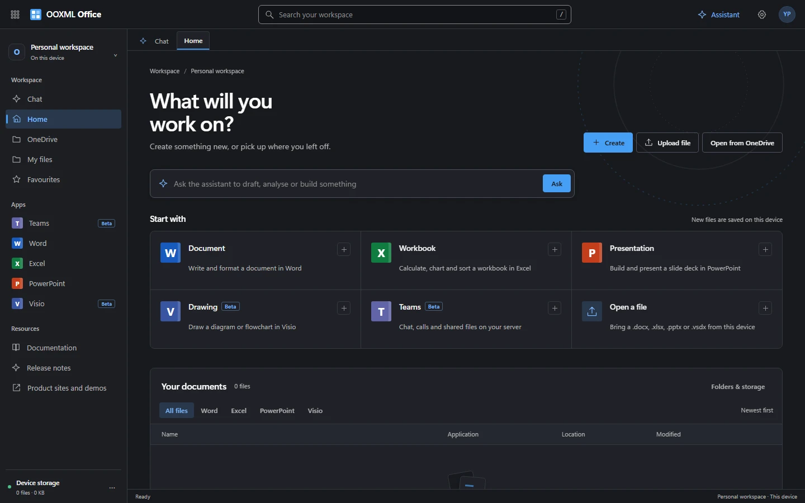
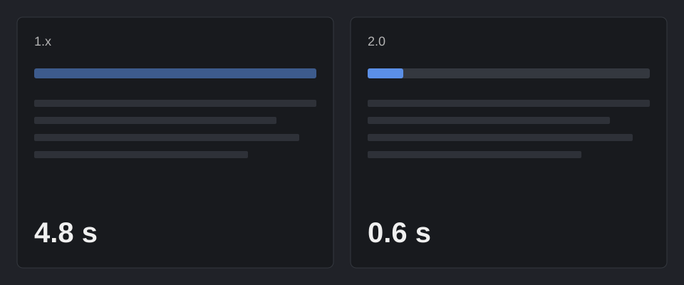

# OOXML 2.0

**Published:** November 21, 2026 | **Author:** [ChristopherVR](https://github.com/ChristopherVR)



<!-- Placeholder content: the release post is being written. Keep the shape (see the "Release post" section of docs/pages-design.md); replace the words. -->

OOXML 2.0 is one coordinated major release of every package in this repository: the core, the shared UI, the MCP servers and the Word, Excel, PowerPoint, Visio and OpenTeams viewers all move to their next major version on the same day. Most of the work went into making documents from strangers safe to open, making large files fast, and making every app work from the keyboard the way Office does.

- **Safe by default:** small crafted files can no longer exhaust memory, stall a load or run script in another user's page.
- **Fast on large files:** Word saves and Excel recalculation scale with the edit, not with the document.
- **Keyboard first:** F6 moves between regions, dialogs keep focus, and accessibility is checked in a real browser before every release.
- **Every browser that matters:** export, copy, print and touch work in Safari and on iPad.
- **One release, one version line:** upgrade every OOXML package together and they are tested together.

```sh
bun add ooxml-core@^2 ooxml-ui@^2
```

> [!NOTE]
> Some changes break existing code, configuration or stored data. The [migration guide](../migration-2.0.md) gives the before and after for each one; most upgrades need no code changes.

## Safer documents and rooms

A review of every package found the ways a document, a chat message or a room could reach further than it should. Each fix has a regression case in the security corpus that runs on every change.

### Crafted files stop at a budget

Every reader now works within a budget: the size of each part, the depth of the XML, the number of shapes and the work a formula may do. A file that goes over it loads what it can and reports the rest, instead of freezing the tab.

**load.ts**

```ts
import { loadWorkbook } from 'ooxml-core/xlsx/load';

// A workbook over its budget still opens; the warnings say what was left out.
const { workbook, warnings } = await loadWorkbook(bytes, { maxCellCount: 2_000_000 });
for (const warning of warnings) console.warn(warning.code, warning.message);
```

_The default budgets fit every file Office itself saves; raise them only for files you trust._

Learn more about [load budgets](../performance-budgets.md).

### Signatures only report the trust they earned

A signed document shows as valid only when the signature covers what you see and the certificate chains to a root you trust. Revocation checks run over plain `node:http` with a timeout, so a slow responder cannot hold a save.

Learn more about [signature verification](../migration-2.0.md#signature-verification).

## Faster on large files

Load and save times now follow what changed, not how big the document is.

### Word saves only what you edited

Saving a 400-page report after a one-word change used to rewrite every paragraph. The writer now keeps the original XML of untouched parts and serialises only the edited ones, so a save takes about as long as the edit.



_Saving a 400-page report after a one-word edit._

**Before:** 4.8 s · **After:** 0.6 s

### Excel recalculates the cells that depend on the edit

The calculation engine tracks dependencies per cell, so typing into one cell recalculates its dependants and nothing else. Each formula also has its own work budget, which keeps a runaway `INDIRECT` chain from stalling the sheet.

**recalc.ts**

```ts
import { CalcEngine } from 'ooxml-core/xlsx';

const engine = new CalcEngine(workbook, { formulaBudget: 50_000 });
engine.setCell('Budget!B2', 4200);
console.log(engine.stopped); // formulas that hit their budget, if any
```

Learn more about [Excel calculation](../migration-2.0.md#excel-calculation-ooxml-corexlsx).

## Built for the keyboard

Every app now follows the same keyboard contract, checked in a real browser before every release.

### F6 moves between regions

F6 and Shift+F6 cycle through the ribbon, the document, the status bar and any open pane, in every app and every framework binding. Tab no longer gets stuck in a slide's objects: it reaches the slide first, then its shapes.

**editor.html**

```html
<!-- The editor element handles F6 itself; give the page a landmark to come back to. -->
<main>
	<pptx-editor src="deck.pptx" aria-label="Quarterly review"></pptx-editor>
</main>
```

> [!TIP]
> Tests that found the zoom button by its old label need its new name; the migration guide lists the selector change.

Learn more about [accessibility checks](../../e2e/a11y/).

## Upgrading

Upgrade every OOXML package you use at once: the packages are released and tested together, and mixing a 1.x package with a 2.x one is not supported. Node.js 22.3 or newer is required. Read the [migration guide](../migration-2.0.md) for each breaking change, and each package's changelog for its own list, linked from [Every change, by product](#every-change-by-product).

## Every change, by product

<a id="changes-core"></a>
<details>
<summary>Platform: ooxml-core</summary>

### Breaking changes

- **Node.js 22.3:** the Node entry points need Node.js 22.3 or newer.
- **Encoded SVG ids:** generated SVG ids are encoded, so selectors that matched a raw part name need updating.

### Security

- **Budgets:** every reader stops at a part size, XML depth and element count budget.
- **Signatures:** a signature reports valid only when it covers the rendered content.

### Fixed

- Theme colours with a `lumMod` and `lumOff` pair round-trip unchanged.
- Custom document properties keep their declared type on save.

</details>

<a id="changes-ui-mcp"></a>
<details>
<summary>Shared UI and MCP</summary>

### Improved

- **Tokens:** derived tokens resolve where they are read, so a scoped theme reaches nested elements.
- **Form controls:** borders use `--office-control-border` and meet 3:1 contrast on every surface.

### Fixed

- The share dialog labels a missing translation key instead of showing it raw.

</details>

<a id="changes-word"></a>
<details>
<summary>Word</summary>

### New

- **Floating objects in tables:** pictures and text boxes anchored in a table cell are laid out where Word puts them.

### Performance

- Saving after a small edit rewrites only the edited parts.

### Fixed

- Hidden runs count toward float anchor offsets.
- Footnotes in a two-column section break where Word breaks them.

</details>

<a id="changes-excel"></a>
<details>
<summary>Excel</summary>

### Breaking changes

- **`surfaceOnly`:** choose it before an editor connects; changing it later has no effect.

### Fixed

- The Borders menu shows the right icon for each border.
- Conditional formats with a `dxf` gradient render in the cell.

</details>

<a id="changes-powerpoint"></a>
<details>
<summary>PowerPoint</summary>

### Breaking changes

- **Enable Content:** linked pictures, media and sounds wait for the user to enable content.
- **Links:** links in a deck always open in a new tab.

### Fixed

- Unicode symbol bullets keep their character on save.

</details>

<a id="changes-visio"></a>
<details>
<summary>Visio</summary>

### Performance

- Pages of 10,000 shapes open within a memory budget.

### Fixed

- Line jumps take the size and style the page sets.

</details>

<a id="changes-openteams"></a>
<details>
<summary>OpenTeams</summary>

### Security

- **Chat:** messages are sanitised before they reach another member's page.
- **Rooms:** a member reaches only the rooms and files they were invited to.

</details>

## Getting started

```sh
bun add ooxml-core@^2 ooxml-ui@^2
```

- [Documentation](https://christophervr.github.io/ooxml/docs/)
- [Open OOXML Office](https://christophervr.github.io/ooxml/?suite)
- [Changelogs](../../src/core/CHANGELOG.md)
- [Migration guide](../migration-2.0.md)
- [Discussions](https://github.com/ChristopherVR/ooxml/discussions)

## Thanks

Thank you to everyone who filed an issue, sent a file that broke something, or tried a preview build and said what was missing. This release is better for every one of them.
