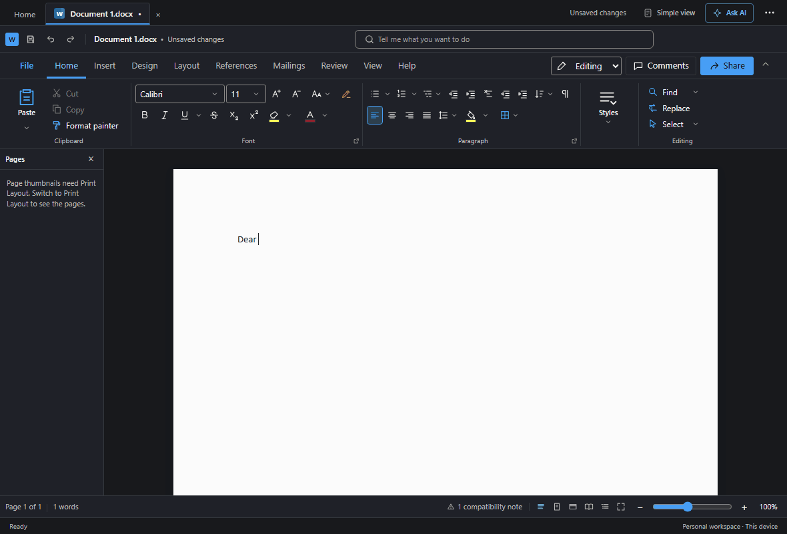
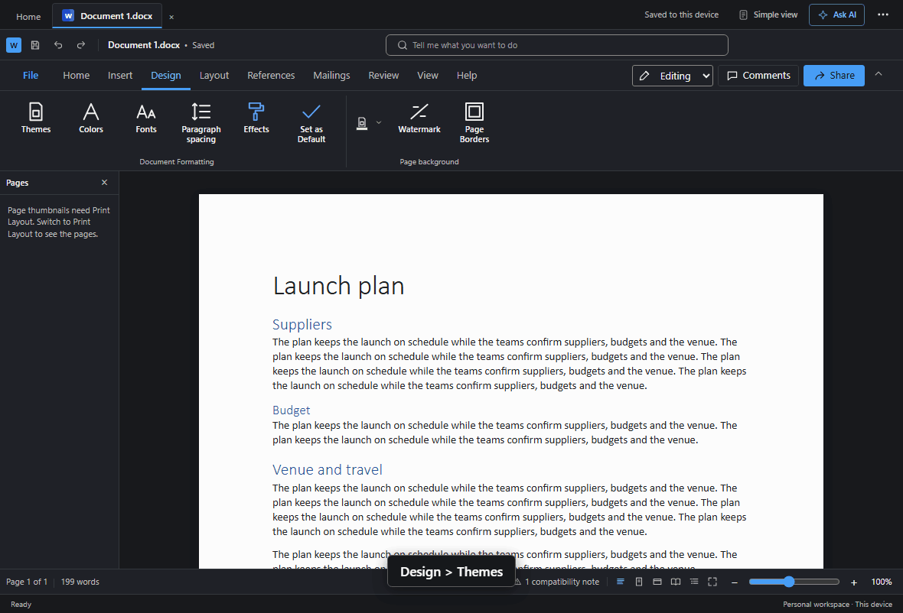
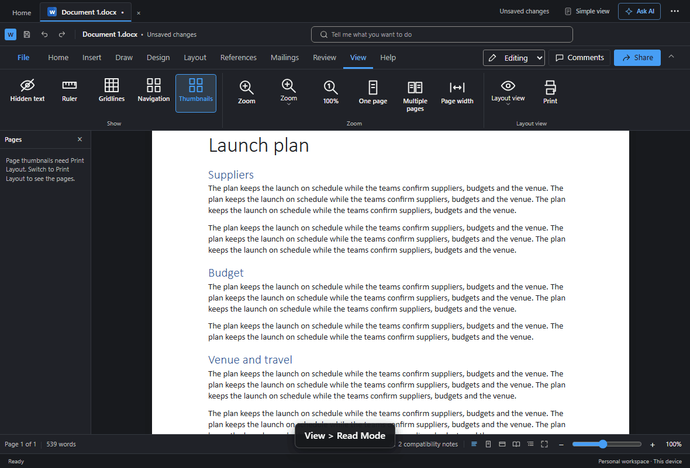
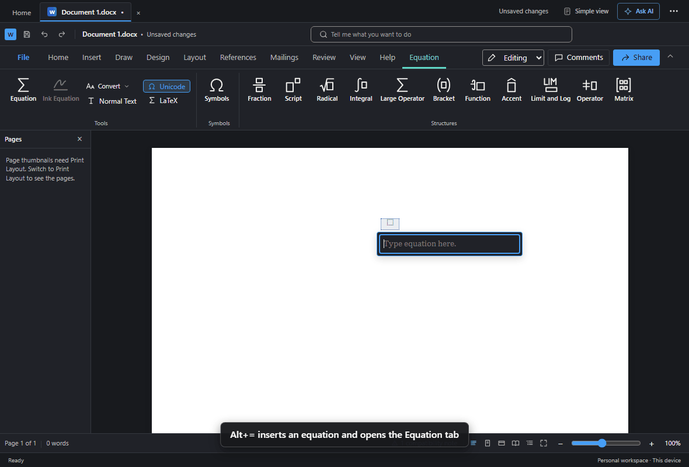
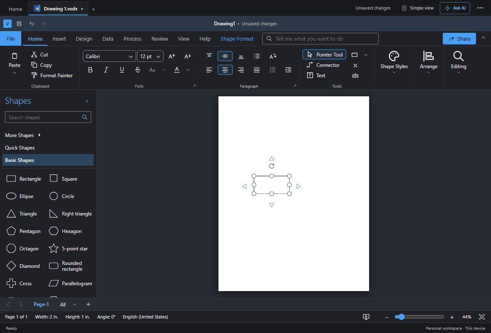
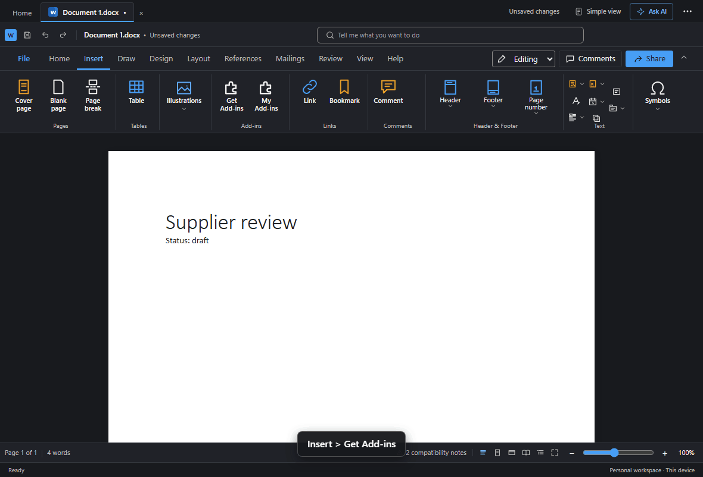

# OOXML 2.5

**Published:** November 27, 2026 | **Author:** [ChristopherVR](https://github.com/ChristopherVR)

This release fills in the ribbons of Word, Excel, PowerPoint and Visio.

Mail merge, equations, ink, PivotCharts, animation tools and stencils arrive, with twelve sample files to try them on. For most applications it is a drop-in upgrade from 2.1, and the [migration guide](../migration-2.5.md) lists what to check.

The recordings below were made in the OOXML Office suite built from this release. Each feature also says what it does not do yet, and the [parity checklist](https://github.com/ChristopherVR/ooxml/blob/main/docs/parity-checklist.md) is the full list of what is open.

## Word

Word gains the Mailings, Design, References, Draw and Equation tabs, four more views and the rest of Insert, in all six bindings.

### Mailings

Open the **Mailings** tab and choose **Start Mail Merge** for letters, a directory, envelopes or labels. **Select Recipients** reads a local CSV, TSV or `.xlsx` file in a worker, or the recipients your host supplies. **Edit Recipient List** filters and sorts them, **Insert Merge Field**, **Address Block** and **Greeting Line** write Word's own fields, and **Preview Results** steps through each record with **Check for Errors** before you finish. **Finish & Merge** creates one document, prints, or prepares email messages through a provider your host supplies.



_A letter merged from a CSV file and previewed one recipient at a time._

The same engine runs headless in `ooxml-core/docx/mail-merge`, for servers and scripts that produce letters from a template.

**merge.ts**

```ts
import { readFile, writeFile } from 'node:fs/promises';
import { loadDocx } from 'ooxml-core/docx';
import {
	checkMailMerge,
	finishMailMerge,
	mailMergeDelimitedText,
	selectMailMergeRecipients,
} from 'ooxml-core/docx/mail-merge';

const template = await loadDocx(await readFile('letter.docx'));
const source = mailMergeDelimitedText(await readFile('recipients.csv', 'utf8'));
const data = selectMailMergeRecipients(await source.read(), {
	sort: (a, b) => String(a.Name).localeCompare(String(b.Name)),
});

const issues = checkMailMerge(template.model, data);
if (issues.length) throw new Error(`${issues.length} merge issues`);
const { document } = finishMailMerge(template.model, data);
if (document) await writeFile('letters.docx', await template.save(document));
```

_One merged document, written with the template's own styles and media._

**Not yet:** Recipient lists beyond 1,000 records, 64 fields or 5 MiB per local file (the editor keeps the data in memory). Labels offer three vendor presets rather than Word's whole catalogue, and fields that span paragraphs or sit inside text boxes do not merge.

Learn more about [the Word mail merge API](https://github.com/ChristopherVR/ooxml/blob/main/docs/docx-mail-merge.md).

### Design

The **Design** tab applies a theme, its colours, fonts, effects and paragraph spacing to the whole document in one undo step, imports and exports `.thmx` themes, keeps custom colour and font schemes, and **Set as Default** stores your choice for new documents. The suite keeps that default per profile; turn off **Remember my Word design** in Settings > General to stop it. **Create a Style** and **Modify Style** edit paragraph, character, linked and table styles, and Word 16 opens the saved files without repair.



_A theme, a colour scheme and paragraph spacing applied to the whole document._

**Not yet:** Nine legacy Word themes are left out until their values are verified, and theme picture fills are imported as solid fills.

Learn more about [the Word editor](https://christophervr.github.io/ooxml/docx/).

### References

On the **References** tab, Mark Entry, Insert Index and Update Index build an index, Manage Sources keeps a bibliography with APA, MLA and Chicago citations, and Mark Citation with Insert Table of Authorities builds a table of authorities. Bibliography sources are shared in a collaboration room.

### Views

**View > Layout view** now offers Read Mode, Outline, Web Layout and Focus beside Draft and Print Layout. Read Mode flows the document into columns and pages with the arrow keys, Outline shows heading levels you can collapse, promote, demote and move as branches, Web Layout lets text fill the window, and Focus hides everything but the page until you press Escape.



_The same report in Read Mode, Outline, Web Layout and Focus._

**Not yet:** Read Mode has no footnote or endnote navigation, and Outline's structural edits are off while changes are tracked or the document is shared.

Learn more about [editing in Word](https://christophervr.github.io/ooxml/docx/editing).

### Equation

Press **Alt+=**, or choose **Insert > Equation > Insert New Equation**, to add an Office Math equation at the caret: a display equation on an empty line, an inline one inside text. The contextual **Equation** tab opens with Word's nine built-in equations, a symbol gallery in eight categories and eleven structure galleries (Fraction, Script, Radical, Integral, Large Operator, Bracket, Function, Accent, Limit and Log, Operator and Matrix), each drawn as the structure it inserts.



_The quadratic formula built up from linear text, then a fraction from the gallery._

Selecting an equation opens an editing box under it that holds its linear text. Typing builds the equation up as you go, a space runs math AutoCorrect (`\alpha`, `\sum`, `\sqrt`), Tab moves between placeholders, and the arrow keys, Enter or Escape leave the equation. **Convert** switches the current equation, or all of them, between Professional and Linear, and the input format can be Unicode or LaTeX. Equations are saved as Office Math, in the element order Word requires.

**Not yet:** Ink Equation is disabled, because there is no handwriting recognition. An equation whose linear text cannot hold it (mixed run formatting, tracked changes, several equations in one paragraph) opens read-only instead of losing content.

### Word Draw

The **Draw** tab draws on the page with pens, a pencil and a highlighter from a pen strip you can add to, each with its own thickness and colour. **Eraser** removes strokes, **Lasso Select** picks them, **Ink to Shape** turns recognised ink into an outlined shape, and **Ink Replay** redraws the ink in the order it was made. Strokes drawn one after another join one ink drawing, ink copies and pastes with the clipboard, and touch scrolls the page unless **Draw with Touch** is on.


_A pen, a highlighter, Ink to Shape and Ink Replay on a Word page._

Ink is saved as native Word ink, so Word 16 opens it as ink with the pen colours and widths you drew. Ink that came with the file and was not touched keeps its part byte for byte.

**Not yet:** Ruler and Ink to Math are disabled with their reasons (no ruler stencil, no handwriting recognizer), and legacy VML ink is kept in the file but not drawn.

### Insert

**Quick Parts** inserts Document Property controls that stay bound to the file's title, author and other properties, inserts a Field, saves the selection to the Quick Part Gallery, and opens the **Building Blocks Organizer** over the building blocks the document carries. **Signature Line** adds the line Word draws for a signer. The **Header** and **Footer** menus offer designs built from content controls, with Edit and Remove.


_A document property, a building block, a signature line and a header design._

**Online Video** appears when your host names the video sites it allows. It accepts an `https` address or embed code on one of those sites, draws a local poster and writes Word's own web video markup; the editor never loads the address.

**online-video.ts**

```ts
const editor = document.querySelector('docx-editor')!;

// Insert > Online Video stays hidden until the host allows at least one site.
editor.onlineVideoHosts = ['www.youtube.com', 'player.vimeo.com'];
```

_A host name covers its sub-domains._

**Not yet:** Online Video has no search and embeds only the hosts you allow. A signature line cannot be signed, because there is no digital signature UI. Building blocks live in the document's own glossary part; there is no store shared between documents.

Learn more about [the Word editor's properties](https://christophervr.github.io/ooxml/docx/api).

### Tables and Arrange

The contextual **Table Design** and **Table Layout** tabs gain table styles and style options, Cell Size and AutoFit, cell alignment and margins, Repeat Header Rows, Formula, Convert to Text, Select and Draw Borders. **Layout** and **Shape Format** share an Arrange group with Position, Wrap Text, Bring Forward, Send Backward, Align, Group, Rotate and a Selection Pane that renames objects. The Insert groups follow Word's order and are checked against Microsoft 365 at 1600 and 1280 pixels wide. Commands that cannot run say why, for example Position outside Print Layout.

**Not yet:** Freeform Draw Table and the structural Eraser.

## Excel

Excel gains PivotCharts and the PivotTable tabs, a Draw tab, pictures that live in cells and more of Insert and Page Layout, in all six bindings.

### PivotTables and PivotCharts

Select a range and choose **Insert > Recommended PivotTables** for previews built from a sample of your data, or **Insert > PivotChart** from a range, a table or an existing PivotTable. The chart's field buttons filter the report, and the **PivotTable Analyze** and **PivotTable Design** tabs edit options, field settings, subtotals, grand totals, the report layout and the PivotTable style. Excel 16 reopens and refreshes the results.


_A recommended PivotTable, charted and then filtered from the chart._

**Not yet:** PivotTables are not shared in collaboration, so their commands are disabled, with a reason, while a workbook is shared.

Learn more about [Excel features](https://christophervr.github.io/ooxml/xlsx/features).

### Excel Draw

The **Draw** tab uses the same pen strip and ink canvas as Word: pens, a pencil and a highlighter, Eraser, Lasso Select with Delete, Draw with Touch, Ink to Shape and Ink Replay. Ink sits over the cells, moves and resizes like other drawings, and one gesture is one undo step. It is saved as native Excel ink, which Excel 16 opens as ink.


_A pen, a highlighter and the eraser over a sheet of figures._

**Not yet:** Ruler and Ink to Math are disabled with their reasons, and ink stays in your own window while a workbook is shared.

### Pictures in cells

Pictures can now live in a cell: **Place in Cell** keeps the picture with its row and column, linked data types show their cards, and `IMAGE()` shows a web picture when your host supplies a fetcher. The **Picture Format** and **Shape Format** tabs bring the shared picture styles, fills, outlines, effects and size, and **Insert > Equation** adds an Office Math text box.

**Not yet:** In-cell pictures are not shared in collaboration, and Picture Style 3-D effects are not drawn in the grid.

### Insert and Page Layout

Insert places Add-ins after Illustrations and adds Shapes, Text Box, New Note, Header & Footer, PivotChart, Recommended PivotTables and Equation. Page Layout adds Scale to Fit, Print Titles, a sheet background and Arrange. PivotTable and Sparkline commands moved to their contextual tabs, the header **Comments** button opens the threaded comments pane, and Review > Notes walks and shows every note.

## PowerPoint

PowerPoint gains ink tools on Draw, the Animation Painter, format tabs for video, audio and SmartArt, and a Home tab closer to PowerPoint's, in all five bindings.

### PowerPoint Draw

The PowerPoint **Draw** tab adds Lasso Select, pen presets you can save, a Ruler you can move and rotate, **Ink to Shape**, and **Ink Replay**, which plays the strokes back at their recorded times. **Ink to Math** sends the selected strokes to a handwriting recognizer only when your host configures one and you ask for recognition; without one the button says why it is unavailable.


_Ink drawn, replayed and converted to a shape._

Ink brushes are now written with their width in centimetres, so ink a deck saves keeps its colour and thickness in PowerPoint, Word and Excel.

**Not yet:** PowerPoint desktop drops Ink Replay's per-point timing when it saves the file again.

Learn more about [Ink to Math and privacy](https://github.com/ChristopherVR/ooxml/blob/main/PRIVACY.md#ink-to-math).

### Animations

Select an animated object, choose **Animation Painter**, then click another object to give it the same effect and timing. Double-click to paint several objects, and press Escape to stop; each application is one undo step. Start, Duration, Delay and Move Earlier or Later edit effects that came from PowerPoint itself, the Animation Pane chooses the effect they edit, and painting onto another slide keeps an embedded sound. Effect Options offer the directions of Split, Zoom and Blinds and the shape reveals.


_One animation painted onto a second object._

**Not yet:** Changing Start on an imported effect that would split or merge a complex click group.

Learn more about [the PowerPoint viewers](https://christophervr.github.io/ooxml/pptx/).

### Media and pictures

Selecting a video, an audio clip or a SmartArt graphic shows the **Video Format**, **Audio Format**, **Playback** and **SmartArt Format** tabs, and **Picture Format** gains Compress, Change Picture, Reset Picture, Picture Border, Alt Text and Remove Background.

**Not yet:** Picture Layout.

### Home

Home is closer to PowerPoint: the header **Comments** button docks a Comments pane beside the slide, the Arrange commands moved into Drawing > Arrange as one vertical menu, and the Selection Pane docks as a task pane. Ribbon IDs you hid before still work.

## Visio

Visio gains stencils you make yourself and more picture formats, in all six bindings.

### Stencils

In the Shapes window, **More Shapes > New Stencil** starts a stencil of your own. **Add Selected Shape** turns a shape into a master, **Edit Stencil** renames and deletes masters with undo, and **Save Stencil** writes a `.vssx` package with master ShapeSheets, connection points and icons that Visio 16 opens for editing. The stencil menus load on demand and are translated into every Visio language.



_A new stencil with a master made from the selected shape._

**Not yet:** Master editing is limited to default plain text, and built-in masters lack the ShapeSheet smart tags, actions and formulas of Visio's own stencils.

Learn more about [the Visio viewer](https://christophervr.github.io/ooxml/visio/getting-started).

### Pictures and connectors

Insert > Pictures and drag and drop now accept static SVG (scripts, events and external references are refused), BMP, TIFF and classic EMF pictures. Connectors copy, drop and reroute around a moved shape the way Visio routes them.

**Not yet:** General OLE objects, and Visio's redistribution of parallel connectors.

## Across the suite

Sample files, add-ins, collaboration and documentation are shared by every product.

### Samples

The new [samples gallery](https://christophervr.github.io/ooxml/samples/) holds twelve files, three each for Word, Excel, PowerPoint and Visio: a technical report, a newsletter and a form; a financial model, a sales analysis and an operations tracker; a keynote, a data story and a portfolio; a flowchart, an architecture diagram and an organisation chart. Each card shows what Office draws for the file, lists the features it exercises, and either downloads it or opens it in its editor.


_From the gallery to the financial model, open in the suite._

Opening a sample is a link, `?sample=<id>`, that you can use yourself: the suite fetches the manifest and that one file from its own site, checks the file's size and SHA-256 against the manifest, adds a copy to your library and opens it. Every sample is written by a script in the repository, so it can be rebuilt and reviewed as source.

**Not yet:** The samples show the gaps too. A load notice lists what a file contains that its editor does not draw or edit yet, and the desktop app does not bundle the samples.

Learn more about [the sample files](https://github.com/ChristopherVR/ooxml/blob/main/samples/README.md).

### Add-ins

<!-- TODO(add-ins): the wave 6 add-ins slice (manual install of AppSource manifests and sandboxed
task panes) is not in this tree yet. When it lands, describe it here from the code, replace
office-add-ins.gif with a recording of an installed add-in's task pane, and update "Not yet",
"Security", "What is still open" and the migration guide's Store section. -->

**Insert > Get Add-ins** opens one Office Add-ins dialog in Word, Excel, PowerPoint and Visio, so a host configures add-ins once. My Add-ins lists what is installed, Admin Managed lists entries your host provides, and in Word, Excel and PowerPoint **Upload My Add-in** reads an XML manifest, a unified `manifest.json` or a `.zip` package, checks it against size, compression and path limits, and shows the permissions it requests before you install it for the session. Nothing is fetched from the origins a manifest names.



_A local manifest uploaded, reviewed and installed._

The Store pivot appears only when your host enables a storefront: a handoff to Microsoft Marketplace or a catalogue of its own. Until then Get Add-ins opens on My Add-ins, and the editors make no request to a marketplace. A handoff opens only when the user clicks it, in a new tab with no opener and no referrer, and sends no document data.

**addins.ts**

```ts
import { setOfficeAddInCatalog, setOfficeAddInStorefront } from 'ooxml-ui';

const editor = document.querySelector('docx-editor')!;

// Add-ins your application already implements, listed under Admin Managed.
setOfficeAddInCatalog(editor, [{ id: 'notes', label: 'Team notes', install: () => openNotes() }]);

// Opt in to the Store pivot. Leave this out to keep it hidden.
setOfficeAddInStorefront(editor, { kind: 'microsoft' });
```

_The settings apply to one editor or to every editor inside a container._

**Not yet:** Installing is not running. The Office.js runtime and manifest-defined ribbon commands are not implemented, so an installed add-in is listed with the requirements it cannot meet. Visio lists host-provided add-ins but cannot install local manifests.

Learn more about [the Office Add-ins plan](https://github.com/ChristopherVR/ooxml/blob/main/docs/office-addins-plan.md).

### Collaboration

Shared sessions keep more of what people edit in step:

- PowerPoint shares a picture's original, its replacement and its reset, and checks the resources a peer sends before they reach the deck.
- Word shares bibliography sources in a room, and the caret stays on the same side of a content control's tag while another person types. An equation's editing box follows its equation through other people's edits.
- Commands whose data is not shared yet are disabled with a reason instead of diverging silently: Excel PivotTable edits and in-cell pictures, and Word's Outline structure edits.

### Documentation

The READMEs of `ooxml-core`, `ooxml-ui`, `ooxml-mcp`, the Word, Excel, PowerPoint, Visio and OpenTeams viewers, the suite and the desktop app were rewritten for this release. Each now says what the package does, what it does not do, and what it sends over the network.

## Performance and size

2.5 adds a lot of ribbon and a lot of features without making every editor download them on open.

### Optional tools load on first use

- **Excel:** non-English interface languages, Insert Chart, the chart format panes, PivotTable creation and settings, the comments pane and the Draw tab load when you first use them. The change that deferred the first five took the compressed JavaScript for opening a new workbook in the suite from 2.59 MB to 1.93 MB.
- **Visio:** embedded workbook charts and metafile conversion load only for drawings that contain them, and the budget for opening a new drawing fell by 625 KiB.
- **Word:** mail merge, the References tools, table tools, the Design theme data, the Draw tab, the Equation tools, Quick Parts and the chart dialogs are split from the core Word bundle.
- **PowerPoint:** the legacy `.ppt` import and export code, slide previews and the ink tools load on demand.
- **Ink:** the InkML part reader and writer load on first use, so a document without ink never downloads them.

The performance budgets now also count work, not only bytes: the first one fails CI when a large deck opens without painting its first slide preview.

### PowerPoint opens and saves faster

Opening a deck now paints a read-only preview of the opening slide before the rest of the deck is parsed, then fills the thumbnails in batches. Slide fingerprints hash about three times faster (75 ms to 23 ms per pass on a 49-slide deck), chart sources are parsed once for load and save, and OLE previews are decoded only when drawn: a headless load of an OLE-heavy deck fell from about 275 ms to 32 ms. Saving keeps compressed media and unchanged zip entries as they were.

**Not yet:** Editing, search, save, undo, collaboration and slide show still wait for the whole deck after a progressive open.

### About the measurements

The Excel download figures are the suite's gzipped route sizes before and after the change that deferred them; the PowerPoint figures are Node 24 medians from the commits that made them. All were measured on the same Windows machine.

## Accessibility

- **Disabled commands say why:** in Word, Excel, PowerPoint and Visio, a command that cannot run exposes the reason to assistive technology, including References, Align and Group in Word, the PowerPoint contextual and gallery commands, and Ruler and Ink to Math on the Draw tabs.
- **Focus comes back:** focus returns to the control that opened a dialog after stencil commands, the PowerPoint media dialogs (across shadow roots), Word's table properties and comment drafts, and stays on the ribbon when a group folds or an Arrange gallery opens. Ctrl+Z and Ctrl+Y keep working after a title-bar Undo while a Draw tool is on.
- **Keyboard:** arrow keys move between the Draw controls and still adjust its sliders, the pen menu is a keyboard dialog that closes on Escape, the equation galleries use one tab stop with arrow keys and return to the equation on Escape, theme rows in Word's Design galleries are navigable, Read Mode pages with the arrow keys from its buttons, and Selection Pane renames keep their keys out of the document.
- **Contrast:** Word's Outline text reaches 4.5:1 in the dark theme, contextual tab labels stay legible, and the Selection Pane and animation rows keep their highlights in forced colours.

## Security

- **Add-in packages:** manifests and `.zip` packages are checked for size, compression ratio and paths before they are read, schema and asset URLs never cause a request, and installing needs consent.
- **Pictures and ink:** Visio admits SVG only through an allowlist without scripts, events or external references, EMF conversion is bounded, PowerPoint bounds InkML before decoding its traces, and ink pasted into Word is rebuilt from what ink may hold.
- **Samples:** `?sample=<id>` can only select an entry of the site's own manifest, and a sample is opened only when its size and SHA-256 match.
- **Online video:** Word embeds only `https` addresses on the hosts your application allows, and the editor never loads them.
- **Themes:** a standalone `.thmx` theme is validated before it is imported, within XML stream limits.
- **Workers:** the editors ignore worker messages from other origins, and Visio installs its message handlers only in worker scopes.
- **Email merges:** a merge for email stays on the addressed recipient, so a `NEXT` field cannot send one person another person's data.
- **Network by default:** `IMAGE()` fetches nothing unless the host supplies a fetcher, and the add-ins Store makes no request unless the host enables it.

The fixes that close a defect class add a case to the [security regression corpus](https://github.com/ChristopherVR/ooxml/blob/main/src/core/test-support/security-corpus/README.md).

## Developer API

Two new subpaths join `ooxml-core`, and the editors gain properties for the new features. Everything else is additive.

- **`ooxml-core/docx/mail-merge`:** recipient sources (`mailMergeDelimitedText`, `mailMergeXlsx`, `mailMergeRecords`), `selectMailMergeRecipients`, `previewMailMerge`, `checkMailMerge`, `finishMailMerge`, `finishMailMergeIndividually` and `loadMailMergeStationery` for envelopes and labels.
- **`ooxml-core/automation/add-ins`:** `readLocalAddIn(bytes, { host })` validates an XML manifest, a unified manifest or a package and returns the manifest with its digest, without any I/O.
- **Word (`ooxml-core/docx`, `ooxml-ui/docx`):** `editDocumentDesign`, `editStyleCatalogs`, the drawing arrangement helpers (`alignDrawingBox`, `groupDrawingShapes`, `rotateDrawing` and others), `DOCUMENT_VIEWS` and `isDocumentView`, and the editor properties `mailMergeDataSource`, `emailProvider`, `wordDesignPreferences` and `onlineVideoHosts`.
- **Excel (`ooxml-core/xlsx`, `ooxml-core/xlsx/ui`, `ooxml-ui/xlsx`):** `recommendedPivotTables`, `pivotChartButtons`, the rich value model (`RichValueStore`, `CellPicture`, `LinkedDataCard`), `createFetchImageProvider`, `loadEditorStrings`, and an `imageProvider` property and binding prop.
- **PowerPoint (`ooxml-core/pptx`, `ooxml-ui/pptx`):** `editNativeEffectTiming`, the picture edit patches, `createProgressiveSlidePreview` and `configurePptxDraw` for where pen presets are kept.
- **Visio (`ooxml-core/visio`):** `loadVisioStencilEditor` and `inspectVisioPicture`.
- **Ink and equations (`ooxml-core/drawingml`, `ooxml-core/math`, `ooxml-ui`):** `loadInkTools` now also loads the InkML part reader and writer Word, Excel and PowerPoint share, `loadEquationTools` loads linear format build-up and the equation galleries, and the `office-ui-ink-canvas` and `office-ui-ink-pens` elements are the Draw tab's canvas and pen strip. `hiddenTabs` accepts `draw` in Word and Excel.
- **Shared (`ooxml-core/drawingml`, `ooxml-ui`):** the picture and shape style catalogues and theme gallery every product uses, and `setOfficeAddInCatalog` and `setOfficeAddInStorefront`.

**image-provider.ts**

```ts
import { createFetchImageProvider } from 'ooxml-core/xlsx';

const editor = document.querySelector('xlsx-editor')!;

// IMAGE() fetches nothing until a host supplies a provider, and then only from these origins.
editor.imageProvider = createFetchImageProvider({
	fetch: (url) => fetch(url, { credentials: 'omit' }),
	allowedOrigins: ['https://images.example.com'],
	onUpdate: () => editor.calculateNow(),
});
```

_Remove the provider to block further image fetches._

Learn more about [`ooxml-core`](https://github.com/ChristopherVR/ooxml/blob/main/src/core/README.md).

## Migrating to 2.5

No export was renamed and no element, event or CSS token was removed. Node.js 22.3, the supported browsers and the bindings' peer ranges are unchanged. These are the changes to check:

- **Excel string tables:** `ooxml-core/xlsx/ui` no longer exports the raw command string tables (`COMMAND_TABLES`, `commandStrings` and the ten `*_STRINGS` tables); a non-English dictionary loads on demand through `loadEditorStrings` ([guide](../migration-2.5.md#excel-command-string-tables-moved-behind-loadeditorstrings)).
- **Word views:** `viewMode` and `onViewModeChange` carry six views instead of `'draft'` and `'print'` ([guide](../migration-2.5.md#word-view-modes-have-six-values)).
- **The add-ins Store:** Get Add-ins opens on My Add-ins until your host enables a storefront ([guide](../migration-2.5.md#the-add-ins-store-is-off-until-the-host-enables-it)).
- **Ribbon layouts:** PowerPoint Home's Arrange and Comments, Excel's Insert, PivotTable and Sparkline commands and Word's Insert order moved to match Microsoft 365, and Word and Excel show a Draw tab; hidden IDs keep working ([guide](../migration-2.5.md#ribbon-layouts-follow-microsoft-365)).
- **Ink brush widths:** saved ink states its brush width in centimetres; code that reads those parts itself must honour the unit ([guide](../migration-2.5.md#ink-brush-widths-are-written-in-centimetres)).
- **On-demand files:** deploy every file of the package build, since more code now loads from your origin on first use ([guide](../migration-2.5.md#more-code-loads-on-first-use)).

The [migration guide](../migration-2.5.md) gives the before and after for each, and the package budgets that moved.

## What is still open

2.5 does not reach full Office parity, and the [parity checklist](https://github.com/ChristopherVR/ooxml/blob/main/docs/parity-checklist.md) is the one list of what is missing. The largest open items in the areas this release touched:

- **Add-ins:** the Office.js runtime, manifest-defined ribbon commands and Marketplace installation; Visio cannot install local manifests.
- **Word:** Ink Equation, Ruler and Ink to Math on the Draw tab, signing a signature line, most of Picture Format, freeform Draw Table and the structural Eraser, mail merge fields that span paragraphs, and Read Mode note navigation.
- **Excel:** a Chart Format tab (a pane today), Ruler and Ink to Math, collaboration for PivotTables, in-cell pictures and ink, and Picture Style 3-D effects in the grid.
- **PowerPoint:** editing before a progressively opened deck finishes parsing, Picture Layout, and Start changes that split a complex click group.
- **Visio:** general OLE objects, Visio's redistribution of parallel connectors, and the native behaviours of built-in masters.

## Every change, by product

The lists below group the user-visible changes since `ooxml-core` and `ooxml-ui` 2.1.2 by where the code lives: the shared core and editors first, then each product.

<a id="changes-core"></a>
<details>
<summary><strong>OOXML core</strong> · <code>ooxml-core</code> 2.5</summary>

### New

- **Word mail merge (`ooxml-core/docx/mail-merge`):** CSV, TSV, `.xlsx` and host recipient sources, filtering and sorting, `MERGEFIELD`, `NEXT`, `NEXTIF`, `SKIPIF`, `MERGEREC`, `MERGESEQ`, `ASK`, `FILLIN`, `IF`, `ADDRESSBLOCK` and `GREETINGLINE`, record preview, error checks, one merged document or one per record, envelopes and labels.
- **Word documents (`ooxml-core/docx`):** style creation and editing with latent styles and the theme saved, document design (themes, colours, fonts, effects, paragraph spacing, custom schemes, `.thmx`), index, citation, bibliography and table of authorities fields, drawing arrangement (align, distribute, group, ungroup, rotate, stacking order), content control tags measured against Word 16, Word ink read and saved, Document Property controls bound to the property parts, the glossary document (building blocks), signature lines and web video pictures.
- **Excel workbooks (`ooxml-core/xlsx`):** PivotCharts bound to their PivotTables, recommended PivotTables, PivotTable style options and layouts, rich values and in-cell pictures, linked data type cards, `IMAGE()` through a host provider, shapes, text boxes, legacy notes, headers and footers, Scale to Fit, Print Titles, sheet backgrounds, drawing arrangement, and Excel ink read and saved.
- **PowerPoint decks (`ooxml-core/pptx`):** native animation timing edits and the Animation Painter's template, picture edits (crop, replace, reset, border, background removal), SmartArt formatting reset and progressive slide previews.
- **Visio drawings (`ooxml-core/visio`):** stencil authoring and `.vssx` saving, SVG, BMP, TIFF and EMF pictures, connector copies, drops and reroutes, and equation previews.
- **Add-ins (`ooxml-core/automation/add-ins`):** validation of XML manifests, unified manifests and packages for Word, Excel and PowerPoint.
- **Shared drawing (`ooxml-core/drawingml`):** the picture and shape style catalogues, the theme gallery with measured palettes, shared ink geometry and timing, and one InkML model, part reader and writer for Word, Excel and PowerPoint.
- **Equations (`ooxml-core/math`):** linear format build-up from Unicode and LaTeX input, math AutoCorrect, the structure and symbol galleries and Word's built-in equations (`loadEquationTools`), Excel equations through the Word equation editor, and `MAX_LATEX_LENGTH`.

### Changed

- **Excel interface languages:** French, German, Spanish and Simplified Chinese dictionaries load on demand; `loadEditorStrings(locale)` loads one, and `STRINGS[locale]` reads English until it has.
- **Saving:** PowerPoint and the other writers keep compressed media and unchanged zip entries as they are, and write new parts at deflate level 6.
- **Ink brushes:** saved ink states its brush width and height in centimetres; see [the migration guide](../migration-2.5.md#ink-brush-widths-are-written-in-centimetres).
- **Office Math:** the writer puts property elements before content, drops empty property lists and writes the degree a hidden radical degree requires, so Word opens saved equations without repair.

### Fixed

- **Word layout:** line wrapping matches Word 16 on the reported documents, a float that would cross the bottom margin moves its paragraph to the next page, table style paragraph formatting and font sizes follow Word's precedence, paragraph borders paint below leading floats, and story text frames resolve against the page.
- **Charts:** removing a row or a series shifts the embedded workbook's cells and shrinks its table.
- **Excel:** pivot caption wildcards, custom subtotals, cached linked-data fields, conditional formats after XPath loads and stale metadata pictures after recalculation.
- **Visio:** master names that differ only in case no longer collide, and orphaned master parts are removed.
- **Ink:** moved and copied ink gets its own part, deleted ink loses its part, and partly read ink parts keep their brush properties.

### Breaking changes

- **`ooxml-core/xlsx/ui` string tables:** see [the migration guide](../migration-2.5.md#excel-command-string-tables-moved-behind-loadeditorstrings).

</details>

<a id="changes-ui-mcp"></a>
<details>
<summary><strong>Shared editors and MCP server</strong> · <code>ooxml-ui</code> 2.5, <code>ooxml-mcp</code> unchanged</summary>

### New

- **Office Add-ins dialog:** one dialog for Word, Excel, PowerPoint and Visio, with My Add-ins, Admin Managed, Upload My Add-in, a consent step, and `setOfficeAddInCatalog` and `setOfficeAddInStorefront`.
- **Ink:** the shared ink canvas (`office-ui-ink-canvas`), the pen strip (`office-ui-ink-pens`) and Ink Replay, used by the Word, Excel and PowerPoint Draw tabs.
- **Word:** the Mailings, Design, References, Draw and Equation tabs, Read Mode, Outline, Web Layout and Focus, Quick Parts, the Building Blocks Organizer, Signature Line, Online Video, header and footer designs, the Table Design and Layout tabs, the Arrange group and Selection Pane, and content control tags in the editing view.
- **Excel:** Insert and Page Layout authoring, the Draw tab, the PivotTable Analyze and Design tabs, Picture Format and Shape Format, Place in Cell, notes navigation, the comments pane and Equation.
- **PowerPoint:** the Draw tab's ink tools, the Animation Painter and ribbon timing, the Video Format, Audio Format, Playback and SmartArt Format tabs, the Picture Format commands, the docked Comments pane and Drawing > Arrange.
- **Visio:** stencil menus and dialogs, picture insertion for new formats, and Get Add-ins.

### Changed

- **Ribbon layouts:** Word's Insert order, Excel's Insert, PivotTable and Sparkline placement and PowerPoint's Home follow Microsoft 365; see [the migration guide](../migration-2.5.md#ribbon-layouts-follow-microsoft-365).
- **Add-ins Store:** off until a host enables it.
- **Folded ribbons:** groups fold and restore from left to right, captions break between words, a folded group's dropdown grows to fit its controls, and Escape stays with an open dialog while the ribbon refits.

### Fixed

- **Focus and keyboard:** dialogs return focus to their openers across shadow roots, ribbon focus survives a group folding, and gallery commands expose why they are disabled.

`ooxml-mcp` has no changes in this release.

</details>

<a id="changes-word"></a>
<details>
<summary><strong>Word</strong> · <code>docx-*-viewer</code> packages</summary>

- **New:** Mailings (letters, directories, envelopes, labels, email through a host provider), Design themes and Set as Default, Create and Modify Style, Index, citations, bibliography and Table of Authorities, Read Mode, Outline, Web Layout and Focus, the Equation tab with in-place linear editing, the Draw tab with ink saved as Word ink, Quick Parts, Signature Line and header and footer designs, Online Video through the `onlineVideoHosts` prop, Table Design and Layout, and the Arrange group with a Selection Pane, in all six bindings.
- **Changed:** the `viewMode` value of the navigation building blocks can be any of the six views ([guide](../migration-2.5.md#word-view-modes-have-six-values)), and Insert follows Word's group order.
- **Fixed:** caret positions in merged and split cells, table edits that keep the selection, undo isolation for table and outline commands, absolutely positioned VML pictures that float and save their placement, floats in headers and footers that wrap body text, and reference ids on insecure origins.

</details>

<a id="changes-excel"></a>
<details>
<summary><strong>Excel</strong> · <code>xlsx-*-viewer</code> packages</summary>

- **New:** Recommended PivotTables, PivotCharts, the PivotTable Analyze and Design tabs, the Draw tab with ink saved as Excel ink, Place in Cell and linked data cards, the `imageProvider` binding prop, Picture Format and Shape Format, Shapes, Text Box, New Note, Header & Footer, Scale to Fit, Print Titles, sheet backgrounds, Arrange and Equation, in all six bindings.
- **Changed:** Add-ins sits after Illustrations on Insert, PivotTable and Sparkline commands live on their contextual tabs, and non-English languages load on first use.
- **Fixed:** slicer and timeline modifier clicks, open form controls above drawings, contextual tab ink in dark mode, and drawing formatting in one undo step.

</details>

<a id="changes-powerpoint"></a>
<details>
<summary><strong>PowerPoint</strong> · <code>pptx-*-viewer</code> packages</summary>

- **New:** Lasso Select, pen presets, Ruler, Ink to Shape, Ink to Math through a host recognizer and Ink Replay, the Animation Painter and timing for native effects, Video Format, Audio Format, Playback and SmartArt Format, Picture Format commands, a docked Comments pane, Drawing > Arrange and progressive opening, in all five bindings.
- **Changed:** Home's Arrange menu moved into Drawing and its Comments group to the header button ([guide](../migration-2.5.md#ribbon-layouts-follow-microsoft-365)).
- **Fixed:** every native media start mode round-trips, cross-slide animation sounds are embedded once, slide exports in React and Angular use the slide's own size, and media dialog focus returns across shadow roots.

</details>

<a id="changes-visio"></a>
<details>
<summary><strong>Visio</strong> · <code>visio-*-viewer</code> packages</summary>

- **New:** New Stencil, Add Selected Shape, Edit Stencil and Save Stencil, SVG, BMP, TIFF and EMF pictures, connector copies, drops and reroutes, equation previews from Word and Get Add-ins, in all six bindings.
- **Fixed:** the Shapes pane and built-in stencils are translated, stencil dialogs restore focus and explain disabled commands, and native context menus are kept for unknown masters.

</details>

<a id="changes-openteams"></a>
<details>
<summary><strong>OpenTeams</strong> · <code>openteams-*</code> packages</summary>

OpenTeams has no user-visible changes in this release beyond its rewritten READMEs. Its packages are released only if a dependency they bundle changed.

</details>

## Getting started

```sh
# For servers, workers and scripts
npm install ooxml-core@2.5
```

- [Documentation](https://christophervr.github.io/ooxml/docs/)
- [Open OOXML Office](https://christophervr.github.io/ooxml/)
- [Sample files](https://christophervr.github.io/ooxml/samples/)
- [Migration guide](../migration-2.5.md)
- [The OOXML 2.0 release post](https://christophervr.github.io/ooxml/releases/2.0/)
- Changelogs: [Word](https://github.com/ChristopherVR/ooxml/blob/main/viewers/docx/CHANGELOG.md), [Excel](https://github.com/ChristopherVR/ooxml/blob/main/viewers/xlsx/CHANGELOG.md), [PowerPoint](https://github.com/ChristopherVR/ooxml/blob/main/viewers/pptx/CHANGELOG.md), [Visio](https://github.com/ChristopherVR/ooxml/blob/main/viewers/visio/CHANGELOG.md), [`ooxml-core`](https://github.com/ChristopherVR/ooxml/blob/main/src/core/CHANGELOG.md) and [`ooxml-ui`](https://github.com/ChristopherVR/ooxml/blob/main/src/ui/CHANGELOG.md)
- [GitHub Discussions](https://github.com/ChristopherVR/ooxml/discussions)
- [Discord](https://discord.gg/haE8xpMET9)

## Thanks

Thank you to everyone who sent a document that Word, Excel, PowerPoint or Visio handled differently from Office. Many of those files are now regression cases. The full list of contributions is in the [git history](https://github.com/ChristopherVR/ooxml/commits/main).
