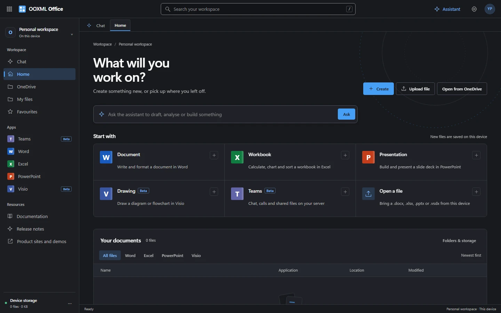

<div align="center">

# ooxml-ui

**The Office user interface as web components: ribbons, dialogs, menus, status bars and the Word, Excel, PowerPoint, Visio and Teams editors.**

[](https://www.npmjs.com/package/ooxml-ui)
[](https://github.com/ChristopherVR/ooxml/blob/main/LICENSE)
[](https://www.npmjs.com/package/ooxml-ui)

[**Live demo**](https://christophervr.github.io/ooxml/) &nbsp;&middot;&nbsp;
[**Docs**](https://christophervr.github.io/ooxml/docs/) &nbsp;&middot;&nbsp;
[**Changelog**](https://github.com/ChristopherVR/ooxml/blob/main/src/ui/CHANGELOG.md) &nbsp;&middot;&nbsp;
[**Report a bug**](https://github.com/ChristopherVR/ooxml/issues/new/choose)

<a href="https://christophervr.github.io/ooxml/"></a>

</div>

`ooxml-ui` is the DOM layer of [ooxml](https://github.com/ChristopherVR/ooxml#readme): the shared Office controls (Lit custom elements with shadow roots, typed events and one `--office-*` token theme) and the product editors as `ooxml-ui/<product>` subpaths. All document logic lives in [`ooxml-core`](https://www.npmjs.com/package/ooxml-core); this package only draws and reports what the user does.

> **Using an editor? You do not need to install this package.** Every editor package
> (`docx-*-viewer`, `xlsx-*-viewer`, `pptx-*-viewer`, `visio-*-viewer` and `openteams-*-viewer`)
> depends on it and registers the elements for you. Install `ooxml-ui` directly to build your own
> Office-style UI from its controls, to mount an editor element without a framework package, or
> to write a binding of your own.

- **Office behaviour built in.** Ribbon tabs and groups with KeyTips, Tell me, backstage, menus with submenus, galleries, colour pickers, dialogs that keep focus, and F6 between the regions of every editor.
- **One theme for everything.** Every colour, length and duration is an `--office-*` token with a default, so the elements render with or without the installed theme and follow a container's `data-office-theme="light" | "dark" | "auto"`, forced colours and touch targets.
- **Accessible by contract.** Accessible names contain the visible text, form boundaries reach 3:1 contrast, and every change is checked with axe and keyboard tests in a real browser.
- **Framework neutral.** Plain custom elements that are safe to import during server rendering, plus `ooxml-ui/bindings`, the kit the React, Vue and Solid bindings of every product are built from.

## Install

```bash
npm install ooxml-ui
```

`lit` and `ooxml-core` come with it. Optional peers: `react` (18 or newer), `vue` (3.5) and `solid-js` (1.9) for `ooxml-ui/bindings/react`, `/vue` and `/solid`; `three` for PowerPoint's 3D charts and models; `ai` for the PowerPoint assistant (`ooxml-ui/pptx/ai`).

## Quick start

```js
import { registerOfficeUi } from 'ooxml-ui';

registerOfficeUi(); // installs the theme and defines every shared element; idempotent
const button = document.createElement('office-ui-button');
button.setAttribute('label', 'Save');
button.setAttribute('command', 'save');
button.addEventListener('office-command', (event) => console.log(event.detail.command));
document.body.append(button);
```

The product editors register themselves when their entry is imported:

```js
import 'ooxml-ui/docx'; // defines <docx-editor>

const editor = document.createElement('docx-editor');
document.body.append(editor);
await editor.load(bytes); // a .docx as Uint8Array or ArrayBuffer
```

For an application, prefer the editor package of your framework ([Word](https://github.com/ChristopherVR/ooxml/tree/main/viewers/docx#readme), [Excel](https://github.com/ChristopherVR/ooxml/tree/main/viewers/xlsx#readme), [PowerPoint](https://github.com/ChristopherVR/ooxml/tree/main/viewers/pptx#readme), [Visio](https://github.com/ChristopherVR/ooxml/tree/main/viewers/visio#readme), [OpenTeams](https://github.com/ChristopherVR/ooxml/tree/main/viewers/teams#readme)): it wraps these elements with props, events, storage and collaboration wiring.

## Entries

| Entry                           | Contents                                                                                                                |
| ------------------------------- | ----------------------------------------------------------------------------------------------------------------------- |
| `ooxml-ui`                      | Everything below except the product editors, plus `registerOfficeUi()` and `OFFICE_UI_TAGS`.                            |
| `ooxml-ui/theme`                | `THEME_CSS`, `OFFICE_TOKENS`, `installOfficeUiTheme()`, `applyOfficeLook()`, `shadcnBridge()` and `themeBridge()`.      |
| `ooxml-ui/icons`                | The icon registry (`registerIcon`, `getIcon`, `listIcons`) and `<office-ui-icon>`.                                      |
| `ooxml-ui/controls`             | Buttons, form controls, ribbon, menus, dialogs, status bar, backstage and the host services below.                      |
| `ooxml-ui/presence`             | `<office-ui-presence>`, the avatar stack for collaboration awareness.                                                   |
| `ooxml-ui/smartart`             | `<office-ui-smartart>`, the SmartArt picker, text pane and Design galleries.                                            |
| `ooxml-ui/chart-format-locales` | The Chart Format pane's own translations (`CHART_FORMAT_STRINGS`), for a product dictionary to extend.                  |
| `ooxml-ui/teams`                | The Teams elements and `<teams-app>`.                                                                                   |
| `ooxml-ui/bindings`             | The framework binding kit; `/bindings/react`, `/vue` and `/solid` are its component factories.                          |
| `ooxml-ui/suite`                | The browser document persistence the Office suite uses.                                                                 |
| `ooxml-ui/docx`                 | The Word editor and viewer elements (`<docx-editor>`).                                                                  |
| `ooxml-ui/xlsx`                 | The Excel editor and viewer elements (`<xlsx-editor>`).                                                                 |
| `ooxml-ui/visio`                | The Visio editor and viewer elements (`<visio-viewer>`).                                                                |
| `ooxml-ui/pptx`                 | The PowerPoint renderer, editor and web components; also `/pptx/theme`, `/loader`, `/i18n`, `/ai`, `/dom`, `/onedrive`. |

Most entries declare an `import` and a `default` condition, so CommonJS consumers on Node 20.19+ or 22.12+ load them through `require(esm)`; the `ooxml-ui/pptx` entries also ship a CommonJS build. `custom-elements.json` (the package's `customElements` field, also exported as `ooxml-ui/custom-elements.json`) lists every element with its attributes, properties and events for editor tooling.

## Theming

Put the shared `--office-*` tokens and `data-office-theme="light" | "dark" | "auto"` on a common ancestor of the editor and any standalone controls. Two editors on one page can use different modes, `auto` follows the system, and changing a token or the attribute never remounts an editor or touches document content (paper, cell fills and slide artwork stay as the file says).

```html
<section class="office-scope" data-office-theme="dark">
	<!-- the editor and its standalone controls -->
</section>
```

```css
.office-scope {
	--office-accent: #0d9488;
	--office-accent-foreground: #ffffff;
	--office-ring: #0f766e;
	--office-font: 'Inter', system-ui, sans-serif;
	--office-radius: 6px;
}
```

- **Tokens.** `OFFICE_TOKENS` (from `ooxml-ui/theme`) is the single table of tokens and defaults: semantic colours (`--office-foreground`, `-background`, `-surface`, `-selected`, `-border`, `-accent`, `-ring`, `-danger`, ...), contrast roles (`--office-accent-ink`, `--office-control-border`), `--office-color-scheme`, and scales (`--office-space-*`, `--office-radius-*`, `--office-font-size-*`, `--office-control-height-*`, `--office-shadow-*`, `--office-duration-*`, `--office-z-*`). Derived tokens such as `--office-select-background` resolve where they are read, so overriding `--office-background` or `--office-accent` on a container also changes the controls inside it.
- **Colour scheme.** The Word, Excel and Visio editors take their `color-scheme` from `--office-color-scheme`. A container that sets only CSS `color-scheme: dark` gets light editors; use `data-office-theme="dark"`, which sets both.
- **Looks.** `data-office-look="cards"` (or `applyOfficeLook(element, 'cards')`) changes the chrome's shape, elevation and density, never a colour; PowerPoint uses it today. Put it on the document root when a product attaches floating menus to `body`.
- **Shadow roots.** `installOfficeUiTheme()` installs one stylesheet in the document; pass a `ShadowRoot` to scope it, or use `installOfficeUiThemeFor(element)` for every enclosing shadow root. Product canvases and `prepareOfficeUiBlock()` do this for you.
- **Product variables.** The products' own `--dve-*`, `--xve-*`, `--vv-*` and `--pptx-*` overrides still work and win for that product. `shadcnBridge(':host', '--dve-')` or `themeBridge(selector, map)` feed every `--office-*` colour from an existing variable set.

The theme is separate from an Office document's embedded theme. The token map and style rules are recorded in [shared UI decisions](https://github.com/ChristopherVR/ooxml/blob/main/docs/ooxml-ui-plan.md).

## Ribbon add-in tabs

A host can add its own ribbon tabs after a product's tabs, as an Office add-in does. The tab is plain data, and the same descriptor works in every editor: `ribbonAddIns` is a property of `<docx-editor>`, `<xlsx-editor>` and `<visio-viewer>`, and a prop of every framework binding, PowerPoint's included.

```ts
import type { RibbonAddInTab } from 'ooxml-ui';

const tab: RibbonAddInTab = {
	id: 'reports',
	label: 'Reports',
	groups: [
		{
			label: 'Export',
			commands: [
				{ id: 'export', label: 'Export', icon: 'save', run: () => exportReport() },
				{ id: 'options', label: 'Options', icon: 'settings', size: 'small' },
				{ id: 'send', label: 'Send', items: [{ id: 'send-mail', label: 'By mail' }] },
			],
		},
	],
};
editor.ribbonAddIns = [tab];
editor.addEventListener('office-ribbon-add-in', (event) => {
	const { tab, command } = event.detail; // 'reports', 'export'
});
```

A command runs its `run` callback, then dispatches the bubbling, composed `office-ribbon-add-in` event; it never reaches the product's own command router. `size: 'small'` commands fill columns of three and `items` makes a drop-down. A tab whose id is empty, repeated or equal to a built-in tab is skipped, so an add-in cannot replace a product tab. Assigning a new array each render is cheap and never closes an open drop-down. The descriptor types are DOM-free and live in `ooxml-core/ribbon`. Products render the list with `syncRibbonAddIns(ribbon, tabs, options)`.

`setOfficeAddInCatalog(editor, entries)` exposes trusted host commands in the shared Office Add-ins dialog (Get Add-ins, My Add-ins), and `setOfficeAddInStorefront(editor, ...)` turns on its Store pivot, which is off by default.

## Framework binding kit

`ooxml-ui/bindings` is the machinery every product's framework adapters share (Word, Excel, Visio and Teams), so a product binding only declares what is its own. A `BindingContract` lists each forwarded prop with its forwarding policy, each element event with its handler name and arguments, and the imperative handle; `bindElement(element, contract, handlers)` listens and forwards. `createReactBinding` (`/bindings/react`), `defineVueBinding` (`/vue`) and `createSolidBinding` (`/solid`) turn a contract into a component; Angular and Svelte components stay in each product because they need their compilers. The kit has no framework imports and touches no DOM at import. See the [binding kit guide](https://github.com/ChristopherVR/ooxml/blob/main/src/ui/src/bindings/README.md).

## PowerPoint renderer (`ooxml-ui/pptx`)

- **DOM renderer.** `ooxml-ui/pptx/dom` renders a parsed slide without a framework: `loadPresentation()` resolves pictures and media through the core handler, and `renderSlideStage()` with `createDefaultRegistry()` draws a slide into a `Document` at the scale you ask for. The host owns navigation, media and playback; the renderer does not edit or collaborate on its own.
- **Lifetimes.** Call `disposePptxRenderStage(stage)` before removing a stage (thumbnails and export stages too) and `revokeBlobUrls()` on the URLs `loadPresentation()` returned. `releasePptxRenderCaches()` empties the bounded render caches once every viewer sharing the module has closed.
- **Fonts.** `buildFontCatalog` (also at `ooxml-ui/pptx/render/font-catalog`) builds the font picker rows; `includeWeightVariants: true` adds weight faces. See [font loading](https://github.com/ChristopherVR/ooxml/blob/main/docs/font-loading.md#font-picker-weights).
- **Symbol fonts.** When Wingdings or Symbol is missing, known characters map to Unicode with a bundled Noto Sans Symbols 2 subset (inline WOFF2, no request). It is an approximation; host CSP must allow `font-src data:`.
- **Headless controllers.** Undo history, autosave and recovery, and the collaboration session are framework-free controllers (`getSnapshot()`, `subscribe()`, typed actions) that each binding adapts with one store adapter.

## Host services

`ooxml-ui/controls` (and the package root) export helpers product hosts reuse: `createLiveColorInput` for preview and commit colour transactions, `createDialogSession` for asynchronous submit and dismissal, the font services `buildFontCatalog`, `scanAvailableFontFamilies` and `createFontFaceScope`, and `createRecoveryScheduler`. Dispose font scopes and sessions when the host unmounts. For your own storage, use [`DocumentStorage` and `createStorageSession`](https://github.com/ChristopherVR/ooxml/blob/main/docs/storage-integrations.md); for OneDrive, [`ooxml-core/embedding/onedrive`](https://github.com/ChristopherVR/ooxml/blob/main/docs/onedrive-integration.md), with Microsoft sign-in supplied by the host.

## Elements

| Tag                                                   | Attributes / properties                                                                                                                                                                                                                                                                                                                                                                                                                                                                                                                                                                                                                                                                                                                                                                                                                                                                                                                                              | Events (all bubble, composed)                                                                                                                                                                                                                     |
| ----------------------------------------------------- | -------------------------------------------------------------------------------------------------------------------------------------------------------------------------------------------------------------------------------------------------------------------------------------------------------------------------------------------------------------------------------------------------------------------------------------------------------------------------------------------------------------------------------------------------------------------------------------------------------------------------------------------------------------------------------------------------------------------------------------------------------------------------------------------------------------------------------------------------------------------------------------------------------------------------------------------------------------------- | ------------------------------------------------------------------------------------------------------------------------------------------------------------------------------------------------------------------------------------------------- |
| `office-ui-button`                                    | `label`, `icon`, `command`, `disabled`, `pressed`, `expanded`, `icon-only`, `variant="stacked"`, `keyshortcuts`                                                                                                                                                                                                                                                                                                                                                                                                                                                                                                                                                                                                                                                                                                                                                                                                                                                      | `office-command` `{ command }`                                                                                                                                                                                                                    |
| `office-ui-checkbox`, `office-ui-switch`              | `checked`, `disabled`, `value`, `aria-label`; form-associated                                                                                                                                                                                                                                                                                                                                                                                                                                                                                                                                                                                                                                                                                                                                                                                                                                                                                                        | `input`, `change`                                                                                                                                                                                                                                 |
| `office-ui-select`                                    | `<option>` / `<optgroup>` children (`data-display-label`, `data-description`, font previews) or the `options` property `[{ value, label, disabled? }]`; `value`, `selectedIndex`, `disabled`, `aria-label`, `variant="ribbon-font"` or `"ribbon-icon"`, `data-font-picker`; `icon` and `custom` slots; arrows, Home, End, PageUp/PageDown, typeahead                                                                                                                                                                                                                                                                                                                                                                                                                                                                                                                                                                                                                 | `input`, `change`                                                                                                                                                                                                                                 |
| `office-ui-ribbon-group`                              | `label`, `launcher` (dialog launcher command), `launcher-disabled`; default slot                                                                                                                                                                                                                                                                                                                                                                                                                                                                                                                                                                                                                                                                                                                                                                                                                                                                                     | launcher: `office-command` `{ command }`                                                                                                                                                                                                          |
| `office-ui-ribbon-stack`                              | `orientation="horizontal"`; default slot (three-row column of small commands by default)                                                                                                                                                                                                                                                                                                                                                                                                                                                                                                                                                                                                                                                                                                                                                                                                                                                                             | none                                                                                                                                                                                                                                              |
| `office-ui-menu-button` / `-menu-item`                | button: `label`, `icon`, `command` (split button), `variant`, `disabled`, `keyshortcuts`; item: `command`, `label`, `icon`, `disabled`, `checked`                                                                                                                                                                                                                                                                                                                                                                                                                                                                                                                                                                                                                                                                                                                                                                                                                    | item choice: `office-command` `{ command }`                                                                                                                                                                                                       |
| `office-ui-toolbar`                                   | `aria-label`, `aria-orientation`; arrow-key focus movement                                                                                                                                                                                                                                                                                                                                                                                                                                                                                                                                                                                                                                                                                                                                                                                                                                                                                                           | none                                                                                                                                                                                                                                              |
| `office-ui-dialog`                                    | `open`, `heading`, `dismissible="false"`, `show()`, `close()`; slots default, `footer`                                                                                                                                                                                                                                                                                                                                                                                                                                                                                                                                                                                                                                                                                                                                                                                                                                                                               | `office-dialog-close` `{ reason }` (cancelable), `office-dialog-closed` after focus returns                                                                                                                                                       |
| `office-ui-status-bar` / `-status-item`               | `label`, `value`, `interactive`, `id`; controlled bar: `state` `{ items?, toggles?, views?, zoom? }` with `summary`, `collaboration` and `end` slots                                                                                                                                                                                                                                                                                                                                                                                                                                                                                                                                                                                                                                                                                                                                                                                                                 | `office-status-activate` `{ id }`                                                                                                                                                                                                                 |
| `office-ui-zoom-slider`                               | `value` (percent), `min`, `max`, `step`, `disabled`, `fit` (fit button name), `label`                                                                                                                                                                                                                                                                                                                                                                                                                                                                                                                                                                                                                                                                                                                                                                                                                                                                                | `input`, `change`; fit: `office-command` `{ command: 'zoom-fit' }`                                                                                                                                                                                |
| `office-ui-color-grid`                                | Office's colour picker body: `themeColors` (ten base colours; Theme Colors grid with lighter and darker variants), `themeNames` (a product's own column names), `variantLabel` (names a variant swatch, for a translated product), `palette` (the Theme Colors grid as a product computes it, in place of `themeColors`), `selectedTheme` (`{ column, variant? }`, marks a theme swatch by position), `extraColors` (one more theme-bound row), `standardColors` (empty leaves the row out), `recentColors`, `value`, `none-label`, `automatic-label`, `more-label`, `label`, `disabled`; events `office-color-pick` `{ color, source, label, theme?, index? }` (a theme swatch reports its column and variant so a product can save a theme reference) and `office-color-more`. In a pane narrower than the grid the swatches shrink to fit; `--office-color-swatch-gap` sets the space between them. The palette maths is `ooxml-core/color` (`buildThemePalette`) |
| `office-ui-color-custom`                              | The Custom tab of Office's Colors dialog: a hue and saturation square, a luminance slider, Hex, Red/Green/Blue and Hue/Sat/Lum fields (0-255) and New over Current swatches. `value` (`#rrggbb`), `current`, `label`, `disabled`, `valid`; event `office-color-change` `{ color }`                                                                                                                                                                                                                                                                                                                                                                                                                                                                                                                                                                                                                                                                                   |
| `office-ui-tab-strip`                                 | `tabs` `[{ id, label, title? }]`, `selected`, `label`, `previous-label`, `next-label`, `add-label`, `add-disabled`, `add-title`, `disabled`                                                                                                                                                                                                                                                                                                                                                                                                                                                                                                                                                                                                                                                                                                                                                                                                                          | `office-tab-select` `{ id }` (cancelable); add: `office-command` `{ command: 'tab-add' }`                                                                                                                                                         |
| `office-ui-context-menu` / `office-ui-menu-separator` | Children mode: `label`, `openAt(x, y)`, `close()`, `open` over `office-ui-menu-item` and separator children. Controlled mode: `state` `{ x, y, label, items: [{ id, label, separatorBefore?, heading?, danger?, disabled?, checked?, icon? }], markers?, zIndex?, autoFocus? }`; arrows, Home, End and type-ahead in both                                                                                                                                                                                                                                                                                                                                                                                                                                                                                                                                                                                                                                            | children: item `office-command` `{ command }`; controlled: `office-menu-request` `{ id }`, `office-menu-close` `{ reason }` (never closes itself)                                                                                                 |
| `office-ui-command-search`                            | `commands` `[{ id, label, keywords?, description?, disabled?, title? }]`, `placeholder`, `label`, `limit` (Office's "Tell me what you want to do")                                                                                                                                                                                                                                                                                                                                                                                                                                                                                                                                                                                                                                                                                                                                                                                                                   | choice: `office-command` `{ command }`                                                                                                                                                                                                            |
| `office-ui-options-dialog`                            | `categories` `[{ id, label, description?, disabled?, sections: [{ id, title, controls }] }]` (controls: `toggle`, `select`, `number`, `text`, each optionally `disabled` with a reason), `values`, `category`, `open`, `heading`, `show()`, `close()`                                                                                                                                                                                                                                                                                                                                                                                                                                                                                                                                                                                                                                                                                                                | OK: `office-options-change` `{ values, changed }`                                                                                                                                                                                                 |
| `office-ui-account`                                   | `profile` `{ displayName, avatarColor, initial? }`; slots `sign-in` and default (product sections)                                                                                                                                                                                                                                                                                                                                                                                                                                                                                                                                                                                                                                                                                                                                                                                                                                                                   | `office-profile-change` `{ profile }`                                                                                                                                                                                                             |
| `office-ui-ribbon`                                    | Tab row over tab panels. Panels are children with `data-ribbon-tab`, `data-label`, optional `data-tab-keytip`; slots `quick-access`, `search`, `end`, `actions` (right end of the tab row); `selected`, `label`, `file-label`, `no-file`, `file-expanded`, `file-keytip`; `focusFile()`, `focusTab()`                                                                                                                                                                                                                                                                                                                                                                                                                                                                                                                                                                                                                                                                | `office-ribbon-select` `{ tab }` (cancelable), `office-ribbon-file`                                                                                                                                                                               |
| `office-ui-backstage`                                 | `items` `[{ id, label, group?: 'footer', disabled?, title? }]`, `open`, `selected`, `label`, `back-label`, `show(page?)`, `close()`; pages are children with `data-backstage-page`                                                                                                                                                                                                                                                                                                                                                                                                                                                                                                                                                                                                                                                                                                                                                                                   | `office-backstage-select` `{ id }` (cancelable), `office-backstage-close` `{ reason }` (cancelable)                                                                                                                                               |
| `office-ui-find-bar`                                  | `open`, `label`, `input-label`, `placeholder`, `maxlength`, `disabled`, `navigation-disabled`, `previous-label`, `next-label`, `close-label`; `value`, `status`, `statusTitle`, `show()`, `close()`                                                                                                                                                                                                                                                                                                                                                                                                                                                                                                                                                                                                                                                                                                                                                                  | `office-find-input` `{ query }`, `office-find-step` `{ direction }`, `office-find-close`                                                                                                                                                          |
| `office-ui-ruler`                                     | `orientation="vertical"`, `origin` (px offset of zero), `scale` (px per unit, default 96), `direction="reverse"`; decorative                                                                                                                                                                                                                                                                                                                                                                                                                                                                                                                                                                                                                                                                                                                                                                                                                                         | none                                                                                                                                                                                                                                              |
| `office-ui-print-preview`                             | `pages` (rendered nodes; an inert clone of the current one is shown), `index`, `label`, `empty-label`                                                                                                                                                                                                                                                                                                                                                                                                                                                                                                                                                                                                                                                                                                                                                                                                                                                                | `office-print-preview-page` `{ index }`                                                                                                                                                                                                           |
| `office-ui-radio`                                     | `checked`, `disabled`, `value`, `name`; radios of one tag sharing a `name` form a roving-focus group; form-associated                                                                                                                                                                                                                                                                                                                                                                                                                                                                                                                                                                                                                                                                                                                                                                                                                                                | `input`, `change`                                                                                                                                                                                                                                 |
| `office-ui-search`                                    | `value`, `placeholder`, `disabled`, `aria-label`, `variant="titlebar"`; `focus()`, `select()`                                                                                                                                                                                                                                                                                                                                                                                                                                                                                                                                                                                                                                                                                                                                                                                                                                                                        | `input`, `change`                                                                                                                                                                                                                                 |
| `office-ui-ribbon-toggle`                             | `label`, `checked`, `disabled`, `title`, `command` (a labelled ribbon checkbox row; static `checkboxTag` picks the inner checkbox)                                                                                                                                                                                                                                                                                                                                                                                                                                                                                                                                                                                                                                                                                                                                                                                                                                   | `office-toggle` `{ command, checked }`                                                                                                                                                                                                            |
| `office-ui-dialog-footer`                             | `state` `{ actions: [{ id, label, variant?, icon?, disabled?, busy?, title?, align?, testId? }] }`, `focusAction(id)`                                                                                                                                                                                                                                                                                                                                                                                                                                                                                                                                                                                                                                                                                                                                                                                                                                                | `office-dialog-footer-request` `{ id }`                                                                                                                                                                                                           |
| `office-ui-toasts`                                    | `state` `{ toasts: [{ id, code?, severity, message }], overflowCount?, labels? }`; hidden when empty, host positions it                                                                                                                                                                                                                                                                                                                                                                                                                                                                                                                                                                                                                                                                                                                                                                                                                                              | `office-toasts-request` `{ id: 'dismiss', toastId }` or `{ id: 'dismissAll' }`                                                                                                                                                                    |
| `office-ui-read-only-banner`                          | `state` `{ kind, message, passwordPromptOpen?, passwordError?, checkingPassword?, labels? }`                                                                                                                                                                                                                                                                                                                                                                                                                                                                                                                                                                                                                                                                                                                                                                                                                                                                         | `office-read-only-request` (Edit anyway, Dismiss, password submit or cancel)                                                                                                                                                                      |
| `office-ui-message-bar`                               | `state` `{ kind (security, info), title, message, actionLabel?, closeLabel? }`; the Office Message Bar under the ribbon                                                                                                                                                                                                                                                                                                                                                                                                                                                                                                                                                                                                                                                                                                                                                                                                                                              | `office-message-bar-request` (`{ id: action }` for the action button, `{ id: close }`)                                                                                                                                                            |
| `office-ui-signature-status`                          | `summary` (a `SignatureSummary` from `ooxml-core/opc`), `locale`, `variant` (`badge`, `notice`, `panel`), `no-activate`; hidden while the document is unsigned                                                                                                                                                                                                                                                                                                                                                                                                                                                                                                                                                                                                                                                                                                                                                                                                       | `office-signature-activate` (badge), `office-signature-dismiss` (notice)                                                                                                                                                                          |
| `office-ui-progress-dialog`                           | `state` `{ open, title, progress, status, cancelLabel? }`; a modal with a `role="progressbar"` (0 to 100) and a polite status line; Escape and the backdrop do nothing; focus moves to Cancel and returns on close                                                                                                                                                                                                                                                                                                                                                                                                                                                                                                                                                                                                                                                                                                                                                   | `office-progress-cancel` (Cancel)                                                                                                                                                                                                                 |
| `office-ui-paste-options`                             | `state` `{ left, top, options: [{ id, label }], label? }`; fixed 4px past the pasted object                                                                                                                                                                                                                                                                                                                                                                                                                                                                                                                                                                                                                                                                                                                                                                                                                                                                          | `office-paste-options-request` `{ format }`, `office-paste-options-dismiss`                                                                                                                                                                       |
| `office-ui-title-bar`                                 | `state` `{ appMark?, fileName, status?, tone?, autosave?, quickAccess?: { label, items, showLabels? }, search? }`, `placement` (`titleBar`, `belowRibbon`); slots `collaboration`, `account`; tokens `--office-title-bar-*`                                                                                                                                                                                                                                                                                                                                                                                                                                                                                                                                                                                                                                                                                                                                          | `office-autosave-toggle`, `office-command` `{ command }`, `office-command-search` `{ query, command? }`                                                                                                                                           |
| `office-ui-ribbon-section`                            | `groups` `[{ id, label, commands: [{ id, label, icon, title?, size?, badge?, disabled?, active?, compact?, hidden?, caret?, pressed?, expanded?, column? }] }]`; keyed groups and commands in the light DOM                                                                                                                                                                                                                                                                                                                                                                                                                                                                                                                                                                                                                                                                                                                                                          | the commands' own events (`office-command`)                                                                                                                                                                                                       |
| `office-ui-gallery`                                   | `state` `{ id, label, moreLabel?, disabled?, command?, sections: [{ title?, columns, tileWidth, tileHeight, items: [{ id, label, applied?, preview? }] }], inline? }`, `mode` (`inline`, `panel`), `compact` (a panel of unlabelled tiles), `chevron-only`, `icon`; `open`, `disabled`, `close()`; tiles in light DOM (`data-gallery-item`), previews parsed by `parseSvgPreview`                                                                                                                                                                                                                                                                                                                                                                                                                                                                                                                                                                                    | `office-gallery-pick` `{ gallery, itemId }`                                                                                                                                                                                                       |
| `office-ui-comments-pane`                             | `threads` `[{ id, anchorLabel?, resolved, comments: [{ id, author, initials?, color?, created?, text, edited? }] }]`, `activeThreadId`, `read-only` (controls disabled), `list-only` (navigation list only), `closable`, `add-disabled`, `currentAuthor` (may edit own comments), `labels` (every string), `classNames` (`{ thread?, comment? }` product hook classes), `locale`; arrows, Home and End between threads, Enter or Space selects                                                                                                                                                                                                                                                                                                                                                                                                                                                                                                                       | `comment-add` `{ text }`, `comment-reply` `{ threadId, text }`, `comment-edit` `{ threadId, commentId, text }`, `comment-delete` `{ threadId, commentId }`, `thread-resolve` / `thread-reopen` / `thread-select` `{ threadId }`, `comments-close` |
| `office-ui-presence`                                  | `participants`, `max`, `label`                                                                                                                                                                                                                                                                                                                                                                                                                                                                                                                                                                                                                                                                                                                                                                                                                                                                                                                                       | `office-presence-select` `{ id }`                                                                                                                                                                                                                 |
| `office-ui-smartart`                                  | `drawing` (core `DiagramDrawing`), `schemeColors`, `schemeFonts`, `label`                                                                                                                                                                                                                                                                                                                                                                                                                                                                                                                                                                                                                                                                                                                                                                                                                                                                                            | `office-smartart-render` (render report)                                                                                                                                                                                                          |
| `office-ui-smartart-picker`                           | `categories`, `layouts`, `labels`, `drawPreview`, `value`, `category`, `items-editor`, `accent`                                                                                                                                                                                                                                                                                                                                                                                                                                                                                                                                                                                                                                                                                                                                                                                                                                                                      | `office-smartart-change` (every choice or edit), `office-smartart-activate` (double-click or Enter on a tile)                                                                                                                                     |
| `office-ui-smartart-text-pane`                        | `nodes` (`{ id, text, level, marker?, style?, canMoveUp?, canMoveDown?, canRemove?, canAddChild? }`), `selected`, `labels`, `closable`, `tools`, `disabled`, `appendDisabled`, `notes` (the host applies every request)                                                                                                                                                                                                                                                                                                                                                                                                                                                                                                                                                                                                                                                                                                                                              | `office-smartart-text-change` `{ id, text }`, `office-smartart-node-add` / `-promote` / `-demote` / `-remove` / `-select` `{ id }`, `office-smartart-text-pane-close`, and with `tools` `-append`, `-move`, `-add-child`, `-style`                |
| `office-ui-chart-picker`                              | `types`, `groupings`, `groupedTypes`, `labels`, `drawPreview`, `value` `{ type, grouping, title, data? }`, `change-only`                                                                                                                                                                                                                                                                                                                                                                                                                                                                                                                                                                                                                                                                                                                                                                                                                                             | `office-chart-change` (every edit, detail is the value)                                                                                                                                                                                           |
| `office-ui-chart-data-sheet`                          | `data` `{ categories, series: [{ name, values }] }`, `labels`, `highlight`, `disabled`, `locale`                                                                                                                                                                                                                                                                                                                                                                                                                                                                                                                                                                                                                                                                                                                                                                                                                                                                     | `office-chart-data-change` `{ edits, data }` (the host maps the edits onto its model)                                                                                                                                                             |
| `office-ui-chart-format-pane`                         | `source` (`ChartFormatSource`) or `chartSpace`, `target`, `theme`, `translateLabel`, `locale`, `disabled`                                                                                                                                                                                                                                                                                                                                                                                                                                                                                                                                                                                                                                                                                                                                                                                                                                                            | `office-chart-format-edit` `{ target, field, value, intent }`, `office-chart-format-target` `{ target }`, `office-chart-format-close`                                                                                                             |
| `office-ui-icon`                                      | `name`, `label`                                                                                                                                                                                                                                                                                                                                                                                                                                                                                                                                                                                                                                                                                                                                                                                                                                                                                                                                                      | none                                                                                                                                                                                                                                              |

The local profile behind `office-ui-account` is stored on the device only, under one suite-wide
key (`readOfficeProfile`, `writeOfficeProfile`, `clearOfficeProfile`), so every Office viewer on
an origin shows the same name and avatar colour.

`attachKeyTips(scope)` (from `ooxml-ui/controls`) adds Office KeyTips to any element or shadow
root: press and release Alt to show badges on controls marked `data-keytip="H"`, type a badge to
activate it (controls inside open shadow roots of shared elements, such as ribbon tabs, are included), and use `data-keytip-panel` / `data-keytip-level` for a tab's second level. Escape
steps back; disabled controls are dimmed and never run.

Elements with intent events read their event name and test-id prefix from static class fields (`requestEvent`, `testIdPrefix`), so a product can register a subclass under its own tag that keeps its published contract.

`office-ui-dialog` keeps focus inside the dialog while it is open. Tab and Shift+Tab cycle through
the body's controls in order, including the focusable controls inside the shadow root of a composite
element slotted into the body (a picker such as `office-ui-chart-picker` is not itself focusable), and
the close button; focus returns to the previous element on close.

Chart and SmartArt editing elements (`office-ui-chart-format-pane`, `office-ui-chart-data-sheet`,
`office-ui-chart-picker`, `office-ui-smartart-picker`, `office-ui-smartart-text-pane`) take the document
data as properties and report each change as an event; they never write a model. Their events, the
Chart Design galleries and the translations are described in the [chart elements README](https://github.com/ChristopherVR/ooxml/blob/main/src/ui/src/chart/README.md) and the
[SmartArt elements README](https://github.com/ChristopherVR/ooxml/blob/main/src/ui/src/smartart/README.md).

Setting a property never emits an event; only user activation does. Controls honour
`prefers-color-scheme`, `forced-colors: active` (system colours and a visible focus ring) and
coarse pointers (44px targets through `--office-target-size`).

### Menus and galleries

`office-ui-menu-button` accepts `submenu` when nested inside another menu.
Its trigger becomes a menu item; hover, click or ArrowRight opens the child
panel beside the parent, with viewport edge placement. ArrowLeft or Escape
returns focus to its trigger; choosing a command closes the whole menu tree.
Arrow navigation stays within the current menu and skips disabled entries.

The shared `office-ui-gallery` also supports `mode="panel"` for modal pickers.
It displays labelled preview tiles directly, keeps focus when a pick refreshes the
selection, and supports arrow, Home and End keys. Panel mode has no dropdown
trigger or popup; `open` remains false. XLSX uses this mode for chart types while
PowerPoint continues to use the same component for ribbon galleries. A `compact`
panel shows its tiles without visible labels, sharing the panel's width with the
previews at their size, and its arrow keys only move focus: PowerPoint's inspector
uses it for Text Warp and Quick Styles, whose picks apply at once.

### SmartArt

`office-ui-smartart` shows the drawing the producing application cached; it never lays out a
diagram itself. Preset outlines it cannot draw are rendered as rectangles, gradient and pattern
fills are approximated, and 3D is flattened. All of that is listed in the `office-smartart-render`
event detail (`approximatedGeometries`, `approximatedFills`, `flattened3d`); nothing is hidden.

`office-ui-smartart` accepts `schemeFonts` (`major` and `minor` Latin typefaces)
alongside `schemeColors`. Cached shape font references provide inherited text
color and font; explicit run formatting takes precedence. Color transforms and
alpha reuse the core DrawingML resolver, with unsupported transforms reported in
`unappliedColorTransforms` on the render report.

## How the elements are built

Every element is a Lit class that reads like a component, in a folder named for what it is:
`<name>.ts` holds the reactive properties and a `render()` template, `<name>.css` the styles (a real
stylesheet imported as `?raw`, tokens only). The folders are `form/` (checkbox, switch, radio, select,
search, zoom), `ribbon/` (button, group, stack, toolbar, tabs, section, toggle), `menu/` (menu button
and item, separator, context menu, command search), `dialog/` (dialog, options dialog, dialog footer),
`notices/` (toasts, read-only banner, message bar, signature status, paste options), `chrome/` (title bar, status bar and item, tab
strip, task pane, format section, backstage, account, find bar, print preview, ruler), `comments/` (the comments pane), `files/` (the cloud file browser), `presence/`,
`smartart/` and `teams/`.

- **`OfficeElement`** (`base.ts`) is the base class, exported for products that build their own
  elements. Bare `var(--office-x)` in a `.css` file gets the token's default when the sheet loads
  (`withTokens`), so an element renders correctly with or without the installed theme.
- **Updates are synchronous.** Setting a property or attribute redraws the shadow DOM before the call
  returns (the contract the earlier hand-built elements had and every test relies on). The team
  elements keep Lit's batched updates (`static syncUpdates = false`).
- **Products subclass these elements** (`ooxml-ui/pptx` registers `pptx-ui-*` aliases that keep their own
  event names and ids), so the base class keeps what those subclasses lean on: the shadow root exists
  when the constructor returns, a connected element renders on first `shadowRoot` read or in a
  microtask even if a subclass skips `super.connectedCallback()`, and a property that a product hook
  reads as an attribute (`icon`, `command`, `launcher`, `placement`) writes the attribute through.
  A constructor must not assign a property a subclass may override with its own accessor (it would
  run the subclass's setter before its fields exist); such state (`state`, `groups`, ...) lives in a
  private field behind a hand-written accessor.
- **Text is exact.** Text-bearing elements are written without whitespace between nodes, because
  consumers compare `textContent`. `oxfmt` is set to `htmlWhitespaceSensitivity: "strict"` for
  `src/ui/src` (not `teams/`) so it never adds whitespace to a template; `glyph.ts` opts out of
  the formatter with `// prettier-ignore` because it reflows `<svg>` regardless.
- **`ribbon-section` and `keytips`** keep imperative DOM on purpose: the section patches light-DOM
  children keyed by id (so focus and a product's tags survive), and keytips attaches a badge layer to
  a scope it does not own.

`bun run check:elements` (part of this package's test suite, so CI runs it) holds every element to
this contract. It defines every element through the public register functions and every `definer`
in the source, then checks that each one is an `OfficeElement`, is defined by a public register
function through the registry (carrying the contract stamp), declares its reactive properties
rather than shadowing them with class fields, has a property for each attribute it reads, keeps a
property a host set before its definition loaded, styles its shadow root from `?raw` CSS through
`controlStyles` with token defaults, and lets go of `window`, `document`, observer and interval
resources when removed. `src/conformance/known-gaps.ts` lists the elements that fail a check today;
the suite fails when a new element fails or a listed one passes, so the list only shrinks.

### Registration and early properties

Importing an entry never touches the DOM (SSR-safe). Elements are defined by the `define*` /
`register*` functions, which are idempotent, no-ops without a `window`, and refuse to coexist
with an incompatible build of this package. Hosts can set properties and define in either order. A
property assigned to an element before its definition loads counts as written just after the
element upgrades: it wins over the attributes the element had then, any later property or attribute
write wins over it, and it is applied before the element first connects (so mount-time options
such as `surfaceOnly` hold for the first build). For an element upgraded while detached with
`customElements.upgrade()`, the rule holds for the shared elements once the current script ends,
but the editors (`docx-editor`, `xlsx-editor`, `visio-viewer`) and other elements not built on
`OfficeElement` apply the early value only when they first connect, so connect them before
writing the same property or attribute again. Properties Lit declares on the shared elements
follow Lit there: on an element upgraded while detached, the early value waits for its first
render, which overrides a write made to the same property in the meantime.

## Custom Elements Manifest

`custom-elements.json` (the package's `customElements` field, also exported as
`ooxml-ui/custom-elements.json`) lists every element with its attributes, properties and events,
for framework bindings and editor tooling. Properties and attributes are read from the live classes;
events are the names each element fires, taken from its source, so an event dispatched under a name
built at run time would be missing. A test fails while the file is out of date: run
`bun run --cwd src/ui gen:manifest` after changing an element.

## Scope

Only what every Office product needs lives in the shared entries. Product ribbon content (PowerPoint slides, transitions and animations; Word styles and review) lives in the product's own subpath. Most `pptx-ui-*` tags are thin subclasses of the `office-ui-*` elements, listed in the [PowerPoint web components README](https://github.com/ChristopherVR/ooxml/blob/main/src/ui/src/pptx/web-components/README.md).

## Privacy and network use

The elements render and edit locally and collect no analytics or telemetry. Code the editors load on demand (dialogs, galleries, workers, equation and theme codecs, Visio's TIFF and metafile decoders, Excel's non-English dictionaries and `FILTERXML` support) comes from the app's own origin and carries no document data. Beyond that, a request leaves the device only in these cases:

- **Fonts that are neither installed nor embedded.** PowerPoint (`ooxml-ui/pptx`) downloads them from Google Fonts by default; turn it off with `googleFonts: false` or point it at your mirror with `googleFonts: { baseUrl }`. `<docx-editor>`, `<xlsx-editor>` and `<visio-viewer>` take the same `googleFonts` value but download nothing unless the host sets it or the reader turns on File > Options > Trust Center > "Download fonts that are not installed or embedded" (off by default; a host value locks it). Only public catalogue family names are sent, never the file or its text. See [font loading](https://github.com/ChristopherVR/ooxml/blob/main/docs/font-loading.md).
- **PowerPoint linked pictures and media** are fetched only after the reader chooses Enable Content (`allowExternalContent` changes that). Word, Excel and Visio never fetch linked content.
- **PowerPoint Share and Broadcast**, only when started: to the server you configure, or with none to a public signaling server and public STUN servers (configure your own `signaling`).
- **Collaboration and Teams** talk only to the servers you configure; Teams calls also use Google's public STUN server unless `iceServers` is set. An active Word collaboration room shares inserted pictures, 3D models, Office objects and the bibliography with its peers.
- **Excel `IMAGE` formulas** fetch only through an `imageProvider` the host supplies (`createFetchImageProvider({ fetch, allowedOrigins, onUpdate })` from `ooxml-core/xlsx`); without one they are blocked.
- **Host callbacks** you supply and control: Word's `mailMergeDataSource` and `emailProvider` (`false` turns email merge off), `wordDesignPreferences`, PowerPoint's Ink to Math recognizer and `configurePptxDraw` preference storage, and Office Add-in catalogue and storefront entries. The Add-ins Store is off by default; a Microsoft Marketplace link opens only on a click.
- **Links** (hyperlinks, help, Microsoft Forms in PowerPoint and Excel) open only when the reader follows them.

Screenshots and screen recordings use the browser's own picker and stay in memory until inserted. Small preferences (such as the Trust Center font choice and Word's default wrap mode) are kept in localStorage. Every request and stored item is listed in [PRIVACY.md](https://github.com/ChristopherVR/ooxml/blob/main/PRIVACY.md).

## Browser support

- The last two major versions of Chrome, Edge, Firefox and Safari, and Safari 16.4 at least ([browser support](https://github.com/ChristopherVR/ooxml/blob/main/docs/browser-support.md)).
- Node.js 22.3 or newer for server rendering and tests; importing an entry never touches the DOM.

## Development

From the repository root:

```bash
bun install
bun run build                     # the core declarations the UI typechecks against
bun run --cwd src/ui typecheck
bun run --cwd src/ui test         # includes check:elements
bun run --cwd src/ui build
bun run --cwd src/ui test:package
bun run --cwd src/ui gen:manifest # after changing an element
```

The UI build stages the PowerPoint declarations from `src/core/dist/pptx` in the ignored `.types-pptx` folder, because the core's pptx area still compiles with relaxed settings and must not be pulled into this strict project as source.

## Documentation

- [Documentation hub](https://christophervr.github.io/ooxml/docs/) and the editor packages of every framework: [Word](https://github.com/ChristopherVR/ooxml/tree/main/viewers/docx#readme), [Excel](https://github.com/ChristopherVR/ooxml/tree/main/viewers/xlsx#readme), [PowerPoint](https://github.com/ChristopherVR/ooxml/tree/main/viewers/pptx#readme), [Visio](https://github.com/ChristopherVR/ooxml/tree/main/viewers/visio#readme) and [OpenTeams](https://github.com/ChristopherVR/ooxml/tree/main/viewers/teams#readme).
- [Chart elements](https://github.com/ChristopherVR/ooxml/blob/main/src/ui/src/chart/README.md), [SmartArt elements](https://github.com/ChristopherVR/ooxml/blob/main/src/ui/src/smartart/README.md) and the [binding kit](https://github.com/ChristopherVR/ooxml/blob/main/src/ui/src/bindings/README.md).
- [`ooxml-core`](https://www.npmjs.com/package/ooxml-core): the models, parsers, writers and editing commands these elements draw.
- [Shared UI decisions](https://github.com/ChristopherVR/ooxml/blob/main/docs/ooxml-ui-plan.md): the layout, style rules, tag aliases and token map behind this package.

## License

[Apache-2.0](https://github.com/ChristopherVR/ooxml/blob/main/LICENSE). Several controls come from the earlier `pptx-viewer` repository; see [PROVENANCE.md](https://github.com/ChristopherVR/ooxml/blob/main/PROVENANCE.md).
