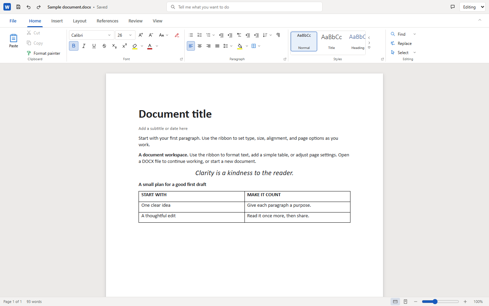

<div align="center">

# Word viewer

**A Word document editor for the browser: one `<docx-editor>` element over one document model, with thin packages for React, Vue, Angular, Svelte, Solid and plain JavaScript.**

For applications that need to open, edit and save Word documents in the page, without a server and without uploading the file.

[](https://www.npmjs.com/package/docx-react-viewer)
[](LICENSE)
[](https://github.com/ChristopherVR/ooxml/actions/workflows/ci.yml)

[**Live demo**](https://christophervr.github.io/ooxml/docx/demo/) &middot; [**Docs**](https://christophervr.github.io/ooxml/docx/) &middot; [**Samples**](https://christophervr.github.io/ooxml/samples/) &middot; [**Packages**](#packages) &middot; [**Changelog**](CHANGELOG.md)



</div>

## Packages

| Package                                                                    | Framework   | What it is                                                                                      |
| -------------------------------------------------------------------------- | ----------- | ----------------------------------------------------------------------------------------------- |
| [`docx-react-viewer`](https://www.npmjs.com/package/docx-react-viewer)     | React 18+   | The editor as a React component ([README](packages/react/README.md)).                           |
| [`docx-vue-viewer`](https://www.npmjs.com/package/docx-vue-viewer)         | Vue 3.5+    | The editor as a Vue component ([README](packages/vue/README.md)).                               |
| [`docx-angular-viewer`](https://www.npmjs.com/package/docx-angular-viewer) | Angular 19+ | A standalone Angular component ([README](packages/angular/README.md)).                          |
| [`docx-svelte-viewer`](https://www.npmjs.com/package/docx-svelte-viewer)   | Svelte 5    | The editor as a Svelte 5 component ([README](packages/svelte/README.md)).                       |
| [`docx-solid-viewer`](https://www.npmjs.com/package/docx-solid-viewer)     | Solid 1.9   | A Solid component, with server rendering ([README](packages/solid/README.md)).                  |
| [`docx-vanilla-viewer`](https://www.npmjs.com/package/docx-vanilla-viewer) | None        | `mountEditor` and the plain `<docx-editor>` element ([README](packages/vanilla/README.md)).     |
| [`docx-core`](https://www.npmjs.com/package/docx-core)                     | None        | The Word model, parser and preserving serializer, headless ([README](packages/core/README.md)). |
| [`docx-viewer-mcp`](https://www.npmjs.com/package/docx-viewer-mcp)         | Node.js     | An MCP server with Word tools for AI assistants ([README](mcp/README.md)).                      |

Each editor package is self-contained: it brings `docx-core`, `ooxml-core` and `ooxml-ui` with it and re-exports the model API, so an application installs one package. The editor element itself lives in `ooxml-ui/docx` and the Word logic in `ooxml-core/docx`; the private `web-component` and `bindings` packages here are bundled into each editor package at build time.

## Quick start

```bash
npm install docx-react-viewer
```

```tsx
import { useState } from 'react';
import { createDocument, WordEditor } from 'docx-react-viewer';

export function Editor() {
	const [model, setModel] = useState(createDocument);
	return <WordEditor className="editor" documentModel={model} onDocumentChange={setModel} />;
}
```

Give the editor's container a height; the editor fills it. Every framework has the same shape: the same props, the same events (in that framework's style) and the same handle (`element`, `load(bytes)`, `save()`, `download(fileName?)`, `markClean()`, `openCloudFile(file)` and `dirty`). Each package's README has its quick start, and the [bindings guide](docs/bindings.md) has every prop and event.

## Features

- **Word-style editing.** The ribbon (Home, Insert, Design, Layout, References, Mailings, Review, View and the contextual tabs), title bar with Tell me, File backstage, status bar, context menus, undo and redo, find and replace, zoom, and Editing and Viewing modes in one element.
- **Views and printing.** Print Layout with the editor's own pagination (widow and orphan control, keep rules, columns, table row splitting, hyphenation), Draft, Web Layout, Read Mode and Outline, page thumbnails, printing and Save as PDF.
- **Document structure.** Styles, lists and multilevel numbering, tables, sections, headers and footers, footnotes and endnotes, fields such as TOC, PAGE and REF, content controls and form fields, pictures, shapes, text boxes, watermarks and page borders.
- **Review.** Tracked changes (accept, reject, navigate) and a comments pane with replies and resolve.
- **Draw and equations.** Pens, highlighter, eraser, Lasso Select, Ink to Shape and Ink Replay, saved as Word ink; the Equation tab with galleries and linear format, saved as Word equations.
- **Charts and SmartArt.** Insert and edit both through the shared Office pickers, data sheet and panes; an unedited chart or diagram keeps its parts byte for byte.
- **File formats.** `.docx`, password-protected `.docx`, and legacy Word 97-2003 `.doc` and PDF files, which are converted to a Word document on open.
- **Careful saving.** An unchanged document saves as its original bytes, supported edits keep the parts the model does not cover, and an edit that cannot be saved safely is refused. See the [preservation guarantee](docs/preservation.md).
- **Host control.** Hide ribbon controls or whole tabs, add your own ribbon tabs, backstage pages and context menu commands, route Save and Open to your storage, share a document over your own collaboration transport, theme with the shared `--office-*` tokens, and switch the interface between English, French, German, Spanish and Simplified Chinese.

## Status and limits

Word is **Stable** under the [stability policy](../../docs/stability.md): a semver-stable API checked against a snapshot, the [preservation guarantee](docs/preservation.md), and saved documents opened in desktop Word. Stable is not a claim of Word parity or of a lossless round trip.

- Pagination, line breaking and table AutoFit are the editor's own and approximate Word's; there is no kerning or complex-script shaping, and right-to-left runs are not reordered.
- A legacy `.doc` is converted to `.docx` on open, without revision marks, form-field data, macros and some drawings.
- Collaboration covers the body and comments; headers, footers and notes are incomplete.
- Draw has no Ink to Math or Ruler, and the Equation tab has no handwriting input; inserted or edited SmartArt uses an approximate layout until Word lays it out again.

The [support roadmap](docs/parity-roadmap.md), [outstanding work](docs/outstanding-work.md) and the [parity checklist](../../docs/parity-checklist.md) list every known gap.

## Privacy and network use

By default the Word packages open, render, edit and save documents on the device: linked pictures are not fetched, linked data is not refreshed, and nothing collects analytics or telemetry. Missing fonts are downloaded from Google Fonts (or a mirror) only when the host sets the element's `googleFonts` property or the reader turns on font downloads in File > Options > Trust Center, which is off by default; mail merge delivery and collaboration go only where the host's `emailProvider` and `collaboration` send them. See [PRIVACY.md](../../PRIVACY.md#word-excel-and-visio) for every request and what is kept on the device.

## Samples

Sample files to try: https://christophervr.github.io/ooxml/samples/

## Documentation

[Getting started](docs/getting-started.md) &middot; [Architecture](docs/architecture.md) &middot; [Framework bindings](docs/bindings.md) &middot; [Framework guides](docs/frameworks/) &middot; [Building blocks](docs/building-blocks.md) &middot; [Editing text](docs/editing.md) &middot; [Theming](docs/theming.md) &middot; [Collaboration](docs/collaboration.md) &middot; [OneDrive](docs/onedrive.md) &middot; [Mail merge](../../docs/docx-mail-merge.md) &middot; [API](docs/api.md) &middot; [Preservation guarantee](docs/preservation.md) &middot; [Support roadmap](docs/parity-roadmap.md) &middot; [Demos](docs/demos.md)

## Development

Run these from `viewers/docx` (after `bun install` at the repository root):

```bash
bun run typecheck         # tsc and svelte-check
bun run test              # Vitest: unit and binding contract tests
bun run lint              # oxlint
bun run fmt:check         # oxfmt
bun run check:shared      # docx-core stays a logic-free re-export
bun run build:packages    # build the publishable packages into packages/*/dist
bun run check:published   # no tarball imports an internal package
bun run pack:smoke        # pack, install into a clean consumer, load .docx and .doc
bun run demo              # the demo app on a local dev server
bunx playwright install chromium
bun run test:browser      # Playwright specs in e2e/docx against the built demo (PLAYWRIGHT_PORT, default 4180)
bun install --cwd docs && bun run --cwd docs docs:build   # the docs site and every demo
```

The packages are released by the repository's shared release flow; see [releasing](docs/releasing.md). Read [AGENTS.md](AGENTS.md) before changing code here: Word logic belongs in `src/core/docx` and the editor in `src/ui/src/docx`, not in this folder.

## License

[Apache License 2.0](LICENSE). See [`NOTICE`](NOTICE) for attributions.
