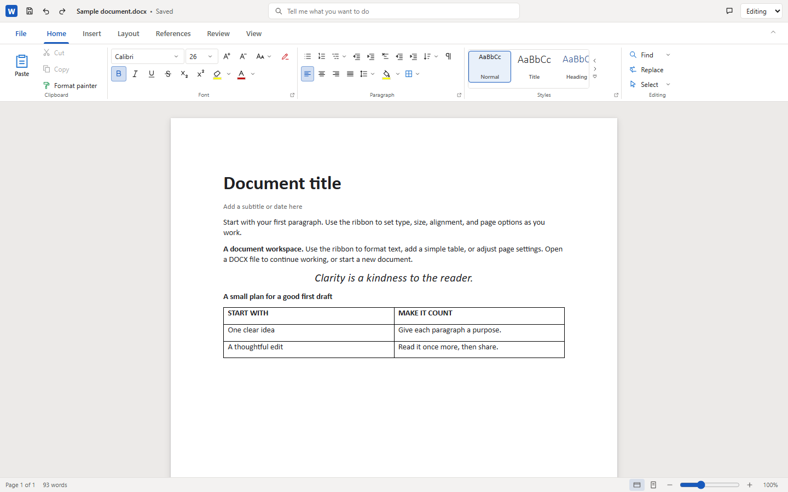

# docx-solid-viewer

**A Word document editor for Solid: open, edit and save `.docx` files (and open legacy `.doc` and PDF files) in the browser, with the Word ribbon, dialogs, Print Layout, tracked changes and comments built in.**

[](https://www.npmjs.com/package/docx-solid-viewer)
[](https://github.com/ChristopherVR/ooxml/blob/main/viewers/docx/LICENSE)
[](https://www.npmjs.com/package/docx-solid-viewer)

[Live demo](https://christophervr.github.io/ooxml/docx/demo-solid/) · [Documentation](https://christophervr.github.io/ooxml/docx/) · [Solid guide](https://christophervr.github.io/ooxml/docx/frameworks/solid) · [Changelog](https://github.com/ChristopherVR/ooxml/blob/main/viewers/docx/packages/solid/CHANGELOG.md) · [Report a bug](https://github.com/ChristopherVR/ooxml/issues)



## Install

```bash
npm install docx-solid-viewer
```

`solid-js` ^1.9.0 is a peer dependency; Solid 2 is not supported yet. The package brings `docx-core`, `ooxml-core` and `ooxml-ui` with it and re-exports the Word model API (`createDocument`, `loadDocument`, `loadDocx`, `saveDocx` and the types), so one install is all an application needs. Use one Word editor package per application: each registers the same `<docx-editor>` element.

## Quick start

```tsx
import { createSignal } from 'solid-js';
import { createDocument, WordEditor, type EditorHandle } from 'docx-solid-viewer';

export function Editor() {
	let editor: EditorHandle | undefined;
	const [model, setModel] = createSignal(createDocument());

	async function open(file: File) {
		await editor?.load(await file.arrayBuffer()); // .docx, .doc or .pdf
	}

	async function save() {
		const blob = await editor!.save(); // always a .docx Blob
		// ...store the blob, then:
		editor!.markClean();
	}

	return (
		<>
			<input
				type="file"
				accept=".docx,.doc,.pdf"
				onChange={(e) => e.currentTarget.files?.[0] && open(e.currentTarget.files[0])}
			/>
			<button onClick={save}>Save</button>
			<WordEditor
				class="editor"
				editorRef={(handle) => (editor = handle)}
				documentModel={model()}
				onDocumentChange={setModel}
			/>
		</>
	);
}
```

The editor fills the element `WordEditor` renders, so give it a height through `class` (for example `.editor { height: 100vh; }`). There is no stylesheet to import: the editor styles itself inside its own shadow root. On the server `WordEditor` renders its empty host; the browser claims it while hydrating and the editor mounts in `onMount`. The component is written without JSX, so the package needs no Solid compiler plugin.

`load` detects the format from the bytes, never the file name: `.docx`, legacy Word 97-2003 `.doc` and PDF files open, and a `.doc` or PDF is converted to a Word document on open. `save()` always writes `.docx` and leaves the document dirty until you call `markClean()`, because only your application knows when the bytes are stored; `download(fileName?)` saves, downloads and marks it clean. A password-protected `.docx` opens through `loadDocument(bytes, { password })`; pass the result to the element's `setLoadedDocument`.

## Props

Every prop is optional and tracked reactively. `WordEditor` also takes `class` for its host element and `editorRef` for the handle.

| Prop             | What it does                                                                                                  |
| ---------------- | ------------------------------------------------------------------------------------------------------------- |
| `documentModel`  | The document to show. A different model object replaces the document.                                         |
| `readOnly`       | Viewing mode. Default `false`.                                                                                |
| `fileName`       | Name in the title bar, used by Save and Download. Default `Document1.docx`.                                   |
| `reviewAuthor`   | Author recorded on tracked changes and comments. Default `Author`.                                            |
| `locale`         | Interface language (see [Localisation](#localisation)). Default `en`.                                         |
| `theme`          | `light`, `dark` or `auto` (default).                                                                          |
| `themeColors`    | Colour and radius overrides, applied as `--dve-*` custom properties.                                          |
| `showToolbar`    | Show the ribbon. Default `true`.                                                                              |
| `hiddenActions`  | Ribbon controls to hide, by stable id (`RIBBON_ACTION_IDS`).                                                  |
| `ribbonAddIns`   | Your own ribbon tabs, after Word's.                                                                           |
| `customization`  | `capabilities`, `ribbon.hiddenTabs` (the File tab included), extra backstage pages and context menu commands. |
| `showThumbnails` | Page thumbnail rail (Print Layout). Default `false`.                                                          |
| `readAloud`      | Read Aloud options, such as `stopOnEdit`.                                                                     |
| `storage`        | Your storage for File > Save and Open, instead of downloads and file pickers.                                 |
| `fileProviders`  | Cloud places in File > Open, such as OneDrive with sign-in your application supplies.                         |
| `collaboration`  | Share the document in a room while set; `null` leaves.                                                        |

`editorRef` is called once the editor has mounted, with `element` (the `<docx-editor>`), `load(bytes)`, `save()`, `download(fileName?)`, `markClean()`, `openCloudFile(file)` and `dirty`.

`collaboration`, `customization`, `storage` and `fileProviders` are forwarded when the object changes, so keep them in a signal or a constant. Passing back the model from `onDocumentChange` does not reset the editor; a different model object replaces the document, so never change a model in place.

The [bindings guide](https://christophervr.github.io/ooxml/docx/bindings) has every prop, its default and how it is forwarded.

## Events

Events are `on...` callback props:

| Event                   | When it fires                                                                                                                                                |
| ----------------------- | ------------------------------------------------------------------------------------------------------------------------------------------------------------ |
| `onDocumentChange`      | The document was edited; receives the new `DocumentModel`.                                                                                                   |
| `onDirtyChange`         | Unsaved changes appeared or were cleared.                                                                                                                    |
| `onDocumentError`       | A load or save failed (an `Error`).                                                                                                                          |
| `onDocumentWarning`     | A non-fatal notice, such as content that could not be laid out faithfully.                                                                                   |
| `onFileCommand`         | A File command (new, open, save, saveAs, export, exportText, print, share) is about to run. Cancelable: call `event.preventDefault()` to handle it yourself. |
| `onReadOnlyChange`      | Editing or Viewing changed (`readOnly`, `detail`).                                                                                                           |
| `onPageChange`          | The current page or page count changed.                                                                                                                      |
| `onRibbonAction`        | A ribbon control was used.                                                                                                                                   |
| `onRibbonCustomize`     | The user changed the shown commands (File > Customize Ribbon); persist the ids.                                                                              |
| `onRibbonAddIn`         | A command on one of your `ribbonAddIns` tabs was chosen.                                                                                                     |
| `onCollaborationChange` | Sharing started, stopped or reconnected, or the people in the room changed.                                                                                  |

If you mirror `readOnly` from `onReadOnlyChange`, store `detail.hostReadOnly`, so a viewer role in a shared room never becomes your own setting.

## Your own editor UI

To draw only the controls you need, in your own design system, use the building blocks instead of the whole editor. `createViewerBuildingBlocks(options)` (options as an accessor) returns `canvasProps` for `DocumentCanvas` plus flat `toolbarProps`, `navigationProps` and `statusProps` for the optional `Toolbar`, `PageNavigation` and `StatusBar` components. The surface is read-only until you pass `canEdit: true`; a read-only surface still allows selection, keyboard navigation and copy. See [Building blocks](https://christophervr.github.io/ooxml/docx/building-blocks).

## Theming

`theme` sets `light`, `dark` or `auto` (the default, which follows the nearest `data-office-theme` scope and then the operating system). The chrome uses the shared `--office-*` tokens (`--office-accent`, `--office-background`, `--office-surface`, `--office-foreground`, `--office-border` and others), so setting `data-office-theme` and those tokens on an ancestor themes the editor together with the rest of your page. `themeColors` still applies Word's own `--dve-*` overrides, which win over the shared tokens. The page stays white, as in Word, unless you set `--office-paper` or `--dve-page-color`. Theming never changes the document's own formatting. See [Theming](https://christophervr.github.io/ooxml/docx/theming).

## Localisation

The interface is in English (`en`), French (`fr`), German (`de`), Spanish (`es`) and Simplified Chinese (`zh-CN`). Set `locale` to one of them, or to a tag such as `de-DE` that maps to one; anything else falls back to English. Document content is never translated.

## Status and limits

Word is **Stable** under the [stability policy](https://github.com/ChristopherVR/ooxml/blob/main/docs/stability.md): a semver-stable API, the [preservation guarantee](https://christophervr.github.io/ooxml/docx/preservation) (an unchanged document saves as its original bytes, supported edits keep the parts the model does not cover, and an edit that cannot be saved safely is refused) and saved files checked in desktop Word. Stable is not a claim of Word parity or of a lossless round trip. Unsupported content is reported in File > Info and kept on save where the editor can keep it.

- Pagination, line breaking and table AutoFit are the editor's own and approximate Word's, so pages can break differently; there is no kerning or complex-script shaping.
- Right-to-left runs are not reordered by the bidirectional algorithm, and the interface has no right-to-left locale.
- A legacy `.doc` is converted to `.docx` on open, without revision marks, form-field data, macros, document protection and some drawings.
- Collaboration covers the body and comments; headers, footers and notes are incomplete, and table commands are off while sharing.
- The Draw and Equation tabs are missing, and SmartArt that is inserted or edited is drawn with an approximate layout until Word lays it out again.

The full list is in the [support roadmap](https://christophervr.github.io/ooxml/docx/parity-roadmap) and the [parity checklist](https://github.com/ChristopherVR/ooxml/blob/main/docs/parity-checklist.md).

## Privacy and network use

By default the editor opens, renders, edits and saves documents on the device and sends nothing to a third party: linked pictures are not fetched, linked data is not refreshed, and fonts come from the device and the file. Nothing collects analytics or telemetry. The `googleFonts`, `mailMergeDataSource`, `emailProvider` and `wordDesignPreferences` settings below are properties of the `<docx-editor>` element, which the handle's `element` gives you.

- **Fonts.** Missing fonts are requested from Google Fonts (`fonts.googleapis.com`, `fonts.gstatic.com`), or a mirror you choose, only when you set the element's `googleFonts` property (for example `{ baseUrl: 'https://fonts.googleapis.com/css2' }`) or the reader turns on "Download fonts that are not installed or embedded (Google Fonts)" in File > Options > Trust Center, which is off by default. A value you set locks that toggle, and `false` sends nothing. Only the names of public catalogue fonts the document uses and the device lacks are sent, never the file, its text or other font names.
- **Mail merge.** `mailMergeDataSource.read()` is called only after the user chooses **Use host recipients**. An `emailProvider.send()` you supply receives each recipient, subject, body and any attachment only after the user confirms **Send messages**; without one, the user can open plain-text drafts in their own mail app. Set `emailProvider` to `false` to turn off both. See [mail merge](https://github.com/ChristopherVR/ooxml/blob/main/docs/docx-mail-merge.md).
- **Collaboration.** While `collaboration` is set, the document, its bibliography sources and inserted files (pictures, 3D models, objects) go to the room's peers over the transport your application provides. Set it to `null` to keep edits local.
- **Same-origin code.** The Design tab, Mailings, equations, Arrange commands and the theme codec load bundled code from your app's own origin when used; those requests carry only the asset URL.
- **On the device.** The Trust Center font choice (`ooxml.docx.allowFontDownloads`) and the Wrap Text default (`ooxml-word-drawing-wrap.picture`, `.shape`) stay in localStorage. A `wordDesignPreferences` store, if you assign one to the element, keeps the default design and named colour and font schemes; clear the property to stop.
- Hyperlinks open only when the reader follows them, and Screenshot uses the browser's own picker and embeds the capture locally.

See [PRIVACY.md](https://github.com/ChristopherVR/ooxml/blob/main/PRIVACY.md#word-excel-and-visio) for every request.

## Browser support

The last two major versions of Chrome, Edge, Firefox and Safari, with Safari 16.4 at least (see [browser support](https://github.com/ChristopherVR/ooxml/blob/main/docs/browser-support.md)). Solid 1.9 (Solid 2 is not supported yet). Node.js 22.3 or newer for builds and tests; the editor itself runs in the browser.

## Documentation and demos

- [Documentation](https://christophervr.github.io/ooxml/docx/), the [Solid guide](https://christophervr.github.io/ooxml/docx/frameworks/solid) and the [live demo](https://christophervr.github.io/ooxml/docx/demo-solid/). Sample files to try: https://christophervr.github.io/ooxml/samples/
- The same editor for other frameworks: [`docx-react-viewer`](https://www.npmjs.com/package/docx-react-viewer) (React), [`docx-vue-viewer`](https://www.npmjs.com/package/docx-vue-viewer) (Vue), [`docx-angular-viewer`](https://www.npmjs.com/package/docx-angular-viewer) (Angular), [`docx-svelte-viewer`](https://www.npmjs.com/package/docx-svelte-viewer) (Svelte), [`docx-vanilla-viewer`](https://www.npmjs.com/package/docx-vanilla-viewer) (Vanilla JS).
- [`docx-core`](https://www.npmjs.com/package/docx-core) (the Word model on its own, for Node and headless use) and [`docx-viewer-mcp`](https://www.npmjs.com/package/docx-viewer-mcp) (Word tools for AI assistants over MCP).
- Part of the [ooxml repository](https://github.com/ChristopherVR/ooxml#readme), which also has Excel, PowerPoint, Visio and OpenTeams editors.

## License

[Apache-2.0](https://github.com/ChristopherVR/ooxml/blob/main/viewers/docx/LICENSE). See [NOTICE](https://github.com/ChristopherVR/ooxml/blob/main/viewers/docx/NOTICE) for attributions.
