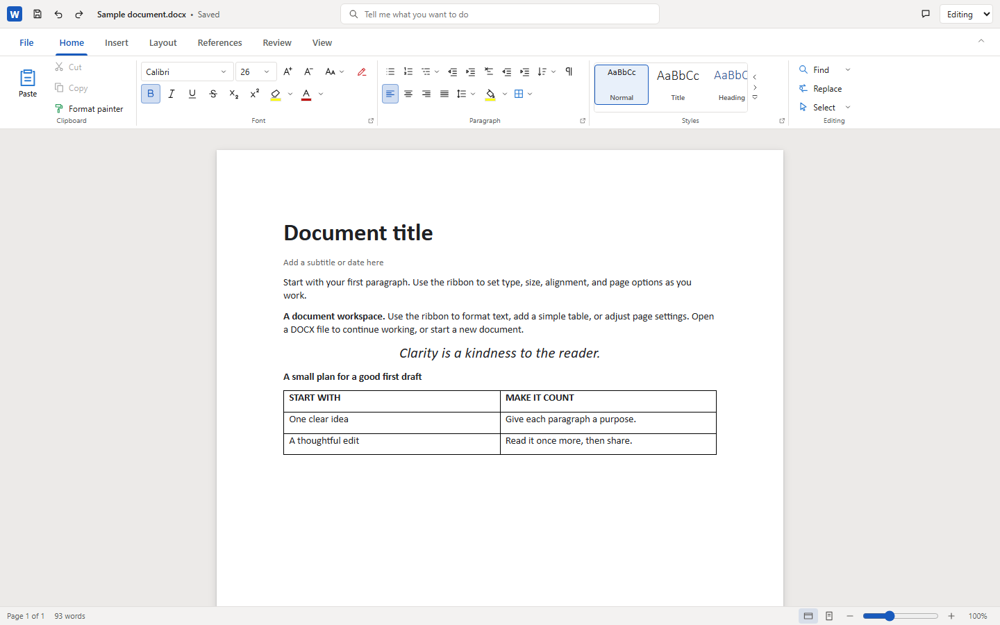

# docx-vanilla-viewer

**A Word document editor for any web page, with no framework: open, edit and save `.docx` and legacy `.doc` files in the browser, with the Word ribbon, dialogs, Print Layout, tracked changes and comments built in.**

[](https://www.npmjs.com/package/docx-vanilla-viewer)
[](https://github.com/ChristopherVR/ooxml/blob/main/viewers/docx/LICENSE)
[](https://www.npmjs.com/package/docx-vanilla-viewer)

[Live demo](https://christophervr.github.io/ooxml/docx/demo-vanilla/) · [Documentation](https://christophervr.github.io/ooxml/docx/) · [Vanilla guide](https://christophervr.github.io/ooxml/docx/frameworks/vanilla) · [Changelog](https://github.com/ChristopherVR/ooxml/blob/main/viewers/docx/packages/vanilla/CHANGELOG.md) · [Report a bug](https://github.com/ChristopherVR/ooxml/issues)



## Install

```bash
npm install docx-vanilla-viewer
```

There is no framework peer dependency. The package brings `docx-core`, `ooxml-core` and `ooxml-ui` with it and re-exports the Word model API (`createDocument`, `loadDocument`, `loadDocx`, `saveDocx` and the types), so one install is all an application needs. Use one Word editor package per application: each registers the same `<docx-editor>` element.

## Quick start

```ts
import { createDocument, mountEditor } from 'docx-vanilla-viewer';

const container = document.querySelector<HTMLElement>('#editor')!;
container.style.height = '100vh';

const editor = mountEditor(container, {
	documentModel: createDocument(),
	onDocumentChange: (model) => console.log('edited', model),
	onDocumentError: (error) => console.error(error),
});
```

`mountEditor` appends a `<docx-editor>` to the container, which it fills, so give the container a height.

## Open and save files

```ts
const input = document.querySelector<HTMLInputElement>('#file')!;
input.addEventListener('change', async () => {
	const file = input.files?.[0];
	if (file) await editor.load(await file.arrayBuffer()); // .docx or legacy .doc
});

document.querySelector('#save')!.addEventListener('click', async () => {
	const blob = await editor.save(); // a .docx Blob
	// ...store the blob, then:
	editor.markClean();
});

// When the editor is no longer needed:
editor.destroy();
```

`load` accepts `.docx` and legacy Word 97-2003 `.doc` bytes and detects the format from the content, never the file name. `save()` resolves to a `Blob` and leaves the document dirty until you call `markClean()`, because only your application knows when the bytes are stored; `download(fileName?)` saves, downloads and marks it clean. A password-protected `.docx` opens through `loadDocument(bytes, { password })`, which the package re-exports; pass the result to the element's `setLoadedDocument`. To route File > Save and File > Open to your own storage instead of downloads and file pickers, set `storage`.

## What you get

- **Word-style editing.** The ribbon (Home, Insert, Design, Layout, References, Mailings, Review, View and the contextual tabs), a title bar with Tell me, the File backstage, a status bar, context menus, undo and redo, find and replace, zoom, and Editing and Viewing modes, all in one element.
- **Print Layout and Draft.** Pagination with line breaking, widow and orphan control, keep rules, columns and table row splitting, page thumbnails and printing. The pagination is this editor's own and approximates Word's.
- **Document structure.** Styles, lists and multilevel numbering, tables, sections and columns, headers and footers, footnotes and endnotes, fields such as TOC, PAGE and REF, content controls and form fields, pictures, shapes, text boxes, watermarks and page borders.
- **Review.** Tracked changes (accept, reject, navigate) and a comments pane with replies and resolve.
- **Charts and SmartArt.** Insert and edit charts (type, legend, data, the Format pane) and SmartArt (nodes, text, layout, styles and colours) with the shared Office pickers and panes.
- **Careful saving.** An unchanged document saves as its original bytes, supported edits keep the package parts the model does not cover, and an edit that cannot be saved safely is refused instead of silently dropped. See the [preservation guarantee](https://github.com/ChristopherVR/ooxml/blob/main/viewers/docx/docs/preservation.md).
- **Collaboration.** `collaboration` shares the document in a room, with presence, over a transport your application provides; your application owns networking, identity, permissions and storage.
- **Interface languages.** English, French, German, Spanish and Simplified Chinese through `locale`. Document content is never translated.

## Using it with plain JavaScript

- **The binding.** `mountEditor(container, options)` returns `element` (the `<docx-editor>`), `load(bytes)`, `save()`, `download(fileName?)`, `markClean()`, `openCloudFile(file)`, `dirty`, `update(options)` and `destroy()`. `update` takes the whole option set; values that did not change are skipped, and a model other than the one the editor last emitted replaces the document. `destroy` leaves a room the binding joined and removes the element.
- **Options and callbacks.** Every prop in [Configuration](#configuration) is an option, and every event is an `on...` callback (`onDocumentChange`, `onDocumentError`, `onDirtyChange`, `onFileCommand` and so on).
- **The element on its own.** Call `registerDocxEditor()`, create a `docx-editor` and set its properties; it raises `document-change`, `document-error`, `file-command` and the other events, which bubble out of its shadow root.

  ```ts
  import { registerDocxEditor } from 'docx-vanilla-viewer';

  registerDocxEditor();
  const element = document.createElement('docx-editor');
  element.fileName = 'Report.docx';
  element.addEventListener('document-change', (event) => console.log(event.detail));
  document.body.append(element);
  ```

- **Element extras.** The element also has `saveBytes()` (the saved `Uint8Array`), `getTextSelection()` and `focusText(range)` to restore the caret after a reload, and `setLoadedDocument(loaded)` for a document you loaded yourself, such as a password-protected one.

### Your own editor UI

To draw only the controls you need, in your own design system, use the building blocks. `createViewerBuildingBlocks(options)` returns a session that `mountDocumentCanvas`, `mountToolbar`, `mountPageNavigation` and `mountStatusBar` render into your own host elements; each returns a function that unmounts it. The surface is read-only until you pass `canEdit: true`; a read-only surface still allows selection, keyboard navigation and copy. See [Building blocks](https://christophervr.github.io/ooxml/docx/building-blocks).

## Configuration

| Prop                                           | What it does                                                                                                   |
| ---------------------------------------------- | -------------------------------------------------------------------------------------------------------------- |
| `documentModel`                                | The document to show. A different model object replaces the document.                                          |
| `readOnly`                                     | Viewing mode. Default `false`.                                                                                 |
| `fileName`                                     | Name in the title bar, used by Save and Download. Default `Document1.docx`.                                    |
| `reviewAuthor`                                 | Author recorded on tracked changes and comments. Default `Author`.                                             |
| `locale`                                       | Interface language: `en`, `fr`, `de`, `es`, `zh-CN`, or a tag such as `de-DE` that maps to one.                |
| `theme`, `themeColors`                         | `light`, `dark` or `auto` (default, follows the system), and colour overrides applied as `--dve-*` properties. |
| `showToolbar`, `hiddenActions`, `ribbonAddIns` | Show the ribbon, hide controls by stable id (`RIBBON_ACTION_IDS`), and add your own tabs after Word's.         |
| `customization`                                | `capabilities`, `ribbon.hiddenTabs` (the File tab included), extra backstage pages and context menu commands.  |
| `showThumbnails`, `readAloud`                  | The page thumbnail rail (Print Layout), and Read Aloud options such as `stopOnEdit`.                           |
| `storage`, `fileProviders`                     | Your storage for File > Save and Open, and cloud places such as OneDrive in File > Open.                       |
| `collaboration`                                | Share the document in a room while set; `null` leaves.                                                         |

The events are document change, document error, document warning (non-fatal notices), page change, dirty change, read-only change, file command (cancelable, to take a File command over), ribbon action, ribbon customize, ribbon add-in command and collaboration change. Listen to them as `on` plus the event name: `onDocumentChange`, `onReadOnlyChange`, `onRibbonAddIn` and so on.

The [bindings guide](https://christophervr.github.io/ooxml/docx/bindings) has every prop and event, [theming](https://christophervr.github.io/ooxml/docx/theming) the colour tokens, and [collaboration](https://christophervr.github.io/ooxml/docx/collaboration) the room protocol. For OneDrive, pass a provider from `ooxml-core/embedding/onedrive` with sign-in your application supplies, as the [OneDrive integration guide](https://github.com/ChristopherVR/ooxml/blob/main/docs/onedrive-integration.md#word-docx) describes; OneDrive storage does not provide Microsoft Office coauthoring or automatic merging of concurrent edits.

## Known limits

This is not Microsoft Word, and it does not claim Word's layout or a lossless round trip for features it does not support. Unsupported content is reported in File > Info and kept on save where the editor can keep it.

- Pagination, line breaking and table AutoFit are the editor's own and can break pages differently from Word.
- Legacy `.doc` files open their main body text, and only paragraph text edits are saved back to `.doc`.
- An inserted or edited SmartArt is drawn with an approximate layout until Word lays it out again, and SmartArt in headers, footers and notes is not editable. Charts are drawn from their cached values, and floating charts are not placed on Print Layout pages.
- Not available yet: Read Mode, Web Layout and Outline views, mail merge data sources, AutoCorrect and AutoFormat as you type, hyphenation, and right-to-left run reordering.

The full list is in the [support roadmap](https://github.com/ChristopherVR/ooxml/blob/main/viewers/docx/docs/parity-roadmap.md) and the [parity checklist](https://github.com/ChristopherVR/ooxml/blob/main/docs/parity-checklist.md).

## Supported environments

- Browsers: the last two major versions of Chrome, Edge, Firefox and Safari, and Safari 16.4 at least. See [browser support](https://github.com/ChristopherVR/ooxml/blob/main/docs/browser-support.md).
- Node.js 22.3 or newer for builds and tests. The editor itself runs in the browser.
- API stability: Word is Stable under the [stability policy](https://github.com/ChristopherVR/ooxml/blob/main/docs/stability.md).

## Privacy and network use

By default the editor makes no network request when it opens, renders, edits or saves a document: linked pictures are not fetched, linked data is not refreshed, and fonts come from the device and the file. Missing fonts are requested from Google Fonts, or a mirror you choose, only when you set the element's `googleFonts` property (for example `{ baseUrl: 'https://fonts.googleapis.com/css2' }`), or when the reader turns on "Download fonts that are not installed or embedded" in File > Options > Trust Center, which is off by default; a value you set locks that toggle. Only the names of public catalogue fonts the document uses and the device lacks are sent, never the file, its text or other font names. Hyperlinks open only when the reader follows them. The editor keeps small preferences on the device in localStorage, including that Trust Center choice (`ooxml.docx.allowFontDownloads`). Nothing collects analytics or telemetry. See [PRIVACY.md](https://github.com/ChristopherVR/ooxml/blob/main/PRIVACY.md).

## Related packages

- The same editor for other frameworks: [`docx-react-viewer`](https://www.npmjs.com/package/docx-react-viewer) (React), [`docx-vue-viewer`](https://www.npmjs.com/package/docx-vue-viewer) (Vue), [`docx-angular-viewer`](https://www.npmjs.com/package/docx-angular-viewer) (Angular), [`docx-svelte-viewer`](https://www.npmjs.com/package/docx-svelte-viewer) (Svelte), [`docx-solid-viewer`](https://www.npmjs.com/package/docx-solid-viewer) (Solid).
- [`docx-core`](https://www.npmjs.com/package/docx-core): the Word model, parser and serializer on its own, for Node and headless use.
- [`docx-viewer-mcp`](https://www.npmjs.com/package/docx-viewer-mcp): Word tools for AI assistants over MCP.
- [`ooxml-core`](https://www.npmjs.com/package/ooxml-core) and [`ooxml-ui`](https://www.npmjs.com/package/ooxml-ui): the Office logic and shared elements this package is built on. The [ooxml repository](https://github.com/ChristopherVR/ooxml#readme) also has Excel, PowerPoint, Visio and OpenTeams editors.

## License

[Apache-2.0](https://github.com/ChristopherVR/ooxml/blob/main/viewers/docx/LICENSE). See [NOTICE](https://github.com/ChristopherVR/ooxml/blob/main/viewers/docx/NOTICE) for attributions.
