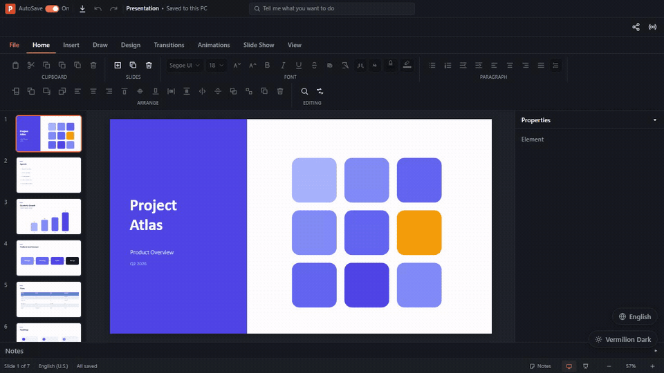
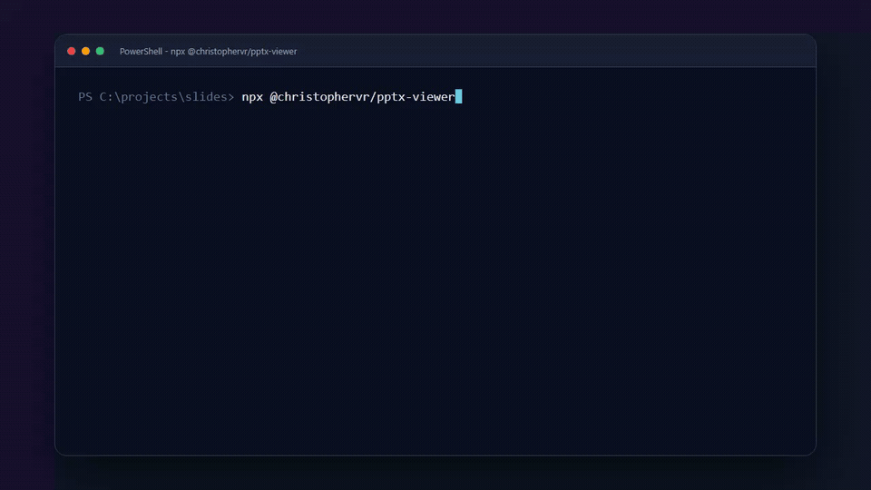

<div align="center">

# pptx-viewer

**Open, edit, present and save PowerPoint files in the browser, or build and convert them in Node.js.**
One TypeScript engine, five UI bindings, no server.

[](https://christophervr.github.io/ooxml/pptx/)
[](LICENSE)
[](https://github.com/ChristopherVR/ooxml/actions/workflows/ci.yml)
[](https://www.npmjs.com/package/pptx-viewer-core)

[**Live demo**](https://christophervr.github.io/ooxml/pptx/demo/) &nbsp;&middot;&nbsp;
[**Documentation**](https://christophervr.github.io/ooxml/pptx/) &nbsp;&middot;&nbsp;
[**Quick start**](#quick-start) &nbsp;&middot;&nbsp;
[**Packages**](#packages) &nbsp;&middot;&nbsp;
[**Changelog**](CHANGELOG.md)

Part of [ooxml](https://github.com/ChristopherVR/ooxml#readme): [Office](https://github.com/ChristopherVR/ooxml#ooxml-office-the-whole-suite-in-one-app) &middot; [Word](../docx#readme) &middot; [Excel](../xlsx#readme) &middot; **PowerPoint** &middot; [Visio](../visio#readme) &middot; [OpenTeams](../teams#readme) &middot; [Core](../../src/core#readme)


</div>

## Why pptx-viewer

- **Client-side.** Decks never leave the user's machine: no PowerPoint install, no conversion service, no native binaries.
- **An editor, not just a viewer.** Ribbon, inspector, on-canvas handles, undo and redo, slide sorter, notes, comments, find and replace, and presenter view.
- **Saves real `.pptx`.** Edit a deck and save a file PowerPoint opens, with the parts you did not touch carried through.
- **Your framework, same product.** React 18 and 19, Vue 3, Angular 19 to 22, Svelte 5 and plain JavaScript run the same viewer from one shared rendering layer, and one manifest keeps their props in step.
- **Sharp and accessible.** Slides are HTML, CSS and SVG, so text is selectable, searchable and read by screen readers. Every change is checked in a real browser for keyboard use, axe-core rules, contrast and 400% zoom, in all five bindings.
- **Safe with files you did not write.** Linked content waits for Enable Content, links open in an isolated tab, signatures show their verified state, and crafted packages cannot exhaust memory.
- **Headless when you need it.** The engine runs in Node.js, Bun, Deno, workers and serverless functions.
- **Ready for agents.** An MCP server with 74 tools reads and edits decks, and a Markdown converter turns slides into text a model can read.

## Feature tour

|                   |                                                                                                                                                                                                                                                                                            |
| ----------------- | ------------------------------------------------------------------------------------------------------------------------------------------------------------------------------------------------------------------------------------------------------------------------------------------ |
| **Rendering**     | 187 preset shapes, custom geometry, gradients, pattern and picture fills, shadows, glow, reflections, soft edges, 3D bevels and camera scenes, WordArt warps, tables with built-in styles, SVG charts, SmartArt, EMF/WMF metafiles, embedded fonts, ink, audio, video and GLB/GLTF models. |
| **Editing**       | Text and rich formatting, style galleries, Edit Points, Merge Shapes, picture cropping, connectors that follow their shapes, chart data and formatting, SmartArt text and layouts, tables, masters and layouts, animation authoring, and full undo and redo.                               |
| **Presenting**    | Fullscreen slide show with transitions (including Morph), entrance, emphasis, exit and motion-path animations, triggers, presenter view with notes and timer, laser pointer and ink.                                                                                                       |
| **Exporting**     | PDF, PNG, GIF, video and JSON from the viewers; SVG and Markdown (with media extraction) from the engine.                                                                                                                                                                                  |
| **Collaboration** | Real-time co-editing and Broadcast over Yjs, through your server or peer to peer, with presence, cursors and threaded comments.                                                                                                                                                            |
| **File formats**  | `.pptx`, `.pptm`, `.ppsx`, `.potx`, OOXML Strict, and legacy binary `.ppt` (PowerPoint 97-2003) for import and export.                                                                                                                                                                     |
| **Security**      | Password-protected decks (AES-128 and AES-256), verified digital signatures, VBA macros kept intact.                                                                                                                                                                                       |
| **Localization**  | English, French, Spanish, German, Simplified Chinese, Japanese and Korean, with pluggable dictionaries.                                                                                                                                                                                    |
| **Storage**       | Host-owned storage and OneDrive through an optional adapter ([integration guide](docs/guide/onedrive.md), [testing](docs/guide/onedrive-testing.md)); sign-in stays with the host, and there is no Office co-authoring.                                                                    |

## Quick start

### 1. Install

The interactive installer detects your framework and package manager, then installs the right package or scaffolds a starter app:

```bash
npx @christophervr/pptx-viewer@latest
```

Or install one package yourself. Every UI package bundles or installs the engine.

| I'm building...                    | Install                     |
| ---------------------------------- | --------------------------- |
| A **React** app                    | `npm i pptx-react-viewer`   |
| A **Vue 3** app                    | `npm i pptx-vue-viewer`     |
| An **Angular** app                 | `npm i pptx-angular-viewer` |
| A **Svelte 5** app                 | `npm i pptx-svelte-viewer`  |
| A page with **no framework**       | `npm i pptx-vanilla-viewer` |
| **Headless** tooling (Node or web) | `npm i pptx-viewer-core`    |
| An **AI agent** workflow           | `npm i pptx-viewer-mcp`     |

Each package README lists its peer dependencies.

### 2. Drop in the viewer

```tsx
import { PowerPointViewer } from 'pptx-react-viewer';
import 'pptx-react-viewer/styles';

export function App({ content }: { content: Uint8Array }) {
	return (
		<div style={{ height: '100vh' }}>
			<PowerPointViewer
				content={content}
				canEdit
				onContentChange={(bytes) => saveToServer(bytes)} // the edited .pptx
			/>
		</div>
	);
}
```

The Vue, Angular and Svelte viewers read their labels through the framework's i18n library (`vue-i18n`, `@ngx-translate/core`) or a built-in translator, so their quick starts include a few lines of setup:

| Framework  | Quick start                                                | Live demo                                                                |
| ---------- | ---------------------------------------------------------- | ------------------------------------------------------------------------ |
| React      | [packages/react](packages/react/README.md#quick-start)     | [demo](https://christophervr.github.io/ooxml/pptx/demo/)                 |
| Vue 3      | [packages/vue](packages/vue/README.md#quick-start)         | [demo-vue](https://christophervr.github.io/ooxml/pptx/demo-vue/)         |
| Angular    | [packages/angular](packages/angular/README.md#quick-start) | [demo-angular](https://christophervr.github.io/ooxml/pptx/demo-angular/) |
| Svelte 5   | [packages/svelte](packages/svelte/README.md#quick-start)   | [demo-svelte](https://christophervr.github.io/ooxml/pptx/demo-svelte/)   |
| Vanilla JS | [packages/vanilla](packages/vanilla/README.md#quick-start) | [demo-vanilla](https://christophervr.github.io/ooxml/pptx/demo-vanilla/) |

For file loading, CSS setup and container sizing, follow the [getting-started guide](https://christophervr.github.io/ooxml/pptx/guide/quick-start).

## Headless: create, edit and convert decks in code

`pptx-viewer-core` is the engine the viewers use, with no UI.

```ts
import { PptxHandler, PptxMarkdownConverter } from 'pptx-viewer-core';

// Build a deck
const { handler, data, createSlide } = await PptxHandler.create({ title: 'Quarterly Review' });
data.slides.push(
	createSlide()
		.addText('Hello World', { x: 100, y: 100, width: 600, height: 80, fontSize: 36 })
		.addShape('rect', { x: 100, y: 250, width: 300, height: 200 })
		.build(),
);
const bytes = await handler.save(data.slides); // a valid .pptx

// Open one, read it, convert it
const opened = await new PptxHandler().load(arrayBuffer);
const markdown = await new PptxMarkdownConverter('./output', {
	sourceName: 'deck.pptx',
	includeSpeakerNotes: true,
	semanticMode: true,
}).convert(opened);
```

The engine also ships a `pptx` command (`npx pptx-viewer-core info deck.pptx`). See the [core guide](https://christophervr.github.io/ooxml/pptx/core/) for the data model, builders, encryption, signatures and the [converter options](docs/core/converter.md).

## AI agents and MCP

`pptx-viewer-mcp` exposes the engine as Model Context Protocol tools, so Claude, Cursor and other agents can read, edit and save presentations under a root folder you choose:

```json
{
	"mcpServers": {
		"pptx": { "command": "npx", "args": ["pptx-viewer-mcp", "--root", "/path/to/decks"] }
	}
}
```

Every tool is also a plain function (`replaceText({ pptxData }, { query: 'Draft', replacement: 'Final' })`). The viewers' optional built-in [AI assistant](https://christophervr.github.io/ooxml/pptx/guide/ai-assistant) drives the same tools, with a write policy that applies, stages or asks for approval of each change.

## See it in each framework

| React                                                                                                                            | Vue 3                                                                                                                              | Angular                                                                                                                            |
| -------------------------------------------------------------------------------------------------------------------------------- | ---------------------------------------------------------------------------------------------------------------------------------- | ---------------------------------------------------------------------------------------------------------------------------------- |
|    |          |  |
| **Svelte 5**                                                                                                                     | **Vanilla JS**                                                                                                                     | **Installer**                                                                                                                      |
|  |  |    |

## Packages

| Package                                                | What it is                                                                       |
| ------------------------------------------------------ | -------------------------------------------------------------------------------- |
| [`pptx-viewer-core`](packages/core/README.md)          | Parse, build, edit, save and convert PowerPoint files, with a CLI. No UI.        |
| [`pptx-react-viewer`](packages/react/README.md)        | React viewer, editor and presenter.                                              |
| [`pptx-vue-viewer`](packages/vue/README.md)            | Vue 3 viewer, editor and presenter.                                              |
| [`pptx-angular-viewer`](packages/angular/README.md)    | Angular viewer, editor and presenter.                                            |
| [`pptx-svelte-viewer`](packages/svelte/README.md)      | Svelte 5 viewer, editor and presenter.                                           |
| [`pptx-vanilla-viewer`](packages/vanilla/README.md)    | Viewer, editor and presenter with no framework: one factory function, plain DOM. |
| [`pptx-viewer-mcp`](packages/tools/README.md)          | MCP server and tool functions for AI agents.                                     |
| [`@christophervr/pptx-viewer`](packages/cli/README.md) | The `npx` installer and scaffolder, and the React viewer under a scoped name.    |

Internal and never installed directly: [`pptx-viewer-shared`](packages/shared/README.md) (a compatibility facade; the framework-neutral renderer lives in `ooxml-ui/pptx`) and [`pptx-viewer-locales`](packages/locales/README.md) (translations).

## How it works

```
pptx-react-viewer   ┐
pptx-vue-viewer     │
pptx-angular-viewer ├── ooxml-ui/pptx ── pptx-viewer-core ── ooxml-core/pptx ──┬── emf-converter
pptx-svelte-viewer  │   (viewer logic)   (thin re-export)    (file format)       └── mtx-decompressor
pptx-vanilla-viewer ┘
```

- **Core** owns the file format: the load and save pipelines, the typed `PptxData` model (a discriminated union of 16 element types), theme inheritance (element, placeholder, layout, master, theme), geometry, encryption, signatures and converters.
- **Shared** (`ooxml-ui/pptx`) holds everything a viewer needs that is not framework code: style and colour resolution, text layout, chart maths, connector routing, the animation and Morph engines, export preparation, and the headless controllers (undo, autosave, slide show, sorter, comments).
- **Bindings** map the shared descriptors onto JSX, single-file components, Angular templates, Svelte runes or plain DOM, which is why all five render the same and ship the same features.

Read the [architecture guide](https://christophervr.github.io/ooxml/pptx/guide/architecture) for the deep dive.

## Fidelity and compatibility

Fidelity is tracked in the open. Rendering is compared with real PowerPoint output, the [OpenXML conformance inventory](docs/architecture/openxml-conformance.md) grades each feature, and a construct that loads as an approximation is reported at runtime on `data.warnings`. The [limitations page](https://christophervr.github.io/ooxml/pptx/guide/limitations) lists what is still being worked on, and [`docs/parity-checklist.md`](../../docs/parity-checklist.md) the open gaps across the Office products.

Browsers: the last two major versions of Chrome, Edge, Firefox and Safari, and Safari 16.4 at least ([browser support](../../docs/browser-support.md)). Node.js 22.3 or newer.

## Contributing

The viewer lives in `viewers/pptx` of [ChristopherVR/ooxml](https://github.com/ChristopherVR/ooxml), next to the `ooxml-core` engine it is built on; its demos are in `demos/pptx` and its browser tests in `e2e/pptx` at the repository root.

```bash
git clone https://github.com/ChristopherVR/ooxml.git
cd ooxml
bun install                                  # one workspace for the whole repository
bun run build && bun run --cwd src/ui build  # the engine and the shared UI the viewer reads
cd viewers/pptx
bun run build:packages   # core -> shared -> locales -> tools -> cli -> the five bindings
bun run test
bun run demo             # React demo on :4173 (also demo:vue, demo:angular, demo:svelte, demo:vanilla)
bun run e2e:fast         # cached production demos, React tests and cross-binding comparisons
bun run e2e:all          # ordinary product tests in every binding
```

See [fast browser testing](../../docs/browser-performance.md) for selected specs, warm servers, worker budgets, CI sharding and measured results.

You will need [Bun](https://bun.sh/) and Node.js 22.3 or newer. Read [CONTRIBUTING.md](CONTRIBUTING.md) before opening a pull request: it explains the **parity rule** (a UI change lands in all five bindings), Conventional Commits (they drive each package's version) and how the demos resolve packages. This project follows a [Code of Conduct](CODE_OF_CONDUCT.md); report vulnerabilities privately through [SECURITY.md](SECURITY.md).

> _Developed with [Claude Code](https://claude.com/claude-code)._

## License

[Apache License 2.0](LICENSE): free to use, modify and distribute, including in commercial and closed-source products, with an explicit patent grant. When redistributing, keep the [`LICENSE`](LICENSE) and [`NOTICE`](NOTICE) files and note any files you changed. Some bundled components carry their own licenses (for example, `mtx-decompressor` is MPL-2.0); see the `NOTICE` files.
