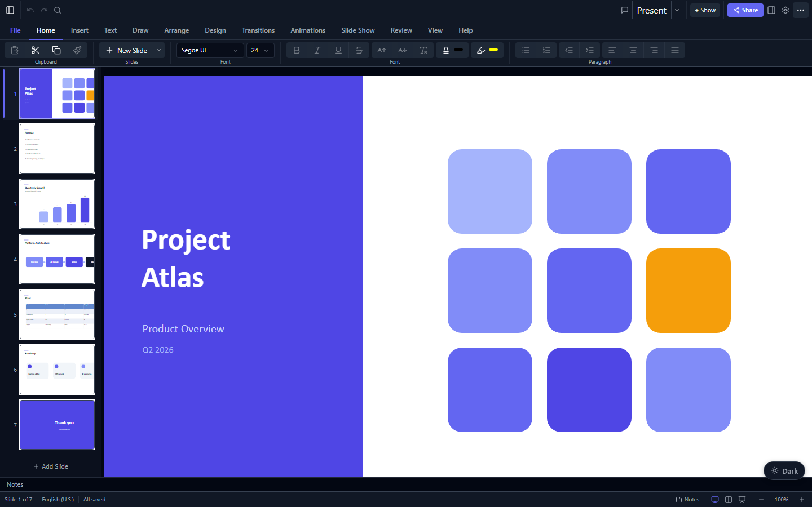

<div align="center">

# PowerPoint viewer

**Open, edit, present and save PowerPoint files in the browser, or build and convert them in Node.js: one TypeScript engine, five UI bindings, no server.**
For web apps that need decks without a PowerPoint install or a conversion service, and for scripts and AI agents that read or write them.

[](LICENSE)
[](https://github.com/ChristopherVR/ooxml/actions/workflows/ci.yml)
[](https://www.npmjs.com/package/pptx-react-viewer)

[**Live demo**](https://christophervr.github.io/ooxml/pptx/demo/) &middot; [**Docs**](https://christophervr.github.io/ooxml/pptx/) &middot; [**Samples**](https://christophervr.github.io/ooxml/samples/) &middot; [**Packages**](#packages) &middot; [**Changelog**](CHANGELOG.md)

Part of [ooxml](https://github.com/ChristopherVR/ooxml#readme): [Word](../docx#readme) &middot; [Excel](../xlsx#readme) &middot; **PowerPoint** &middot; [Visio](../visio#readme) &middot; [OpenTeams](../teams#readme) &middot; [Core](../../src/core#readme)



</div>

## Packages

| Package                                                | Framework              | npm                                                             | What it is                                                          |
| ------------------------------------------------------ | ---------------------- | --------------------------------------------------------------- | ------------------------------------------------------------------- |
| [`pptx-react-viewer`](packages/react/README.md)        | React 18.2 or 19       | [npm](https://www.npmjs.com/package/pptx-react-viewer)          | Viewer, editor and presenter component.                             |
| [`pptx-vue-viewer`](packages/vue/README.md)            | Vue 3.5                | [npm](https://www.npmjs.com/package/pptx-vue-viewer)            | The same, as a Vue component.                                       |
| [`pptx-angular-viewer`](packages/angular/README.md)    | Angular 19 to 22       | [npm](https://www.npmjs.com/package/pptx-angular-viewer)        | The same, as a standalone component (`<pptx-viewer>`).              |
| [`pptx-svelte-viewer`](packages/svelte/README.md)      | Svelte 5               | [npm](https://www.npmjs.com/package/pptx-svelte-viewer)         | The same, as a Svelte component.                                    |
| [`pptx-vanilla-viewer`](packages/vanilla/README.md)    | None                   | [npm](https://www.npmjs.com/package/pptx-vanilla-viewer)        | The same, from one `createPptxViewer` call.                         |
| [`pptx-viewer-core`](packages/core/README.md)          | None (Node or browser) | [npm](https://www.npmjs.com/package/pptx-viewer-core)           | Read, build, edit, save and convert decks with no UI; a `pptx` CLI. |
| [`pptx-viewer-mcp`](packages/tools/README.md)          | None (Node)            | [npm](https://www.npmjs.com/package/pptx-viewer-mcp)            | MCP server with 74 PowerPoint tools, and the tools as functions.    |
| [`@christophervr/pptx-viewer`](packages/cli/README.md) | Any                    | [npm](https://www.npmjs.com/package/@christophervr/pptx-viewer) | The `npx` installer, and the React viewer under a scoped name.      |

[`pptx-viewer-shared`](packages/shared/README.md) and [`pptx-viewer-locales`](packages/locales/README.md) are private workspace packages and are never published.

## Quick start

```bash
npx @christophervr/pptx-viewer@latest # picks your framework and installs the right package
```

```tsx
import { PowerPointViewer } from 'pptx-react-viewer';
import 'pptx-react-viewer/styles';

export function App({ content }: { content: Uint8Array }) {
	return (
		<div style={{ height: '100vh' }}>
			<PowerPointViewer content={content} canEdit onContentChange={(bytes) => save(bytes)} />
		</div>
	);
}
```

Every framework has the same shape: pass the deck's bytes, turn editing on, listen for the edited bytes or read them from the handle. The props and events of the five bindings are kept identical by one manifest (`src/ui/src/pptx/render/viewer-props-manifest.ts`, checked by `bun run check:viewer-props`). Vue and Angular read their labels through `vue-i18n` and `@ngx-translate/core`, so their quick starts add a few lines; see each [package](#packages).

## Features

- **Rendering** as HTML, CSS and SVG (selectable text, screen readers): the 187 preset shapes, custom geometry, effects, tables, charts, SmartArt, EMF/WMF pictures, embedded fonts, ink, audio, video and 3D models.
- **Editing** with a PowerPoint-style ribbon, inspector and on-canvas handles: text, tables, chart data, SmartArt, masters and layouts, animations, undo and redo.
- **Presenting** with transitions (including Morph), animations and motion paths, presenter view, rehearse timings, pen and laser.
- **Files**: `.pptx`, `.pptm`, `.ppsx`, `.potx`, Strict OOXML and legacy `.ppt` in and out; password-protected decks; signature inspection; export to PDF, PNG, GIF, video and JSON, and to SVG and Markdown from the engine.
- **Collaboration** over Yjs, through your server or peer to peer, with presence and threaded comments.
- **Host control**: hide or lock any ribbon command, panel or option, bring your own storage, fonts and load limits, and an optional AI assistant with a write policy.
- **Seven UI languages**: English, French, Spanish, German, Simplified Chinese, Japanese and Korean.

## Status and limits

PowerPoint carries no stability label yet: it has not been assessed against the [stability policy](../../docs/stability.md). It does not claim PowerPoint parity or a lossless round trip: untouched parts are carried through a save, but an edited slide can still lose minor markup, some effects are approximated, and the editor covers a subset of PowerPoint. A deck that hits a known gap reports it on load (`data.warnings`). The [limitations page](https://christophervr.github.io/ooxml/pptx/guide/limitations), the [OpenXML conformance inventory](docs/architecture/openxml-conformance.md) and the PowerPoint section of the [Office parity checklist](../../docs/parity-checklist.md#powerpoint) list what is open.

## Privacy and network use

Decks are opened and saved on the device and never uploaded, and nothing collects telemetry. By default the viewers download fonts that are neither installed nor embedded from Google Fonts (`googleFonts: false` or a mirror turns it off); linked media wait for Enable Content (`allowExternalContent`), and collaboration and the AI assistant contact only what you configure once started. Details are in the [PowerPoint section of PRIVACY.md](../../PRIVACY.md#powerpoint-ooxml-uipptx-and-the-pptx--viewer-packages).

## Samples

Sample files to try: https://christophervr.github.io/ooxml/samples/

## Documentation

- [Docs site](https://christophervr.github.io/ooxml/pptx/): the [getting-started guide](https://christophervr.github.io/ooxml/pptx/guide/quick-start), one guide per framework, the [core guide](https://christophervr.github.io/ooxml/pptx/core/), the [architecture](https://christophervr.github.io/ooxml/pptx/guide/architecture) and the [user guide](https://christophervr.github.io/ooxml/pptx/user/). Its source is [`docs/`](docs/).
- [Browser support](../../docs/browser-support.md): the last two major versions of Chrome, Edge, Firefox and Safari, Safari 16.4 at least; Node.js 22.3 or newer.
- [AGENTS.md](AGENTS.md) and [CONTRIBUTING.md](CONTRIBUTING.md) for contributors: the parity rule (a UI change lands in all five bindings), where code goes, and how the demos resolve packages. Report vulnerabilities through [SECURITY.md](SECURITY.md).

## Development

The viewer lives in `viewers/pptx` of this repository; its demos are in `demos/pptx` and its browser tests in `e2e/pptx` at the root. Install and build the engine and the shared UI at the root first, then work here:

```bash
bun install                                  # at the repository root: one workspace
bun run build && bun run --cwd src/ui build  # the core and ooxml-ui that the bindings read
cd viewers/pptx
bun run build:packages   # core, shared, locales, tools, cli, then the five bindings
bun run typecheck        # needs the built packages
bun run test             # every package's Vitest suite
bun run lint
bun run check:viewer-props
bun run demo             # React demo on :4173 (also demo:vue, demo:angular, demo:vanilla, demo:svelte)
bun run e2e              # Playwright across the five demos (--project=react to narrow)
bun run e2e:fast         # cached production demos, React tests and cross-binding comparisons
bun run e2e:local-only   # the specs CI skips; run before pushing changes they cover
bun run docs:dev         # the VitePress docs site
```

See [fast browser testing](../../docs/browser-performance.md) for selected specs, warm servers and worker budgets.

## License

[Apache License 2.0](LICENSE). Keep the [LICENSE](LICENSE) and [NOTICE](NOTICE) files with redistributions; some bundled components carry their own licences (for example `mtx-decompressor` is MPL-2.0), listed in the NOTICE files.
