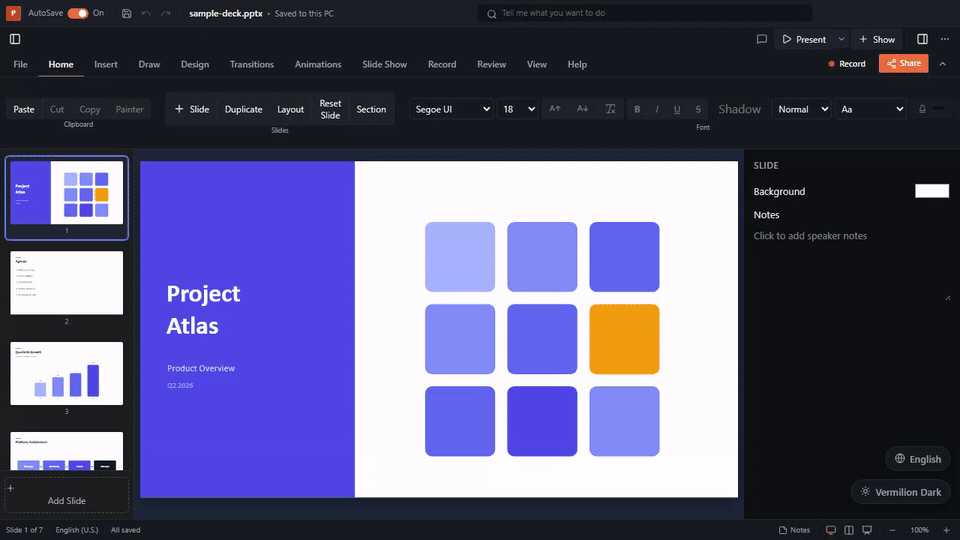

# pptx-angular-viewer

**A standalone Angular component (`<pptx-viewer>`) that opens, edits, presents and saves PowerPoint files (`.pptx`, `.pptm`, `.ppsx`, `.potx` and legacy `.ppt`) in the browser, with no server.**

[](https://www.npmjs.com/package/pptx-angular-viewer)
[](https://github.com/ChristopherVR/ooxml/blob/main/viewers/pptx/LICENSE)
[](https://www.npmjs.com/package/pptx-angular-viewer)

[Live demo](https://christophervr.github.io/ooxml/pptx/demo-angular/) · [Documentation](https://christophervr.github.io/ooxml/pptx/) · [Angular guide](https://christophervr.github.io/ooxml/pptx/angular/) · [Changelog](https://github.com/ChristopherVR/ooxml/blob/main/viewers/pptx/packages/angular/CHANGELOG.md) · [Report a bug](https://github.com/ChristopherVR/ooxml/issues)



## Install

```bash
npm install pptx-angular-viewer
npm install @angular/core @angular/common @angular/platform-browser rxjs @ngx-translate/core
```

The second line is the required peers: Angular 19, 20, 21 or 22, `rxjs` `^7.8.0` and `@ngx-translate/core` 18. The engine comes with it (`pptx-viewer-core` and `ooxml-ui` are dependencies). The component is built on signals and `OnPush`, works without Zone.js and needs no NgModule. Optional peers:

| For                                  | Add                                    |
| ------------------------------------ | -------------------------------------- |
| Real-time collaboration              | `yjs` with `y-websocket` or `y-webrtc` |
| 3D models, 3D SmartArt and 3D charts | `three` 0.187                          |
| The AI assistant panel               | `ai` (6 or 7)                          |

Without them those features stay off and everything else works.

## Quick start

Add the stylesheet to the `styles` array of your build target in `angular.json` (or `@import` it at the top of `src/styles.css`). Do not import it from TypeScript: the application builder writes CSS imported that way to a file `index.html` never links.

```json
"styles": ["pptx-angular-viewer/styles.css", "src/styles.css"]
```

Every label goes through `@ngx-translate/core`, so provide it and register the viewer's English dictionary:

```ts
// main.ts
import { bootstrapApplication } from '@angular/platform-browser';
import { provideTranslateService } from '@ngx-translate/core';

import { AppComponent } from './app.component';

bootstrapApplication(AppComponent, {
	providers: [provideTranslateService({ lang: 'en', fallbackLang: 'en' })],
});
```

```ts
// app.component.ts
import { Component, inject, signal, viewChild } from '@angular/core';
import { TranslateService } from '@ngx-translate/core';
import { PowerPointViewerComponent, translationsEn } from 'pptx-angular-viewer';

@Component({
	selector: 'app-root',
	imports: [PowerPointViewerComponent],
	template: `
		<div style="height: 100vh">
			@if (content()) {
				<pptx-viewer [content]="content()" [canEdit]="true" />
			} @else {
				<input type="file" accept=".pptx,.ppt" (change)="onPick($event)" />
			}
		</div>
	`,
})
export class AppComponent {
	readonly content = signal<Uint8Array | null>(null);
	private readonly viewer = viewChild(PowerPointViewerComponent);

	constructor() {
		inject(TranslateService).setTranslation('en', translationsEn);
	}

	async onPick(event: Event) {
		const file = (event.target as HTMLInputElement).files?.[0];
		if (file) this.content.set(new Uint8Array(await file.arrayBuffer()));
	}

	async save() {
		const bytes = await this.viewer()?.getContent(); // the edited .pptx
	}
}
```

`content` takes a `Uint8Array` or an `ArrayBuffer`. The viewer fills its parent, so give the parent a height.

## Props

The most used inputs. Every binding takes the same set; the [inputs reference](https://christophervr.github.io/ooxml/pptx/angular/props) has all of them.

| Input                                            | What it does                                                                                    |
| ------------------------------------------------ | ----------------------------------------------------------------------------------------------- |
| `content`                                        | The deck's bytes (`Uint8Array` or `ArrayBuffer`).                                               |
| `canEdit`, `readOnly`                            | Turn editing on, or force the deck read-only (`readOnly` wins).                                 |
| `initialSlide`, `showToolbar`, `showThumbnails`  | Starting slide and which chrome to show.                                                        |
| `theme`, `defaultThemeKey`, `availableThemes`    | Viewer chrome colours and radius, and the File > Options appearance choices.                    |
| `defaultLocale`, `availableLocales`              | The starting UI language and the languages offered.                                             |
| `customization`, `hiddenActions`, `ribbonAddIns` | Hide, lock or remap ribbon tabs, commands, options, menus, shortcuts and panels; add your tabs. |
| `fonts`, `googleFonts`                           | Supply licensed fonts; turn off or redirect web font downloads.                                 |
| `allowExternalContent`                           | Fetch a deck's linked pictures and media without asking (`true`) or block them (`false`).       |
| `limits`                                         | Bound the work a load may do, for decks you do not trust.                                       |
| `collaboration`, `shareDefaults`                 | Join or seed a real-time session.                                                               |
| `storage`, `fileProviders`, `autosave`           | Save to your own storage or a cloud provider, and control recovery autosave.                    |
| `ai`                                             | The optional assistant, from `createAiAssistant` in `pptx-angular-viewer/ai`.                   |
| `fitPadding`, `maxFitScale`                      | How the slide fits its viewport.                                                                |

The component instance has `getContent`, navigation (`goTo`, `goNext`, `goPrev`), zoom (`setZoom`, `zoomIn`, `zoomOut`), `setMode`, `undo`, `redo`, `isDirty`, and the slide and element API (`getSlides`, `addSlide`, `deleteSlides`, `addElement`, `updateElement`, `deleteElements`, `selectElements`). See [the API](https://christophervr.github.io/ooxml/pptx/angular/api).

## Events

Outputs, most used first: `(contentChange)` (the edited bytes), `(dirtyChange)`, `(activeSlideChange)`, `(selectionChange)`, `(load)`, `(error)`, `(documentChange)`, `(modeChange)`, `(zoomChange)`, `(slideCountChange)`, `(autosaved)`, `(collaborationChange)` and `(pdfExportReport)`. A few host callbacks are inputs instead: `onOpenFile`, `onHyperlinkClick`, `onThemeChange`, `onLocaleChange` and `onElementRenderError`. See the [inputs reference](https://christophervr.github.io/ooxml/pptx/angular/props).

## Your own UI

`createViewerBuildingBlocks` with `VIEWER_BUILDING_BLOCKS_PROVIDERS` runs the viewer's editor services behind `<pptx-building-blocks-canvas>`, `<pptx-building-blocks-toolbar>` and `<pptx-slides-pane>`, so you can place them in your own layout and answer picker and dialog requests with your own UI. See [building blocks](https://christophervr.github.io/ooxml/pptx/angular/building-blocks) and the [services reference](https://christophervr.github.io/ooxml/pptx/angular/services-reference).

## Theming

The chrome inherits the shared `--office-*` tokens: put `data-office-theme="light"`, `"dark"` or `"auto"` on a containing element, or set tokens such as `--office-accent` there. The `[theme]` input (a partial `ViewerTheme`) overrides them through the viewer's `--pptx-*` properties, and `provideViewerTheme(theme)` in `bootstrapApplication` themes the whole app; `vermilionLightTheme` and `vermilionDarkTheme` are ready-made. See [theming](https://christophervr.github.io/ooxml/pptx/angular/theming).

## Localisation

English, French, Spanish, German, Simplified Chinese, Japanese and Korean. `translationsEn`, `keyToLabel` (for a `MissingTranslationHandler`) and `LOCALE_CATALOG` come from the package root, and the other dictionaries from `pptx-angular-viewer/i18n/fr`, `/es`, `/de`, `/zh-CN`, `/ja` and `/ko`: register them with `setTranslation` and switch with `use('fr')`. See [localisation](https://christophervr.github.io/ooxml/pptx/guide/localization).

## Status and limits

PowerPoint carries no stability label yet: it has not been assessed against the [stability policy](https://github.com/ChristopherVR/ooxml/blob/main/docs/stability.md).

- Saving keeps the parts you did not touch, but saving an edited slide can still rewrite minor markup; it is not a lossless round trip.
- Some effects are approximated (3D materials, some WordArt warps, SmartArt without its cached drawing). A deck that uses an approximated construct reports it as a load warning.
- The editor covers a subset of PowerPoint: Remove Background, narration, Notes Master, Handout Master, Notes Page view, Grayscale views and Designer are not there yet.
- OneDrive stores files through an adapter whose sign-in your host provides; there is no Office co-authoring.

See the [limitations page](https://christophervr.github.io/ooxml/pptx/guide/limitations) and the [Office parity checklist](https://github.com/ChristopherVR/ooxml/blob/main/docs/parity-checklist.md#powerpoint).

## Privacy and network use

The viewer renders and saves decks in the browser and never uploads them. Nothing collects analytics or telemetry. It contacts other servers only in these cases:

- **Web fonts (on by default).** A font that is neither installed nor embedded, when the bundled Google Fonts catalogue serves it or a stand-in, is downloaded from `fonts.googleapis.com` and `fonts.gstatic.com`; Google sees the reader's IP address and the family names. Set `googleFonts` to `false` to turn it off, or to `{ baseUrl }` to use your own mirror; readers can turn it off in File > Options > Trust Center. Offline, the deck opens with substitute fonts.
- **Linked pictures and media (off by default).** Fetched only after the reader chooses Enable Content on the security bar, or always with `allowExternalContent` set to `true`; `false` blocks them without the bar.
- **Share and Broadcast (only when started).** Updates go to the server you configure; without one, peers meet through y-webrtc's public signalling server and public STUN servers. Pass your own `collaboration.signaling` list to avoid them.
- **AI assistant (off unless you pass `ai`).** Requests go to the connection you configure, with the conversation and deck context (`contextStrategy: 'none'` sends no deck context).
- **Links** (hyperlinks, Microsoft Forms responses) open only when clicked, in a new tab without opener or referrer. `file:` and `ftp:` links never open, and relative links (`notes.html`, `#part`) open, against your page's address, only after you call `setOpenRelativeHyperlinks(true)` from `ooxml-ui/pptx`.

Autosave, recovery and preferences stay on the device (IndexedDB and localStorage). The full list, including Ink to Math and the camera, is in [PRIVACY.md](https://github.com/ChristopherVR/ooxml/blob/main/PRIVACY.md#powerpoint-ooxml-uipptx-and-the-pptx--viewer-packages).

## Browser support

- The last two major versions of Chrome, Edge, Firefox and Safari; Safari 16.4 at least ([browser support](https://github.com/ChristopherVR/ooxml/blob/main/docs/browser-support.md)).
- Angular 19, 20, 21 or 22, with or without Zone.js.
- Node.js 22.3 or newer to install and build (the Angular CLI may ask for more).

## Documentation and demos

- [Documentation](https://christophervr.github.io/ooxml/pptx/), the [Angular guide](https://christophervr.github.io/ooxml/pptx/angular/) and the [live demo](https://christophervr.github.io/ooxml/pptx/demo-angular/).
- The same viewer for [React](https://www.npmjs.com/package/pptx-react-viewer), [Vue](https://www.npmjs.com/package/pptx-vue-viewer), [Svelte](https://www.npmjs.com/package/pptx-svelte-viewer) and [no framework](https://www.npmjs.com/package/pptx-vanilla-viewer).
- [`pptx-viewer-core`](https://www.npmjs.com/package/pptx-viewer-core) for decks without a UI, and [`pptx-viewer-mcp`](https://www.npmjs.com/package/pptx-viewer-mcp) for AI agents.
- Part of [ooxml](https://github.com/ChristopherVR/ooxml#readme), with Word, Excel and Visio editors.

## License

[Apache-2.0](https://github.com/ChristopherVR/ooxml/blob/main/viewers/pptx/LICENSE). Keep the [NOTICE](https://github.com/ChristopherVR/ooxml/blob/main/viewers/pptx/NOTICE) file with redistributions.
