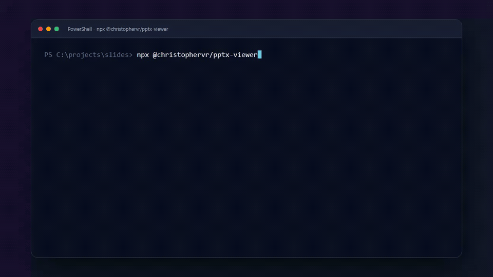

# @christophervr/pptx-viewer

**An `npx` installer that adds the PowerPoint viewer to your React, Vue, Angular, Svelte or plain JavaScript project (or scaffolds a new one), and, imported as a library, the React viewer from `pptx-react-viewer` under a scoped name.**

[](https://www.npmjs.com/package/@christophervr/pptx-viewer)
[](https://github.com/ChristopherVR/ooxml/blob/main/viewers/pptx/LICENSE)
[](https://www.npmjs.com/package/@christophervr/pptx-viewer)

[Live demo](https://christophervr.github.io/ooxml/pptx/demo/) · [Documentation](https://christophervr.github.io/ooxml/pptx/) · [Installation guide](https://christophervr.github.io/ooxml/pptx/guide/installation) · [Changelog](https://github.com/ChristopherVR/ooxml/blob/main/viewers/pptx/packages/cli/CHANGELOG.md) · [Report a bug](https://github.com/ChristopherVR/ooxml/issues)



## Install

Nothing needs installing first for the installer:

```bash
npx @christophervr/pptx-viewer@latest
# or
bunx @christophervr/pptx-viewer@latest
```

To use it as a library, install it with `pptx-react-viewer` and the React viewer's peers (they are optional peers here, so an installer-only use never warns about React):

```bash
npm install @christophervr/pptx-viewer pptx-react-viewer
npm install react react-dom framer-motion lucide-react react-icons jspdf jszip fast-xml-parser i18next react-i18next
```

## Quick start

The installer asks what you are building, checks your project, then installs the right package or scaffolds a starter app:

| Target     | Installs                                                                                                               |
| ---------- | ---------------------------------------------------------------------------------------------------------------------- |
| React      | [`pptx-react-viewer`](https://www.npmjs.com/package/pptx-react-viewer), for React 18.2 or 19                           |
| Vue        | [`pptx-vue-viewer`](https://www.npmjs.com/package/pptx-vue-viewer), for Vue 3.5                                        |
| Angular    | [`pptx-angular-viewer`](https://www.npmjs.com/package/pptx-angular-viewer), for Angular 19 to 22                       |
| Svelte     | [`pptx-svelte-viewer`](https://www.npmjs.com/package/pptx-svelte-viewer), for Svelte 5                                 |
| Vanilla JS | [`pptx-vanilla-viewer`](https://www.npmjs.com/package/pptx-vanilla-viewer), no framework                               |
| Core       | [`pptx-viewer-core`](https://www.npmjs.com/package/pptx-viewer-core), the engine with no UI                            |
| MCP        | Nothing: it prints the MCP client configuration for [`pptx-viewer-mcp`](https://www.npmjs.com/package/pptx-viewer-mcp) |

1. **Pick targets.** Arrow keys move, Space toggles, `a` selects all, Enter confirms: at most one UI framework, plus `core` and `mcp` if you like.
2. **Compatibility check.** With a `package.json` present, it compares your installed `react`, `vue`, `@angular/core` or `svelte` major with what the viewer supports, and asks before going on when they differ.
3. **Install here, or scaffold.** Installing here needs an existing `package.json`. Scaffolding creates a project with `create-vite` (React, Vue, Svelte, Vanilla JS) or `@angular/cli` (whose current major needs Node.js 22.22.0+, 24.13.1+ or 26.0.0+), replaces its entry file with a working viewer, installs the viewer and its companion packages, offers collaboration (`yjs`, `y-websocket`, `y-webrtc`) and, for Vanilla JS, 3D (`three`), then starts the dev server.

It detects `bun`, `pnpm`, `yarn` or `npm` from your lockfile, then from the manager that launched it, and prints a quick-start snippet when it is done.

## Options

```bash
npx @christophervr/pptx-viewer --target react,mcp --yes
npx @christophervr/pptx-viewer --target vue --scaffold --dir my-app --yes
npx @christophervr/pptx-viewer --pm pnpm
```

| Flag             | Meaning                                                                                          |
| ---------------- | ------------------------------------------------------------------------------------------------ |
| `--target <ids>` | Comma-separated `react`, `vue`, `angular`, `svelte`, `vanilla`, `core`, `mcp`; skips the picker. |
| `--scaffold`     | Create a new project instead of installing here; needs exactly one UI target.                    |
| `--dir <name>`   | The new project's folder (default `pptx-<target>-app`).                                          |
| `--pm <manager>` | `bun`, `pnpm`, `yarn` or `npm`, instead of detecting one.                                        |
| `--yes`, `-y`    | Skip confirmations, including the compatibility warning; optional prompts take their default.    |
| `--help`, `-h`   | Print usage and exit.                                                                            |

Without `--target` and without a terminal (piped stdin, most CI runners) it exits with an error instead of waiting for input. An unknown flag, target or manager exits with a one-line error, and Ctrl+C in the picker exits with status 130. Colour turns off under `NO_COLOR` or when output is not a terminal.

## As a React component

```tsx
import { PowerPointViewer } from '@christophervr/pptx-viewer';
import 'pptx-react-viewer/styles';

// <div style={{ height: '100vh' }}><PowerPointViewer content={bytes} canEdit /></div>
```

Everything `pptx-react-viewer` exports from its root is re-exported here, so its [README](https://github.com/ChristopherVR/ooxml/blob/main/viewers/pptx/packages/react/README.md) (props, events, theming, localisation) and [React guide](https://christophervr.github.io/ooxml/pptx/react/) apply as written. The stylesheet and the subpath entries (`/styles`, `/ai`, `/i18n`, `/viewer`) ship only under the real package name, which is why the install line adds it. For a new React project, depending on `pptx-react-viewer` alone is simpler.

## Status and limits

PowerPoint carries no stability label yet: it has not been assessed against the [stability policy](https://github.com/ChristopherVR/ooxml/blob/main/docs/stability.md). The library inherits the React viewer's limits (see its README, the [limitations page](https://christophervr.github.io/ooxml/pptx/guide/limitations) and the [Office parity checklist](https://github.com/ChristopherVR/ooxml/blob/main/docs/parity-checklist.md#powerpoint)). The installer installs only into a project with a `package.json`, and scaffolds only one UI target at a time.

## Privacy and network use

The installer runs your package manager and, when scaffolding, `create-vite` or `@angular/cli`, which download packages from your configured registry. It sends nothing else.

As a library this package is the React viewer, which renders and saves decks in the browser and never uploads them. It contacts other servers only for web fonts that are neither installed nor embedded (Google Fonts, on by default; `googleFonts: false` or a mirror turns it off), for a deck's linked pictures and media after the reader chooses Enable Content (or `allowExternalContent: true`), for links the reader clicks, for Share and Broadcast once started, and for the AI assistant when you pass `ai`. The [React viewer's README](https://github.com/ChristopherVR/ooxml/blob/main/viewers/pptx/packages/react/README.md#privacy-and-network-use) gives the details. Nothing collects analytics or telemetry. See [PRIVACY.md](https://github.com/ChristopherVR/ooxml/blob/main/PRIVACY.md#powerpoint-ooxml-uipptx-and-the-pptx--viewer-packages).

## Browser support

- The library: the last two major versions of Chrome, Edge, Firefox and Safari, Safari 16.4 at least ([browser support](https://github.com/ChristopherVR/ooxml/blob/main/docs/browser-support.md)), with React 18.2 or 19.
- Node.js 22.3 or newer to run the installer and to build.

## Documentation and demos

- [Documentation](https://christophervr.github.io/ooxml/pptx/), the [installation guide](https://christophervr.github.io/ooxml/pptx/guide/installation) and the [live demo](https://christophervr.github.io/ooxml/pptx/demo/).
- The packages it installs are listed above; the [PowerPoint overview](https://github.com/ChristopherVR/ooxml/tree/main/viewers/pptx#readme) shows how they fit together.
- Part of [ooxml](https://github.com/ChristopherVR/ooxml#readme).

## License

[Apache-2.0](https://github.com/ChristopherVR/ooxml/blob/main/viewers/pptx/LICENSE). Keep the [NOTICE](https://github.com/ChristopherVR/ooxml/blob/main/viewers/pptx/NOTICE) file with redistributions.
