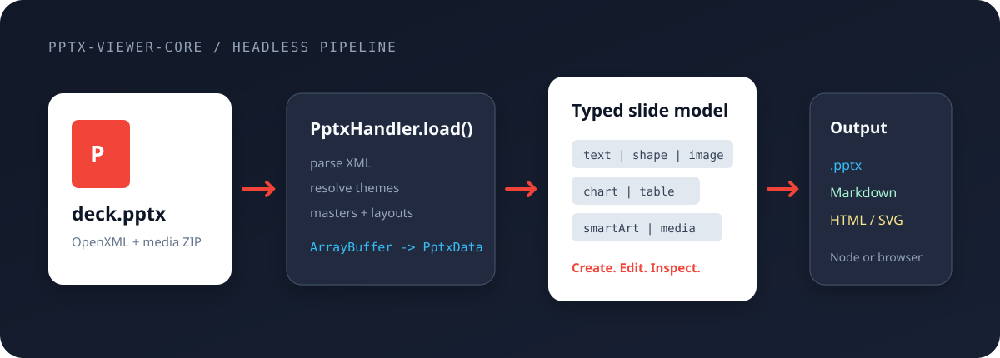

# pptx-viewer-core

Read, build, edit and save PowerPoint (`.pptx`) files from TypeScript, in the browser or in Node.js, with no native or system dependencies.

[](https://www.npmjs.com/package/pptx-viewer-core)
[](https://github.com/ChristopherVR/ooxml/blob/main/viewers/pptx/LICENSE)
[](https://www.npmjs.com/package/pptx-viewer-core)

[Docs](https://christophervr.github.io/ooxml/pptx/core/) · [Live demo](https://christophervr.github.io/ooxml/pptx/demo/) · [Changelog](https://github.com/ChristopherVR/ooxml/blob/main/viewers/pptx/packages/core/CHANGELOG.md) · [Report a bug](https://github.com/ChristopherVR/ooxml/issues)



Hand it the bytes of a deck and it returns a fully typed model of every slide: text, shapes, pictures, tables, charts, SmartArt, themes, masters and layouts. Change the model and save it back to a valid `.pptx`, build a deck from scratch, or convert one to Markdown, JSON or SVG. It is the engine behind the [React](https://www.npmjs.com/package/pptx-react-viewer), [Vue](https://www.npmjs.com/package/pptx-vue-viewer), [Angular](https://www.npmjs.com/package/pptx-angular-viewer), [Svelte](https://www.npmjs.com/package/pptx-svelte-viewer) and [vanilla](https://www.npmjs.com/package/pptx-vanilla-viewer) viewers, and a thin re-export of `ooxml-core/pptx`.

## Install

```bash
npm install pptx-viewer-core
```

Everything for reading, editing, saving and password protection installs with it (encryption runs on the Web Crypto API). Only Node signature signing and verification needs the optional peers `node-forge`, `xml-crypto` and `@xmldom/xmldom`.

## Quick start

```ts
import { PptxHandler } from 'pptx-viewer-core';

const handler = new PptxHandler();
const buffer = await fetch('presentation.pptx').then((r) => r.arrayBuffer());
const data = await handler.load(buffer); // .pptx, legacy .ppt, or pptx-viewer-json

console.log(`${data.slides.length} slides, ${data.width}x${data.height}`);

for (const element of data.slides[0]?.elements ?? []) {
	if (element.type === 'text') console.log(element.text);
}

const bytes = await handler.save(data.slides); // Uint8Array of a valid .pptx
const excerpt = await handler.save([data.slides[0]!, data.slides[2]!]); // just two slides
```

In Node, read the file with `readFile` and pass `buffer.buffer.slice(buffer.byteOffset, buffer.byteOffset + buffer.byteLength)`: `load` takes an `ArrayBuffer`.

### Build a deck from scratch

```ts
import { ChartBuilder, Presentation, ThemePresets } from 'pptx-viewer-core';

const pptx = await Presentation.create({ title: 'Sales Report', theme: ThemePresets.MODERN_BLUE });

pptx
	.addSlide('Title Slide')
	.addText('Q4 Sales Report', { fontSize: 44, bold: true, x: 100, y: 200, width: 800, height: 80 });

pptx
	.addSlide('Blank')
	.addBuilderElement(
		ChartBuilder.create('bar')
			.categories(['North', 'South', 'East', 'West'])
			.addSeries('2026', [210, 150, 180, 120], '#2563EB')
			.title('Revenue ($M)')
			.bounds(50, 100, 860, 420),
	);

pptx.replaceText('2026', 'FY2026');
const bytes = await pptx.save();
```

`Presentation` works on the whole deck (slides, sections, templates, merging, find and replace). Element builders (`TextBuilder`, `ShapeBuilder`, `ChartBuilder`, `TableBuilder`, `ImageBuilder`, `ConnectorBuilder`, `MediaBuilder`, `GroupBuilder`) give finer control, and `PptxXmlBuilder` writes raw XML for the rare case the others do not cover. Unit helpers (`inches`, `cm`, `mm`, `pt`), `SlideSizes` and eight `ThemePresets` come with it. See the [builder guide](https://christophervr.github.io/ooxml/pptx/core/builder).

### Convert

```ts
import { PptxJsonConverter, PptxMarkdownConverter } from 'pptx-viewer-core';

const markdown = await new PptxMarkdownConverter(
	'./output',
	{ sourceName: 'deck.pptx', includeSpeakerNotes: true, semanticMode: true },
	fileSystemAdapter, // { writeFile, writeBinaryFile, createFolder }, to extract media
).convert(data);

const json = PptxJsonConverter.toJson(data, { pretty: true }); // load() reads it back
```

The JSON document (`format: "pptx-viewer-json"`) is self-contained model interchange, not a copy of the ZIP archive. `SvgExporter` draws slides headlessly. See [converter](https://christophervr.github.io/ooxml/pptx/core/converter) and [SVG export](https://christophervr.github.io/ooxml/pptx/core/svg-export).

### From the terminal

The package ships a `pptx` command for `info`, `export-svg`, `export-md`, `merge`, `find`, `replace`, `create` and `diff`:

```bash
npx pptx-viewer-core info deck.pptx
```

Run it by the package name: `npx pptx` fetches an unrelated package. See the [CLI](https://christophervr.github.io/ooxml/pptx/core/cli).

## What it covers

| Area           | Details                                                                                                                                  |
| -------------- | ---------------------------------------------------------------------------------------------------------------------------------------- |
| **Elements**   | 16 types: text, shape, connector, image, picture, table, chart, SmartArt, OLE, media, group, ink, content part, zoom, 3D model, unknown. |
| **Shapes**     | All 187 ECMA-376 preset shapes with their adjust handles, plus custom geometry.                                                          |
| **Charts**     | 23 types, including waterfall, funnel, treemap, sunburst, box and whisker, region map and combo, with their embedded workbooks.          |
| **SmartArt**   | Broken into editable shapes, with a reflow engine for structural edits.                                                                  |
| **Motion**     | 57 transitions (including Morph), 39 animation presets and 26 motion paths.                                                              |
| **Formats**    | `.pptx`, `.pptm`, `.ppsx`, `.potx`, ISO/IEC 29500 Strict (converted to Transitional on load and back on save), legacy `.ppt` in and out. |
| **Protection** | AES-128 and AES-256 encryption, modify passwords, and digital signature inspection and signing in Node.                                  |
| **Preserved**  | VBA macros, custom XML and comment authors are kept through a save.                                                                      |

Positions and sizes are in EMU (914,400 per inch, 12,700 per point). Every element has a `type` field to narrow on, and colours resolve through the deck's theme. Some constructs load as approximations and are reported on `data.warnings`; see the [limitations page](https://christophervr.github.io/ooxml/pptx/guide/limitations).

## Loading decks you do not control

- `load(buffer, { limits })` bounds the work a load may do (input and uncompressed bytes, entries, slides). Every package is read through a guarded zip reader either way.
- Linked pictures and media keep their addresses but are not fetched unless you pass `allowExternalImages: true`.
- Node signature verification (`pptx-viewer-core/signature-node`, `inspectPptxDigitalSignatures`) reports `verified-trusted` only for an intact signature that covers the document, from a document-signing certificate that chains to a root you configure with `PPTX_VIEWER_TRUST_ROOTS_PEM` or `PPTX_VIEWER_TRUST_ROOTS_FILE`. No roots are built in. See [encryption and signatures](https://christophervr.github.io/ooxml/pptx/core/encryption).

## Entry points

| Import                                                            | Contents                                                       |
| ----------------------------------------------------------------- | -------------------------------------------------------------- |
| `pptx-viewer-core`                                                | `PptxHandler`, `Presentation`, builders, converters and types. |
| `pptx-viewer-core/signature-node`                                 | Node signature inspection and signing.                         |
| `pptx-viewer-core/converter`                                      | The Markdown converter and `SvgExporter` on their own.         |
| `pptx-viewer-core/chart`, `/geometry`, `/color`, `/text`, `/math` | The shared chart, geometry, colour, text and maths helpers.    |
| `pptx-viewer-core/smartart-layouts`                               | The built-in SmartArt layout definitions.                      |

## Supported environments

- Node.js 22.3 or newer, Bun, Deno, workers and serverless runtimes.
- Browsers: the last two major versions of Chrome, Edge, Firefox and Safari, and Safari 16.4 at least ([browser support](https://github.com/ChristopherVR/ooxml/blob/main/docs/browser-support.md)).

## Privacy and network use

Parsing, editing and saving happen locally and never upload the file. Linked (external) pictures and media are not fetched unless you pass `allowExternalImages: true`. Node signature inspection checks certificate revocation with the OCSP responder named in each certificate, only for certificates that verified a signature value; pass `{ checkRevocation: false }` to make no request. Nothing collects analytics or telemetry. See [PRIVACY.md](https://github.com/ChristopherVR/ooxml/blob/main/PRIVACY.md).

## Related packages

| Package                                                                    | Use it for                                                   |
| -------------------------------------------------------------------------- | ------------------------------------------------------------ |
| [`pptx-react-viewer`](https://www.npmjs.com/package/pptx-react-viewer)     | A full viewer and editor for React.                          |
| [`pptx-vue-viewer`](https://www.npmjs.com/package/pptx-vue-viewer)         | The same for Vue 3.                                          |
| [`pptx-angular-viewer`](https://www.npmjs.com/package/pptx-angular-viewer) | The same for Angular.                                        |
| [`pptx-svelte-viewer`](https://www.npmjs.com/package/pptx-svelte-viewer)   | The same for Svelte 5.                                       |
| [`pptx-vanilla-viewer`](https://www.npmjs.com/package/pptx-vanilla-viewer) | The same with no framework.                                  |
| [`pptx-viewer-mcp`](https://www.npmjs.com/package/pptx-viewer-mcp)         | 74 editing tools over this engine, as an MCP server.         |
| [`ooxml-core`](https://www.npmjs.com/package/ooxml-core)                   | The Word, Excel, PowerPoint and Visio logic this re-exports. |

## License

[Apache-2.0](https://github.com/ChristopherVR/ooxml/blob/main/viewers/pptx/LICENSE). Keep the [NOTICE](https://github.com/ChristopherVR/ooxml/blob/main/viewers/pptx/NOTICE) file with redistributions.
