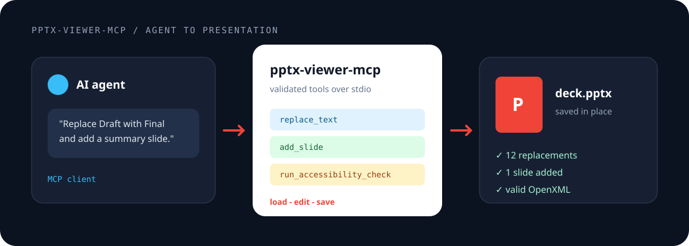

# pptx-viewer-mcp

Let an AI agent read and edit PowerPoint files: an [MCP](https://modelcontextprotocol.io) server with 74 PowerPoint tools, and the same tools as plain functions for your own code.

[](https://www.npmjs.com/package/pptx-viewer-mcp)
[](https://github.com/ChristopherVR/ooxml/blob/main/viewers/pptx/LICENSE)

[Docs](https://christophervr.github.io/ooxml/pptx/packages/mcp) · [Changelog](https://github.com/ChristopherVR/ooxml/blob/main/viewers/pptx/packages/tools/CHANGELOG.md) · [Report a bug](https://github.com/ChristopherVR/ooxml/issues)



The tools add and reorder slides, edit text, tables, charts, SmartArt, themes, layouts and embedded objects, validate and repair a deck, and export it to Markdown, JSON or SVG. They are `pptxTools` from `ooxml-core/pptx/automation`, registered the same way as the Word, Excel and Visio servers, so the built-in assistant of the PowerPoint viewers runs the same code.

## Quick start

Point your MCP client (Claude Desktop, Claude Code, Cursor or any other) at the published server:

```json
{
	"mcpServers": {
		"pptx": {
			"command": "npx",
			"args": ["pptx-viewer-mcp", "--root", "/path/to/decks"]
		}
	}
}
```

Restart the client and the tools are there. Every tool takes a `filePath` and loads and saves the deck itself. Files are scoped to the root directory: `--root <dir>`, else the `PPTX_TOOLS_ROOT` environment variable, else the working directory (with a warning on stderr). Tools read `.pptx` and `.ppt` and write `.pptx`.

A global install (`npm install -g pptx-viewer-mcp`) provides the same server as the `pptx-tools` command.

## Tools

The table gives the function names; over MCP the tools have snake_case names (`add_slide`, `batch_update_elements`, `ole_get_content`).

| Group            | Tools                                                                                                                                                                                                                                                                                              |
| ---------------- | -------------------------------------------------------------------------------------------------------------------------------------------------------------------------------------------------------------------------------------------------------------------------------------------------- |
| Slides           | `getSlide` `addSlide` `deleteSlides` `reorderSlides` `duplicateSlide` `updateSlideProperties` `setSlideTransition` `setCanvasSize`                                                                                                                                                                 |
| Elements         | `addElement` `updateElement` `renameElement` `deleteElements` `arrangeElements` `cloneElement` `setElementAnimation` `groupElements` `ungroupElements` `batchUpdateElements` `setElementLock` `replaceGeometry`                                                                                    |
| Tables           | `updateTableCells` `manageTableStructure` `setTableStyleSection` `createTableStyle` `deleteTableStyle` `assignTableStyle`                                                                                                                                                                          |
| Text and review  | `findText` `replaceText` `manageComments` `manageHyperlinks` `updateElementStyle` `runAccessibilityCheck`                                                                                                                                                                                          |
| Charts           | `createChart` `updateChart` `addChartSeries` `removeChartSeries` `updateChartSeriesData` `listChartUserShapes` `addChartUserShape` `updateChartUserShape` `removeChartUserShape` `formatChartDataPoint` `formatChartDataLabel` `formatChartSeries` `setChartHelperLine` `setChartColorMapOverride` |
| Themes, layouts  | `getThemeInfo` `applyThemePreset` `updateThemeColors` `updateThemeFonts` `getLayouts` `applyLayout` `findPlaceholders` `applyTemplate`                                                                                                                                                             |
| Deck             | `getMetadata` `updateMetadata` `getPresentationProperties` `updatePresentationProperties` `manageSections` `manageCustomShows` `manageSmartArt` `validatePresentation` `repairPresentation`                                                                                                        |
| Embedded objects | `getOleContent` `setOleSheetCell` `setOleDocumentParagraph` `setOleDeckSlideTitle` `replaceOleFile` `setOleObjectName`                                                                                                                                                                             |
| Export           | `convertToMarkdown` `exportToSvg` `exportSlideSvg` `exportToJson` `importFromJson`                                                                                                                                                                                                                 |

The [tools reference](https://christophervr.github.io/ooxml/pptx/packages/mcp) gives each one's parameters.

## As a library

```bash
npm install pptx-viewer-mcp
npm install yjs # only for the collaboration codec
```

Each tool is a plain function: deck data in, changed data out, with no file access of its own. `PptxHandler` is re-exported, so one install loads and saves too.

```ts
import { readFile, writeFile } from 'node:fs/promises';

import { PptxHandler, replaceText } from 'pptx-viewer-mcp';

const file = await readFile('deck.pptx');
const handler = new PptxHandler();
const pptxData = await handler.load(
	file.buffer.slice(file.byteOffset, file.byteOffset + file.byteLength),
);

const {
	pptxData: updated,
	dirty,
	result,
} = replaceText({ pptxData }, { query: 'Draft', replacement: 'Final' });
if (dirty) await writeFile('deck.pptx', await handler.save(updated.slides));
console.log(result.replacementCount);
```

`executeToolWithContext(filePath, context, tool)` runs the load, tool and save cycle through a `FileSystemProvider` you supply, and, given a `collaboration` provider, writes the change into a live Y.Doc instead so everyone in the session sees it without reloading.

| Import                    | Contents                                                                                                                     |
| ------------------------- | ---------------------------------------------------------------------------------------------------------------------------- |
| `pptx-viewer-mcp`         | The tool functions, `PptxHandler`, the provider types and `executeToolWithContext`.                                          |
| `pptx-viewer-mcp/schemas` | The Zod input schema of every tool.                                                                                          |
| `pptx-viewer-mcp/codec`   | `PptxCodec`, between a Y.Doc and `.pptx` bytes.                                                                              |
| `pptx-viewer-mcp/mcp`     | `createServer({ rootDir })` and `registerTools(server, { rootDir })`, to host the tools in your own MCP server or transport. |

## Supported environments

- Node.js 22.3 or newer.
- Any MCP client that launches stdio servers.
- On Windows, file tools refuse UNC and device paths, drive-relative paths and names Windows would reinterpret (such as `NUL` or a trailing dot) before touching the filesystem.

## Privacy and network use

The MCP server talks to its client over stdio only and makes no network request of its own. It reads and writes files under its root directory, and linked pictures in a deck are not fetched. Nothing collects analytics or telemetry. See [PRIVACY.md](https://github.com/ChristopherVR/ooxml/blob/main/PRIVACY.md).

## Related packages

| Package                                                                | Use it for                                                                                                                                                                                                                                                                                                              |
| ---------------------------------------------------------------------- | ----------------------------------------------------------------------------------------------------------------------------------------------------------------------------------------------------------------------------------------------------------------------------------------------------------------------- |
| [`ooxml-mcp`](https://www.npmjs.com/package/ooxml-mcp)                 | One server with the Word, Excel, PowerPoint and Visio tools.                                                                                                                                                                                                                                                            |
| [`pptx-viewer-core`](https://www.npmjs.com/package/pptx-viewer-core)   | The engine on its own, for scripts that build or convert decks.                                                                                                                                                                                                                                                         |
| [`pptx-react-viewer`](https://www.npmjs.com/package/pptx-react-viewer) | A full viewer whose assistant panel drives these tools (also for [Vue](https://www.npmjs.com/package/pptx-vue-viewer), [Angular](https://www.npmjs.com/package/pptx-angular-viewer), [Svelte](https://www.npmjs.com/package/pptx-svelte-viewer) and [no framework](https://www.npmjs.com/package/pptx-vanilla-viewer)). |

## License

[Apache-2.0](https://github.com/ChristopherVR/ooxml/blob/main/viewers/pptx/LICENSE).
