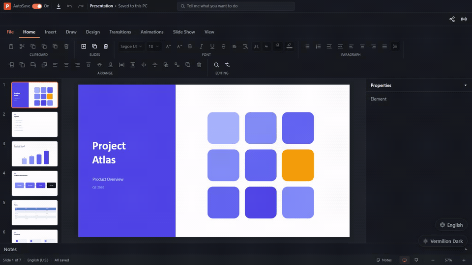

# pptx-vanilla-viewer

**A zero-framework PowerPoint viewer and editor: one function call opens, edits, presents and saves `.pptx`, `.pptm`, `.ppsx`, `.potx` and legacy `.ppt` files in any web page, with no server.**

[](https://www.npmjs.com/package/pptx-vanilla-viewer)
[](https://github.com/ChristopherVR/ooxml/blob/main/viewers/pptx/LICENSE)
[](https://www.npmjs.com/package/pptx-vanilla-viewer)

[Live demo](https://christophervr.github.io/ooxml/pptx/demo-vanilla/) · [Documentation](https://christophervr.github.io/ooxml/pptx/) · [Vanilla JS guide](https://christophervr.github.io/ooxml/pptx/vanilla/) · [Changelog](https://github.com/ChristopherVR/ooxml/blob/main/viewers/pptx/packages/vanilla/CHANGELOG.md) · [Report a bug](https://github.com/ChristopherVR/ooxml/issues)



## Install

```bash
npm install pptx-vanilla-viewer
```

There are no required peers; the engine comes with it (`ooxml-core` and `ooxml-ui` are dependencies). Optional extras:

| For                                  | Add                                                            |
| ------------------------------------ | -------------------------------------------------------------- |
| Real-time collaboration              | `yjs` (`y-websocket` and `y-webrtc` are optional dependencies) |
| 3D models, 3D SmartArt and 3D charts | `three` 0.187 (an optional peer of `ooxml-ui`)                 |
| The AI assistant panel               | `ai` (6 or 7)                                                  |

Without them those features stay off and everything else works.

## Quick start

```ts
import { createPptxViewer } from 'pptx-vanilla-viewer';

const viewer = createPptxViewer(document.getElementById('host')!, {
	source: '/decks/quarterly.pptx', // a URL, ArrayBuffer, Uint8Array, Blob or File
	editable: true,
	onLoad: ({ slideCount }) => console.log(`${slideCount} slides`),
	onDirtyChange: (dirty) => console.log('unsaved edits:', dirty),
});

const bytes = await viewer.save(); // the edited .pptx
await viewer.downloadPptx('quarterly-edited.pptx');

viewer.destroy(); // removes the DOM, listeners, blob URLs and the engine handler
```

The viewer fills its container, so give the container a size. Styles are injected once per document; under a strict Content Security Policy import `pptx-vanilla-viewer/styles.css` instead (`getViewerCss()` returns the same text). For a complete Vite project, see [getting started](https://christophervr.github.io/ooxml/pptx/vanilla/getting-started).

## Options

The most used options. Every binding takes the same set (here the bytes are `source` and the edit switch is `editable`); the [options reference](https://christophervr.github.io/ooxml/pptx/vanilla/options) has all of them.

| Option                                           | What it does                                                                                    |
| ------------------------------------------------ | ----------------------------------------------------------------------------------------------- |
| `source`                                         | The deck: a URL, `ArrayBuffer`, `Uint8Array`, `Blob` or `File`.                                 |
| `editable`, `readOnly`                           | Turn editing on, or force the deck read-only (`readOnly` wins).                                 |
| `initialSlide`, `showToolbar`, `showThumbnails`  | Starting slide and which chrome to show.                                                        |
| `locale`, `messages`                             | The UI language and your dictionaries.                                                          |
| `theme`, `defaultThemeKey`, `availableThemes`    | Viewer chrome colours and radius, and the File > Options appearance choices.                    |
| `customization`, `hiddenActions`, `ribbonAddIns` | Hide, lock or remap ribbon tabs, commands, options, menus, shortcuts and panels; add your tabs. |
| `fonts`, `googleFonts`                           | Supply licensed fonts; turn off or redirect web font downloads.                                 |
| `allowExternalContent`                           | Fetch a deck's linked pictures and media without asking (`true`) or block them (`false`).       |
| `limits`                                         | Bound the work a load may do, for decks you do not trust.                                       |
| `collaboration`, `shareDefaults`                 | Join or seed a real-time session.                                                               |
| `storage`, `fileProviders`, `autosave`           | Save to your own storage or a cloud provider, and control recovery autosave.                    |
| `registry`                                       | Your own element renderers.                                                                     |
| `ai`                                             | The optional assistant, from `createAiAssistant` in `pptx-vanilla-viewer/ai`.                   |
| `fitPadding`, `maxFitScale`                      | How the slide fits its viewport.                                                                |

The instance (`PptxViewerInstance`) has the shared slide and element API (`getContent`, `getSlides`, `addSlide`, `addElement`, `updateElement`, `deleteElements`, `undo`, `redo`, zoom, mode and selection) plus loading (`loadFile`, `loadUrl`), navigation (`next`, `prev`, `goToSlide`, `zoomToFit`), `enterPresentation`, saving and export (`save`, `downloadAs`, `downloadPptx`, `exportPdf`, `exportSlidePng`, `print`), `startCollaboration`, `setTheme`, `setLocale`, `getRegistry()`, `getHandler()` for the live engine and `destroy`. See [the API](https://christophervr.github.io/ooxml/pptx/vanilla/api).

## Events

Callback options, most used first: `onContentChange` (the edited bytes), `onDirtyChange`, `onSlideChange`, `onSelectionChange`, `onLoad`, `onError`, `onChange`, `onModeChange`, `onZoomChange`, `onSlideCountChange`, `onAutosave`, `onCollaborationChange`, `onHyperlinkClick`, `onOpenFile`, `onThemeChange`, `onLocaleChange` and `onPdfExportReport`. See the [options reference](https://christophervr.github.io/ooxml/pptx/vanilla/options).

## Your own UI

`createViewerBuildingBlocks` runs the full viewer engine behind a canvas, a compact toolbar and the slide rail that you mount where you like (`mountCanvas`, `mountToolbar`, `mountSlidesPane`), and lets you answer picker and dialog requests with your own UI. Elements are drawn through an open registry, so you can replace one kind without forking: `viewer.getRegistry().register('table', renderTable)`. See [building blocks](https://christophervr.github.io/ooxml/pptx/vanilla/building-blocks) and [renderers](https://christophervr.github.io/ooxml/pptx/vanilla/renderers).

## Theming

The chrome inherits the shared `--office-*` tokens: put `data-office-theme="light"`, `"dark"` or `"auto"` on a containing element, or set tokens such as `--office-accent` there. The `theme` option (a partial `ViewerTheme`, also `viewer.setTheme(theme)`) overrides them through the viewer's `--pptx-*` properties; `vermilionLightTheme` and `vermilionDarkTheme` are ready-made. See [theming](https://christophervr.github.io/ooxml/pptx/vanilla/theming).

## Localisation

English (built in), French, Spanish, German, Simplified Chinese, Japanese and Korean. Pass `messages` (one `pptx.*` dictionary per locale) with `locale`, or call `setLocale`; missing keys fall back to English. The dictionaries are at `pptx-vanilla-viewer/i18n/fr`, `/es`, `/de`, `/zh-CN`, `/ja` and `/ko`. See [localisation](https://christophervr.github.io/ooxml/pptx/guide/localization).

## Status and limits

PowerPoint carries no stability label yet: it has not been assessed against the [stability policy](https://github.com/ChristopherVR/ooxml/blob/main/docs/stability.md).

- Saving keeps the parts you did not touch, but saving an edited slide can still rewrite minor markup; it is not a lossless round trip.
- Some effects are approximated (3D materials, some WordArt warps, SmartArt without its cached drawing). A deck that uses an approximated construct reports it as a load warning.
- The editor covers a subset of PowerPoint: Remove Background, narration, Notes Master, Handout Master, Notes Page view, Grayscale views and Designer are not there yet.
- OneDrive stores files through an adapter whose sign-in your host provides; there is no Office co-authoring.

See the [limitations page](https://christophervr.github.io/ooxml/pptx/guide/limitations) and the [Office parity checklist](https://github.com/ChristopherVR/ooxml/blob/main/docs/parity-checklist.md#powerpoint).

## Privacy and network use

The viewer renders and saves decks in the browser and never uploads them. Nothing collects analytics or telemetry. It contacts other servers only in these cases:

- **Web fonts (on by default).** A font that is neither installed nor embedded, when the bundled Google Fonts catalogue serves it or a stand-in, is downloaded from `fonts.googleapis.com` and `fonts.gstatic.com`; Google sees the reader's IP address and the family names. Set `googleFonts` to `false` to turn it off, or to `{ baseUrl }` to use your own mirror; readers can turn it off in File > Options > Trust Center. Offline, the deck opens with substitute fonts.
- **Linked pictures and media (off by default).** Fetched only after the reader chooses Enable Content on the security bar, or always with `allowExternalContent: true`; `false` blocks them without the bar.
- **Share and Broadcast (only when started).** Updates go to the server you configure; without one, peers meet through y-webrtc's public signalling server and public STUN servers. Pass your own `collaboration.signaling` list to avoid them.
- **AI assistant (off unless you pass `ai`).** Requests go to the connection you configure, with the conversation and deck context (`contextStrategy: 'none'` sends no deck context).
- **Links** (hyperlinks, Microsoft Forms responses) open only when clicked, in a new tab without opener or referrer.
- **A `source` URL** is fetched by the viewer; pass bytes instead to avoid it.

Autosave, recovery and preferences stay on the device (IndexedDB and localStorage). The full list, including Ink to Math and the camera, is in [PRIVACY.md](https://github.com/ChristopherVR/ooxml/blob/main/PRIVACY.md#powerpoint-ooxml-uipptx-and-the-pptx--viewer-packages).

## Browser support

- The last two major versions of Chrome, Edge, Firefox and Safari; Safari 16.4 at least ([browser support](https://github.com/ChristopherVR/ooxml/blob/main/docs/browser-support.md)).
- Any bundler that resolves ES modules (CommonJS builds ship too); no framework.
- Node.js 22.3 or newer to install and build.

## Documentation and demos

- [Documentation](https://christophervr.github.io/ooxml/pptx/), the [Vanilla JS guide](https://christophervr.github.io/ooxml/pptx/vanilla/) and the [live demo](https://christophervr.github.io/ooxml/pptx/demo-vanilla/).
- The same viewer for [React](https://www.npmjs.com/package/pptx-react-viewer), [Vue](https://www.npmjs.com/package/pptx-vue-viewer), [Angular](https://www.npmjs.com/package/pptx-angular-viewer) and [Svelte](https://www.npmjs.com/package/pptx-svelte-viewer).
- [`pptx-viewer-core`](https://www.npmjs.com/package/pptx-viewer-core) for decks without a UI, and [`pptx-viewer-mcp`](https://www.npmjs.com/package/pptx-viewer-mcp) for AI agents.
- Part of [ooxml](https://github.com/ChristopherVR/ooxml#readme), with Word, Excel and Visio editors.

## License

[Apache-2.0](https://github.com/ChristopherVR/ooxml/blob/main/viewers/pptx/LICENSE). Keep the [NOTICE](https://github.com/ChristopherVR/ooxml/blob/main/viewers/pptx/NOTICE) file with redistributions.
