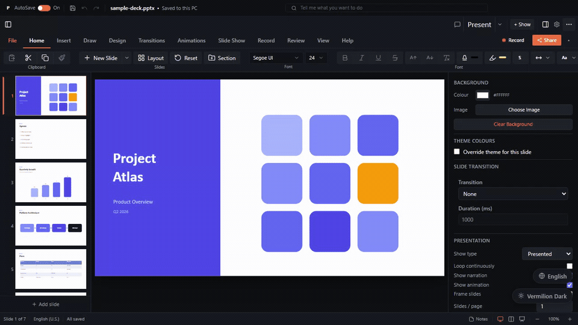

# pptx-vue-viewer

A Vue 3 component that opens, edits, presents and saves PowerPoint (`.pptx`) files in the browser. No server, no conversion step, no PowerPoint install.

[](https://www.npmjs.com/package/pptx-vue-viewer)
[](https://github.com/ChristopherVR/ooxml/blob/main/viewers/pptx/LICENSE)

[Live demo](https://christophervr.github.io/ooxml/pptx/demo-vue/) · [Docs](https://christophervr.github.io/ooxml/pptx/vue/) · [Changelog](https://github.com/ChristopherVR/ooxml/blob/main/viewers/pptx/packages/vue/CHANGELOG.md) · [Report a bug](https://github.com/ChristopherVR/ooxml/issues)



Slides are drawn as HTML, CSS and SVG, not as a canvas bitmap, so text stays sharp at any zoom, can be selected and is read by screen readers. The [`pptx-viewer-core`](https://www.npmjs.com/package/pptx-viewer-core) engine that parses and writes the file is bundled in.

## Install

```bash
npm install pptx-vue-viewer
npm install vue vue-i18n jszip fast-xml-parser
```

The second line is the peer dependencies: Vue 3.5 or newer and `vue-i18n` 11. Optional extras:

| For                                  | Add                                                                 |
| ------------------------------------ | ------------------------------------------------------------------- |
| Real-time collaboration              | `yjs` (`y-websocket` and `y-webrtc` are optional dependencies)      |
| 3D models, 3D SmartArt and 3D charts | nothing: `three` is an optional dependency npm installs when it can |
| The AI assistant panel               | `ai` and `@ai-sdk/vue`                                              |

Without them, those features stay off and everything else works.

## Quick start

Every label goes through `vue-i18n`, so install an instance with the viewer's English dictionary:

```ts
// main.ts
import { keyToLabel, translationsEn } from 'pptx-vue-viewer/i18n';
import 'pptx-vue-viewer/styles';
import { createApp } from 'vue';
import { createI18n } from 'vue-i18n';

import App from './App.vue';

const i18n = createI18n({
	legacy: false,
	locale: 'en',
	fallbackLocale: 'en',
	messages: { en: translationsEn },
	missing: (_locale, key) => keyToLabel(key),
});

createApp(App).use(i18n).mount('#app');
```

```vue
<!-- App.vue -->
<script setup lang="ts">
import { PowerPointViewer, type PowerPointViewerExpose } from 'pptx-vue-viewer';
import { ref } from 'vue';

const content = ref<Uint8Array | null>(null);
const viewer = ref<PowerPointViewerExpose>();

async function onPick(event: Event) {
	const file = (event.target as HTMLInputElement).files?.[0];
	if (file) content.value = new Uint8Array(await file.arrayBuffer());
}

async function save() {
	const bytes = await viewer.value?.getContent(); // a valid .pptx
}
</script>

<template>
	<div style="height: 100vh">
		<PowerPointViewer v-if="content" ref="viewer" :content="content" can-edit />
		<input v-else type="file" accept=".pptx,.ppt" @change="onPick" />
	</div>
</template>
```

`content` takes a `Uint8Array` or an `ArrayBuffer`. The viewer fills its parent, so give the parent a height.

## What you get

- **Viewing**: text, all 187 preset shapes, pictures, tables, charts, SmartArt, connectors, audio, video, ink, OLE objects and 3D models, with themes, masters and layouts resolved.
- **Editing**: a PowerPoint-style ribbon, inspector and on-canvas handles; inline text, tables, chart data, SmartArt, masters and layouts; full undo and redo.
- **Presenting**: transitions (including Morph), animations and motion paths, presenter view with notes and timer, rehearse timings, pen, highlighter and laser.
- **Exporting**: PDF, PNG, GIF, video and JSON, slides copied as images, printed handouts and notes pages, and Save As `.pptx`, `.ppsx`, `.pptm` or legacy `.ppt`.
- **Working together**: real-time co-editing and Broadcast over Yjs, through your server or peer to peer, with presence, cursors and threaded comments.
- **Assistant**: an optional AI panel whose edits follow a write policy you choose (apply, stage or approve).
- **Keyboard and screen readers**: F6 between regions, Tab through slide objects, Enter to edit text, and names that match the visible captions.
- **Seven UI languages**: English, French, Spanish, German, Simplified Chinese, Japanese and Korean.

Some effects are approximated or not yet supported; the [limitations page](https://christophervr.github.io/ooxml/pptx/guide/limitations) lists them, and a deck that uses one reports it as a load warning.

## Using it in Vue

**Events and the template ref.** Changes arrive as events (`@content-change`, `@dirty-change`, `@active-slide-change`, `@selection-change` and more). The template ref (`PowerPointViewerExpose`) covers navigation, zoom, mode, selection, undo and redo, plus the shared slide and element API (`getSlides`, `addSlide`, `addElement`, `updateElement` and the rest). Host callbacks such as `onOpenFile` and `onLocaleChange` are props. See [props](https://christophervr.github.io/ooxml/pptx/vue/props) and [the handle](https://christophervr.github.io/ooxml/pptx/vue/handle).

**Theming.** Pass a partial `theme` prop, or call `provideViewerTheme(theme)` in a parent's `setup()` for a whole subtree. `vermilionLightTheme` and `vermilionDarkTheme` are ready-made presets. See [theming](https://christophervr.github.io/ooxml/pptx/vue/theming).

**Your own shell.** `useViewerBuildingBlocks` runs the full viewer engine behind `BuildingBlocksCanvas`, `BuildingBlocksToolbar` and `BuildingBlocksSlidesPane`, so you can place them in your own layout and answer picker and dialog requests with your own UI. `pptx-vue-viewer/viewer` adds composables such as `useCollaboration` and `useInlineEditing` for deeper custom chrome. See [building blocks](https://christophervr.github.io/ooxml/pptx/vue/building-blocks) and [composables](https://christophervr.github.io/ooxml/pptx/vue/composables).

**Translations.** Dictionaries for the other languages are at `pptx-vue-viewer/i18n/fr`, `/es`, `/de`, `/zh-CN`, `/ja` and `/ko`. Convert one with `toVueI18nSyntax` from `pptx-vue-viewer/i18n` before passing it to `vue-i18n` (`translationsEn` is already converted), then switch with `i18n.global.locale.value = 'fr'`. See [localization](https://christophervr.github.io/ooxml/pptx/guide/localization).

**AI assistant.** Create one assistant with `createAiAssistant` from `pptx-vue-viewer/ai` and pass it to the `ai` prop. Its panel and the AI SDK load only when the user opens it. See the [assistant guide](https://christophervr.github.io/ooxml/pptx/guide/ai-assistant).

## Configuration

The most used props; the [props reference](https://christophervr.github.io/ooxml/pptx/vue/props) has all of them, and every binding takes the same set.

| Prop                                             | What it does                                                                                                     |
| ------------------------------------------------ | ---------------------------------------------------------------------------------------------------------------- |
| `canEdit`, `readOnly`                            | Turn editing on, or force the deck read-only.                                                                    |
| `initialSlide`, `showToolbar`, `showThumbnails`  | Starting slide and which chrome to show.                                                                         |
| `theme`, `defaultThemeKey`, `availableThemes`    | Colours and radius as `--pptx-*` tokens, and the File > Options appearance choices.                              |
| `customization`, `hiddenActions`, `ribbonAddIns` | Hide, lock or remap ribbon tabs, commands, options, menus, shortcuts and panels; add your own tabs.              |
| `fonts`, `googleFonts`                           | Supply licensed fonts, and control or redirect web font downloads.                                               |
| `allowExternalContent`                           | Download a deck's linked pictures and media without asking (`true`) or block them silently (`false`).            |
| `limits`                                         | Bound the work a load may do, for decks you do not trust.                                                        |
| `collaboration`, `shareDefaults`                 | Join or seed a real-time session.                                                                                |
| `storage`, `fileProviders`, `autosave`           | Save to your own storage or OneDrive, and control recovery autosave.                                             |
| `ai`                                             | The optional assistant.                                                                                          |
| `fitPadding`, `maxFitScale`                      | How the slide fits its viewport ([viewport fit](https://christophervr.github.io/ooxml/pptx/guide/viewport-fit)). |

OneDrive needs a Microsoft sign-in your host provides; see the [OneDrive guide](https://christophervr.github.io/ooxml/pptx/guide/onedrive). It stores files and does not provide Office co-authoring.

## Supported environments

- Browsers: the last two major versions of Chrome, Edge, Firefox and Safari, and Safari 16.4 at least ([browser support](https://github.com/ChristopherVR/ooxml/blob/main/docs/browser-support.md)).
- Vue 3.5 or newer with `vue-i18n` 11.
- Node.js 22.3 or newer to install, build and test.

## Privacy and network use

The viewer renders and saves decks in the browser and never uploads them. It contacts other servers only in these cases:

- **Fonts that are neither installed nor embedded.** When a deck uses such a font and Google Fonts serves it (or a metric-compatible clone, such as Carlito for Calibri), the viewer downloads it from `fonts.googleapis.com` and `fonts.gstatic.com`, so the reader's IP address and the needed family names reach Google. This is on by default, as PowerPoint downloads its cloud fonts. Turn it off with `googleFonts: false`, or send the same requests to your own mirror with `googleFonts: { baseUrl: 'https://fonts.example.com/css2' }`. Readers can turn it off in File > Options > Trust Center ("Download fonts that are not installed or embedded (Google Fonts)"); a host value locks that toggle. With downloads off, text uses installed, embedded or substitute fonts, so line breaks can differ from PowerPoint. A slow download holds the deck for up to 8 seconds, and the deck opens at once when the font server cannot be reached, so offline use works. See [font loading](https://github.com/ChristopherVR/ooxml/blob/main/docs/font-loading.md).
- **Linked pictures and media** are not fetched when a deck opens, as in PowerPoint. A security bar offers **Enable Content**, which draws them for that presentation without reloading it; in a shared session each participant chooses for themselves. The Trust Center option "Allow external content" (off by default) always allows them. `allowExternalContent: true` downloads them without asking, and `false` blocks them without the bar.
- **Hyperlinks** open only when the reader clicks them, always in a new tab with `noopener` and `noreferrer`, so the linked site receives no referrer and cannot script the viewer's page, whatever frame the deck names. `file:` and `ftp:` links stay in the deck but never open. Relative links (no scheme, such as `notes.html`) open, against the host page's address, only after the host calls `setOpenRelativeHyperlinks(true)` from `ooxml-ui/pptx`.
- **Share and Broadcast**, only when started. Updates go to the server you configure. With no server, peers meet through y-webrtc's public signaling server and public STUN servers; the signaling server sees a hash of the secret in the invitation link's `#key=` fragment (never the room name), the participants' IP addresses and encrypted signaling messages.

Nothing collects analytics or telemetry. The full list, including what is kept in local storage, is in [PRIVACY.md](https://github.com/ChristopherVR/ooxml/blob/main/PRIVACY.md).

## Related packages

| Package                                                                    | Use it for                                                     |
| -------------------------------------------------------------------------- | -------------------------------------------------------------- |
| [`pptx-react-viewer`](https://www.npmjs.com/package/pptx-react-viewer)     | The same viewer for React.                                     |
| [`pptx-angular-viewer`](https://www.npmjs.com/package/pptx-angular-viewer) | The same viewer for Angular.                                   |
| [`pptx-svelte-viewer`](https://www.npmjs.com/package/pptx-svelte-viewer)   | The same viewer for Svelte 5.                                  |
| [`pptx-vanilla-viewer`](https://www.npmjs.com/package/pptx-vanilla-viewer) | The same viewer with no framework.                             |
| [`pptx-viewer-core`](https://www.npmjs.com/package/pptx-viewer-core)       | Reading, building and saving decks in Node or a worker, no UI. |
| [`pptx-viewer-mcp`](https://www.npmjs.com/package/pptx-viewer-mcp)         | PowerPoint editing tools for AI agents, as an MCP server.      |

Part of [ooxml](https://github.com/ChristopherVR/ooxml#readme), which also has [Word](https://github.com/ChristopherVR/ooxml/tree/main/viewers/docx#readme), [Excel](https://github.com/ChristopherVR/ooxml/tree/main/viewers/xlsx#readme) and [Visio](https://github.com/ChristopherVR/ooxml/tree/main/viewers/visio#readme) viewers.

## License

[Apache-2.0](https://github.com/ChristopherVR/ooxml/blob/main/viewers/pptx/LICENSE). Keep the [NOTICE](https://github.com/ChristopherVR/ooxml/blob/main/viewers/pptx/NOTICE) file with redistributions.
