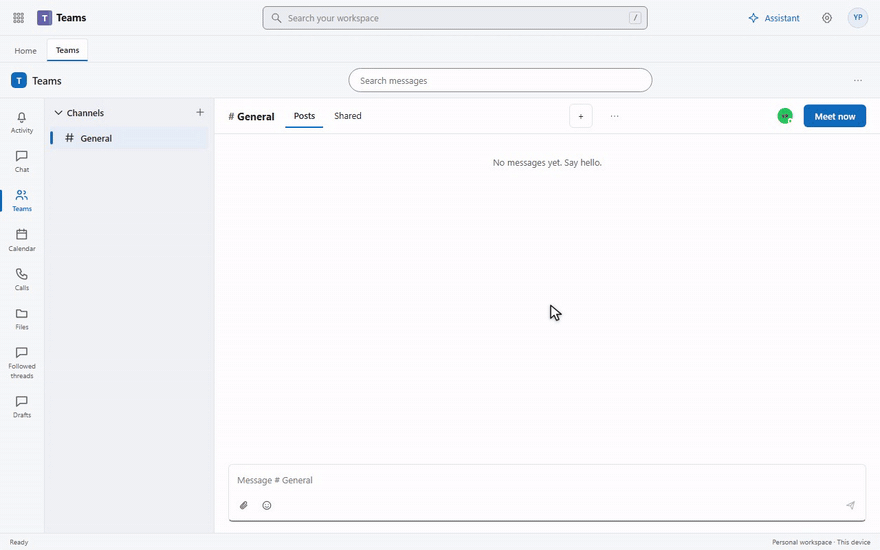

<div align="center">

# OpenTeams

**An open-source team workspace on the server you run: channels and chat, presence and WebRTC meetings, as one web component with a thin binding for your framework.**

For teams and products that want chat and calls they host themselves, with no hosted service in between.

[](https://www.npmjs.com/package/openteams-react-viewer)
[](https://www.npmjs.com/package/openteams-server)
[](LICENSE)
[](../../docs/stability.md)

[**Live demo**](https://christophervr.github.io/ooxml/teams/demo/) &middot;
[**Docs**](https://christophervr.github.io/ooxml/teams/) &middot;
[**Samples**](https://christophervr.github.io/ooxml/samples/) &middot;
[**Packages**](#packages) &middot;
[**Changelog**](CHANGELOG.md)

[](https://christophervr.github.io/ooxml/apps/teams/)

</div>

OpenTeams is in **beta**. It is not Microsoft Teams and is not affiliated with Microsoft, and it
has no end-to-end encryption: your server can read chat and files.

## Packages

Seven packages are published, each versioned on its own. The names are `openteams-*` because the
plain `openteams` npm name belongs to an unrelated project.

| Package                                                                              | Framework     | What it is                                                                                      |
| ------------------------------------------------------------------------------------ | ------------- | ----------------------------------------------------------------------------------------------- |
| [`openteams-react-viewer`](https://www.npmjs.com/package/openteams-react-viewer)     | React 18+     | `<Teams>` component and `useTeams` hooks ([README](packages/react)).                            |
| [`openteams-vue-viewer`](https://www.npmjs.com/package/openteams-vue-viewer)         | Vue 3.4+      | `<Teams>` component and `useTeams` composable ([README](packages/vue)).                         |
| [`openteams-angular-viewer`](https://www.npmjs.com/package/openteams-angular-viewer) | Angular 17+   | `<teams-workspace>` standalone component and `TeamsService` ([README](packages/angular)).       |
| [`openteams-svelte-viewer`](https://www.npmjs.com/package/openteams-svelte-viewer)   | Svelte 5      | `Teams.svelte` and the `teamsStore` store ([README](packages/svelte)).                          |
| [`openteams-solid-viewer`](https://www.npmjs.com/package/openteams-solid-viewer)     | SolidJS 1.9   | `Teams(props)` and `createTeamsClient` ([README](packages/solid)).                              |
| [`openteams-vanilla-viewer`](https://www.npmjs.com/package/openteams-vanilla-viewer) | none          | `mountTeams()`, the plain `<teams-app>` element and `createTeams` ([README](packages/vanilla)). |
| [`openteams-server`](https://www.npmjs.com/package/openteams-server)                 | Node.js 22.3+ | The reference server: sync, signaling, files and accounts ([README](server)).                   |

Each binding brings [`ooxml-core`](https://www.npmjs.com/package/ooxml-core) (the workspace logic,
`ooxml-core/teams`), [`ooxml-ui`](https://www.npmjs.com/package/ooxml-ui) (`<teams-app>`) and
`lit`. Use one binding per page, and the bindings and server of the same major version.

## Quick start

```bash
npm install openteams-react-viewer
npx openteams-server --insecure-dev     # local development only: no accounts, 127.0.0.1:8787
```

```tsx
import { Teams } from 'openteams-react-viewer';

const config = {
	mode: 'server' as const,
	syncUrl: 'ws://127.0.0.1:8787/sync',
	signalingUrl: 'ws://127.0.0.1:8787/signal',
	iceServers: [], // add your STUN and TURN servers for calls across networks
};

export function Workspace() {
	return (
		<div style={{ height: '100vh' }}>
			<Teams workspaceId="acme" userName="Ada" config={config} />
		</div>
	);
}
```

Every framework has the same shape: the same props and events, plus a raw hook over the same
client for building your own UI. See each package's README above, or the
[framework guides](https://christophervr.github.io/ooxml/teams/frameworks/react). For a real
deployment (accounts, session secret, origins, TLS) start from the
[server README](server/README.md#install-and-run).

## Features

- **Channels and chat:** posts with replies, 1:1 and group chats in rooms only their members can
  join, reactions, pins, author-only edit and delete, search and unread counts.
- **Presence:** who is online and typing, a status and status message, automatic away when idle.
- **Meetings:** pre-join screen, audio, video, screen share and raise hand over WebRTC, and a
  calendar with repeats, reminders and `.ics` export.
- **Files:** attachments go to your server's `/files` endpoint or your own `uploadFile`; Word,
  Excel, PowerPoint and Visio files are recognised and open in a preview or in your own opener.
- **A hardened server:** accounts and signed sessions, server-side authorship checks, moderators,
  per-room permissions (`authorizeSync`), an origin allowlist and quotas.
- **Local mode:** `mode: 'local'` needs no server; tabs of one browser share the workspace over
  `BroadcastChannel`. The live demos run this way.
- **Accessible and localised:** F6 moves between regions and dialogs keep focus (checked with
  axe-core); English, German, Spanish, French and Simplified Chinese (`locale`).

## Status and limits

OpenTeams is **Beta** ([stability](../../docs/stability.md)): the 2.0 packages run on sync protocol
2, and no production deployment has been reported yet.

- No end-to-end encryption, SSO or password reset.
- Calls are full mesh with no media server, comfortable up to about a dozen people; TURN for strict
  networks is yours to run.
- No recording, background blur, live captions, or push and email notifications.
- The reference server is one process with rooms in memory; it does not scale horizontally.

See [limitations](https://christophervr.github.io/ooxml/teams/limitations),
[teams-parity.md](../../docs/teams-parity.md) and
[parity-checklist.md](../../docs/parity-checklist.md).

## Privacy and network use

Chat, presence and signaling go only to the `syncUrl` and `signalingUrl` you configure, and local
mode stays in the browser. Calls use Google's public STUN server unless you set `iceServers` (to
your own servers, or `[]`), and a website tab loads the URL a member added. The reference server
makes no outbound requests, and nothing collects analytics or telemetry. See
[PRIVACY.md](../../PRIVACY.md#teams-ooxml-coreteams-ooxml-uiteams-the-openteams--packages).

## Samples

Sample files to try: https://christophervr.github.io/ooxml/samples/

## Documentation

[Getting started](https://christophervr.github.io/ooxml/teams/getting-started) &middot;
[Architecture](https://christophervr.github.io/ooxml/teams/architecture) &middot;
[Element API](https://christophervr.github.io/ooxml/teams/api) &middot;
[Framework guides](https://christophervr.github.io/ooxml/teams/frameworks/react) &middot;
[Theming](https://christophervr.github.io/ooxml/teams/theming) &middot;
[Bring your own server](https://christophervr.github.io/ooxml/teams/server) &middot;
[Deploying](https://christophervr.github.io/ooxml/teams/deploy) &middot;
[OneDrive links](https://christophervr.github.io/ooxml/teams/onedrive) &middot;
[Limitations](https://christophervr.github.io/ooxml/teams/limitations) &middot;
[Live demos](https://christophervr.github.io/ooxml/teams/demos)

The workspace logic is the `teams` area of the core ([teams-area.md](../../docs/teams-area.md)),
and `<teams-app>` with its binding wiring lives in `src/ui/src/teams` (`ooxml-ui/teams`). This
folder holds the bindings, the reference server and the docs site; the demos are `demos/teams/`
and the browser tests `e2e/teams/` at the repository root. [AGENTS.md](AGENTS.md) explains the
layout.

## Development

Needs Node.js 22.3+ and Bun. Run `bun install` at the repository root, then from this folder:

```bash
bun run dev            # reference server :8787, vanilla demo :5173, React demo :5174
bun run typecheck      # the web component and all six bindings (.svelte files excepted)
bun run test           # vitest (jsdom), then the server's node:test suite
bun run test:browser   # Playwright, against the vanilla demo in local mode
bun run test:scripts   # this folder's script tests
bun run build:packages # dist/ for the six bindings; the server needs no build
bun run check:published && bun run pack:smoke   # what the tarballs import; install and import them
bun run docs:dev       # the docs site with hot reload
bun run build:pages    # the docs site and every demo, as deployed (bun install --cwd docs first)
```

Open `http://127.0.0.1:5173/?name=Ada` and, in another tab, `?name=Bob`: two people in one
workspace. `?local=1` runs without the server, and `TEAMS_USE_DIST=1` makes the demos use the built
packages. Cameras and microphones need `localhost` or HTTPS. Releases are automated from
Conventional Commits ([docs/releasing.md](docs/releasing.md)); contributions follow
[CONTRIBUTING.md](../../CONTRIBUTING.md).

## License

[Apache License 2.0](LICENSE); see [NOTICE](NOTICE) for attributions.
