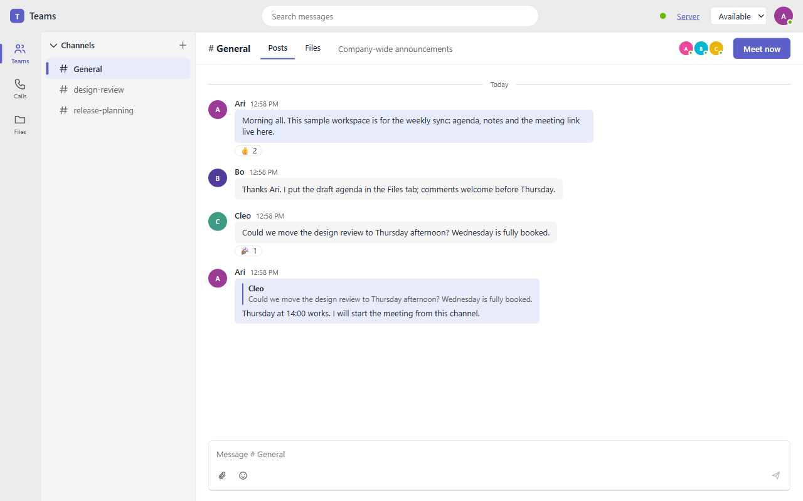
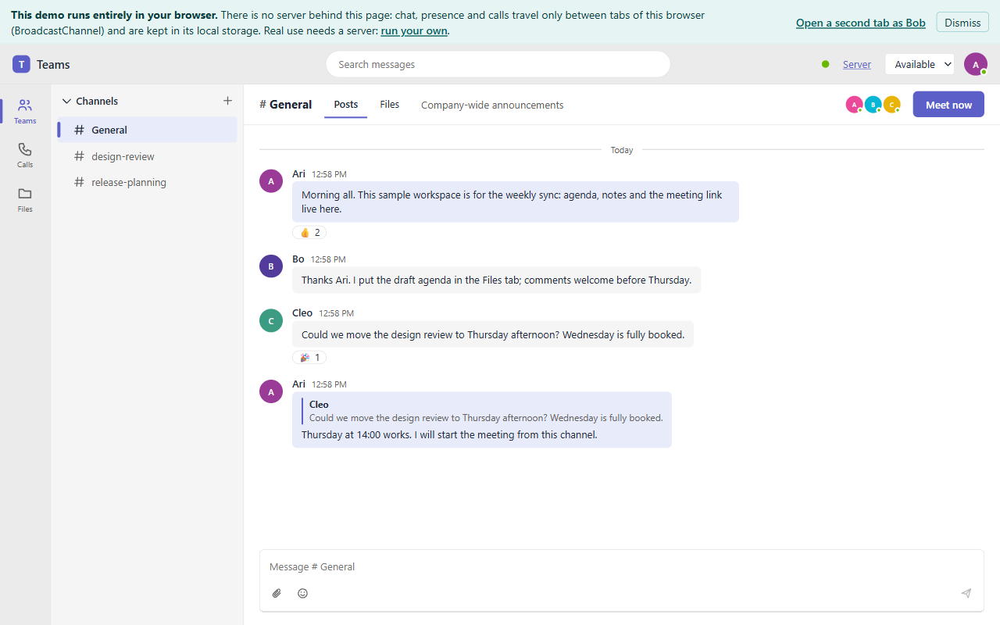
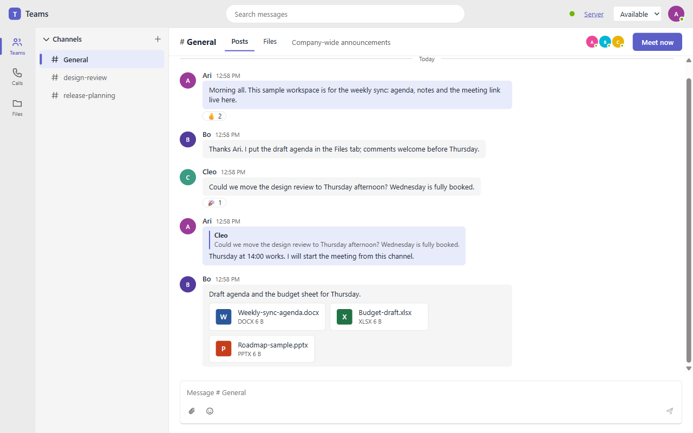
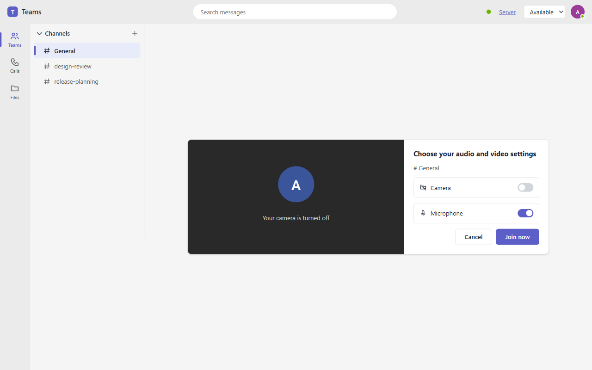

<div align="center">

# OpenTeams

**An open-source team workspace on the server you run: channels and chat, presence and WebRTC meetings, one web component and a thin binding for your framework.**

[](https://www.npmjs.com/package/openteams-react-viewer)
[](https://www.npmjs.com/package/openteams-server)
[](LICENSE)
[](../../docs/stability.md)
[](https://github.com/ChristopherVR/ooxml/actions/workflows/ci.yml)

[**Live demo**](https://christophervr.github.io/ooxml/teams/demo/) &nbsp;&middot;&nbsp;
[**Documentation**](https://christophervr.github.io/ooxml/teams/) &nbsp;&middot;&nbsp;
[**Getting started**](#getting-started) &nbsp;&middot;&nbsp;
[**Changelog**](CHANGELOG.md) &nbsp;&middot;&nbsp;
[**Report a bug**](https://github.com/ChristopherVR/ooxml/issues)

Part of [ooxml](https://github.com/ChristopherVR/ooxml#readme): [Office](https://github.com/ChristopherVR/ooxml#ooxml-office-the-whole-suite-in-one-app) &middot; [Word](../docx#readme) &middot; [Excel](../xlsx#readme) &middot; [PowerPoint](../pptx#readme) &middot; [Visio](../visio#readme) &middot; **OpenTeams** &middot; [Core](../../src/core#readme)



</div>

OpenTeams is in **beta**. It is not Microsoft Teams and is not affiliated with Microsoft, and it
has no end-to-end encryption: your server can read chat and files.

## Why OpenTeams

- **Your server, your data.** There is no hosted service. Run the reference server
  (`openteams-server`, one Node process) or any server that speaks three documented contracts:
  y-websocket sync, a JSON signaling relay and optional file storage.
- **One app, every framework.** The Lit `<teams-app>` element owns the UI. The React, Vue,
  Angular, Svelte, Solid and vanilla bindings handle lifecycle and events only, and each also
  exposes a raw hook over the same client, so you can build your own UI.
- **Hardened against hostile peers.** With accounts, the server decides who is in each private
  chat and call, checks the author of every update, and bounds what one client can make it store,
  hold in memory or compute.
- **Logic in one place.** Chat, presence, calls and the client store live in
  [`ooxml-core/teams`](../../docs/teams-area.md), the visual primitives and `<teams-app>` in
  [`ooxml-ui/teams`](../../src/ui). This folder holds the bindings, the reference server and the
  docs site.
- **Honest limits.** What is not supported is written down. See
  [limitations](https://christophervr.github.io/ooxml/teams/limitations).

## Features and limitations

|                       |                                                                                                                                                                                                                                                       |
| --------------------- | ----------------------------------------------------------------------------------------------------------------------------------------------------------------------------------------------------------------------------------------------------- |
| **Channels and chat** | Channels, posts with replies, 1:1 and group chats in rooms only their members can join, reactions, pins, author-only edit and delete, search and unread counts. Concurrent edits merge. Everything a peer sends is validated again and shown as text. |
| **Presence**          | Who is online and typing, a status you set (available, busy, do not disturb, be right back, away, offline), a status message and automatic away when idle.                                                                                            |
| **Meetings**          | Pre-join screen, audio, video, screen share and raise hand over WebRTC, and a calendar with repeats, reminders and `.ics` export. Full mesh with no media server: comfortable up to about a dozen people. TURN for strict networks is yours to run.   |
| **Files**             | Attachments go to your server's `/files` endpoint or your own `uploadFile` function and are posted as links; Word, Excel, PowerPoint and Visio files are recognised so a host can open them. Without file storage, files are shared by name only.     |
| **Languages**         | English, German, Spanish, French and Simplified Chinese (`locale`); text people wrote is never translated.                                                                                                                                            |
| **Keyboard**          | F6 and Shift+F6 move between the app bar, chat list, header, messages and message box; dialogs keep focus and give it back. Checked in a real browser, with axe-core, before every release.                                                           |
| **Server**            | Sync, signaling and file storage with accounts and signed sessions, server-side authorship checks, moderators, per-room permissions (`authorizeSync`), an origin allowlist, quotas and short-lived signed download links.                             |
| **Local mode**        | `mode: 'local'` needs no server: tabs of one browser share chat, presence and calls over `BroadcastChannel`. The live demos run this way.                                                                                                             |
| **Not supported**     | End-to-end encryption, SSO, password reset, recording, background blur, live captions, push or email notifications (notifications work only while the app is open), invitations outside the workspace, full CommonMark/GFM.                           |

## How it works

1. **Start a workspace.** Open the [in-browser demo](https://christophervr.github.io/ooxml/teams/demo/)
   (no server; it says so at the top), or run `npx openteams-server --insecure-dev` (local
   development only) and point the app at `ws://127.0.0.1:8787/sync` and `/signal`.

   

2. **Open a second tab as someone else.** The notice's link (or `?name=Bob`) opens the same
   workspace as another person; in server mode, any browser that reaches your server can join.
3. **Talk.** Post in a channel, reply, react and attach files. Each message is a Yjs update that
   reaches the other tabs (local mode) or every client of the room (server mode).

   

4. **Meet.** **Meet now** opens the pre-join screen with camera and microphone toggles; **Join
   now** connects everyone in the call peer to peer, with signaling relayed by the server (or
   `BroadcastChannel` locally).

   

## Getting started

### 1. Install

```bash
npm install openteams-react-viewer      # or -vue-, -angular-, -svelte-, -solid-, -vanilla-viewer
npx openteams-server --insecure-dev     # local development only: 127.0.0.1:8787 (Node 22.3+)
```

Each binding installs [`ooxml-core`](https://www.npmjs.com/package/ooxml-core) (the workspace
logic), [`ooxml-ui`](https://www.npmjs.com/package/ooxml-ui) (the `<teams-app>` element) and `lit`
as regular dependencies. Use one binding per page: they register the same custom elements. Use
the bindings and the server of the same major version; they speak the same Teams protocol.

### 2. Mount the workspace

```tsx
import { Teams } from 'openteams-react-viewer';

const config = {
	mode: 'server' as const,
	syncUrl: 'wss://teams.example.com/sync',
	signalingUrl: 'wss://teams.example.com/signal',
	iceServers: [{ urls: 'stun:stun.example.com:3478' }],
};

export function Workspace() {
	return (
		<div style={{ height: '100vh' }}>
			<Teams workspaceId="acme" userName="Ada" config={config} />
		</div>
	);
}
```

Or build your own UI over the raw hook (state in, plain actions out):

```tsx
import { useTeams } from 'openteams-react-viewer';

const { client, state } = useTeams({
	workspaceId: 'acme',
	user: { id: 'ada', name: 'Ada' },
	config,
});
state?.channels.map((c) => <button onClick={() => client?.select(c.id)}>{c.name}</button>);
```

<details>
<summary><strong>Vanilla JavaScript</strong></summary>

```ts
import { mountTeams } from 'openteams-vanilla-viewer';

const teams = mountTeams(document.querySelector<HTMLElement>('#teams')!, {
	workspaceId: 'acme',
	userName: 'Ada',
	config,
	onOpenFile: (detail) => console.log(detail.attachment.kind, detail.url),
});
// teams.destroy();
```

Or plain markup after `defineTeamsApp()`:

```html
<teams-app
	workspace-id="acme"
	user-name="Ada"
	server-config='{"mode":"server","syncUrl":"wss://teams.example.com/sync","signalingUrl":"wss://teams.example.com/signal","iceServers":[{"urls":"stun:stun.example.com:3478"}]}'
></teams-app>
```

</details>

| Binding  | Component                       | Raw hook                                                 |
| -------- | ------------------------------- | -------------------------------------------------------- |
| React    | `<Teams />`                     | `useTeams(options)` (`useTeamsClient`, `useTeamsState`)  |
| Vue 3    | `<Teams />`                     | `useTeams(() => options)` returns shallow refs           |
| Angular  | `<teams-workspace>`             | `TeamsService` (signals)                                 |
| Svelte 5 | `Teams.svelte` (default export) | `teamsStore(options)` from `/runtime` (a readable store) |
| Solid    | `Teams(props)`                  | `createTeamsClient(() => options)` returns signals       |
| Vanilla  | `mountTeams(el, props)`         | `createTeams(options)`                                   |

See the [framework guides](https://christophervr.github.io/ooxml/teams/frameworks/react) and
`demos/teams/react/src/App.tsx` at the repository root for both styles side by side.

### 3. Run the reference server

```bash
openssl rand -hex 32 > session-secret   # once; keep it outside the repository
TEAMS_USERS_FILE=users.json TEAMS_SESSION_SECRET="$(cat session-secret)" TEAMS_ORIGINS=https://app.example.com TEAMS_DATA=/var/lib/openteams npx openteams-server
npx openteams-server --insecure-dev     # local development only: no accounts, listens on 127.0.0.1:8787
```

The server refuses to start without accounts (`TEAMS_USERS_FILE`), an `authenticate` hook or
`authorizeSync`; `--insecure-dev` is the explicit, warned opt-out. It refuses a session secret
shorter than 32 characters, and with only `authorizeSync` it offers sync but no sessions, files or
call signaling. It is configured by environment (`PORT`, `HOST`, `TEAMS_USERS_FILE`,
`TEAMS_SESSION_SECRET`, `TEAMS_ORIGINS`, `TEAMS_DATA` and the limits) and serves `ws /sync/<room>`,
`ws /signal/<room>`, `POST|GET|DELETE /files/<scope>/<name>`, `GET /files/<scope>`,
`POST /files/link/<scope>/<name>`, the `/auth/...` routes, `GET /health` and, with
`TEAMS_METRICS_TOKEN`, `GET /metrics`. It compacts room snapshots, enforces file quotas per
workspace, per uploader and for the whole directory, caps stored rooms and presence, and can log
JSON (`--log-format=json`). Put it behind TLS. [server/README.md](server/README.md) is the full
reference, [bring your own server](https://christophervr.github.io/ooxml/teams/server) describes
the contracts, and [docs/deploy.md](docs/deploy.md) covers TLS, tokens, TURN and Docker.

## Packages

Seven packages are published on npm, each versioned on its own. The names are `openteams-*`
because the plain `openteams` name on npm belongs to an unrelated project.

| Package                    | What it is                                                             | Peer dependency |
| -------------------------- | ---------------------------------------------------------------------- | --------------- |
| `openteams-react-viewer`   | React 18+ component and hooks (`packages/react`).                      | `react`         |
| `openteams-vue-viewer`     | Vue 3.4+ component and composable (`packages/vue`).                    | `vue`           |
| `openteams-angular-viewer` | Angular 17+ standalone component and service (`packages/angular`).     | `@angular/core` |
| `openteams-svelte-viewer`  | Svelte 5 component and store (`packages/svelte`).                      | `svelte`        |
| `openteams-solid-viewer`   | SolidJS 1.9 component and primitive (`packages/solid`).                | `solid-js`      |
| `openteams-vanilla-viewer` | `mountTeams` and the plain `<teams-app>` element (`packages/vanilla`). | none            |
| `openteams-server`         | The reference server and its `openteams-server` command (`server`).    | none            |

Every package needs Node.js 22.3 or newer where it runs under Node; the bindings support the last
two major versions of Chrome, Edge, Firefox and Safari. The workspace also holds **private**
packages that are never published: `teams-viewer` (`packages/web-component`, a re-export of
`ooxml-ui/teams` that the bindings build against) and the demos.

```
packages/web-component   re-exports ooxml-ui/teams (the element and the binding wiring in bind.ts)
packages/{react,vue,solid,svelte,angular,vanilla}   thin bindings: a component AND raw hooks each
server/                  reference BYO server: Yjs sync + signaling relay + file storage + accounts
docs/                    the VitePress site and the GitHub Pages build (separate install)
```

`<teams-app>` itself (Lit: `teams-app.ts` and `teams-app.css`, with its controller) and the
binding wiring (`bindTeams`, `pickTeamsProps`, `TEAMS_CONTRACT` in `bind.ts`) are
`src/ui/src/teams/app` at the repository root, shipped as `ooxml-ui/teams`. The demos are
`demos/teams/*` and the browser tests `e2e/teams/`, both at the repository root.

## Privacy and network use

Chat, presence and session data go only to the `syncUrl` and `signalingUrl` you configure; local
mode stays in the browser. Calls use Google's public STUN server (`stun:stun.l.google.com:19302`)
unless you set `iceServers` to your own STUN or TURN servers (or to `[]`), and a website tab loads
the URL a member added. The reference server makes no outbound requests. Nothing collects
analytics or telemetry. See [PRIVACY.md](../../PRIVACY.md).

## OneDrive integration

A host can connect OneDrive storage through the optional shared `ooxml-core/embedding/onedrive`
connection with its own Microsoft sign-in. See the
[integration reference](../../docs/onedrive-integration.md#sharing-and-openteams) for loading and
saving, sharing permissions and conflict recovery, and the
[testing guide](../../docs/onedrive-testing.md). No simulation service is shipped, and OneDrive
storage does not provide Microsoft Office coauthoring or automatic merging.

## Development

Needs Node.js 22.3+ and Bun. This folder is `viewers/teams` of the
[`ooxml`](https://github.com/ChristopherVR/ooxml) repository: run `bun install` at the repository
root, then the commands below here. The demos and tests use the source of `ooxml-core` and
`ooxml-ui` in the same tree.

```bash
bun install
bun run dev            # reference server :8787, vanilla demo :5173, React demo :5174
bun run typecheck      # strict; the web component and all six bindings (.svelte files excepted)
bun run test           # vitest (jsdom) then the server's node:test suite
bun run test:scripts   # this folder's script tests (published-reference and workspace-package checks)
bun run build:packages # dist/ for the six bindings; the server needs no build
bun run check:published && bun run pack:smoke
bun run pack:smoke --workspace-runtime   # also packs this checkout's ooxml-core and ooxml-ui (what CI runs)
bun install --cwd docs && bun run build:pages   # the docs site and the demos of all six bindings, as deployed
bun run docs:dev       # the docs site with hot reload
```

Open `http://127.0.0.1:5173/?name=Ada` and, in another tab, `...?name=Bob`: two people in one
workspace. `?local=1` runs without the server. `TEAMS_USE_DIST=1` makes the demos use the built
packages (`bun run build:packages` first) instead of the source. Cameras and microphones need
`localhost` or HTTPS.

## Releasing

Releases are automated from Conventional Commits: each package has its own version and tag
(`<npm-name>@<version>`), and the repository root's release workflow plans, tags and publishes
through npm trusted publishing. See [docs/releasing.md](docs/releasing.md) and the root
[docs/releasing.md](../../docs/releasing.md). Each package's history is in its own `CHANGELOG.md`,
summarised in [CHANGELOG.md](CHANGELOG.md).

## Documentation

[Getting started](https://christophervr.github.io/ooxml/teams/getting-started) &middot; [Architecture](https://christophervr.github.io/ooxml/teams/architecture) &middot; [Framework guides](https://christophervr.github.io/ooxml/teams/frameworks/react) &middot; [Bring your own server](https://christophervr.github.io/ooxml/teams/server) &middot; [Deploying](https://christophervr.github.io/ooxml/teams/deploy) &middot; [Limitations](https://christophervr.github.io/ooxml/teams/limitations) &middot; [Live demos](https://christophervr.github.io/ooxml/teams/demos)

## Contributing and license

Contributions follow [CONTRIBUTING.md](../../CONTRIBUTING.md). [Apache License 2.0](LICENSE); see
[`NOTICE`](NOTICE) for attributions.
