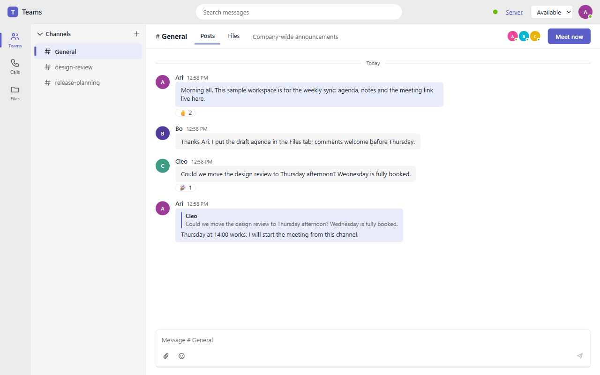

# openteams-angular-viewer

**A complete team workspace for Angular: channels, chat, presence and video meetings in one standalone component, on a server you run.**

[](https://www.npmjs.com/package/openteams-angular-viewer)
[](https://github.com/ChristopherVR/ooxml/blob/main/viewers/teams/LICENSE)
[](https://github.com/ChristopherVR/ooxml/blob/main/docs/stability.md)

[Live demo](https://christophervr.github.io/ooxml/teams/demo-angular/) · [Angular guide](https://christophervr.github.io/ooxml/teams/frameworks/angular) · [Docs](https://christophervr.github.io/ooxml/teams/) · [Changelog](https://github.com/ChristopherVR/ooxml/blob/main/viewers/teams/packages/angular/CHANGELOG.md) · [Report a bug](https://github.com/ChristopherVR/ooxml/issues)



OpenTeams is an open-source, bring-your-own-server team workspace. It is in **beta**, it is not
Microsoft Teams and is not affiliated with Microsoft, and it has no end-to-end encryption: your
server can read chat and files.

## Install

```bash
npm install openteams-angular-viewer
```

`@angular/core` 17 or later is a peer dependency (the package is built and tested against Angular
22.2). [`ooxml-core`](https://www.npmjs.com/package/ooxml-core) (the workspace logic,
`ooxml-core/teams`), [`ooxml-ui`](https://www.npmjs.com/package/ooxml-ui) (the `<teams-app>`
element) and `lit` come with it as regular dependencies.

The package is a bundled ES module whose decorators are applied at runtime, not an Ivy
partially-compiled library, so the app needs the Angular JIT compiler: import `@angular/compiler`
once in your entry file, before you bootstrap.

## Quick start

```ts
import '@angular/compiler';
import { Component } from '@angular/core';
import { bootstrapApplication } from '@angular/platform-browser';
import { TeamsWorkspaceComponent } from 'openteams-angular-viewer';

@Component({
	selector: 'app-root',
	standalone: true,
	imports: [TeamsWorkspaceComponent],
	template: `<teams-workspace
		workspaceId="acme"
		userName="Ada"
		[config]="config"
		(openFile)="onOpen($event.detail)"
	/>`,
	styles: [':host { display: block; height: 100vh; }'],
})
export class AppComponent {
	config = {
		mode: 'server' as const,
		syncUrl: 'wss://teams.example.com/sync',
		signalingUrl: 'wss://teams.example.com/signal',
		iceServers: [{ urls: 'stun:stun.example.com:3478' }],
	};
	onOpen(detail: { url: string | undefined }) {
		console.log(detail.url);
	}
}

void bootstrapApplication(AppComponent);
```

`<teams-workspace>` fills the height of its host. Leave out `config` and the workspace runs in local mode: tabs of one browser share chat,
presence and calls over `BroadcastChannel`, with no server at all. When the server requires
accounts, the workspace asks the person to sign in.

## Build your own UI

`TeamsService` gives you the same client without the bundled UI, as Angular signals.

```ts
import { Component, inject } from '@angular/core';
import { TeamsService } from 'openteams-angular-viewer';

@Component({
	selector: 'app-channels',
	standalone: true,
	providers: [TeamsService],
	template: `@for (c of teams.state()?.channels ?? []; track c.id) {
		<button (click)="teams.client()?.select(c.id)">{{ c.name }}</button>
	}`,
})
export class ChannelsComponent {
	teams = inject(TeamsService);
	constructor() {
		this.teams.connect({ workspaceId: 'acme', user: { id: 'ada', name: 'Ada' }, config });
	}
}
```

Provide the service in the component that owns the workspace. `connect()` replaces any earlier
client, `disconnect()` ends it, and the service disconnects when it is destroyed.

## What you get

| Area                | In the workspace                                                                                                                     |
| ------------------- | ------------------------------------------------------------------------------------------------------------------------------------ |
| Channels and chat   | Posts with replies, 1:1 and group chats in rooms only their members can join, reactions, pins, author-only edit and delete, search.  |
| Presence            | Who is online and typing, a status you set, a status message and automatic away when idle.                                           |
| Meetings            | Pre-join screen, audio, video, screen share and raise hand over WebRTC, plus a calendar with repeats, reminders and `.ics` export.   |
| Files               | Attachments go to your server or your own `uploadFile`; Word, Excel, PowerPoint and Visio files are recognised so you can open them. |
| Languages           | English, German, Spanish, French and Simplified Chinese (`locale`); text people wrote is never translated.                           |
| Keyboard and themes | F6 moves between regions, dialogs keep focus; colours come from the shared `--office-*` tokens.                                      |

Everything a peer sends is validated again and rendered as text, never as markup.

## Inputs and outputs

| Input         | Type                                                  | Notes                                                                                    |
| ------------- | ----------------------------------------------------- | ---------------------------------------------------------------------------------------- |
| `workspaceId` | `string`                                              | The shared room: 1 to 100 letters, digits, `-` or `_`. Default `demo`.                   |
| `userName`    | `string`                                              | Display name.                                                                            |
| `userId`      | `string`                                              | Stable id for authorship; by default one remembered in this browser.                     |
| `locale`      | `string`                                              | BCP 47 tag such as `de` or `zh-CN`; empty or unknown means English.                      |
| `config`      | `TeamsServerConfig \| null`                           | Server settings (below). Omit for the settings dialog or local mode; `null` clears them. |
| `uploadFile`  | `(file, { workspaceId, signal }) => Promise<{ url }>` | Where attachments go; by default the server's `/files` endpoint.                         |
| `openers`     | `{ docx?, xlsx?, pptx?, vsdx?, other? }`              | One function per file kind, called with the open-file detail.                            |
| `embeds`      | `{ docx?, xlsx?, pptx?, vsdx?, other? }`              | One function per file kind returning a URL to embed in the preview pane.                 |
| `className`   | `string`                                              | Classes for the inner `<teams-app>` (a plain `class` attribute styles the host element). |

Outputs: `ready` (`{ user }`), `openFile` and `configChange` (`{ config }`). Angular outputs carry
one value, so `openFile` emits `{ detail, event }` where the other bindings pass
`(detail, event)`; call `event.preventDefault()` to take over opening a file.

## Connect a server

`config` is a `TeamsServerConfig` from `ooxml-core/teams`: `mode` (`'server'` or `'local'`),
`syncUrl` and `signalingUrl` (the room is appended), `iceServers` (STUN and TURN), and optionally
`iceTransportPolicy`, a shared `token` and a `sessionToken` your own sign-in obtained.

The reference server is [`openteams-server`](https://www.npmjs.com/package/openteams-server), one
Node process for sync, call signaling and file storage. Use the release with the same major version
as this package: both speak the same Teams protocol, and the server closes clients that speak
another. Any server that follows the same three contracts works too; see
[bring your own server](https://christophervr.github.io/ooxml/teams/server).

```bash
npx openteams-server --insecure-dev   # local development only: no accounts, 127.0.0.1:8787
```

Calls are full mesh with no media server, which is comfortable up to about a dozen people; add a
TURN server for strict networks.

## Supported environments

- Browsers: the last two major versions of Chrome, Edge, Firefox and Safari, and Safari 16.4 at
  least. Cameras and microphones need `localhost` or HTTPS.
- Node.js 22.3 or newer for builds and tests.
- Use one OpenTeams binding per page: they register the same custom elements.

## Privacy and network use

Chat, presence and session data go only to the `syncUrl` and `signalingUrl` you configure; local
mode stays in the browser. Calls use Google's public STUN server (`stun:stun.l.google.com:19302`)
unless you set `iceServers` to your own STUN or TURN servers (or to `[]`). A website tab loads the
URL a member added. Nothing collects analytics or telemetry. See
[PRIVACY.md](https://github.com/ChristopherVR/ooxml/blob/main/PRIVACY.md).

## OneDrive

A host can connect OneDrive storage through the optional `ooxml-core/embedding/onedrive`
connection with its own Microsoft sign-in. See the
[integration reference](https://github.com/ChristopherVR/ooxml/blob/main/docs/onedrive-integration.md#sharing-and-openteams)
and the [testing guide](https://github.com/ChristopherVR/ooxml/blob/main/docs/onedrive-testing.md).
OneDrive storage does not provide Microsoft Office coauthoring or automatic merging.

## Related packages

- Other frameworks: [`openteams-react-viewer`](https://www.npmjs.com/package/openteams-react-viewer),
  [`openteams-vue-viewer`](https://www.npmjs.com/package/openteams-vue-viewer),
  [`openteams-svelte-viewer`](https://www.npmjs.com/package/openteams-svelte-viewer),
  [`openteams-solid-viewer`](https://www.npmjs.com/package/openteams-solid-viewer),
  [`openteams-vanilla-viewer`](https://www.npmjs.com/package/openteams-vanilla-viewer).
- Server: [`openteams-server`](https://www.npmjs.com/package/openteams-server).
- Underneath: [`ooxml-core`](https://www.npmjs.com/package/ooxml-core) and
  [`ooxml-ui`](https://www.npmjs.com/package/ooxml-ui). OpenTeams is part of
  [ooxml](https://github.com/ChristopherVR/ooxml#readme), next to the Word, Excel, PowerPoint and
  Visio viewers.

## License

[Apache-2.0](https://github.com/ChristopherVR/ooxml/blob/main/viewers/teams/LICENSE).
