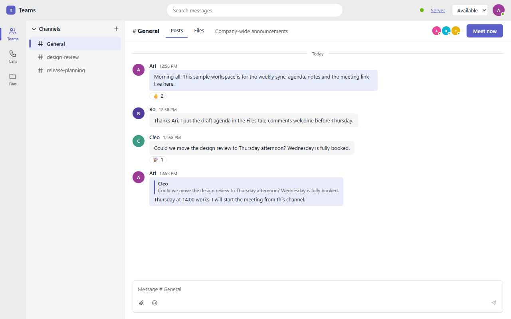

# openteams-svelte-viewer

**OpenTeams for Svelte 5: a team workspace (channels, chat, presence and meetings) in one component, connected to a server you run.**

[](https://www.npmjs.com/package/openteams-svelte-viewer)
[](https://github.com/ChristopherVR/ooxml/blob/main/viewers/teams/LICENSE)
[](https://www.npmjs.com/package/openteams-svelte-viewer)
[](https://github.com/ChristopherVR/ooxml/blob/main/docs/stability.md)

[Live demo](https://christophervr.github.io/ooxml/teams/demo-svelte/) · [Documentation](https://christophervr.github.io/ooxml/teams/) · [Svelte guide](https://christophervr.github.io/ooxml/teams/frameworks/svelte) · [Changelog](https://github.com/ChristopherVR/ooxml/blob/main/viewers/teams/packages/svelte/CHANGELOG.md) · [Report a bug](https://github.com/ChristopherVR/ooxml/issues)



OpenTeams is not Microsoft Teams and is not affiliated with Microsoft. There is no end-to-end
encryption: your server can read chat and files.

## Install

```bash
npm install openteams-svelte-viewer
```

Peer dependency: `svelte` `^5.0.0`. The package ships `Teams.svelte` as source, which your Svelte
toolchain compiles, next to a JavaScript runtime (`openteams-svelte-viewer/runtime`).
[`ooxml-core`](https://www.npmjs.com/package/ooxml-core) (the workspace logic),
[`ooxml-ui`](https://www.npmjs.com/package/ooxml-ui) (the `<teams-app>` element) and `lit` come
with it. Use one OpenTeams binding per page: they register the same custom elements.

## Quick start

```svelte
<script lang="ts">
	import Teams from 'openteams-svelte-viewer';

	const config = {
		mode: 'server' as const,
		syncUrl: 'wss://teams.example.com/sync',
		signalingUrl: 'wss://teams.example.com/signal',
		iceServers: [{ urls: 'stun:stun.example.com:3478' }],
	};
</script>

<div style="height: 100vh">
	<Teams
		workspaceId="acme"
		userName="Ada"
		{config}
		onOpenFile={(detail) => console.log(detail.attachment.kind, detail.url)}
	/>
</div>
```

`Teams` fills its container, so give the container a height. `config` points at a server that
speaks the OpenTeams contracts, such as [`openteams-server`](https://www.npmjs.com/package/openteams-server)
(locally: `npx openteams-server --insecure-dev`, then `ws://127.0.0.1:8787/sync` and
`ws://127.0.0.1:8787/signal`). When the server requires accounts, the workspace asks the person to
sign in. Leave `config` out and the app uses the settings saved in its dialog, or runs in local
mode, where tabs of one browser share the workspace over `BroadcastChannel`.

## Props

| Prop          | Type                                                  | Notes                                                                                                                      |
| ------------- | ----------------------------------------------------- | -------------------------------------------------------------------------------------------------------------------------- |
| `workspaceId` | `string`                                              | The shared room: 1 to 100 letters, digits, `-` or `_`. Default `demo`.                                                     |
| `userName`    | `string`                                              | Display name.                                                                                                              |
| `userId`      | `string`                                              | Stable id for authorship; by default one remembered in this browser.                                                       |
| `config`      | `TeamsServerConfig \| null`                           | `mode`, `syncUrl`, `signalingUrl`, `iceServers`; optional `iceTransportPolicy`, `token`, `sessionToken`. `null` clears it. |
| `locale`      | `string`                                              | BCP 47 tag such as `de` or `zh-CN`; empty or unknown means English.                                                        |
| `uploadFile`  | `(file, { workspaceId, signal }) => Promise<{ url }>` | Where attachments go; by default the server's `/files` endpoint.                                                           |
| `openers`     | `{ docx?, xlsx?, pptx?, vsdx?, other? }`              | One function per file kind, called with the open-file detail.                                                              |
| `embeds`      | `{ docx?, xlsx?, pptx?, vsdx?, other? }`              | One function per file kind returning a viewer page URL for the preview pane.                                               |
| `class`       | `string`                                              | Classes for the `<teams-app>` element (`className` works too).                                                             |

Full reference: [element API](https://christophervr.github.io/ooxml/teams/api).

## Events

Svelte 5 event handlers are props:

| Prop             | Called with       | When                                                                             |
| ---------------- | ----------------- | -------------------------------------------------------------------------------- |
| `onOpenFile`     | `(detail, event)` | Someone opened an attachment; call `event.preventDefault()` to open it yourself. |
| `onReady`        | `({ user })`      | The workspace is up and knows who the user is.                                   |
| `onConfigChange` | `({ config })`    | The person saved new server settings in the app.                                 |

## Your own UI

`teamsStore` gives you the same client without the bundled UI, as a readable store.

```svelte
<script lang="ts">
	import { teamsStore } from 'openteams-svelte-viewer/runtime';

	const teams = teamsStore({ workspaceId: 'acme', user: { id: 'ada', name: 'Ada' }, config });
</script>

{#each $teams?.channels ?? [] as c (c.id)}
	<button onclick={() => teams.client()?.select(c.id)}>{c.name}</button>
{/each}
```

The client lives while the store has subscribers, and its actions are on `client()`. The root
export is the component; the store, `createTeams` and the element helpers are under
`openteams-svelte-viewer/runtime`. The actions are listed under
[the raw client](https://christophervr.github.io/ooxml/teams/api#the-raw-client).

## Theming

The element styles itself in its shadow root, so there is no stylesheet to import. Colours,
spacing and radii come from the shared `--office-*` tokens; the OpenTeams ones are prefixed
`--office-teams-` (such as `--office-teams-brand`, `--office-teams-rail` and
`--office-teams-panel`). Override them on `teams-app` or an ancestor. The app follows the system
colour scheme or `data-office-theme="light"` / `"dark"` on the page, and each person can pick
System, Light or Dark in its settings. See
[theming](https://christophervr.github.io/ooxml/teams/theming).

## Localisation

The UI ships in English, German, Spanish, French and Simplified Chinese: set `locale` to `de`,
`es`, `fr` or `zh-CN`; an empty or unknown tag means English. Text people wrote is never
translated.

## Status and limits

OpenTeams is **Beta** ([stability](https://github.com/ChristopherVR/ooxml/blob/main/docs/stability.md)).

- No end-to-end encryption: the server stores and can read every message and file.
- Calls are full mesh with no media server, comfortable up to about a dozen people; strict
  networks need a TURN server you run.
- No SSO, password reset, recording, background blur, live captions, or push and email
  notifications (notifications work only while the app is open).
- Markdown is a safe subset, not full CommonMark or GFM.

See [limitations](https://christophervr.github.io/ooxml/teams/limitations),
[teams-parity.md](https://github.com/ChristopherVR/ooxml/blob/main/docs/teams-parity.md) and
[parity-checklist.md](https://github.com/ChristopherVR/ooxml/blob/main/docs/parity-checklist.md).

## Privacy and network use

- **Sync and signaling** go only to the `syncUrl` and `signalingUrl` that you or the person
  configure; local mode stays in the browser. Call signaling carries each participant's network
  addresses to the others in the call.
- **Calls** use Google's public STUN server (`stun:stun.l.google.com:19302`) when no `iceServers`
  are set, which learns each participant's IP address. Set `iceServers` to your own STUN or TURN
  servers, or to `[]` for none.
- **Website tabs** load the URL a member added, for everyone who opens the tab.
- **On the device:** chat snapshots, read state, drafts and the server settings in localStorage;
  session tokens stay in memory. Nothing collects analytics or telemetry.

See [PRIVACY.md](https://github.com/ChristopherVR/ooxml/blob/main/PRIVACY.md#teams-ooxml-coreteams-ooxml-uiteams-the-openteams--packages).

## Browser support

The last two major versions of Chrome, Edge, Firefox and Safari, and Safari 16.4 at least
([browser support](https://github.com/ChristopherVR/ooxml/blob/main/docs/browser-support.md)).
Cameras and microphones need `localhost` or HTTPS. Svelte 5; Node.js 22.3 or newer for builds and
tests.

## Documentation and demos

- [Documentation](https://christophervr.github.io/ooxml/teams/),
  [Svelte guide](https://christophervr.github.io/ooxml/teams/frameworks/svelte) and
  [Svelte demo](https://christophervr.github.io/ooxml/teams/demo-svelte/).
- Server: [`openteams-server`](https://www.npmjs.com/package/openteams-server) and
  [bring your own server](https://christophervr.github.io/ooxml/teams/server). Use the same major
  version as this package: both speak the same Teams protocol.
- Other frameworks: [React](https://www.npmjs.com/package/openteams-react-viewer) ·
  [Vue](https://www.npmjs.com/package/openteams-vue-viewer) ·
  [Angular](https://www.npmjs.com/package/openteams-angular-viewer) ·
  [Solid](https://www.npmjs.com/package/openteams-solid-viewer) ·
  [vanilla](https://www.npmjs.com/package/openteams-vanilla-viewer).
- [OneDrive links](https://christophervr.github.io/ooxml/teams/onedrive) in a workspace.
- Part of [ooxml](https://github.com/ChristopherVR/ooxml#readme), next to the Word, Excel,
  PowerPoint and Visio viewers.

## License

[Apache-2.0](https://github.com/ChristopherVR/ooxml/blob/main/viewers/teams/LICENSE); see
[NOTICE](https://github.com/ChristopherVR/ooxml/blob/main/viewers/teams/NOTICE).
