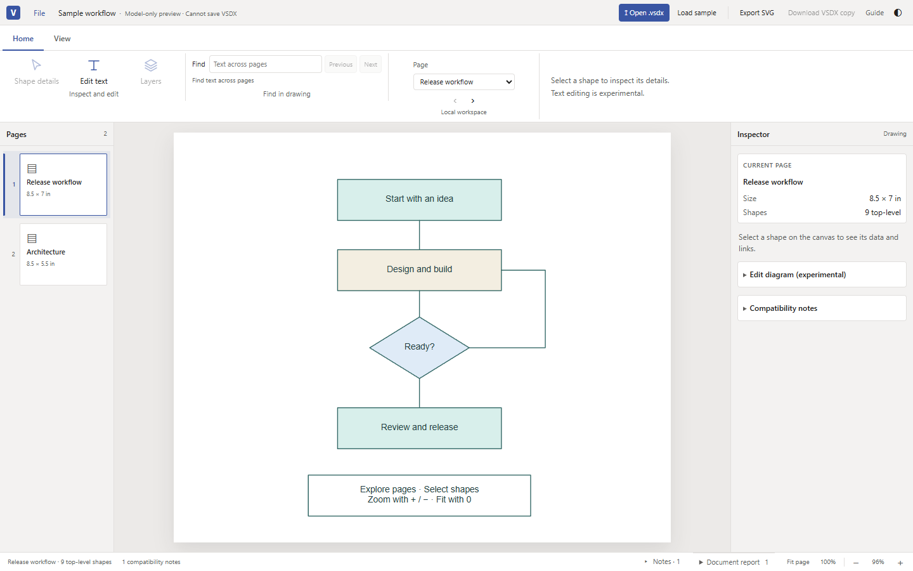

<div align="center">

# Visio viewer

**View and edit Visio drawings in the browser, from any framework. One SVG renderer, one `<visio-viewer>` element, a native component for React, Vue, Angular, Svelte and Solid, and nothing uploaded.**

[](https://www.npmjs.com/package/visio-react-viewer)
[](LICENSE)
[](../../docs/stability.md)
[](https://github.com/ChristopherVR/ooxml/actions/workflows/ci.yml)

[**Live demo**](https://christophervr.github.io/ooxml/visio/demo/) &nbsp;&middot;&nbsp;
[**Documentation**](https://christophervr.github.io/ooxml/visio/) &nbsp;&middot;&nbsp;
[**Changelog**](CHANGELOG.md) &nbsp;&middot;&nbsp;
[**Report a bug**](https://github.com/ChristopherVR/ooxml/issues)

Part of [ooxml](https://github.com/ChristopherVR/ooxml#readme): [Office](https://github.com/ChristopherVR/ooxml#readme) &middot; [Word](../docx#readme) &middot; [Excel](../xlsx#readme) &middot; [PowerPoint](../pptx#readme) &middot; **Visio** &middot; [OpenTeams](../teams#readme) &middot; [Core](../../src/core#readme)



</div>

> **Beta.** The API changes only with a changelog note. The viewer does not match Microsoft Visio, and saving is not yet guaranteed to keep everything a file contains. The [capability ledger](docs/parity.md) separates implemented code, tested evidence and missing functionality, and the [verification record](docs/verification.md) holds the native Visio checks.

## Why this viewer

- **One viewer, every framework.** The `<visio-viewer>` element owns the renderer, ribbon, page tabs, status bar, selection, search, layers and editing. Each framework package only maps its props, events, refs and reactivity onto it, so a fix reaches all six at once.
- **One document model.** Loading, the ShapeSheet, editing and saving live in the `visio` area of [`ooxml-core`](../../src/core#readme), shared with the MCP tools and the Office suite. Every edit is validated there before it is applied.
- **Local by default.** Drawings are parsed in a worker with a time limit and a memory budget, document XML never reaches the DOM, and nothing is uploaded. Storage such as OneDrive is connected only by the host.
- **Honest limits.** Unsupported features are reported, not hidden: unavailable commands say why, and loads and edits return diagnostics.

## Packages

| Package                                           | For                                                                                     |
| ------------------------------------------------- | --------------------------------------------------------------------------------------- |
| [`visio-react-viewer`](packages/react#readme)     | React 18 or later: a `forwardRef` component, `useVisioViewerState` and building blocks. |
| [`visio-vue-viewer`](packages/vue#readme)         | Vue 3.5 or later: a component with emits, an exposed handle and composables.            |
| [`visio-angular-viewer`](packages/angular#readme) | Angular 21 or 22: a standalone component with inputs, outputs and signals.              |
| [`visio-svelte-viewer`](packages/svelte#readme)   | Svelte 5: a component with exported methods and stores.                                 |
| [`visio-solid-viewer`](packages/solid#readme)     | `solid-js` 1.9: a component with a `viewerRef` and accessors.                           |
| [`visio-vanilla-viewer`](packages/vanilla#readme) | No framework: `mountViewer` and the `<visio-viewer>` element.                           |
| [`visio-core`](packages/core#readme)              | The DOM-free document API (parse, inspect, edit), for Node and the browser.             |
| [`visio-viewer-mcp`](mcp#readme)                  | MCP tools that let an agent inspect and edit `.vsdx` files in one folder.               |

Each viewer package is self-contained: it ships the shared viewer, its adapter and both browser workers, re-exports the `visio-core` API, and installs `ooxml-core`, `ooxml-ui` and `emf-converter` for you.

## Quick start

```bash
npm install visio-react-viewer
```

```tsx
import { useRef } from 'react';
import { VisioViewer, type ViewerHandle } from 'visio-react-viewer';

export function Diagram() {
	const viewer = useRef<ViewerHandle>(null);
	return (
		<>
			<input
				type="file"
				accept=".vsdx"
				onChange={async (event) => {
					const file = event.currentTarget.files?.[0];
					if (file) await viewer.current?.load(file);
				}}
			/>
			<VisioViewer ref={viewer} showToolbar style={{ height: 600 }} />
		</>
	);
}
```

Give the viewer a height and load a `File`, `Blob`, `Uint8Array` or `ArrayBuffer` through the handle. Every package README has the same quick start for its framework, and each framework has a live demo running the same workspace: [React](https://christophervr.github.io/ooxml/visio/demo-react/), [Vue](https://christophervr.github.io/ooxml/visio/demo-vue/), [Angular](https://christophervr.github.io/ooxml/visio/demo-angular/), [Svelte](https://christophervr.github.io/ooxml/visio/demo-svelte/), [Solid](https://christophervr.github.io/ooxml/visio/demo-solid/) and [vanilla](https://christophervr.github.io/ooxml/visio/demo/).

Saving is the application's job: `exportVsdx()` returns `{ bytes, dirty, diagnostics }`, and `controller.markClean()` marks them saved. Or pass `storage` and File > Save hands you the bytes.

## Features and limitations

|                      |                                                                                                                                                                                                                                                                  |
| -------------------- | ---------------------------------------------------------------------------------------------------------------------------------------------------------------------------------------------------------------------------------------------------------------- |
| **Window**           | Visio-style ribbon with File backstage, Tell me and KeyTips, Shapes window, page tabs, rulers, Pan & Zoom, status-bar zoom slider, Find, layers, shape data, comments, Presentation Mode and full screen. Unavailable commands say why.                          |
| **Editing**          | Text and shape formatting, multi-selection, align and distribute, ordering, duplicate, create, move, resize, rotate and delete, connectors with glue, containers, pages and page setup. The core validates each atomic edit; undo and redo cover them all.       |
| **File formats**     | `.vsdx`, `.vsdm`, `.vstx` and `.vstm` open as drawings; `.vssx` and `.vssm` stencils open in the Shapes window; legacy `.vsd` (Visio 2003) previews read-only. Saving writes a new copy and never overwrites the source; a VBA project is kept and never run.    |
| **Objects**          | Shapes with master inheritance, groups, background pages, paths, arcs, splines and bounded NURBS, line and fill styles, themes and variants, arrowheads, rich text, embedded PNG, JPEG and GIF pictures, a subset of EMF, and 2-D and 3-D charts with Edit Data. |
| **Export and print** | File > Export writes SVG, PNG and PDF (vector pages with extractable standard-font text; host fonts embed as subsets). Print preview and frozen print artifacts. Saved printer and layer print settings are not applied.                                         |
| **Collaboration**    | The `collaboration` property shares the open drawing in a room, merged per page and shape; File > Share connects windows of one browser, and a host server connects people elsewhere ([collaboration](docs/collaboration.md)).                                   |
| **Scale and safety** | Pages of up to about 10,000 shapes open inside a memory budget sized from the host's heap; a file that would exhaust it is refused, and a drawing too large to edit opens read-only with the reason.                                                             |
| **Localization**     | English, German, Spanish, French and Simplified Chinese interface text through `locale` (or the `lang` attribute). Diagram content is never translated.                                                                                                          |
| **Not supported**    | General ShapeSheet recalculation, most EMF records, EMF+, WMF and OLE, VDX, legacy binary stencils, ChartEx charts and macros (kept, never run). Visio's own connector routing and Re-Layout are partial; native visual equivalence is not established.          |

Plain-text editing and the shape clipboard are experimental ([viewer API](docs/api.md)).

## Configuration

Every binding takes the same properties: `document`, `pageIndex`, `zoom`, `showToolbar`, `canEdit`, `readOnly`, `locale`, `ribbonAddIns`, `collaboration`, `storage`, `fileProviders` and `customization`, and reports the same events, from `document-change` to the cancelable `file-command`.

- **Theme:** shared `--office-*` tokens, `data-office-theme="dark"` or `--office-color-scheme: dark`, and `--vv-*` overrides for this viewer alone ([theming](docs/theming.md)).
- **Capabilities and chrome:** `customization.capabilities` removes every route to `edit`, `open`, `save`, `export`, `print`, `share`, `copy`, `comment`, `find` or `settings`; `customization.ribbon.hiddenTabs` removes native tabs, File included ([customization](docs/api.md#customization)).
- **Storage and OneDrive:** `storage` takes over Save, Open and AutoRecover, and `fileProviders` adds places to File > Open. The optional `ooxml-core/embedding/onedrive` connection uses sign-in the host supplies and does not provide Microsoft coauthoring or automatic merging ([OneDrive](docs/onedrive.md), [integration reference](../../docs/onedrive-integration.md#visio-vsdx)).
- **Your own layout:** the [composable building blocks](docs/building-blocks.md) give you the canvas, toolbar, page navigation, inspector and Shapes pane separately, read-only until you pass `canEdit: true`.

The [viewer API](docs/api.md) is the full reference, and the [bindings guide](docs/bindings.md) lists each framework's native forms.

## Supported environments

- Browsers: the last two major versions of Chrome, Edge, Firefox and Safari, and Safari 16.4 at least ([browser support](../../docs/browser-support.md)).
- Node.js 22.3 or newer for the published packages (builds, tests, server rendering and `visio-core`).

## Privacy and network use

The Visio packages make no network request when opening, rendering, editing or saving a drawing, unless the host or the reader turns on Google Fonts, and then only public font family names are requested. Linked pictures are not fetched, linked data is not refreshed, and nothing collects analytics or telemetry. [PRIVACY.md](../../PRIVACY.md) lists every request the repository's packages can make.

## Development

The viewer is part of the `ooxml` monorepo (a Bun workspace). Install once at the repository root, then work from `viewers/visio` with Node.js 22.12 or newer and Bun. `ooxml-core` (`src/core/visio`) and `ooxml-ui` (`src/ui/src/visio`) resolve to the same checkout, so there is nothing to link.

```bash
bun install                 # once, at the repository root
cd viewers/visio
bun run dev                 # docs landing page and /demo/ workspace
bun run typecheck           # viewer and demo TypeScript
bun run test                # controller, renderer, scene safety and binding tests
bun run check:bindings      # native adapter types, lifecycle and SSR
bun run check:core          # core TypeScript and focused Visio tests
bun run test:docs           # VitePress docs build, ledger and theme tests
bun run docs:build          # the VitePress docs and every demo in docs/.vitepress/dist
bun run build               # ESM/declarations and the playground in site-dist/
bun run check               # all non-browser checks and production build
bun run build:packages      # the seven framework and core distributions
bun run test:packages:workspace  # packed distributions against this checkout's core and ui (what CI runs)
bun run test:browser        # Playwright Chromium workflows, then the packed-package browser check
bun run fmt                 # oxfmt
```

`CHROMIUM_PATH` selects an explicit Chromium for the browser tests; otherwise install Playwright's Chromium. `bun run test:corpus -- LIBVISIO_CHECKOUT POI_CHECKOUT` runs optional hash-pinned real and security fixture regressions (see [corpus setup](docs/corpus.md)). The demos are in `demos/visio/` and the browser tests in `e2e/visio/`, at the repository root. `packages/bindings` holds the framework adapters; it is private and bundled into each framework package at build time.

Releases are automated from Conventional Commits by the repository's release flow, published with npm trusted publishing and provenance ([release policy](docs/releasing.md)). Never run `npm publish` or push release tags by hand.

## Documentation

[Guide](https://christophervr.github.io/ooxml/visio/) &middot; [Viewer API](docs/api.md) &middot; [Bindings](docs/bindings.md) &middot; [Architecture](docs/architecture.md) &middot; [Building blocks](docs/building-blocks.md) &middot; [Collaboration](docs/collaboration.md) &middot; [Theming](docs/theming.md) &middot; [Capability ledger](docs/parity.md) &middot; [Verification record](docs/verification.md) &middot; [Corpus setup](docs/corpus.md)

## Contributing

The repository is trunk-based and uses [Conventional Commits](https://www.conventionalcommits.org); the commit type sets the version bump and the touched paths decide which packages release. Format logic belongs in `src/core/visio` and shared Office controls in `src/ui`; read [`AGENTS.md`](AGENTS.md) before changing code here.

## License

[Apache License 2.0](LICENSE). See [`NOTICE`](NOTICE) for attributions.
