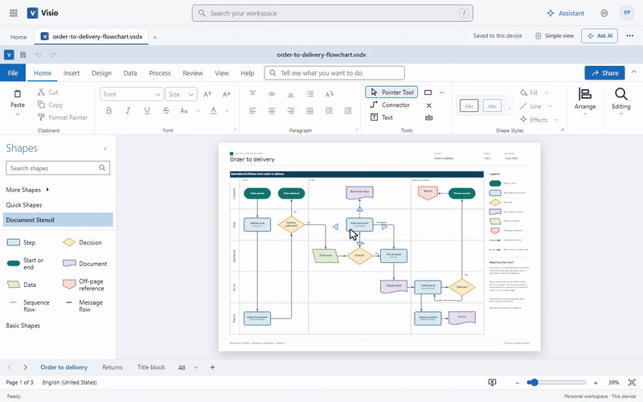

# Visio for the web

**View and edit Visio drawings in the browser from React, Vue, Angular, Svelte, Solid or plain JavaScript: one SVG renderer, one `<visio-viewer>` element, and nothing uploaded.** For web apps that need to open, review or lightly edit `.vsdx` diagrams without Microsoft Visio installed, and for Node or agent workflows that read and change them.

[Live demo](https://christophervr.github.io/ooxml/visio/demo/) · [Docs](https://christophervr.github.io/ooxml/visio/) · [Samples](https://christophervr.github.io/ooxml/samples/) · [Packages](#packages) · [Changelog](CHANGELOG.md)

[](https://christophervr.github.io/ooxml/apps/visio/?sample=order-to-delivery-flowchart)

## Packages

| Package                                    | Framework        | npm                                                       | What it is                                                          |
| ------------------------------------------ | ---------------- | --------------------------------------------------------- | ------------------------------------------------------------------- |
| [`visio-react-viewer`](packages/react)     | React 18+        | [npm](https://www.npmjs.com/package/visio-react-viewer)   | `forwardRef` component, `useVisioViewerState`, building blocks.     |
| [`visio-vue-viewer`](packages/vue)         | Vue 3.5+         | [npm](https://www.npmjs.com/package/visio-vue-viewer)     | Component with emits, an exposed handle and composables.            |
| [`visio-angular-viewer`](packages/angular) | Angular 21 or 22 | [npm](https://www.npmjs.com/package/visio-angular-viewer) | Standalone component with inputs, outputs and a state signal.       |
| [`visio-svelte-viewer`](packages/svelte)   | Svelte 5         | [npm](https://www.npmjs.com/package/visio-svelte-viewer)  | Component with exported handle methods and a state store.           |
| [`visio-solid-viewer`](packages/solid)     | `solid-js` 1.9   | [npm](https://www.npmjs.com/package/visio-solid-viewer)   | Component with a `viewerRef` and state accessors.                   |
| [`visio-vanilla-viewer`](packages/vanilla) | None             | [npm](https://www.npmjs.com/package/visio-vanilla-viewer) | `mountViewer` and the `<visio-viewer>` element.                     |
| [`visio-core`](packages/core)              | None (DOM-free)  | [npm](https://www.npmjs.com/package/visio-core)           | Parse, create and edit drawings in Node, browsers and workers.      |
| [`visio-viewer-mcp`](mcp)                  | Node.js          | [npm](https://www.npmjs.com/package/visio-viewer-mcp)     | MCP tools that let an agent inspect and edit `.vsdx` in one folder. |

Each viewer package is self-contained: it ships the shared viewer, its adapter and both browser workers, re-exports the `visio-core` API, and installs `ooxml-core`, `ooxml-ui` and `emf-converter`. The logic lives in the core's [`visio` area](../../src/core/visio/README.md) and the element in `ooxml-ui/visio` (`src/ui/src/visio`); this folder holds the thin framework adapters, the docs site and the package build.

## Quick start

```bash
npm install visio-react-viewer
```

```tsx
import { useRef } from 'react';
import { VisioViewer, type ViewerHandle } from 'visio-react-viewer';

export function Diagram() {
	const viewer = useRef<ViewerHandle>(null);
	return (
		<>
			<input
				type="file"
				accept=".vsdx"
				onChange={async (event) => {
					const file = event.currentTarget.files?.[0];
					if (file) await viewer.current?.load(file);
				}}
			/>
			<VisioViewer ref={viewer} showToolbar style={{ height: 600 }} />
		</>
	);
}
```

Every framework has the same shape: the same properties, the same events and the same handle (`load`, `exportVsdx`, `applyEdits`, `undo` and the rest), in that framework's own idiom. Saving is the application's job: `exportVsdx()` returns `{ bytes, dirty, diagnostics }` and `controller.markClean()` marks them saved, or pass `storage` and File > Save hands you the bytes. Each [package](#packages) README has the quick start for its framework, and each framework has a live demo: [React](https://christophervr.github.io/ooxml/visio/demo-react/), [Vue](https://christophervr.github.io/ooxml/visio/demo-vue/), [Angular](https://christophervr.github.io/ooxml/visio/demo-angular/), [Svelte](https://christophervr.github.io/ooxml/visio/demo-svelte/), [Solid](https://christophervr.github.io/ooxml/visio/demo-solid/) and [vanilla](https://christophervr.github.io/ooxml/visio/demo/).

## Features

- **A Visio-style window:** ribbon with File backstage, Tell me and KeyTips, Shapes window, page tabs, rulers, Pan & Zoom, Find, layers, shape data, comments and Presentation Mode. Unavailable commands say why.
- **Editing:** text and shape formatting, multi-selection, align and distribute, ordering, duplicate, create, move, resize, rotate and delete, connectors with glue, containers, pages and page setup. The core validates each atomic edit; undo and redo cover them all.
- **Files:** `.vsdx`, `.vsdm`, `.vstx` and `.vstm` open as drawings; `.vssx` and `.vssm` stencils open in the Shapes window; legacy `.vsd` previews read-only. Saving writes a new copy, and a VBA project is kept, never run.
- **Objects:** master inheritance, groups, background pages, paths, arcs, splines and bounded NURBS, themes and variants, rich text, pictures, a subset of EMF, and embedded charts (including ChartEx) with Edit Data.
- **Export and print:** SVG, PNG and PDF export (vector pages with extractable standard-font text), print preview and frozen print artifacts.
- **Collaboration:** the `collaboration` property shares the open drawing in a room, merged per page and shape ([collaboration](docs/collaboration.md)).
- **Host integration:** `--office-*` theming, `customization` capabilities and hidden tabs, host-owned `storage` and `fileProviders` (such as OneDrive), ribbon add-in tabs, and [building blocks](docs/building-blocks.md) for your own layout.
- **Bounded and local:** drawings parse in a worker with a time limit and a memory budget; pages of up to about 10,000 shapes open, and a drawing too large to edit opens read-only with the reason.

## Status and limits

**Beta** ([stability labels](../../docs/stability.md#current-labels)). The API changes only with a changelog note.

- There is no written preservation guarantee yet: saving is not guaranteed to keep everything a file contains.
- Plain-text editing and the shape clipboard are experimental ([viewer API](docs/api.md)).
- There is no general ShapeSheet recalculation; each edit has its own admission rules and other edits are refused.
- Most EMF records, EMF+, WMF and OLE objects, VDX files and legacy binary stencils are not supported.
- Visio's connector routing and Re-Layout are partial, and native visual equivalence is not established.

The [capability ledger](docs/parity.md) separates implemented code, tested evidence and missing functionality; the [verification record](docs/verification.md) holds the native Visio checks, and open gaps are tracked in the [parity checklist](../../docs/parity-checklist.md).

## Privacy and network use

Drawings open, render, edit and save on the device; nothing is uploaded, linked pictures and data are never fetched, and nothing collects telemetry. Font downloads (the `googleFonts` element property or the reader's Trust Center toggle) are off by default, bundled decoders and stencil tools load only from the app's own origin, and sharing reaches a server only when the host or reader configures one. [PRIVACY.md](../../PRIVACY.md#word-excel-and-visio) lists every request and what is kept on the device.

## Samples

Sample files to try: https://christophervr.github.io/ooxml/samples/

## Documentation

[Guide](https://christophervr.github.io/ooxml/visio/) · [Getting started](docs/getting-started.md) · [Viewer API](docs/api.md) · [Bindings](docs/bindings.md) · [Framework guides](docs/frameworks/) · [Building blocks](docs/building-blocks.md) · [Theming](docs/theming.md) · [Collaboration](docs/collaboration.md) · [OneDrive](docs/onedrive.md) · [Architecture](docs/architecture.md) · [Capability ledger](docs/parity.md) · [Verification record](docs/verification.md) · [Corpus setup](docs/corpus.md) · [Releasing](docs/releasing.md)

## Development

The viewer is part of the `ooxml` Bun workspace. Install once at the repository root, then work from `viewers/visio` (Node.js 22.12 or newer and Bun); `ooxml-core` and `ooxml-ui` resolve to the same checkout. Read [`AGENTS.md`](AGENTS.md) before changing code.

```bash
bun install                      # once, at the repository root
cd viewers/visio
bun run dev                      # docs landing page and the /demo/ workspace
bun run typecheck                # viewer and demo TypeScript
bun run test                     # viewer unit and DOM tests
bun run check:bindings           # native adapter types, lifecycle and SSR
bun run check:core               # core TypeScript and focused Visio tests
bun run test:docs                # VitePress docs build, ledger and theme tests
bun run build                    # ESM, declarations and the playground in site-dist/
bun run build:packages           # the seven framework and core distributions
bun run test:packages:workspace  # packed distributions with this checkout's core and ui (what CI runs)
bun run test:browser             # Playwright workflows, then the packed-package browser check
bun run check                    # every non-browser check and the production build
```

The demos are in `demos/visio/` and the browser tests in `e2e/visio/`, at the repository root. `CHROMIUM_PATH` selects a Chromium for the browser tests. `bun run test:corpus -- LIBVISIO_CHECKOUT POI_CHECKOUT` runs the optional hash-pinned corpus ([corpus setup](docs/corpus.md)). Releases are automated from Conventional Commits ([release policy](docs/releasing.md)); never run `npm publish` or push release tags by hand.

## License

[Apache License 2.0](LICENSE). See [`NOTICE`](NOTICE) for attributions.
