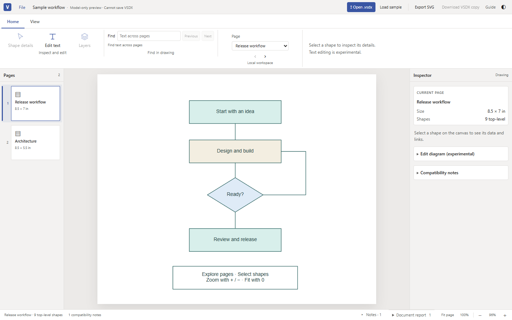

# visio-vanilla-viewer

View and edit Visio drawings on any web page, with no framework. One SVG renderer, a Visio-style ribbon and source-backed editing, with nothing uploaded.

[](https://www.npmjs.com/package/visio-vanilla-viewer)
[](https://github.com/ChristopherVR/ooxml/blob/main/viewers/visio/LICENSE)
[](https://www.npmjs.com/package/visio-vanilla-viewer)
[](https://github.com/ChristopherVR/ooxml/blob/main/docs/stability.md)

[Live demo](https://christophervr.github.io/ooxml/visio/demo/) · [Docs](https://christophervr.github.io/ooxml/visio/frameworks/vanilla) · [Changelog](https://github.com/ChristopherVR/ooxml/blob/main/viewers/visio/packages/vanilla/CHANGELOG.md) · [Report a bug](https://github.com/ChristopherVR/ooxml/issues)



> **Beta.** The API changes only with a changelog note. The viewer does not match Microsoft Visio, and saving is not yet guaranteed to keep everything a file contains. The [capability ledger](https://github.com/ChristopherVR/ooxml/blob/main/viewers/visio/docs/parity.md) lists what works, the evidence behind it and what is missing.

## Install

```bash
npm install visio-vanilla-viewer
```

No framework is needed. `ooxml-core`, `ooxml-ui`, `visio-core` and `emf-converter` are installed with the package; you do not import them yourself.

## Quick start

```js
import { mountViewer } from 'visio-vanilla-viewer';

const host = document.createElement('div');
host.style.height = '600px';
const input = document.createElement('input');
input.type = 'file';
input.accept = '.vsdx';
document.body.append(input, host);

const viewer = mountViewer(host, { showToolbar: true });
input.addEventListener('change', async () => {
	const file = input.files?.[0];
	if (file) await viewer.load(file);
});
// Call viewer.destroy() when the host is removed.
```

Give the viewer a height. `load()` takes a `File`, `Blob`, `Uint8Array` or `ArrayBuffer`; the `document` property takes an already parsed `VisioDocument`, not a URL. Importing the package on the server is safe; the viewer itself mounts in the browser and parses in a worker with a time limit.

## What you get

- **A Visio-style window.** Ribbon with the File backstage, Tell me and KeyTips, the Shapes window, page tabs, rulers, Pan & Zoom, a status-bar zoom slider, Find, layers, shape data, comments and Presentation Mode.
- **Editing.** Text and shape formatting, multi-selection, align and distribute, ordering, duplicate, create, move, resize, rotate and delete, connectors with glue and containers. The core validates every edit before it is applied, and each one is a single undo step.
- **Files.** Opens `.vsdx`, `.vsdm`, `.vstx` and `.vstm` drawings; stencils (`.vssx`, `.vssm`) open in the Shapes window; legacy binary `.vsd` (Visio 2003) previews read-only. Saving writes a new copy and never overwrites the file it came from; macros are kept and never run.
- **Charts.** Embedded charts render in 2-D and 3-D, and Insert > Chart, Edit Data and Format Chart edit them.
- **Export and print.** File > Export writes SVG, PNG and PDF (vector pages whose standard-font text can be extracted); `exportSvg()` and `createPrintSnapshot()` give the same output to your code.
- **Sharing.** The `collaboration` property shares the open drawing in a room; File > Share connects windows of the same browser, and your own server connects people elsewhere.
- **Large drawings, safely.** Pages of up to about 10,000 shapes open within a memory budget sized from the browser. A file that would exhaust memory is refused with the reason, and a drawing too large to edit opens read-only and says why.
- **Languages.** English, German, Spanish, French and Simplified Chinese interface text through `locale`. Diagram content is never translated.
- **Keyboard and screen readers.** F6 moves between the ribbon, Shapes window, drawing, task pane, page tabs and status bar; dialogs keep and return focus; shapes keep focus across redraws. Every release is checked in a real browser, with axe-core in light and dark themes and on a phone.

**Not supported yet:** general ShapeSheet recalculation; most EMF records, EMF+, WMF and OLE objects; VDX files; ChartEx charts; Visio's own connector routing and Re-Layout (partial). Plain-text editing and the shape clipboard are experimental. Native Visio visual equivalence is not established.

## Using it in plain JavaScript

`mountViewer(host, options)` creates a `<visio-viewer>` inside `host` and returns the [handle](#handle) with two more members: `update(options)` applies a partial change of properties, and `destroy()` removes the viewer (it is idempotent; later calls reject).

Events arrive through the `events` callback map, in the options or a later `update()`:

```js
viewer.update({
	locale: 'fr',
	events: {
		'document-change': ({ dirty }) => setDirty(dirty),
		'document-error': (error) => report(error),
		'file-command': ({ command }) => command !== 'new', // false cancels New
	},
});
```

`viewer.controller.subscribe(listener)` reports the live viewer state (page, zoom, selection, search, edit and undo state) and returns an unsubscribe function; call it before `destroy()`.

To use the element directly, call `registerVisioViewer()` once and create `<visio-viewer>` yourself; importing the package does not register it.

### Properties

| Property        | What it does                                                                                       |
| --------------- | -------------------------------------------------------------------------------------------------- |
| `document`      | A parsed `VisioDocument` to show, or `null` to clear. Load file bytes with `load()` instead.       |
| `pageIndex`     | The zero-based page to show.                                                                       |
| `zoom`          | The zoom, where `1` is 100%.                                                                       |
| `showToolbar`   | Shows or hides the ribbon.                                                                         |
| `canEdit`       | Editing permission. The viewer is editable unless you pass `false`.                                |
| `readOnly`      | A restriction of its own: `true` makes the drawing read-only and wins over `canEdit`.              |
| `locale`        | Interface language, such as `fr` or `zh-CN`. Empty follows File > Options, `lang` and the browser. |
| `ribbonAddIns`  | Tabs your app adds after Help, as an Office add-in does.                                           |
| `customization` | Capabilities, hidden ribbon tabs, host File tab pages and context menu commands.                   |
| `storage`       | Host-owned Save, Open and AutoRecover instead of downloads and IndexedDB.                          |
| `fileProviders` | Cloud places for File > Open, such as OneDrive.                                                    |
| `collaboration` | Shares the open drawing in a room while set; `null` leaves it.                                     |

Omitted properties keep the viewer's current state, so an unrelated re-render never undoes a load or the user's zoom.

### Events

The names are the keys of the `events` callback map, which every binding accepts.

| Event                  | Payload                                                                                  |
| ---------------------- | ---------------------------------------------------------------------------------------- |
| `document-load`        | The loaded `VisioDocument`.                                                              |
| `document-change`      | `{ document, dirty, kind }`, with `kind` `edit`, `undo`, `redo`, `remote` or `save`.     |
| `document-error`       | An `Error`, with its message in the viewer's language.                                   |
| `page-change`          | The new page index.                                                                      |
| `zoom-change`          | The new zoom, once per zoom gesture.                                                     |
| `shape-select`         | The primary selected shape, or `null`.                                                   |
| `selection-change`     | Every selected shape, in order.                                                          |
| `office-ribbon-add-in` | A command of one of your `ribbonAddIns` tabs was chosen.                                 |
| `collaboration-change` | Sharing started, stopped, or its status, sync or people changed.                         |
| `file-command`         | New, Open, Save or Share is about to run. Return `false` from the callback to cancel it. |

### Handle

| Member                                                                          | What it does                                                           |
| ------------------------------------------------------------------------------- | ---------------------------------------------------------------------- |
| `load(source)`, `createBlankDrawing(options?)`, `openCloudFile(file)`           | Open a drawing from bytes, start a blank one, or open a cloud file.    |
| `exportVsdx()`                                                                  | Returns `{ bytes, dirty, diagnostics }` for your app to save.          |
| `exportSvg(options?)`, `createPrintSnapshot(options?)`                          | Static SVG of the current page, and frozen print-ready page artifacts. |
| `applyEdits(edits)`, `replacePlainText(pageId, shapeId, text)`                  | Apply core-validated edits as one undo step.                           |
| `undo()`, `redo()`, `cancelEdit()`                                              | Undo, redo, or abandon the edit in progress.                           |
| `selectShapes(shapes)`, `selectAll()`, `clearSelection()`                       | Selection.                                                             |
| `copySelection()`, `cutSelection()`, `pasteSelection()`, `duplicateSelection()` | The viewer's shape clipboard (needs a user gesture).                   |
| `fit()`, `setLayerVisibility(...)`, `resetLayerVisibility(pageId?)`             | View.                                                                  |
| `controller`, `element`                                                         | The state controller and the `<visio-viewer>` element.                 |

Saving is your app's job: write the bytes `exportVsdx()` returns, then call `controller.markClean()` so the viewer counts the drawing as saved. Or pass `storage` and let File > Save hand you the bytes. Handle calls reject before the viewer mounts and after it unmounts.

## Configuration

- **Theme.** The viewer follows the shared `--office-*` tokens and turns dark with `data-office-theme="dark"` (or the system preference) or `--office-color-scheme: dark`; `--vv-*` tokens restyle this viewer alone. See [theming](https://github.com/ChristopherVR/ooxml/blob/main/viewers/visio/docs/theming.md).
- **Capabilities and chrome.** `customization.capabilities` turns off `edit`, `open`, `save`, `export`, `print`, `share`, `copy`, `comment`, `find` or `settings` and removes every route to it; `customization.ribbon.hiddenTabs` removes native tabs, `'file'` included. See [customization](https://github.com/ChristopherVR/ooxml/blob/main/viewers/visio/docs/api.md#customization).
- **Storage and OneDrive.** `storage` takes Save, Open and AutoRecover; `fileProviders` adds places to File > Open. The optional `ooxml-core/embedding/onedrive` connection works with sign-in your app supplies; it does not provide Microsoft coauthoring or automatic merging. See [host-owned storage](https://github.com/ChristopherVR/ooxml/blob/main/viewers/visio/docs/api.md#host-owned-storage-and-file-commands) and the [OneDrive guide](https://github.com/ChristopherVR/ooxml/blob/main/docs/onedrive-integration.md#visio-vsdx).
- **Fonts.** Fonts come from the device and the file. Set `googleFonts` and `pdfFonts` on the element (`handle.element`) to download missing fonts or embed your own in PDF export.
- **Memory.** Package limits, including `maxXmlHeapBytes`, come from `visio-core`; the defaults follow the browser's heap.

The [viewer API](https://github.com/ChristopherVR/ooxml/blob/main/viewers/visio/docs/api.md) is the full reference.

## Compose your own UI

To build your own layout instead of mounting the whole viewer, use the building blocks. Vanilla: `createViewerBuildingBlocks` returns the flat `toolbarProps` (page, zoom, selection, search, enabled flags and callbacks), `mode`, `loading`, `error` and `markClean()`, with `mountCanvas`, `mountToolbar`, `mountPageNavigation`, `mountInspector` and `mountShapes` to place each part in your own markup. They are read-only until you pass `canEdit: true`, and take optional `onOpenFile`, `onOpenPageSetup`, `onOpenSettings` and `onOpenShareDialog` callbacks for the dialogs your app owns. See [composable building blocks](https://github.com/ChristopherVR/ooxml/blob/main/viewers/visio/docs/building-blocks.md).

## Supported environments

- Browsers: the last two major versions of Chrome, Edge, Firefox and Safari, and Safari 16.4 at least ([browser support](https://github.com/ChristopherVR/ooxml/blob/main/docs/browser-support.md)).
- No framework; any bundler that handles ES modules and workers.
- Node.js 22.3 or newer for builds, tests and server rendering.

## Privacy and network use

The Visio packages make no network request when opening, rendering, editing or saving a drawing: linked pictures are not fetched, linked data is not refreshed, fonts come from the device and the file, and workers load from your own origin. The one exception is Google Fonts, which stays off until your app sets `googleFonts` or the reader turns on File > Options > Trust Center > "Download fonts that are not installed or embedded"; then only public catalogue family names and their font files are requested, never the file or its text. Hyperlinks open only when the reader follows them. Nothing collects analytics or telemetry. See [PRIVACY.md](https://github.com/ChristopherVR/ooxml/blob/main/PRIVACY.md).

## Related packages

| Package                                                                      | What it is                                               |
| ---------------------------------------------------------------------------- | -------------------------------------------------------- |
| [`visio-react-viewer`](https://www.npmjs.com/package/visio-react-viewer)     | The same viewer for React.                               |
| [`visio-vue-viewer`](https://www.npmjs.com/package/visio-vue-viewer)         | The same viewer for Vue.                                 |
| [`visio-angular-viewer`](https://www.npmjs.com/package/visio-angular-viewer) | The same viewer for Angular.                             |
| [`visio-svelte-viewer`](https://www.npmjs.com/package/visio-svelte-viewer)   | The same viewer for Svelte.                              |
| [`visio-solid-viewer`](https://www.npmjs.com/package/visio-solid-viewer)     | The same viewer for Solid.                               |
| [`visio-core`](https://www.npmjs.com/package/visio-core)                     | The DOM-free Visio document API this package re-exports. |
| [`visio-viewer-mcp`](https://www.npmjs.com/package/visio-viewer-mcp)         | Visio inspection and edits as MCP tools for agents.      |
| [`ooxml-core`](https://www.npmjs.com/package/ooxml-core)                     | The Office logic behind every viewer.                    |

Part of [ooxml](https://github.com/ChristopherVR/ooxml#readme), with viewers for [Word](https://github.com/ChristopherVR/ooxml/tree/main/viewers/docx#readme), [Excel](https://github.com/ChristopherVR/ooxml/tree/main/viewers/xlsx#readme), [PowerPoint](https://github.com/ChristopherVR/ooxml/tree/main/viewers/pptx#readme) and [Visio](https://github.com/ChristopherVR/ooxml/tree/main/viewers/visio#readme).

## License

[Apache-2.0](https://github.com/ChristopherVR/ooxml/blob/main/viewers/visio/LICENSE). See [NOTICE](https://github.com/ChristopherVR/ooxml/blob/main/viewers/visio/NOTICE) for attributions.
