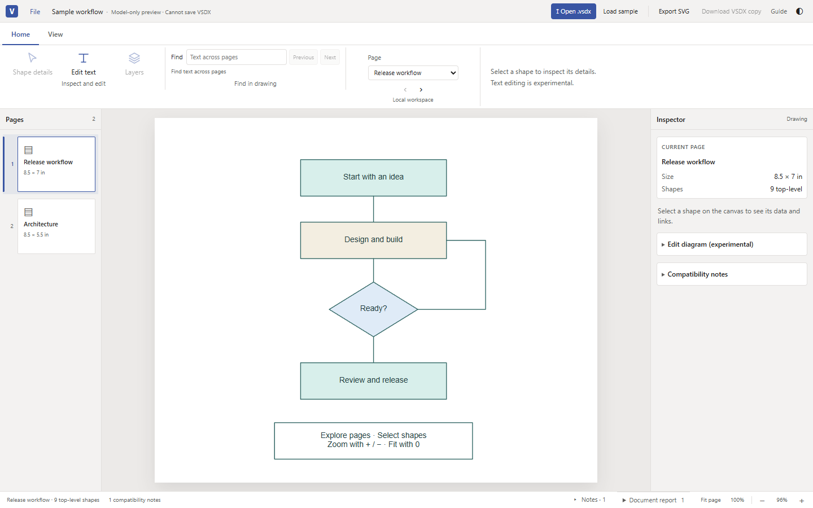

# visio-vue-viewer

**A Visio viewer and editor for Vue 3 that opens, edits and saves `.vsdx` drawings entirely in the browser.**

[](https://www.npmjs.com/package/visio-vue-viewer)
[](https://github.com/ChristopherVR/ooxml/blob/main/viewers/visio/LICENSE)
[](https://www.npmjs.com/package/visio-vue-viewer)

[Live demo](https://christophervr.github.io/ooxml/visio/demo-vue/) · [Documentation](https://christophervr.github.io/ooxml/visio/) · [Vue guide](https://christophervr.github.io/ooxml/visio/frameworks/vue) · [Changelog](https://github.com/ChristopherVR/ooxml/blob/main/viewers/visio/packages/vue/CHANGELOG.md) · [Report a bug](https://github.com/ChristopherVR/ooxml/issues)



## Install

```bash
npm install visio-vue-viewer
```

Peer dependency: `vue` `^3.5.0`. The package bundles the shared `<visio-viewer>` element, the Vue adapter and both browser workers, re-exports the [`visio-core`](https://www.npmjs.com/package/visio-core) document API, and installs `ooxml-core`, `ooxml-ui`, `visio-core` and `emf-converter` for you. There is no stylesheet to import: the element carries its own styles.

## Quick start

```vue
<script setup lang="ts">
import { ref } from 'vue';
import { VisioViewer, type ViewerHandle } from 'visio-vue-viewer';

const viewer = ref<ViewerHandle>();

async function open(event: Event) {
	const file = (event.target as HTMLInputElement).files?.[0];
	if (file) await viewer.value?.load(file);
}

function save() {
	const handle = viewer.value;
	if (!handle) return;
	const { bytes } = handle.exportVsdx();
	const url = URL.createObjectURL(new Blob([bytes.slice()]));
	Object.assign(document.createElement('a'), { href: url, download: 'drawing.vsdx' }).click();
	URL.revokeObjectURL(url);
	handle.controller.markClean();
}
</script>

<template>
	<input type="file" accept=".vsdx" @change="open" />
	<button @click="save">Save</button>
	<VisioViewer ref="viewer" :show-toolbar="true" style="height: 600px" />
</template>
```

Give the viewer a height. `load()` takes a `File`, `Blob`, `Uint8Array` or `ArrayBuffer`; the `document` prop takes an already parsed `VisioDocument`, not a URL. Importing the package on the server is safe; the viewer mounts in the browser and parses in a worker with a time limit.

## Props

`<VisioViewer>` takes each viewer property as a prop (`:page-index` or `:pageIndex` in templates). Omitted props keep the viewer's current state, so an unrelated re-render never undoes a load or the user's zoom. Attributes such as `class` and `style` fall through to the host element. Pass large documents through `shallowRef` or `markRaw`: a new reactive proxy is a new document to the viewer.

| Prop            | What it does                                                                                       |
| --------------- | -------------------------------------------------------------------------------------------------- |
| `document`      | A parsed `VisioDocument` to show, or `null` to clear.                                              |
| `pageIndex`     | The zero-based page to show.                                                                       |
| `zoom`          | The zoom, where `1` is 100%.                                                                       |
| `showToolbar`   | Shows or hides the ribbon.                                                                         |
| `canEdit`       | Editing permission; the viewer is editable unless you pass `false`.                                |
| `readOnly`      | `true` makes the drawing read-only and wins over `canEdit`.                                        |
| `locale`        | Interface language, such as `fr` or `zh-CN`. Empty follows File > Options, `lang` and the browser. |
| `customization` | Capabilities, hidden ribbon tabs, host File tab pages and context menu commands.                   |
| `storage`       | Host-owned Save, Open and AutoRecover instead of downloads and IndexedDB.                          |
| `fileProviders` | Cloud places for File > Open, such as OneDrive.                                                    |
| `collaboration` | Shares the open drawing in a room while set; `null` leaves it.                                     |
| `ribbonAddIns`  | Tabs your app adds after Help, as an Office add-in does.                                           |
| `events`        | The event callback map; the same events are also emitted (see [Events](#events)).                  |

The template ref exposes the handle:

- `load(source)`, `createBlankDrawing(options?)`, `openCloudFile(file)`: open bytes, start a blank drawing, open a cloud file.
- `exportVsdx()`: returns `{ bytes, dirty, diagnostics }`; after saving the bytes, call `controller.markClean()`.
- `exportSvg(options?)`, `createPrintSnapshot(options?)`: static SVG of the current page and frozen print-ready pages.
- `applyEdits(edits)`, `replacePlainText(pageId, shapeId, text)`, `undo()`, `redo()`, `cancelEdit()`: core-validated edits, one undo step each.
- `selectShapes(shapes)`, `selectAll()`, `clearSelection()`, `copySelection()`, `cutSelection()`, `pasteSelection()`, `duplicateSelection()`: selection and the shape clipboard (clipboard calls need a user gesture).
- `fit()`, `setLayerVisibility(pageId, layerId, visible)`, `resetLayerVisibility(pageId?)`: view.
- `controller`, `element`: the state controller and the `<visio-viewer>` element (element-only members such as `googleFonts` and `pdfFonts` live there).

Handle calls reject before the viewer mounts and after it unmounts. Full reference: [viewer API](https://christophervr.github.io/ooxml/visio/api) and [bindings](https://christophervr.github.io/ooxml/visio/bindings).

## Events

Each event is emitted under its own name, and the `events` callback map is accepted too. Emitted events only report: to cancel a `file-command`, return `false` from `events['file-command']`.

```vue
<VisioViewer
	ref="viewer"
	@document-change="({ dirty }) => (isDirty = dirty)"
	@document-error="report"
	:events="{ 'file-command': ({ command }) => command !== 'new' }"
/>
```

| Event                   | Payload                                                                              |
| ----------------------- | ------------------------------------------------------------------------------------ |
| `@document-change`      | `{ document, dirty, kind }`, with `kind` `edit`, `undo`, `redo`, `remote` or `save`. |
| `@document-load`        | The loaded `VisioDocument`.                                                          |
| `@document-error`       | An `Error`, with its message in the viewer's language.                               |
| `@selection-change`     | Every selected shape, in order; `@shape-select` gives the primary one, or `null`.    |
| `@page-change`          | The new page index.                                                                  |
| `@zoom-change`          | The new zoom, once per zoom gesture.                                                 |
| `@file-command`         | New, Open, Save or Share is about to run (cancel through `events`).                  |
| `@collaboration-change` | Sharing started, stopped, or its status, sync or people changed.                     |
| `@office-ribbon-add-in` | A command of one of your `ribbonAddIns` tabs was chosen.                             |

`useVisioViewerState(viewer)` returns a read-only shallow ref of the live viewer state (page, zoom, selection, search, edit and undo state), `null` until the viewer mounts.

## Your own UI

To lay out your own window instead of mounting the whole viewer, the `useViewerBuildingBlocks` composable returns refs for the flat `toolbarProps`, `mode`, `loading`, `error` and `markClean()`, which you pass to the `DiagramCanvas`, `Toolbar`, `PageNavigation`, `Inspector` and `ShapesPane` components. They are read-only until you pass `canEdit: true`. See [building blocks](https://christophervr.github.io/ooxml/visio/building-blocks).

## Theming

The viewer follows the shared `--office-*` tokens (`--office-accent`, `--office-background`, `--office-foreground` and the rest) set on `:root`, a container or the element. It is light by default and dark when the system prefers it; `data-office-theme="light"` or `"dark"` on the document root forces one. `--vv-*` tokens restyle this viewer alone. See [theming](https://christophervr.github.io/ooxml/visio/theming).

## Localisation

The interface ships in English, German, Spanish, French and Simplified Chinese. Set `locale` (for example `de` or `zh-CN`); left empty, the viewer uses the language chosen in File > Options, then the `lang` attribute, the page's language and the browser's. Diagram content is never translated.

## Status and limits

**Beta.** The API changes only with a changelog note.

- Saving is not yet guaranteed to keep everything a file contains; there is no written preservation guarantee yet.
- Plain-text editing and the shape clipboard are experimental.
- There is no general ShapeSheet recalculation: only the bounded dependencies of admitted edits are recomputed, and other edits are refused.
- Most EMF records, EMF+, WMF and OLE objects, VDX files and legacy binary stencils are not supported; legacy `.vsd` opens as a read-only preview.
- Visio's connector routing and Re-Layout are partial, and native visual equivalence is not established.

See the [capability ledger](https://christophervr.github.io/ooxml/visio/parity) and the [parity checklist](https://github.com/ChristopherVR/ooxml/blob/main/docs/parity-checklist.md).

## Privacy and network use

Drawings open, render, edit and save on the device; nothing is uploaded and nothing collects analytics or telemetry. Linked pictures are not fetched, and data record sets and linked chart data are never refreshed.

- **Fonts:** off by default. Set the element's `googleFonts` to `{ baseUrl: 'https://fonts.googleapis.com/css2' }` (or your own mirror) to download missing public catalogue fonts, or to `false` to keep them off; left unset, the reader's File > Options > Trust Center toggle "Download fonts that are not installed or embedded" decides. Only family names and font files are requested, never the file or its text.
- **Bundled code:** the TIFF decoder, equation renderer, embedded chart and metafile readers and stencil tools load from your own origin when a drawing or command needs them, carrying only the asset URL.
- **Sharing:** nothing leaves the browser unless the host sets `collaboration` with a server, provider or session, or the reader types a server URL in File > Share; without one, File > Share connects windows of the same browser only.
- **Storage:** OneDrive and other cloud places are used only when your app passes `fileProviders` or `storage`. On the device the viewer keeps preferences in localStorage (`ooxml-visio-options`, saved shapes) and, once the reader turns AutoRecover on, recovery copies in IndexedDB (`ooxml-visio-recovery`) unless `storage` provides its own.
- **Links:** hyperlinks open only when the reader follows them.

See [PRIVACY.md](https://github.com/ChristopherVR/ooxml/blob/main/PRIVACY.md#word-excel-and-visio).

## Browser support

The last two major versions of Chrome, Edge, Firefox and Safari, and Safari 16.4 at least ([browser support](https://github.com/ChristopherVR/ooxml/blob/main/docs/browser-support.md)). Vue 3.5 or later. Node.js 22.3 or newer for builds, tests and server rendering.

## Documentation and demos

- [Documentation](https://christophervr.github.io/ooxml/visio/), the [Vue guide](https://christophervr.github.io/ooxml/visio/frameworks/vue) and the [Vue demo](https://christophervr.github.io/ooxml/visio/demo-vue/).
- The same viewer for other frameworks: [React](https://www.npmjs.com/package/visio-react-viewer), [Angular](https://www.npmjs.com/package/visio-angular-viewer), [Svelte](https://www.npmjs.com/package/visio-svelte-viewer), [Solid](https://www.npmjs.com/package/visio-solid-viewer) and [vanilla JavaScript](https://www.npmjs.com/package/visio-vanilla-viewer).
- Headless and agent packages: [`visio-core`](https://www.npmjs.com/package/visio-core) (the DOM-free document API) and [`visio-viewer-mcp`](https://www.npmjs.com/package/visio-viewer-mcp) (MCP tools).
- Source: the [ooxml repository](https://github.com/ChristopherVR/ooxml/tree/main/viewers/visio#readme).

## License

[Apache-2.0](https://github.com/ChristopherVR/ooxml/blob/main/viewers/visio/LICENSE). See [NOTICE](https://github.com/ChristopherVR/ooxml/blob/main/viewers/visio/NOTICE) for attributions.
