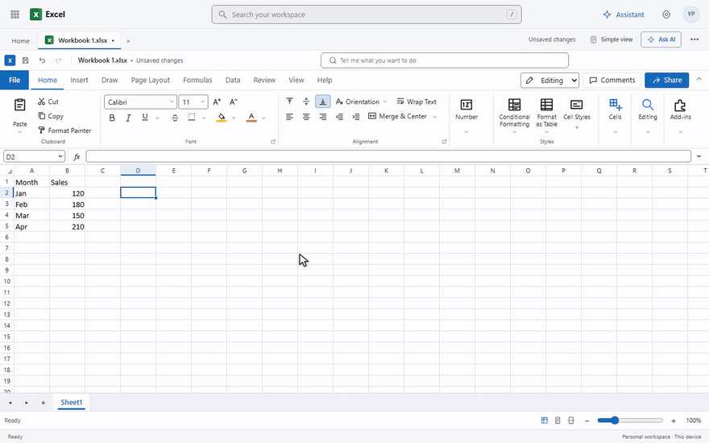

# xlsx-viewer

**An Excel spreadsheet editor that runs entirely in the browser: one `<xlsx-editor>` web component over one workbook model, with thin packages for React, Vue, Angular, Svelte, Solid and plain JavaScript.**
For web applications that need to open, edit, calculate and save workbooks without a server or an Office install.

[Live demo](https://christophervr.github.io/ooxml/xlsx/demo/) · [Docs](https://christophervr.github.io/ooxml/xlsx/) · [Samples](https://christophervr.github.io/ooxml/samples/) · [Packages](#packages) · [Changelog](CHANGELOG.md)

[](https://christophervr.github.io/ooxml/apps/excel/)

## Packages

| Package                                                     | Framework | npm                                                                   | What it is                                           |
| ----------------------------------------------------------- | --------- | --------------------------------------------------------------------- | ---------------------------------------------------- |
| [`@christophervr/xlsx-react-viewer`](packages/react#readme) | React     | [npm](https://www.npmjs.com/package/@christophervr/xlsx-react-viewer) | `SpreadsheetEditor` component.                       |
| [`xlsx-vue-viewer`](packages/vue#readme)                    | Vue 3     | [npm](https://www.npmjs.com/package/xlsx-vue-viewer)                  | `SpreadsheetEditor` component.                       |
| [`xlsx-angular-viewer`](packages/angular#readme)            | Angular   | [npm](https://www.npmjs.com/package/xlsx-angular-viewer)              | `SpreadsheetEditorComponent` standalone component.   |
| [`xlsx-svelte-viewer`](packages/svelte#readme)              | Svelte 5  | [npm](https://www.npmjs.com/package/xlsx-svelte-viewer)               | Default-export component, helpers in `/runtime`.     |
| [`xlsx-solid-viewer`](packages/solid#readme)                | Solid     | [npm](https://www.npmjs.com/package/xlsx-solid-viewer)                | `SpreadsheetEditor` component.                       |
| [`xlsx-vanilla-viewer`](packages/vanilla#readme)            | None      | [npm](https://www.npmjs.com/package/xlsx-vanilla-viewer)              | `mountEditor` and the plain `<xlsx-editor>` element. |
| [`@christophervr/xlsx-core`](packages/core#readme)          | Headless  | [npm](https://www.npmjs.com/package/@christophervr/xlsx-core)         | The workbook model for Node.js, workers and scripts. |
| [`xlsx-viewer-mcp`](mcp#readme)                             | Headless  | [npm](https://www.npmjs.com/package/xlsx-viewer-mcp)                  | MCP server with Excel tools for AI agents.           |

Each editor package bundles the editor, depends on `@christophervr/xlsx-core`, `ooxml-core` and `ooxml-ui`, and re-exports the model API, so an application needs one install. The Excel packages keep the `@christophervr` scope because the unscoped names belong to others.

## Quick start

```bash
npm install @christophervr/xlsx-react-viewer react
```

```tsx
import { useRef } from 'react';
import { SpreadsheetEditor, type EditorHandle } from '@christophervr/xlsx-react-viewer';

export function Budget() {
	const editor = useRef<EditorHandle>(null);
	return (
		<>
			<button onClick={() => void editor.current?.download('Budget.xlsx')}>Download</button>
			<SpreadsheetEditor ref={editor} src="/files/budget.xlsx" className="sheet" />
		</>
	);
}
```

Give `.sheet` a height in your CSS; the grid fills it. Every framework has the same shape: the same props (`workbook`, `bytes`, `src`, `fileName`, `readOnly`, `locale`, ...), the same events in that framework's style and the same handle (`load`, `save`, `saveBytes`, `download`, ...). See each [package's README](#packages) and the [bindings guide](https://christophervr.github.io/ooxml/xlsx/bindings).

## Features

- **The Excel window:** ribbon with Tell me, Name Box, formula bar, grid with frozen panes, sheet tabs, status bar, File backstage, Find and Replace, undo and redo, read-only mode.
- **Formulas:** more than 500 functions with dynamic arrays, `LET` and `LAMBDA`; automatic or manual and iterative calculation. Each formula has a work budget, and a slow calculation on open runs in a worker.
- **Formatting:** fonts, fills, borders, number formats, merged cells, tables, outline groups, data validation and conditional formatting with colour scales, data bars and icon sets.
- **Objects:** charts drawn from live values with Chart Design and a Format pane, SmartArt, shapes, pictures, sparklines, worksheet PivotTables, slicers, form controls linked to cells, and ink from the Draw tab.
- **Files:** `.xlsx`, `.xlsm` (macros never run, kept on save), `.xltx`, password-protected workbooks, legacy `.xls` (read; saved as `.xlsx`) and `.csv`.
- **Collaboration:** optional real-time co-editing between tabs or through a y-websocket compatible server you run ([collaboration](docs/collaboration.md)).
- **Your storage:** `storage` and `fileProviders` send File > Save and Open to your backend, OneDrive or your own cloud places ([OneDrive](docs/onedrive.md)).
- **Accessibility and languages:** F6 regions, Excel's shortcuts, a grid that reads as a table, forced-colours support; interface in English, French, German, Spanish and Simplified Chinese.

## Status and limits

Excel is **Stable** under the [stability policy](../../docs/stability.md): a frozen API under semver, a [preservation guarantee](docs/preservation.md), a written feature list and native Excel save and reopen checks. It does not match Microsoft Excel feature for feature: `.xlsb` and `.ods` do not open, external links, data connections and Power Query are kept but never refreshed, PivotTables from external or OLAP sources are not editable, ink has no Ink to Math, and older OLE objects show as placeholders. See [features and limitations](docs/features.md) and the [parity checklist](../../docs/parity-checklist.md).

## Privacy and network use

Workbooks open, calculate, edit and save on the device, and nothing collects analytics or telemetry. The editor loads workers and on-demand code (languages, chart, PivotTable, picture and shape tools) from the page's own origin, downloads fonts only when the reader or the host (`googleFonts`) turns that on, and otherwise contacts only destinations the host configures (`src`, `collaboration`, `fileProviders`, `imageProvider`) or a sharing server the reader types in File > Share. See [PRIVACY.md](../../PRIVACY.md#word-excel-and-visio).

## Samples

Sample files to try: https://christophervr.github.io/ooxml/samples/

## Documentation

[Getting started](docs/getting-started.md) · [Architecture](docs/architecture.md) · [Framework bindings](docs/bindings.md) · [Element API](docs/api.md) · [Building blocks](docs/building-blocks.md) · [Theming](docs/theming.md) · [Localization](docs/localization.md) · [Collaboration](docs/collaboration.md) · [Features and limitations](docs/features.md) · [Functions](docs/functions.md) · [Preservation](docs/preservation.md). The published site is https://christophervr.github.io/ooxml/xlsx/, and the [ooxml repository](https://github.com/ChristopherVR/ooxml#readme) covers the other products.

## Development

All Excel logic lives in `src/core/xlsx` and the editor DOM in `src/ui/src/xlsx`; this folder holds the bindings, packaging and docs site (see [AGENTS.md](AGENTS.md)).

```bash
bun install               # once, at the repository root
cd viewers/xlsx
bun run demo              # demo dev server; add ?framework=react|vue|angular|svelte|solid
bun run typecheck         # tsc and svelte-check
bun run test              # Vitest (binding contract tests)
bun run test:scripts      # publish guards and viewer script tests
bun run check:shared      # @christophervr/xlsx-core stays a logic-free re-export
bun run build             # production build of the demo
bun run build:packages    # build the publishable packages into packages/*/dist
bun run check:published   # tarballs import only allowed packages
bun run pack:smoke        # pack, install into a clean consumer, load .xlsx and .xls
bun run test:browser      # Playwright specs in e2e/xlsx (PLAYWRIGHT_PORT, default 4180)
bun run lint && bun run fmt:check
bun install --cwd docs && bun run --cwd docs docs:build   # docs site
```

The demo is `demos/xlsx/demo-vanilla` and the browser specs are `e2e/xlsx`, both at the repository root. Releases are automated ([releasing](docs/releasing.md)).

## License

[Apache License 2.0](LICENSE). See [NOTICE](NOTICE) for attributions.
