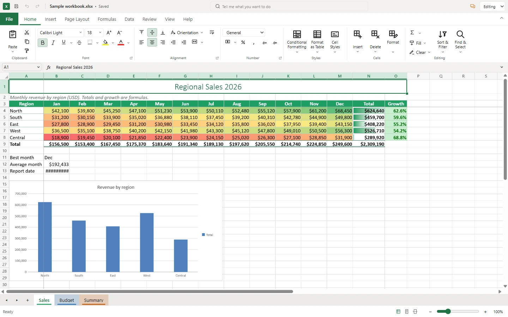

# xlsx-angular-viewer

**The Excel editor for Angular: open, edit, calculate and save `.xlsx` workbooks entirely in the browser.**

[](https://www.npmjs.com/package/xlsx-angular-viewer)
[](https://github.com/ChristopherVR/ooxml/blob/main/viewers/xlsx/LICENSE)
[](https://christophervr.github.io/ooxml/xlsx/)

[Live demo](https://christophervr.github.io/ooxml/xlsx/demo-angular/) · [Documentation](https://christophervr.github.io/ooxml/xlsx/) · [Changelog](https://github.com/ChristopherVR/ooxml/blob/main/viewers/xlsx/packages/angular/CHANGELOG.md) · [Report a bug](https://github.com/ChristopherVR/ooxml/issues)



## Install

```bash
npm install xlsx-angular-viewer
```

One install is enough. The package bundles the editor and its Angular adapter, and brings the workbook model (`@christophervr/xlsx-core`, re-exported from this package), `ooxml-core` and `ooxml-ui` with it. The peer dependency is `@angular/core` 19 or newer (tested with Angular 22).

## Quick start

```ts
import { Component } from '@angular/core';
import { createWorkbook, SpreadsheetEditorComponent } from 'xlsx-angular-viewer';

@Component({
	selector: 'app-editor',
	standalone: true,
	imports: [SpreadsheetEditorComponent],
	template: `<spreadsheet-editor
		style="display: block; height: 100vh"
		[workbook]="workbook"
		(workbookChange)="workbook = $event"
	/>`,
})
export class EditorComponent {
	workbook = createWorkbook();
}
```

Give the editor a height: the grid fills its container and scrolls inside it. Use one Excel editor package per application, since each registers the same `<xlsx-editor>` element.

## Open and save files

Pass `bytes` (with `fileName`) or a `src` URL to open a file, and use the handle to save:

```ts
import { Component, ViewChild } from '@angular/core';
import { SpreadsheetEditorComponent } from 'xlsx-angular-viewer';

@Component({
	selector: 'app-budget',
	standalone: true,
	imports: [SpreadsheetEditorComponent],
	template: `<button (click)="download()">Download</button>
		<spreadsheet-editor
			style="display: block; height: 600px"
			src="/files/budget.xlsx"
			fileName="Budget.xlsx"
			[(readOnly)]="readOnly"
			(dirtyChange)="dirty = $event"
		/>`,
})
export class BudgetComponent {
	@ViewChild(SpreadsheetEditorComponent) editor!: SpreadsheetEditorComponent;
	readOnly = false;
	dirty = false;
	download() {
		void this.editor.download('Budget.xlsx');
	}
}
```

The editor opens `.xlsx`, `.xlsm`, `.xltx`, password-protected workbooks, legacy `.xls` and `.csv`. `save()` resolves to an `.xlsx` Blob, `saveBytes('csv')` exports the active sheet, and `download()` saves and marks the workbook clean. For headless work, the package also exports the model API: `createWorkbook`, `loadWorkbook`, `saveWorkbook`, `detectWorkbookFormat` and the rest of `@christophervr/xlsx-core`.

## What you get

- **The Excel window.** Ribbon with Tell me, Name Box, formula bar, grid with frozen panes, sheet tabs, a status bar with sum, average and count, the File backstage, Find and Replace, and undo and redo.
- **A calculation engine.** More than 500 functions, dynamic arrays, `LET` and `LAMBDA`, automatic or manual calculation and iterative calculation. Each formula has a work budget, and a slow calculation on open runs in a worker, so a workbook cannot freeze the page.
- **Formatting.** Fonts, fills, borders, number formats, merged cells, tables, outline groups, data validation and conditional formatting with colour scales, data bars and icon sets.
- **Objects.** Charts drawn from live values and edited from the Chart Design tab and Format pane, SmartArt, shapes, pictures, sparklines, worksheet PivotTables and slicers, and form controls linked to cells.
- **Collaboration.** Optional real-time co-editing between tabs of one browser, or across machines through a y-websocket compatible server you run.
- **Five interface languages.** English, French, German, Spanish and Simplified Chinese through `locale`. Workbook content is never translated.
- **Keyboard and screen reader support.** F6 regions, Excel's shortcuts, a grid that reads as a table, and forced-colours support.

## Angular notes

- `SpreadsheetEditorComponent` is a standalone component with the selector `spreadsheet-editor`. The component instance is the [handle](#the-handle) once the view is initialised.
- Inputs and outputs are camelCase: `(workbookChange)`, `(selectionChange)`, `(dirtyChange)`, `(fileCommand)` and the others in the [bindings guide](https://christophervr.github.io/ooxml/xlsx/bindings#callbacks-and-events). `[(readOnly)]` two-way binds the user's Editing / Viewing switch, never a collaboration role lock.
- It works with zoneless change detection, and inputs are forwarded only when their value changes, so change detection never undoes what the user changed inside the editor.
- Give the host element a block display and a height; the grid fills it.

## Configuration

Every binding takes the same settings (the [bindings guide](https://christophervr.github.io/ooxml/xlsx/bindings) has the full list):

| Setting                                | What it does                                                                                                                 |
| -------------------------------------- | ---------------------------------------------------------------------------------------------------------------------------- |
| `workbook`, `bytes`, `src`, `fileName` | What to show: a model, file bytes or a URL, and the name used by the title bar, Save and Download.                           |
| `readOnly`                             | Opens in Viewing mode.                                                                                                       |
| `locale`                               | `en`, `fr`, `de`, `es` or `zh-CN` (tags such as `de-DE` map to one).                                                         |
| `theme`, `themeColors`                 | `light`, `dark` or `auto`, and `--xve-*` token overrides. See [theming](https://christophervr.github.io/ooxml/xlsx/theming). |
| `showToolbar`, `showFormulaBar`        | Show or hide the ribbon and the formula bar.                                                                                 |
| `hiddenActions`, `ribbonAddIns`        | Hide ribbon commands by id, or add your own tabs after Excel's.                                                              |
| `customization`                        | Capabilities, hidden ribbon tabs (`ribbon.hiddenTabs`, including File), extra backstage pages and menu items.                |
| `storage`, `fileProviders`             | Send Save and Open to your own storage, and offer OneDrive or your own cloud places in File > Open.                          |
| `collaboration`                        | Join a shared room. See [collaboration](https://christophervr.github.io/ooxml/xlsx/collaboration).                           |
| `authorName`, `validateReplace`        | The author of new comments, and whether Replace applies data validation.                                                     |

### The handle

The handle has `load(bytes, fileName?)`, `newWorkbook()`, `save()`, `saveBytes(format?)`, `download(fileName?)`, `markClean()`, `openCloudFile(file)`, `select(ref)`, `getSelection()`, `setActiveSheet(index)`, `share()`, and the `dirty` and `element` properties.

### Building blocks

To build your own interface around the grid, use `SpreadsheetBuildingBlocks` with the `SpreadsheetCanvasComponent`, `ToolbarComponent`, `FormulaBarComponent` and `SheetTabsComponent` components. No title bar, ribbon, backstage or dialog is mounted, and the surface is read-only until you pass `canEdit: true`. See the [building blocks guide](https://christophervr.github.io/ooxml/xlsx/building-blocks).

## Supported environments

- **Browsers:** the last two major versions of Chrome, Edge, Firefox and Safari, and Safari 16.4 at least ([browser support](https://github.com/ChristopherVR/ooxml/blob/main/docs/browser-support.md)).
- **Node.js:** 22.3 or newer for builds, tests and server rendering. The package imports without a DOM; the editor itself runs in the browser.
- **Workers:** a workbook that needs a long calculation on open is calculated in a module worker that bundlers pick up from `new Worker(new URL(..., import.meta.url))`. A Content Security Policy must allow `worker-src 'self'`; without workers the calculation runs on the page under the same time limit.

## Limitations

This is not Microsoft Excel. Content the model does not cover is kept through a save or reported, as the [preservation guarantee](https://christophervr.github.io/ooxml/xlsx/preservation) describes, and the [features page](https://christophervr.github.io/ooxml/xlsx/features) lists what is supported.

- `.xlsb` and `.ods` do not open. Legacy `.xls` workbooks are read and saved as `.xlsx`.
- Macros never run; a `.xlsm` keeps its VBA project on save.
- External links, Power Query, OLAP and external-source PivotTables are kept but never refreshed, and `WEBSERVICE` is not evaluated.
- A few functions are not implemented (`ASC`, `DBCS`, `JIS`, `PHONETIC`, `INFO`, `WEBSERVICE`) and show `#NAME?`.
- Ink and OLE objects show as placeholders. In a shared room, pictures, other drawings and page setup stay local.

## Privacy and network use

The editor makes no network request when it opens, renders, edits or saves a workbook. Linked pictures are not fetched, external workbook links and linked data are not refreshed, and fonts come from the device and the file. Fonts are downloaded only when the reader turns on the Trust Center option (off by default) or the host sets `googleFonts`, and then only public font family names are sent, never the workbook. Workers load from your own origin. Hyperlinks open only when the reader follows them. Collaboration talks only to the server you configure (without one it stays in the browser), and OneDrive only when you connect it. Preferences such as the font-download choice (`ooxml.xlsx.allowFontDownloads`) stay in the browser's localStorage. Nothing collects analytics or telemetry. See [PRIVACY.md](https://github.com/ChristopherVR/ooxml/blob/main/PRIVACY.md).

## Related packages

- Other frameworks: [React](https://www.npmjs.com/package/@christophervr/xlsx-react-viewer) (`@christophervr/xlsx-react-viewer`), [Vue](https://www.npmjs.com/package/xlsx-vue-viewer) (`xlsx-vue-viewer`), [Svelte](https://www.npmjs.com/package/xlsx-svelte-viewer) (`xlsx-svelte-viewer`), [Solid](https://www.npmjs.com/package/xlsx-solid-viewer) (`xlsx-solid-viewer`), [Vanilla JS](https://www.npmjs.com/package/xlsx-vanilla-viewer) (`xlsx-vanilla-viewer`).
- [`@christophervr/xlsx-core`](https://www.npmjs.com/package/@christophervr/xlsx-core): the workbook model on its own, for servers and scripts.
- [`xlsx-viewer-mcp`](https://www.npmjs.com/package/xlsx-viewer-mcp): Excel tools for AI agents over MCP.
- [`ooxml-core`](https://www.npmjs.com/package/ooxml-core) and [`ooxml-ui`](https://www.npmjs.com/package/ooxml-ui): the engine and the shared editor elements underneath.
- The same approach for [Word](https://github.com/ChristopherVR/ooxml/tree/main/viewers/docx#readme), [PowerPoint](https://github.com/ChristopherVR/ooxml/tree/main/viewers/pptx#readme) and [Visio](https://github.com/ChristopherVR/ooxml/tree/main/viewers/visio#readme), or the whole [OOXML Office suite](https://github.com/ChristopherVR/ooxml#readme).

## License

[Apache-2.0](https://github.com/ChristopherVR/ooxml/blob/main/viewers/xlsx/LICENSE)
