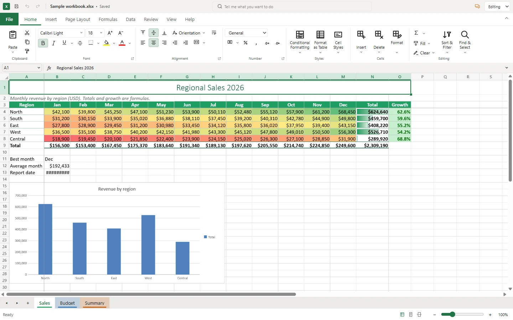

# xlsx-svelte-viewer

**The Excel spreadsheet editor as a Svelte 5 component: open, edit, calculate and save `.xlsx`, `.xlsm`, `.xltx`, legacy `.xls` and `.csv` files in the browser.**

[](https://www.npmjs.com/package/xlsx-svelte-viewer)
[](https://github.com/ChristopherVR/ooxml/blob/main/viewers/xlsx/LICENSE)
[](https://www.npmjs.com/package/xlsx-svelte-viewer)

[Live demo](https://christophervr.github.io/ooxml/xlsx/demo-svelte/) · [Documentation](https://christophervr.github.io/ooxml/xlsx/) · [Svelte guide](https://christophervr.github.io/ooxml/xlsx/frameworks/svelte) · [Changelog](https://github.com/ChristopherVR/ooxml/blob/main/viewers/xlsx/packages/svelte/CHANGELOG.md) · [Report a bug](https://github.com/ChristopherVR/ooxml/issues)



## Install

```bash
npm install xlsx-svelte-viewer svelte
```

- Peer dependency: `svelte` `^5.0.0`.
- Bundled: the `<xlsx-editor>` web component and the Svelte adapter. Installed with it: `@christophervr/xlsx-core` (the workbook model, re-exported from this package), `ooxml-core` and `ooxml-ui`.
- Use one Excel editor package per application: each registers the same `<xlsx-editor>` element.

## Quick start

```svelte
<script>
	import XlsxEditor from 'xlsx-svelte-viewer';

	let editor;
</script>

<button onclick={() => editor.download('Budget.xlsx')}>Download</button>
<XlsxEditor
	bind:this={editor}
	class="sheet"
	src="/files/budget.xlsx"
	fileName="Budget.xlsx"
	ondirtychange={(dirty) => console.log('unsaved edits:', dirty)}
/>

<style>
	:global(.sheet) { height: 80vh; }
</style>
```

The component renders one host `<div>`, which `class` and `style` style: give it a height and the editor fills it and scrolls inside it. The package root is the component (default export); `createWorkbook`, `loadWorkbook`, `mountEditor` and the types are in `xlsx-svelte-viewer/runtime`. Hold a `workbook` prop in `$state.raw`. There is no stylesheet to import: the element carries its own styles. Without `src`, `bytes` or `workbook` the editor starts with a blank workbook.

## Props

| Prop                                   | What it does                                                                                                                                    |
| -------------------------------------- | ----------------------------------------------------------------------------------------------------------------------------------------------- |
| `workbook`, `bytes`, `src`, `fileName` | What to show: a workbook model, file bytes or a URL, and the name used by the title bar, Save and Download (default `Book1.xlsx`).              |
| `readOnly`                             | Opens in Viewing mode (default `false`).                                                                                                        |
| `locale`                               | Interface language (see [Localisation](#localisation)).                                                                                         |
| `theme`, `themeColors`                 | `light`, `dark` or `auto` (default), and `--xve-*` token overrides (see [Theming](#theming)).                                                   |
| `showToolbar`, `showFormulaBar`        | Show or hide the ribbon and the formula bar (both default `true`).                                                                              |
| `hiddenActions`, `ribbonAddIns`        | Hide ribbon commands by stable id, or add your own tabs after Excel's.                                                                          |
| `customization`                        | Capabilities, hidden ribbon tabs (File included), extra File pages and context-menu commands.                                                   |
| `storage`, `fileProviders`             | Send File > Save and Open to your own storage, and add OneDrive or your own cloud places to File > Open.                                        |
| `collaboration`                        | Join a shared room while set; `null` leaves it.                                                                                                 |
| `imageProvider`                        | Opt in to `IMAGE` formulas with your own fetcher (without one they show `#BLOCKED!`).                                                           |
| `googleFonts`                          | Turn font downloads off (`false`) or point them at Google Fonts or your mirror (`{ baseUrl }`); unset leaves it to the reader (off by default). |
| `authorName`, `validateReplace`        | The author of new comments (default `Author`), and whether Replace applies data validation (default `false`).                                   |
| `class`, `style`                       | Class and inline style of the host `<div>` the editor fills.                                                                                    |

Props are forwarded only when their value changes, so a re-render never undoes what the user changed inside the editor (Editing or Viewing, theme, language, Customize Ribbon). Keep `customization`, `fileProviders` and `ribbonAddIns` stable between renders.

`bind:this` gives the component, whose exports are the editor handle, with live `element` and `dirty` properties (`isDirty()` and `getElement()` are deprecated). The handle has `load(bytes, fileName?)`, `newWorkbook()`, `save()`, `saveBytes('xlsx' | 'csv')`, `download(fileName?)`, `markClean()`, `openCloudFile(file)`, `select(ref)`, `getSelection()`, `setActiveSheet(index)`, `share()`, and the `dirty` and `element` properties. A method called before the editor has mounted throws `Editor is not mounted`.

Full reference: [framework bindings](https://christophervr.github.io/ooxml/xlsx/bindings) and the [element API](https://christophervr.github.io/ooxml/xlsx/api).

## Events

| Callback prop           | Receives                                                                                                                |
| ----------------------- | ----------------------------------------------------------------------------------------------------------------------- |
| `onworkbookchange`      | The edited `Workbook`.                                                                                                  |
| `ondirtychange`         | `true` while there are unsaved edits.                                                                                   |
| `onworkbookerror`       | An `Error` when a file or a `src` fetch fails to open.                                                                  |
| `onfilecommand`         | The cancelable `file-command` event: call `event.preventDefault()` to run New, Open, Save, Print and the rest yourself. |
| `onselectionchange`     | `{ sheet, ref, active }`.                                                                                               |
| `onsheetchange`         | `{ index, name }` of the new active sheet.                                                                              |
| `onreadonlychange`      | `(readOnly, { readOnly, locked, hostReadOnly })`; a controlled parent stores `hostReadOnly`.                            |
| `onworkbookwarning`     | The loader's notes about content it could not read.                                                                     |
| `onribbonaction`        | `{ id }` of a command that ran.                                                                                         |
| `onribboncustomize`     | The new hidden-action list after Customize Ribbon.                                                                      |
| `onribbonaddin`         | `{ tab, command }` of a host tab command.                                                                               |
| `oncollaborationchange` | The sharing state.                                                                                                      |
| `onready`               | The `<xlsx-editor>` element, once mounted.                                                                              |

See [callbacks and events](https://christophervr.github.io/ooxml/xlsx/bindings#callbacks-and-events).

## Open and save files

The editor opens `.xlsx`, `.xlsm` (macros never run), `.xltx`, password-protected workbooks, legacy `.xls` and `.csv`; `.xls` and `.csv` are saved as `.xlsx`. `save()` resolves to an `.xlsx` Blob and does not clear `dirty`: call `markClean()` once you have stored it, or use `download()`, which does both. `saveBytes('csv')` exports the active sheet. The model API (`createWorkbook`, `loadWorkbook`, `saveWorkbook`, `detectWorkbookFormat` and the rest of `@christophervr/xlsx-core`) is re-exported from `xlsx-svelte-viewer/runtime`, so headless work needs no second install. The editor mounts in an action, so the component is safe in server-rendered apps.

## Theming

`theme` picks `light`, `dark` or `auto`, and `themeColors` sets `--xve-*` tokens on the editor (for example `{ primary: '#1f9d63', radius: '6px' }`). The chrome also follows the shared `--office-*` tokens and a `data-office-theme` attribute on any ancestor; install them once with `installOfficeUiTheme()` from `ooxml-ui/theme`. Theme changes never alter workbook colours. See [theming](https://christophervr.github.io/ooxml/xlsx/theming).

## Localisation

The interface is available in English (`en`, the default, built in), French (`fr`), German (`de`), Spanish (`es`) and Simplified Chinese (`zh-CN`), set with `locale`. A tag that maps to one (`de-DE`, `zh-Hans`) works; any other falls back to English. Other languages load on demand. Workbook content and function names are never translated. See [localization](https://christophervr.github.io/ooxml/xlsx/localization).

## Status and limits

Excel is **Stable** under the [stability policy](https://github.com/ChristopherVR/ooxml/blob/main/docs/stability.md): a frozen API under semver, a [preservation guarantee](https://christophervr.github.io/ooxml/xlsx/preservation) and native Excel save and reopen checks. It does not match Microsoft Excel feature for feature.

- `.xlsb` and `.ods` do not open.
- Macros never run (a `.xlsm` keeps its VBA project). External links, data connections and Power Query are kept with their cached values and never refreshed.
- PivotTables from external or OLAP sources and advanced pivot filters are kept but not editable; the sparkline style gallery is missing.
- Ink is drawn, erased and saved as Excel ink from the Draw tab (Ink to Math is not available). Older OLE objects show as placeholders; form controls cannot be moved or resized, and buttons run no macro.
- In a shared room, pictures, ink, other drawings, page setup and PivotTables are not shared.

See [features and limitations](https://christophervr.github.io/ooxml/xlsx/features) and the [parity checklist](https://github.com/ChristopherVR/ooxml/blob/main/docs/parity-checklist.md).

## Privacy and network use

Workbooks open, calculate, render, edit and save on the device. Nothing is uploaded, and nothing collects analytics or telemetry.

- **Same-origin assets.** Workers, the selected non-English language, and chart, PivotTable, picture and shape tool code load on demand from your app's origin, carrying only the asset URL. Keep `locale` at `en` to skip language requests.
- **Fonts.** Off by default. Fonts the device lacks are downloaded from `fonts.googleapis.com` and `fonts.gstatic.com` only when the reader turns on File > Options > Trust Center "Download fonts that are not installed or embedded", or the host sets the `googleFonts` prop: `false` turns downloads off and locks the toggle, `{ baseUrl }` points at Google Fonts or your own mirror. Only public font family names are sent.
- **Linked content.** Linked pictures are not fetched, external links and linked data are not refreshed, and `WEBSERVICE` is not evaluated. `IMAGE` formulas fetch only through an `imageProvider` you pass.
- **Destinations you choose.** `src` fetches the URL you pass; sharing (`collaboration`, or a server URL the reader types in File > Share) talks only to that server, and without one connects tabs of the same browser only; OneDrive and other `fileProviders` only when you add them. Hyperlinks and the Forms link open only when the reader follows them.
- **On the device.** Small preferences, such as the font-download choice (`ooxml.xlsx.allowFontDownloads`), stay in localStorage.

See [PRIVACY.md](https://github.com/ChristopherVR/ooxml/blob/main/PRIVACY.md#word-excel-and-visio).

## Browser support

The last two major versions of Chrome, Edge, Firefox and Safari, and Safari 16.4 at least ([browser support](https://github.com/ChristopherVR/ooxml/blob/main/docs/browser-support.md)). Svelte 5. Node.js 22.3 or newer for builds, tests and server rendering. A slow calculation on open runs in a module worker from your origin, so a Content Security Policy must allow `worker-src 'self'`; without workers it runs on the page under the same time limit.

## Documentation and demos

- [Documentation](https://christophervr.github.io/ooxml/xlsx/), the [Svelte guide](https://christophervr.github.io/ooxml/xlsx/frameworks/svelte) and the [live demo](https://christophervr.github.io/ooxml/xlsx/demo-svelte/).
- Your own interface around the grid: `createViewerBuildingBlocks` from `xlsx-svelte-viewer/runtime` with `xlsx-svelte-viewer/SpreadsheetCanvas.svelte`, `/Toolbar.svelte`, `/FormulaBar.svelte` and `/SheetTabs.svelte` ([building blocks](https://christophervr.github.io/ooxml/xlsx/building-blocks)).
- Other frameworks: [`@christophervr/xlsx-react-viewer`](https://www.npmjs.com/package/@christophervr/xlsx-react-viewer) · [`xlsx-vue-viewer`](https://www.npmjs.com/package/xlsx-vue-viewer) · [`xlsx-angular-viewer`](https://www.npmjs.com/package/xlsx-angular-viewer) · [`xlsx-solid-viewer`](https://www.npmjs.com/package/xlsx-solid-viewer) · [`xlsx-vanilla-viewer`](https://www.npmjs.com/package/xlsx-vanilla-viewer).
- Headless and agents: [`@christophervr/xlsx-core`](https://www.npmjs.com/package/@christophervr/xlsx-core) (the workbook model) and [`xlsx-viewer-mcp`](https://www.npmjs.com/package/xlsx-viewer-mcp) (MCP tools).
- Source: the [ooxml repository](https://github.com/ChristopherVR/ooxml).

## License

[Apache-2.0](https://github.com/ChristopherVR/ooxml/blob/main/viewers/xlsx/LICENSE). See [NOTICE](https://github.com/ChristopherVR/ooxml/blob/main/viewers/xlsx/NOTICE) for attributions.
